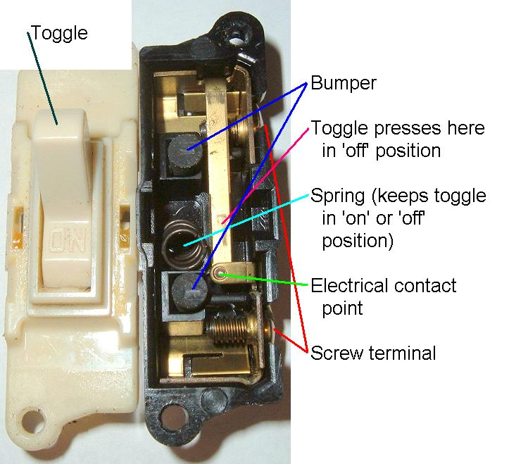
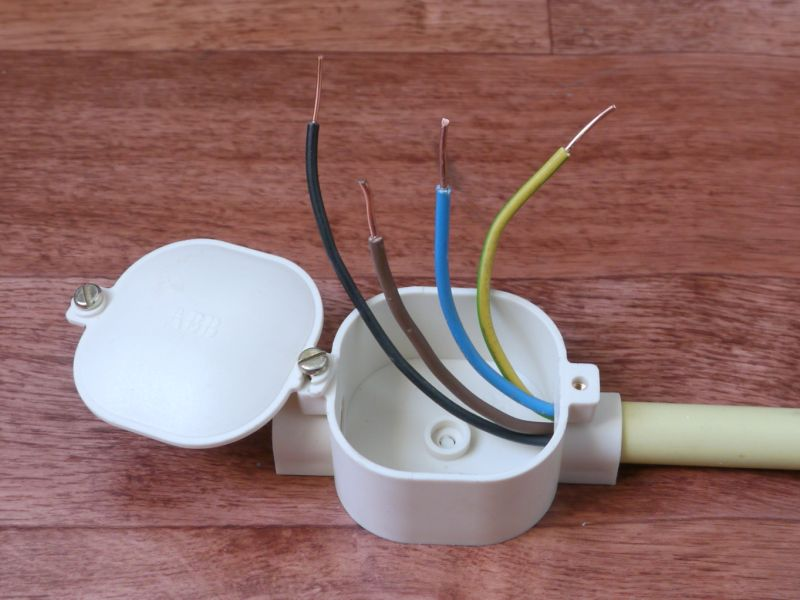
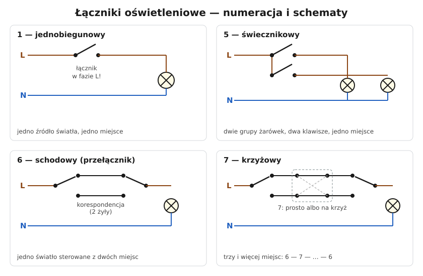

# 18.02 — Łącznik jednobiegunowy i świecznikowy — schematy

> **Moduł:** [18 — Oświetlenie](README.md) · **Oznaczenia:** 🏠 · **Zakres SEP:** (a) (c) · **Status:** ✅ pełny
>
> **Czytaj:**
>
> - Osprzęt: [06.02](../06-osprzet-instalacyjny/06.02-laczniki-jednobiegunowy-dwubiegunowy.md)
> - Wymiana łącznika: [19.02](../19-prace-krok-po-kroku/19.02-wymiana-lacznika.md); montaż lampy: [19.03](../19-prace-krok-po-kroku/19.03-montaz-lampy-i-oprawy.md)
> - Kolory żył: [05.03](../05-przewody-i-kable/05.03-kolory-zyl-i-ich-znaczenie.md)

[← poprzedni temat](18.01-zrodla-swiatla-i-zasilacze-led.md) · [spis modułu](README.md) · [następny temat →](18.03-uklad-schodowy-i-krzyzowy-schematy.md)

## Po co to jest

Łącznik jednobiegunowy i świecznikowy to najczęstszy osprzęt w mieszkaniu. Każdy, kto wymienia łącznik albo lampę, musi rozumieć, co jest w puszce i dlaczego łącznik przerywa fazę. Na egzaminie typowe zadanie: narysuj schemat podłączenia lampy z łącznikiem albo żyrandola z łącznikiem świecznikowym.

## Po ludzku

**Łącznik jednobiegunowy (symbol 1)** — przerywa **jeden** przewód. Zawsze **fazę L**, nigdy N. Dlaczego? Gdy lampa jest wyłączona, w oprawie nie ma wtedy napięcia (poza przewodem N, który ma potencjał bliski ziemi). Przy wymianie żarówki nie dotkniesz fazy.

Co jest gdzie:

- do łącznika dochodzi **L** (brązowa lub czarna żyła) i z łącznika wychodzi **przewód łącznikowy** (do lampy — zwykle czarna lub brązowa);
- **N** (niebieska) idzie prosto do lampy, z pominięciem łącznika;
- **PE** (żółto-zielona) idzie do zacisku ochronnego oprawy klasy I.

**Łącznik świecznikowy (symbol 5)** — dwa klawisze w jednej ramce. Jedna faza wchodzi, dwie wychodzą: każda do innej grupy żarówek żyrandola (albo do dwóch różnych lamp). Do lampy potrzeba wtedy przewodu **4-żyłowego**: dwa przewody łącznikowe, N i PE.

**Łącznik dwubiegunowy (symbol 2)** — przerywa L i N jednocześnie. Stosuje się go tam, gdzie wymagane jest odłączenie obu biegunów (np. przy niektórych urządzeniach, w instalacjach o nieustalonym L i N). W mieszkaniu rzadko.

**Gdzie łączyć przewody?** Albo w **puszce przy łączniku**, albo w **puszce rozgałęźnej pod sufitem**. W nowych instalacjach często wszystko schodzi do puszki łącznika (głęboka puszka) — tam dochodzi też N, przydatny dla łączników elektronicznych ([27.02](../27-inteligentny-dom/27.02-przewod-neutralny-w-puszce-lacznika.md)).

## Jak to wygląda

*Na co patrzeć: w środku łącznika jest sprężyna, która przerzuca styk w jedną z dwóch pozycji, i dwa zaciski. Jednobiegunowy łącznik ma tylko dwa zaciski: wejście (L) i wyjście do lampy.*

*Na co patrzeć: cztery żyły w puszce: brązowa (L), czarna (przewód łącznikowy do lampy), niebieska (N) i żółto-zielona (PE). Taki zestaw spotkasz w puszce nad łącznikiem.*

## Schemat

## Pojęcia

| Pojęcie | Po ludzku | Termin normowy / symbol |
|---------|-----------|-------------------------|
| Łącznik jednobiegunowy | Zwykły włącznik światła | łącznik 1 |
| Łącznik świecznikowy | Podwójny klawisz do żyrandola | łącznik 5 |
| Łącznik dwubiegunowy | Przerywa L i N naraz | łącznik 2 |
| Przewód łącznikowy | Przewód od łącznika do lampy | — |
| Zacisk PE oprawy | Zacisk ze znakiem ⏚ | oprawa klasy I |

## Liczby do zapamiętania

| Wielkość | Wartość | Kiedy obowiązuje | Źródło |
|----------|---------|------------------|--------|
| Łącznik przerywa | **fazę L** | łącznik jednobiegunowy | PN-HD 60364 (łączniki jednobiegunowe tylko w przewodzie fazowym) |
| Przewód do łącznika 1 | **3 żyły** (L, łącznikowy, PE lub N) | wg układu połączeń | praktyka |
| Przewód do lampy przy łączniku 5 | **4 żyły** (2 × łącznikowy, N, PE) | żyrandol na 2 grupy | praktyka |
| Prąd łączników | zwykle **10 A** (10 AX) | 230 V | katalogi, PN-EN 60669-1 |
| Wysokość łącznika | ok. **105 cm** | [16.05](../16-planowanie-obwodow/16.05-wysokosci-montazu-i-liczba-gniazd.md) | N SEP-E-002 |

## W praktyce

Wymiana łącznika — szczegóły w [19.02](../19-prace-krok-po-kroku/19.02-wymiana-lacznika.md). Najważniejsze:

1. **Wyłącz obwód oświetlenia** w rozdzielnicy i sprawdź brak napięcia dwubiegunowym próbnikiem ([00.02](../00-bezpieczenstwo-najpierw/00.02-sprawdzanie-braku-napiecia-probnik-dwubiegunowy.md)).
2. **Zrób zdjęcie** połączeń przed odkręceniem.
3. Przy łączniku 1: dwa przewody, ich zamiana nie ma znaczenia. Przy łączniku 5: zacisk wspólny (L) oznaczony zwykle „L” lub strzałką — **nie pomyl go** z wyjściami.
4. Dokręć zaciski, ułóż przewody w puszce bez zgniatania.

## Błędy i zagrożenia

- ⚠️ **Łącznik w przewodzie N** — lampa gaśnie, ale oprawa jest stale pod napięciem fazowym. Przy wymianie żarówki — porażenie.
- ⚠️ **Żyła żółto-zielona użyta jako przewód łącznikowy** — w puszce i oprawie kolor PE oznacza fazę. Następny elektryk podłączy ją do obudowy.
- **Przewód 3-żyłowy do żyrandola przy łączniku świecznikowym** — brakuje żyły na drugą grupę; kończy się użyciem PE.
- **Luźny zacisk** w łączniku — grzanie, zapach, zmatowiały klawisz ([20.06](../20-diagnostyka-usterek/20.06-grzejace-sie-zaciski-i-zapach-spalenizny.md)).

## Przykład

**Zadanie.** Żyrandol z 5 żarówkami: chcesz włączać osobno 2 i 3 żarówki oraz wszystkie razem. Narysuj, jak to podłączyć, i jakie przewody położyć.

**Rozwiązanie.** Łącznik **świecznikowy (5)**: klawisz I zasila grupę 2 żarówek, klawisz II — grupę 3 żarówek, oba klawisze — wszystkie 5. Do łącznika: **L** (z puszki), z łącznika do lampy **dwa przewody łącznikowe**. Do lampy: dwa łącznikowe + **N** + **PE** → przewód **4 × 1,5 mm²** (np. YDYp 4 × 1,5 z PE). W żyrandolu: N wspólny dla obu grup, PE do zacisku oprawy (klasa I).

## Pytania SEP

1. **Narysuj i omów schemat podłączenia lampy z łącznikiem jednobiegunowym.**

Odpowiedź

Przewód fazowy L z obwodu oświetleniowego doprowadza się do zacisku łącznika jednobiegunowego. Z drugiego zacisku łącznika przewód łącznikowy biegnie do oprawy. Przewód N doprowadza się do oprawy bezpośrednio, a przewód PE — do zacisku ochronnego oprawy klasy I. Łącznik musi przerywać przewód fazowy, a nie neutralny, aby po wyłączeniu oprawa nie była pod napięciem.

2. **Do czego służy łącznik świecznikowy?**

Odpowiedź

Do sterowania z jednego miejsca dwiema grupami źródeł światła (np. dwiema grupami żarówek żyrandola) — każdy z dwóch klawiszy załącza inną grupę, oba razem — wszystkie źródła. Łącznik ma jeden zacisk wspólny (L) i dwa wyjściowe, a do oprawy prowadzi się przewód z dwoma żyłami łącznikowymi, przewodem N i PE.

## Sprawdź się

1. Po wyłączeniu światła próbnik pokazuje napięcie na obu przewodach oprawy. Co jest nie tak?

Odpowiedź

Łącznik przerywa przewód N, a nie fazę. Faza dochodzi do oprawy bezpośrednio, a przez żarnik/zasilacz pojawia się też na drugim zacisku. Trzeba zamienić połączenia tak, żeby łącznik przerywał L.

## Źródła

- PN-EN 60669-1 — łączniki do stałych instalacji elektrycznych domowych i podobnych.
- PN-HD 60364-5-53 — dobór i montaż aparatury rozdzielczej i sterowniczej.
- PN-EN 60617 — symbole graficzne.

---

[← poprzedni temat](18.01-zrodla-swiatla-i-zasilacze-led.md) · [spis modułu](README.md) · [następny temat →](18.03-uklad-schodowy-i-krzyzowy-schematy.md)
