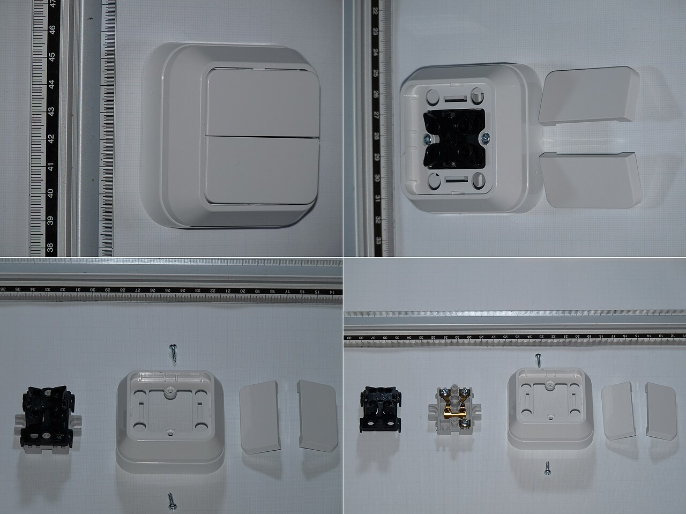
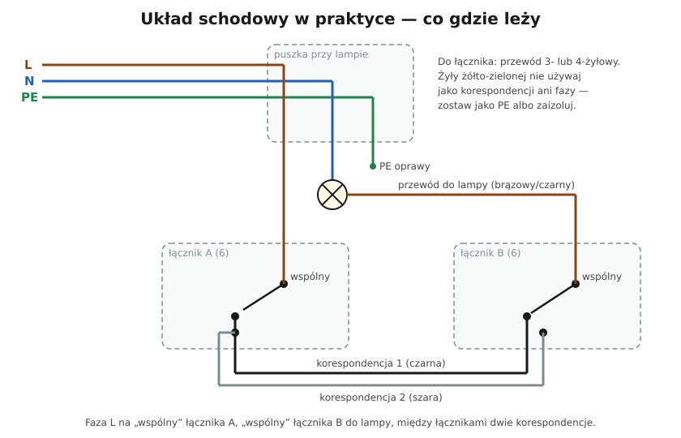
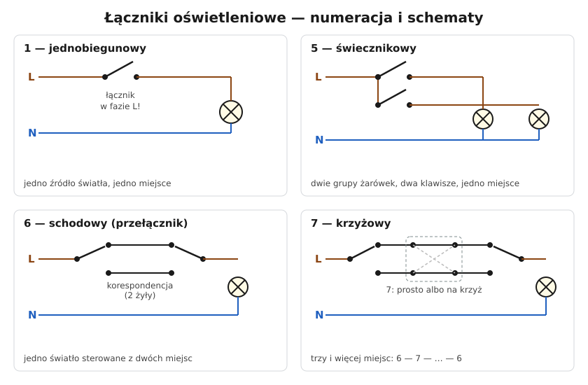

# 18.03 — Układ schodowy i krzyżowy — schematy

> **Moduł:** [18 — Oświetlenie](README.md) · **Oznaczenia:** 🏠 · **Zakres SEP:** (a) (c) · **Status:** ✅ pełny
>
> **Czytaj:**
>
> - Łączniki 6 i 7: [06.02](../06-osprzet-instalacyjny/06.02-laczniki-jednobiegunowy-dwubiegunowy.md)
> - Alternatywa — przekaźnik impulsowy: [18.04](18.04-przekaznik-impulsowy-zamiast-lacznikow.md)

[← poprzedni temat](18.02-lacznik-jednobiegunowy-i-swiecznikowy-schematy.md) · [spis modułu](README.md) · [następny temat →](18.04-przekaznik-impulsowy-zamiast-lacznikow.md)

## Po co to jest

Światło na schodach, w długim korytarzu czy w sypialni (przy drzwiach i przy łóżku) chcemy włączać z dwóch albo więcej miejsc. Do tego służą łączniki schodowe (6) i krzyżowe (7). To klasyczne zadanie egzaminacyjne: narysuj układ schodowy, dodaj trzecie miejsce sterowania.

## Po ludzku

**Łącznik schodowy (6)** to przełącznik: ma **zacisk wspólny** (oznaczony L, strzałką lub innym kolorem śruby) i **dwa zaciski korespondencyjne**. Styk zawsze łączy wspólny z jednym z nich.

**Układ schodowy** — dwa łączniki 6 połączone **dwiema żyłami korespondencyjnymi**:

- **faza L** → zacisk wspólny łącznika A,
- korespondencje A ↔ B (dwie żyły),
- zacisk wspólny łącznika B → **lampa**,
- N i PE → bezpośrednio do lampy.

Lampa świeci, gdy oba łączniki „wskazują” tę samą korespondencję. Przełączenie dowolnego z nich zmienia stan. Nie ma pozycji „góra = włączone” — zależy to od drugiego łącznika.

**Łącznik krzyżowy (7)** — ma **cztery zaciski**: dwie korespondencje wchodzące i dwie wychodzące. Przełącza je **prosto** albo **na krzyż**. Wstawia się go między dwa łączniki schodowe. Każde kolejne miejsce sterowania = kolejny łącznik 7: **6 – 7 – 7 – … – 6**.

**Przewody:**

- między łącznikami schodowymi: dwie korespondencje (+ PE, jeśli w ramce są elementy metalowe lub chcesz mieć PE w puszce) — przewód **3- lub 4-żyłowy**;
- do łącznika krzyżowego: **dwie pary** korespondencji — w praktyce dwa przewody 3-żyłowe albo jeden 5-żyłowy.

**Ważne:** żyła żółto-zielona **nigdy** nie jest korespondencją. Jeśli przewód ma PE, a potrzebujesz trzech żył roboczych — kładziesz przewód 4-żyłowy.

**Układ „przez puszkę”** — jeśli wszystkie przewody schodzą do puszki rozgałęźnej przy lampie, faza i korespondencje biegną przez nią. Działa tak samo, tylko w puszce jest więcej połączeń.

## Jak to wygląda

*Na co patrzeć: mechanizm łącznika schodowego ma trzy zaciski — jeden wspólny i dwa korespondencyjne. Przed odłączeniem starego łącznika zaznacz, który przewód był na zacisku wspólnym — to najczęstsze źródło pomyłek.*

## Schemat

## Pojęcia

| Pojęcie | Po ludzku | Termin normowy / symbol |
|---------|-----------|-------------------------|
| Łącznik schodowy | Przełącznik do sterowania z 2 miejsc | łącznik 6 |
| Łącznik krzyżowy | Dodaje 3., 4. … miejsce sterowania | łącznik 7 |
| Zacisk wspólny | Zacisk, który łącznik łączy z jednym z dwóch pozostałych | — |
| Korespondencja | Żyła łącząca dwa łączniki | żyła korespondencyjna |

## Liczby do zapamiętania

| Wielkość | Wartość | Kiedy obowiązuje | Źródło |
|----------|---------|------------------|--------|
| Miejsca sterowania | **2** — dwa łączniki 6; **3** — 6 + 7 + 6; **n** — 6 + (n−2) × 7 + 6 | — | — |
| Zaciski | łącznik 6: **3**; łącznik 7: **4** | — | PN-EN 60669-1 |
| Żyły między łącznikami | **2** korespondencje (+ PE) | — | praktyka |
| Przewód przy 3+ miejscach | rozważ przekaźnik impulsowy | wiele miejsc | [18.04](18.04-przekaznik-impulsowy-zamiast-lacznikow.md) |

## W praktyce

- **Wymiana łącznika schodowego** — najpierw znajdź zacisk wspólny w starym łączniku (oznaczenie, kolor śruby) i oznacz przewód taśmą. Dwie korespondencje można zamienić miejscami.
- **Diagnoza „działa tylko z jednego miejsca”** — zwykle zamieniony zacisk wspólny z korespondencją albo przerwa w jednej korespondencji.
- **Podświetlane łączniki schodowe** — przez podświetlenie płynie mały prąd; przy LED może to powodować żarzenie ([20.07](../20-diagnostyka-usterek/20.07-migajace-i-zarzace-sie-led.md)).
- **Łączniki elektroniczne/smart** w układzie schodowym — tylko takie, które to przewidują (często potrzebny N i „pomocnicze” łączniki).

## Błędy i zagrożenia

- ⚠️ **PE (żółto-zielony) użyty jako korespondencja** — na żyle „ochronnej” pojawia się faza; ktoś podłączy ją do obudowy oprawy.
- **Faza podłączona do korespondencji, a nie do wspólnego** — układ działa „dziwnie”: z jednego miejsca da się tylko włączyć, a z drugiego tylko wyłączyć, albo wcale.
- **Łącznik krzyżowy podłączony „bokiem”** (wejście z wyjściem) — przełącza zwarcie korespondencji albo nic nie robi; sprawdź schemat na łączniku.
- **Mostek w puszce przez N** — łączniki przerywają N zamiast L.

## Przykład

**Zadanie.** Sypialnia: światło sufitowe ma się włączać przy drzwiach i przy obu stronach łóżka. Jakie łączniki i ile żył?

**Rozwiązanie.** Trzy miejsca: **6 (drzwi) – 7 (łóżko lewe) – 6 (łóżko prawe)**. Połączenia:

- faza L → zacisk wspólny łącznika przy drzwiach;
- łącznik przy drzwiach → łącznik krzyżowy: 2 korespondencje (przewód 3 × 1,5 z PE lub 4 × 1,5);
- łącznik krzyżowy → łącznik przy prawej stronie łóżka: 2 korespondencje;
- zacisk wspólny ostatniego łącznika → lampa; N i PE do lampy.

Alternatywa: trzy przyciski i przekaźnik impulsowy — wtedy do każdego przycisku wystarczy przewód 2-żyłowy (+ PE) ([18.04](18.04-przekaznik-impulsowy-zamiast-lacznikow.md)).

## Pytania SEP

1. **Narysuj układ schodowy i wyjaśnij jego działanie.**

Odpowiedź

Dwa łączniki schodowe (przełączniki, symbol 6), każdy z zaciskiem wspólnym i dwoma korespondencyjnymi. Faza L dochodzi do zacisku wspólnego pierwszego łącznika, zaciski korespondencyjne obu łączników są połączone dwiema żyłami, zacisk wspólny drugiego łącznika zasila lampę, przewód N idzie do lampy bezpośrednio. Lampa świeci, gdy oba łączniki ustawione są na tę samą żyłę korespondencyjną; zmiana położenia któregokolwiek łącznika zmienia stan lampy.

2. **Jak sterować oświetleniem z trzech miejsc?**

Odpowiedź

Między dwa łączniki schodowe włącza się łącznik krzyżowy (symbol 7), który przełącza dwie żyły korespondencyjne prosto lub na krzyż. Dla każdego dalszego miejsca dodaje się kolejny łącznik krzyżowy. Alternatywą jest przekaźnik impulsowy (bistabilny) sterowany przyciskami połączonymi równolegle.

## Sprawdź się

1. Na schemacie montażu znajdź, gdzie jest faza, gdy lampa jest wyłączona.

Odpowiedź

Faza zawsze jest na zacisku wspólnym łącznika A i na jednej z korespondencji (tej, na którą ustawiony jest łącznik A). Gdy łącznik B jest ustawiony na drugą korespondencję, do lampy faza nie dochodzi. Dlatego przy pracy przy łącznikach schodowych wyłącza się obwód w rozdzielnicy — wyłączenie lampy łącznikiem nie wystarcza.

## Źródła

- PN-EN 60669-1 — łączniki do stałych instalacji elektrycznych.
- PN-EN 60617 — symbole graficzne na schematach.

---

[← poprzedni temat](18.02-lacznik-jednobiegunowy-i-swiecznikowy-schematy.md) · [spis modułu](README.md) · [następny temat →](18.04-przekaznik-impulsowy-zamiast-lacznikow.md)
