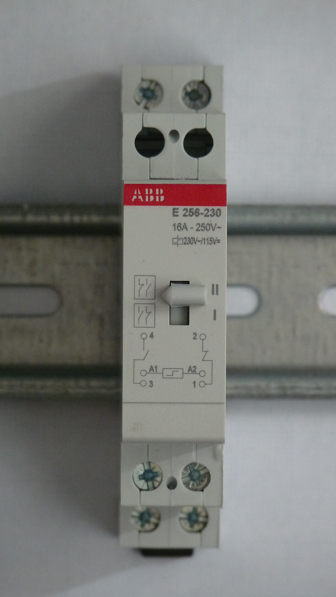
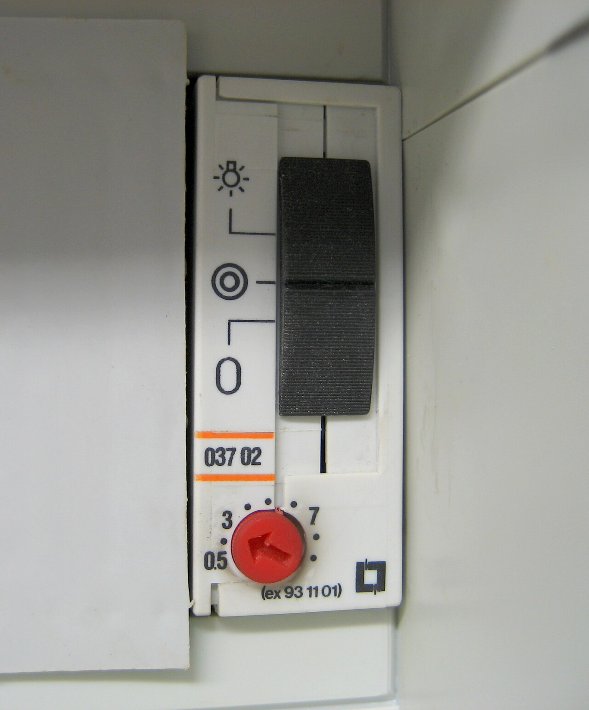
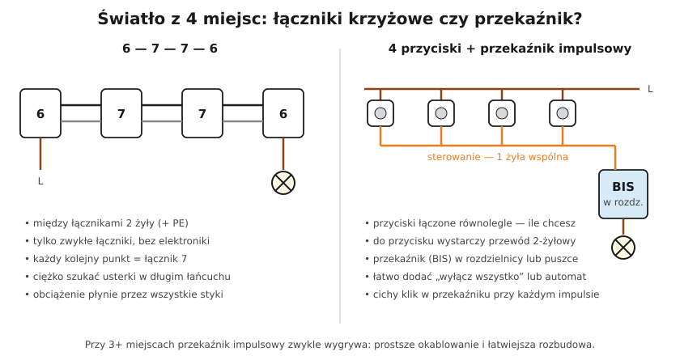
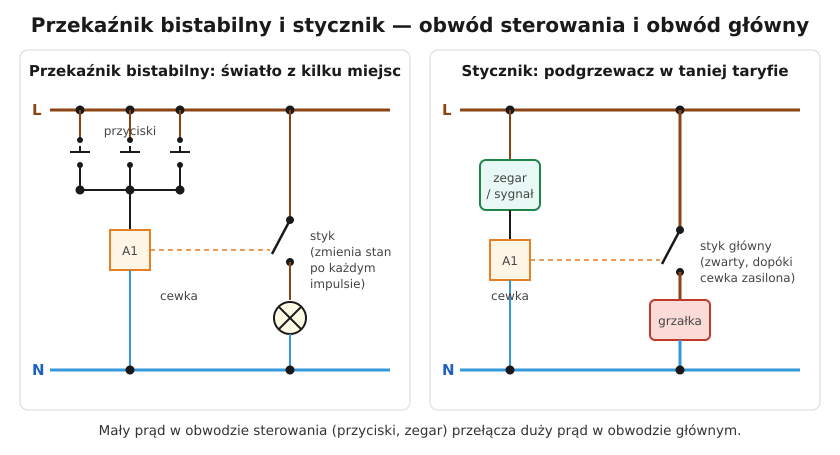

# 18.04 — Przekaźnik impulsowy zamiast łączników schodowych

> **Moduł:** [18 — Oświetlenie](README.md) · **Oznaczenia:** 🏠 · **Zakres SEP:** (a) (c) · **Status:** ✅ pełny
>
> **Czytaj:**
>
> - Przekaźnik bistabilny i automat schodowy: [10.02](../10-aparatura-modulowa/10.02-stycznik-modulowy-i-przekaznik-bistabilny.md)
> - Instrukcje producentów przekaźników impulsowych (liczba podświetlanych przycisków, obciążalność LED)

[← poprzedni temat](18.03-uklad-schodowy-i-krzyzowy-schematy.md) · [spis modułu](README.md) · [następny temat →](18.05-sciemniacze-i-wspolpraca-z-led.md)

## Po co to jest

Przy trzech, czterech i więcej miejscach sterowania łańcuch łączników krzyżowych staje się drogi i trudny do naprawy. Przekaźnik impulsowy (bistabilny) rozwiązuje ten problem: przyciski łączy się równolegle, a włączaniem steruje jeden aparat. To też pierwszy krok do automatyki — przekaźnikiem łatwo sterować z zegara, czujnika czy sterownika.

## Po ludzku

**Przekaźnik impulsowy** (bistabilny) zmienia stan styku przy **każdym krótkim impulsie** na cewce: impuls — włączone, kolejny impuls — wyłączone. Pamięta stan bez zasilania cewki ([10.02](../10-aparatura-modulowa/10.02-stycznik-modulowy-i-przekaznik-bistabilny.md)).

**Jak podłączyć:**

- **obwód sterowania**: faza (albo 12/24 V z zasilacza SELV) → **przyciski zwierne połączone równolegle** → cewka przekaźnika (zaciski A1–A2) → N;
- **obwód główny**: faza → styk przekaźnika → lampa → N.

Do każdego przycisku idą tylko **dwa przewody** (dopływ i powrót impulsu); można też poprowadzić jedną wspólną żyłę „sterującą” od przycisku do przycisku.

**Gdzie stoi przekaźnik?** W rozdzielnicy (wersja modułowa na szynę TH35) albo w puszce przy lampie (wersja puszkowa).

**Zalety:**

- dowolna liczba miejsc sterowania, przewody 2-żyłowe do przycisków,
- prąd lampy nie płynie przez przyciski,
- łatwo dodać „centralne wyłącz”, zegar, czujnik ruchu, sterowanie z automatyki.

**Wady:**

- przekaźnik może cicho klikać,
- **podświetlane przyciski** przewodzą mały prąd — przy wielu przyciskach cewka może „drgać”; producent podaje, ile podświetleń wolno podłączyć (albo trzeba podświetlenia z osobnym N),
- przekaźnik to dodatkowy aparat, który może się zepsuć.

**Automat schodowy** (też [10.02](../10-aparatura-modulowa/10.02-stycznik-modulowy-i-przekaznik-bistabilny.md)) — podobny układ z przyciskami, ale po impulsie świeci przez nastawiony czas i sam gaśnie. Na klatkach schodowych w blokach.

## Jak to wygląda

*Na co patrzeć: zaciski A1–A2 to cewka, dolne zaciski — styki. Dźwignia pozwala przełączyć styk ręcznie i jednocześnie pokazuje jego stan. Parametr „cewka 230 V AC” oznacza, że przyciski pracują na napięciu sieci.*

*Na co patrzeć: automat schodowy też jest sterowany przyciskami, ale zamiast pamiętać stan, odlicza czas. Przełącznik trybu pozwala włączyć światło na stałe — np. na czas sprzątania.*

## Schemat

## Pojęcia

| Pojęcie | Po ludzku | Termin normowy / symbol |
|---------|-----------|-------------------------|
| Przekaźnik impulsowy | „Pamiętający” przekaźnik przełączany impulsami | przekaźnik bistabilny, BIS |
| Przycisk zwierny | Łącznik, który łączy tylko póki trzymasz | łącznik przyciskowy, NO |
| Cewka A1–A2 | Uzwojenie sterujące przekaźnika | — |
| Automat schodowy | Przekaźnik czasowy do oświetlenia | — |
| Centralne wyłączanie | Jeden przycisk gaszący wiele lamp | — |

## Liczby do zapamiętania

| Wielkość | Wartość | Kiedy obowiązuje | Źródło |
|----------|---------|------------------|--------|
| Przewód do przycisku | **2 żyły** (+ PE wg potrzeby) | przekaźnik impulsowy | praktyka |
| Napięcie cewki | typowo **230 V AC**, także **12/24 V** AC/DC | wg wersji | katalogi producentów |
| Prąd styku | typowo **16 A** (obciążalność LED mniejsza — wg katalogu) | — | katalogi, [10.02](../10-aparatura-modulowa/10.02-stycznik-modulowy-i-przekaznik-bistabilny.md) |
| Czas automatu schodowego | typowo **0,5–7 min** (lub więcej) | — | katalogi |
| Kiedy przekaźnik | od **3–4 miejsc** sterowania | praktyka | — |

## W praktyce

- **Przy rozbudowie** układu schodowego o kolejne miejsca — zamiast dokładać łączniki krzyżowe, wymień łączniki na przyciski i dodaj przekaźnik.
- **Oznacz w rozdzielnicy**, który przekaźnik steruje którą lampą, i opisz przyciski na schemacie.
- **Sterowanie 12/24 V (SELV)** — przyciski bez 230 V, bezpieczniejsze przy wilgoci i łatwiejsze dla automatyki.
- **Obciążenie LED** — sprawdź w katalogu maksymalną moc LED i liczbę zasilaczy dla styku przekaźnika (prąd załączania, [18.01](18.01-zrodla-swiatla-i-zasilacze-led.md)).

## Błędy i zagrożenia

- **Łącznik zamiast przycisku** na cewce przekaźnika — cewka przekaźnika impulsowego dostaje stałe napięcie; niektóre przekaźniki są do tego nieprzystosowane i się przegrzewają.
- **Za dużo podświetlanych przycisków** — przekaźnik klika sam albo nie odpada.
- **Faza sterowania z innego obwodu** niż obwód główny — po wyłączeniu wyłącznika oświetlenia w puszce przycisku nadal jest napięcie. Opisz to na schemacie i w rozdzielnicy albo zasilaj sterowanie z tego samego obwodu.

## Przykład

**Zadanie.** Długi korytarz z 4 wejściami w domu jednorodzinnym. Porównaj: łączniki 6–7–7–6 i przekaźnik impulsowy.

**Rozwiązanie.**

- **Łączniki:** 2 schodowe + 2 krzyżowe; między łącznikami 3 odcinki przewodu z dwiema korespondencjami (+ PE); prąd lampy przez wszystkie 4 łączniki; dodanie piątego miejsca = kolejny krzyżowy i przekładanie przewodów.
- **Przekaźnik:** 4 przyciski zwierne, przekaźnik w rozdzielnicy lub puszce, do każdego przycisku przewód 2-żyłowy (+ PE); dodanie piątego miejsca = jeden przycisk podłączony równolegle; można dodać zmierzchówkę lub „wyłącz wszystko” przy wyjściu z domu.
- Wybór: **przekaźnik impulsowy** — prostsza i elastyczniejsza instalacja.

## Pytania SEP

1. **Jak działa i jak się podłącza przekaźnik impulsowy (bistabilny) do sterowania oświetleniem?**

Odpowiedź

Przekaźnik bistabilny zmienia stan styku na przeciwny przy każdym impulsie napięcia na cewce i utrzymuje ten stan bez zasilania cewki. Cewkę zasila się przez przyciski zwierne połączone równolegle (ich liczba jest praktycznie dowolna), a styk przekaźnika włącza się w przewód fazowy zasilający lampy. Pozwala sterować oświetleniem z wielu miejsc przy prostym okablowaniu i łatwo integrować sterowanie z automatyką.

## Sprawdź się

1. Na schemacie porównawczym policz, przez ile styków płynie prąd lampy w każdym rozwiązaniu.

Odpowiedź

Łańcuch 6–7–7–6: przez **4** łączniki (każdy styk to możliwy luźny zacisk i grzanie). Przekaźnik: przez **1** styk przekaźnika; przyciski przenoszą tylko mały prąd cewki.

## Źródła

- PN-EN 60669-2-2 — łączniki elektromagnetyczne zdalnie sterowane (przekaźniki impulsowe).
- Karty katalogowe przekaźników impulsowych (np. ABB E250, Hager EPN, F&F BIS) — obciążalność, liczba podświetlanych przycisków.

---

[← poprzedni temat](18.03-uklad-schodowy-i-krzyzowy-schematy.md) · [spis modułu](README.md) · [następny temat →](18.05-sciemniacze-i-wspolpraca-z-led.md)
