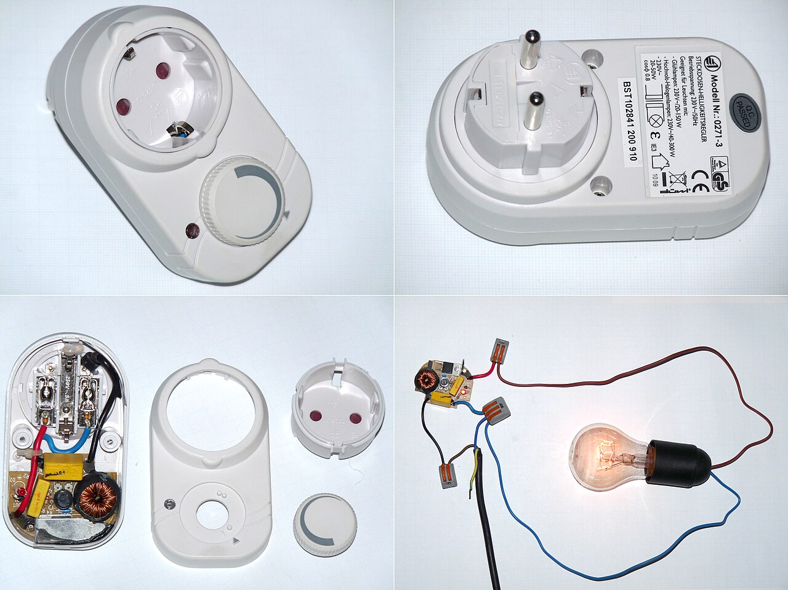
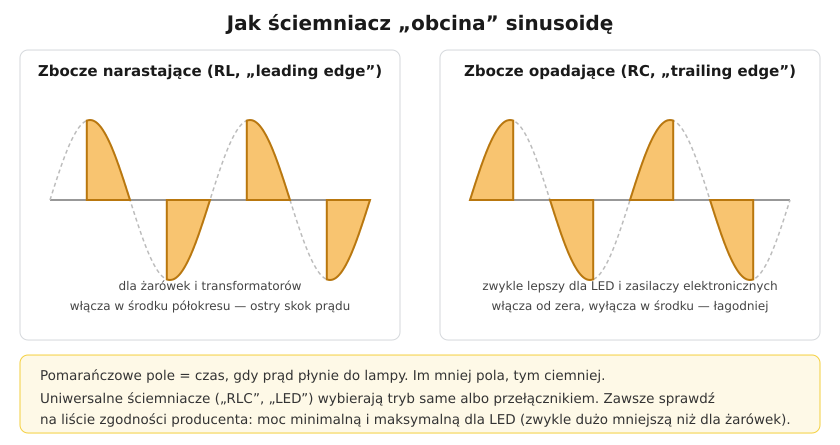

# 18.05 — Ściemniacze i współpraca z LED

> **Moduł:** [18 — Oświetlenie](README.md) · **Oznaczenia:** 🏠 · **Zakres SEP:** (a) (c) · **Status:** ✅ pełny
>
> **Czytaj:**
>
> - PN-EN 60669-2-1 — łączniki elektroniczne (ściemniacze)
> - [Shelly — jak działa ściemnianie lamp LED](https://www.shelly.com/pl/pages/dimming-leds)
> - Migające LED: [20.07](../20-diagnostyka-usterek/20.07-migajace-i-zarzace-sie-led.md)

[← poprzedni temat](18.04-przekaznik-impulsowy-zamiast-lacznikow.md) · [spis modułu](README.md) · [następny temat →](18.06-tasmy-led-i-ich-zasilanie.md)

## Po co to jest

Ściemniacz działał bez problemu z żarówkami — rezystorem, który da się zasilać „kawałkiem” napięcia. LED ma w środku elektroniczny zasilacz i nie każdy zasila się „pociętą” sinusoidą. Skutek: migotanie, buczenie, wąski zakres ściemniania albo spalona żarówka. Trzeba wiedzieć, jak działa ściemniacz i co sprawdzić przed zakupem.

## Po ludzku

Typowy ściemniacz ścienny **„obcina” część każdego półokresu** napięcia sieci. Lampa dostaje prąd tylko przez część czasu — im mniej, tym ciemniej.

Są dwa sposoby obcinania:

- **zbocze narastające (RL, „leading edge”, triakowy)** — ściemniacz **włącza** się dopiero w środku półokresu. Ostry skok prądu — dobry dla żarówek i transformatorów żelaznych, często gorszy dla LED;
- **zbocze opadające (RC, „trailing edge”, tranzystorowy)** — ściemniacz włącza od zera i **wyłącza** w środku półokresu. Łagodniej — zwykle lepszy dla LED i zasilaczy elektronicznych.

**Ściemniacze uniwersalne** („RLC”, „LED”) wybierają tryb same albo przełącznikiem.

**Co sprawdzić:**

1. **Źródło musi być „ściemnialne”** (dimmable) — inaczej nie podłączaj.
2. **Lista zgodności** producenta ściemniacza lub żarówki.
3. **Moc minimalna i maksymalna dla LED** — dla LED jest zwykle **dużo mniejsza** niż dla żarówek (bo prąd załączania zasilaczy). Za małe obciążenie → migotanie i żarzenie po wyłączeniu.
4. **Ściemniacz 2-przewodowy czy 3-przewodowy?** Dwuprzewodowy (bez N) zasila się przez lampę — przy małym obciążeniu LED mogą się żarzyć. Trzyprzewodowy (z N w puszce) działa stabilniej ([27.02](../27-inteligentny-dom/27.02-przewod-neutralny-w-puszce-lacznika.md)).
5. **Kilka ściemniaczy w jednej ramce** — producent każe zmniejszyć moc każdego (gorzej oddają ciepło).

**Inne sposoby ściemniania:**

- **sterowanie 1–10 V lub DALI** — osobne żyły sterujące do zasilacza; w biurach i lepszych instalacjach;
- **PWM po stronie 12/24 V** — dla taśm LED, sterownik między zasilaczem a taśmą ([18.06](18.06-tasmy-led-i-ich-zasilanie.md));
- **żarówki „smart”** — ściemniane radiowo; nie podłączaj ich pod ściemniacz ścienny.

## Jak to wygląda

*Na co patrzeć: w środku ściemniacza jest triak lub tranzystor, pokrętło ustawia moment przełączania, a cewka (dławik) łagodzi skoki prądu i zakłócenia. Na tabliczce szukaj zakresu mocy i rodzaju obciążenia (R, L, C, LED).*

## Schemat

## Pojęcia

| Pojęcie | Po ludzku | Termin normowy / symbol |
|---------|-----------|-------------------------|
| Ściemniacz fazowy | Ściemniacz „obcinający” sinusoidę | łącznik elektroniczny, PN-EN 60669-2-1 |
| Zbocze narastające / opadające | Obcina początek / koniec półokresu | leading edge (RL) / trailing edge (RC) |
| Obciążenie R, L, C | Rezystancyjne / indukcyjne / pojemnościowe | — |
| Ściemnialne źródło LED | LED przystosowany do ściemniania | dimmable |
| 1–10 V, DALI | Sterowanie jasnością osobnymi żyłami | PN-EN 62386 (DALI) |

## Liczby do zapamiętania

| Wielkość | Wartość | Kiedy obowiązuje | Źródło |
|----------|---------|------------------|--------|
| RL (narastające) | żarówki, halogeny, transformatory żelazne (L) | — | katalogi producentów |
| RC (opadające) | LED, zasilacze elektroniczne (C) | — | jw. |
| Moc dla LED | zwykle **dużo mniejsza** niż dla żarówek (często kilka–kilkanaście razy) | — | instrukcje ściemniaczy |
| Moc minimalna | ≤ moc podłączonych źródeł | — | [Shelly](https://www.shelly.com/pl/pages/dimming-leds) |
| Ściemniacze w ramce wielokrotnej | moc każdego **obniżona** wg instrukcji | — | instrukcje |

## W praktyce

- **Kupuj zestaw**: ściemniacz + żarówki z listy zgodności. Inaczej to loteria.
- **Ustaw minimum** — wiele ściemniaczy ma regulację jasności minimalnej; ustaw ją tak, żeby LED nie migały przy najniższym poziomie.
- **Ściemniacz nie jest wyłącznikiem bezpieczeństwa** — w pozycji „wyłączone” część ściemniaczy nie odcina obwodu galwanicznie. Do prac przy lampie — wyłącz obwód w rozdzielnicy.
- **Nie podłączaj ściemniacza do gniazda** z odbiornikami innymi niż lampy (np. silniki, zasilacze komputerów).

## Błędy i zagrożenia

- ⚠️ **Nieściemnialna LED pod ściemniaczem** — przegrzanie zasilacza w żarówce, pęknięta bańka.
- **Ściemniacz RL z wieloma LED** — prąd załączania niszczy triak albo zasilacze żarówek.
- **Za małe obciążenie** (jedna żarówka 5 W na ściemniaczu 2-przewodowym) — migotanie, żarzenie po wyłączeniu.
- **Kilka ściemniaczy w jednej puszce bez obniżenia mocy** — przegrzanie.

## Przykład

**Zadanie.** Ściemniacz uniwersalny: „R, L 20–400 W; C 20–300 W; LED 3–100 W”. Chcesz podłączyć 8 ściemnialnych LED GU10 po 5 W. Czy to zadziała?

**Rozwiązanie.** Łączna moc LED: 8 × 5 = 40 W. Mieści się w zakresie **LED 3–100 W** — tak. Gdybyś patrzył na zakres dla żarówek (do 400 W), uznałbyś, że zmieści się 80 takich żarówek — a dla LED producent dopuszcza maksymalnie 100 W, czyli 20 sztuk. Zanim kupisz — sprawdź, czy żarówki są na liście zgodności ściemniacza.

## Pytania SEP

1. **Na jakiej zasadzie działa ściemniacz oświetlenia i jakie są jego rodzaje?**

Odpowiedź

Ściemniacz fazowy (łącznik elektroniczny z triakiem lub tranzystorami) ogranicza wartość skuteczną napięcia na lampie, przewodząc prąd tylko przez część każdego półokresu. Ściemniacze z obcinaniem zbocza narastającego (RL) włączają w środku półokresu — stosowane do żarówek i transformatorów indukcyjnych; z obcinaniem zbocza opadającego (RC) wyłączają w środku półokresu — do zasilaczy elektronicznych i LED. Ściemniacze uniwersalne dostosowują tryb do obciążenia. Inne metody: sterowanie 1–10 V, DALI, PWM po stronie niskonapięciowej.

## Sprawdź się

1. Po zamianie żarówek na LED (ściemnialne) światło migocze przy małej jasności. Podaj trzy możliwe przyczyny.

Odpowiedź

(1) Ściemniacz RL zamiast RC lub uniwersalnego. (2) Obciążenie poniżej mocy minimalnej ściemniacza dla LED. (3) Brak zgodności żarówek ze ściemniaczem / źle ustawione minimum jasności. Dodatkowo: ściemniacz 2-przewodowy bez N, zakłócenia sieci.

## Źródła

- PN-EN 60669-2-1 — łączniki elektroniczne.
- [Jak działa ściemnianie lamp LED — Shelly](https://www.shelly.com/pl/pages/dimming-leds).
- Instrukcje ściemniaczy (np. Hager, Gira, Elektro-Plast) — zakresy mocy dla obciążeń R, L, C i LED.

---

[← poprzedni temat](18.04-przekaznik-impulsowy-zamiast-lacznikow.md) · [spis modułu](README.md) · [następny temat →](18.06-tasmy-led-i-ich-zasilanie.md)
