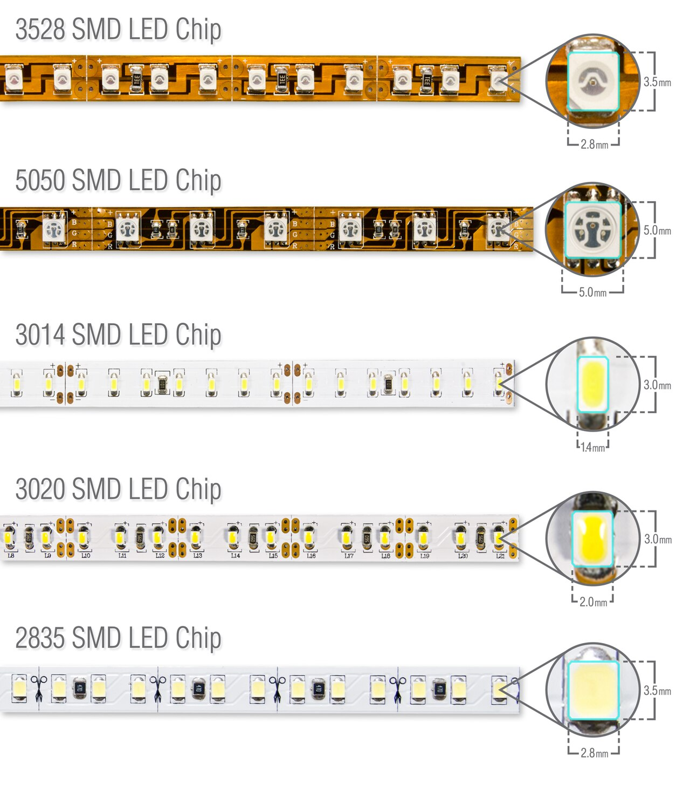
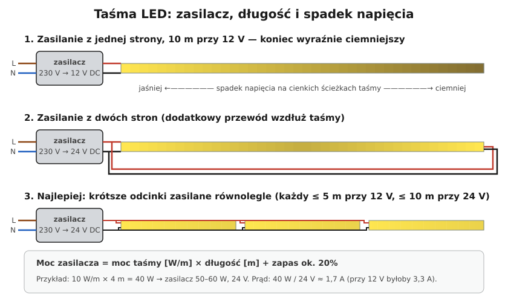

# 18.06 — Taśmy LED i ich zasilanie

> **Moduł:** [18 — Oświetlenie](README.md) · **Oznaczenia:** 🏠 · **Zakres SEP:** (a) (c) · **Status:** ✅ pełny
>
> **Czytaj:**
>
> - 🇬🇧 [Selecting LED tape power supplies — AVSL](https://avsl.com/support/howtoselectledtapepower)
> - [Kanlux — katalog taśm LED](https://kanlux.com/download/mat/38472.pdf)
> - Zasilacze: [18.01](18.01-zrodla-swiatla-i-zasilacze-led.md); spadek napięcia: [16.03](../16-planowanie-obwodow/16.03-sprawdzanie-spadku-napiecia.md)

[← poprzedni temat](18.05-sciemniacze-i-wspolpraca-z-led.md) · [spis modułu](README.md) · (koniec modułu) →

## Po co to jest

Taśma LED pod szafkami kuchennymi, w suficie podwieszanym, przy schodach — to dziś jedna z najczęstszych prac przy oświetleniu. Źle zasilona taśma świeci nierówno, przegrzewa się albo przegrzewa zasilacz w niewentylowanej szafce. Wszystko sprowadza się do trzech rzeczy: moc zasilacza, długość odcinka, odprowadzenie ciepła.

## Po ludzku

**Taśma LED** to elastyczna płytka z diodami i rezystorami, zasilana **stałym napięciem** — najczęściej **12 V lub 24 V DC** z zasilacza stałonapięciowego (CV, [18.01](18.01-zrodla-swiatla-i-zasilacze-led.md)). Można ją ciąć w zaznaczonych miejscach (co kilka centymetrów).

**Moc zasilacza** = moc taśmy [W/m] × długość [m] + zapas ok. 20 %. Zasilacz pracujący na 100 % mocy grzeje się i szybciej padnie.

**Spadek napięcia na taśmie.** Ścieżki miedziane w taśmie są bardzo cienkie. Przy długim odcinku zasilanym z jednego końca koniec świeci wyraźnie ciemniej (i inną barwą). Dlatego:

- **12 V** — typowo do **5 m** z jednego punktu zasilania,
- **24 V** — typowo do **10 m** (przy tej samej mocy prąd jest dwa razy mniejszy),
- dłuższe odcinki — **zasilanie z dwóch stron** albo **kilka odcinków zasilanych równolegle** osobnymi przewodami z zasilacza.

**Przewód od zasilacza do taśmy** — przy 12/24 V płyną duże prądy (kilka amperów), więc przekrój ma znaczenie: dla kilku metrów zwykle 0,75–1,5 mm². Policz spadek jak w [16.03](../16-planowanie-obwodow/16.03-sprawdzanie-spadku-napiecia.md).

**Ciepło.** Diody się grzeją — taśmę o większej mocy (powyżej kilku W/m) klei się do **profilu aluminiowego**, który odprowadza ciepło. Bez profilu taśma szybciej ciemnieje, klej puszcza.

**IP** — IP20 do suchych wnętrz, IP65 (w silikonie) do kuchni i łazienki. W łazience — zgodnie ze strefami i tylko SELV ([17.01](../17-pomieszczenia-szczegolne/17.01-lazienka-strefy-0-1-i-2.md)).

**Zasilacz** — w dostępnym, wentylowanym miejscu, nie zamknięty w szczelnej szafce ani nie przykryty wełną. Powinien mieć oznaczenie SELV.

**Ściemnianie i kolory** — sterownik PWM między zasilaczem a taśmą (mono, CCT, RGB, RGBW) albo zasilacz ściemnialny ([18.05](18.05-sciemniacze-i-wspolpraca-z-led.md)).

## Jak to wygląda

*Na co patrzeć: taśmy różnią się typem diod (3528, 5050, 2835…), ich gęstością i mocą na metr. Na taśmie co kilka diod jest miejsce cięcia z polami lutowniczymi (+/−). Moc w W/m znajdziesz na szpuli — od niej liczy się zasilacz.*

## Schemat

## Pojęcia

| Pojęcie | Po ludzku | Termin normowy / symbol |
|---------|-----------|-------------------------|
| Taśma LED | Elastyczny pasek z diodami | LED strip |
| Zasilacz CV | Zasilacz o stałym napięciu | constant voltage |
| Profil aluminiowy | Szyna, która chłodzi taśmę i ma klosz | — |
| PWM | Szybkie włączanie i wyłączanie w celu ściemniania | modulacja szerokości impulsów |
| Zasilanie równoległe | Kilka odcinków z jednego zasilacza osobnymi przewodami | — |

## Liczby do zapamiętania

| Wielkość | Wartość | Kiedy obowiązuje | Źródło |
|----------|---------|------------------|--------|
| Moc zasilacza | moc taśmy × długość + **ok. 20 %** | — | praktyka, [AVSL 🇬🇧](https://avsl.com/support/howtoselectledtapepower) |
| Długość z jednego punktu | **5 m** przy 12 V, **10 m** przy 24 V | typowe taśmy | [AVSL 🇬🇧](https://avsl.com/support/howtoselectledtapepower) |
| Przewód zasilający | **0,75 mm²** do ok. 10 m, **1 mm²** do ok. 20 m | typowe obciążenia | jw. |
| Złączki zaciskowe do taśm | często **max 2 A** | wg katalogu | [Kanlux](https://kanlux.com/download/mat/38472.pdf) |
| IP | **IP20** wnętrza suche, **IP65** kuchnia, łazienka | — | katalogi |
| Prąd taśmy | $I = P / U$: 40 W przy 12 V = **3,3 A**, przy 24 V = **1,7 A** | — | — |

## W praktyce

1. **Policz moc**: W/m z opakowania × długość. Dodaj zapas.
2. **Wybierz 24 V**, jeśli odcinek jest dłuższy niż kilka metrów.
3. **Zaplanuj miejsce zasilacza** — dostępne (puszka rewizyjna, szafka z wentylacją), blisko taśmy.
4. **Rozplanuj odcinki** — każdy do 5 m (12 V) / 10 m (24 V), zasilane równolegle.
5. **Profil aluminiowy** dla taśm o większej mocy.
6. **Łącz taśmy lutowaniem** albo dobrymi złączkami — złączki zaciskowe to częsty punkt grzania.
7. **Przewód 230 V do zasilacza** — normalny obwód oświetlenia z łącznikiem; łącznik po stronie 230 V (albo czujnik/ściemniacz zgodny z zasilaczem).

## Błędy i zagrożenia

- ⚠️ **Zasilacz bez obudowy (typ „otwarty”, do zabudowy w urządzeniach) zamontowany w szafce kuchennej** — zaciski 230 V dostępne, pożar od przegrzania.
- **Zasilacz zbyt mały** — przegrzewa się, „pompuje” światło, pada.
- **10 m taśmy 12 V z jednego końca** — koniec ciemny i żółtawy, zasilacz pracuje dobrze, a taśma przy wejściu przegrzewa się od dużego prądu.
- **Taśma bez profilu** w zamkniętej wnęce — degradacja diod.
- **Cienki przewód „dzwonkowy”** od zasilacza do taśmy — spadek napięcia i grzanie.

## Przykład

**Zadanie.** Podświetlenie blatu kuchennego: 3,6 m taśmy 9,6 W/m. Zasilacz w szafce nad lodówką, 2 m od początku taśmy. Dobierz zasilacz i przewód.

**Rozwiązanie.**

- Moc: $9{,}6 \cdot 3{,}6 \approx 34{,}6$ W; z zapasem 20 % → **≥ 41,5 W** → zasilacz **50 W**.
- Napięcie: odcinek 3,6 m — wystarczy 12 V, ale 24 V daje mniejszy prąd; wybierz **24 V**.
- Prąd: $34{,}6 / 24 \approx 1{,}44$ A.
- Przewód 2 m, 0,75 mm²: $\Delta U = 2 \cdot 2 \cdot 1{,}44 / (56 \cdot 0{,}75) \approx 0{,}14$ V — pomijalne.
- Profil aluminiowy z kloszem (taśma pod szafkami, 9,6 W/m), taśma IP65 lub w profilu z kloszem (para znad płyty).
- Zasilacz z oznaczeniem SELV, w obudowie, w wentylowanej szafce; zasilanie 230 V z obwodu oświetlenia kuchni przez łącznik.

## Pytania SEP

1. **Jak zasilić taśmę LED i jak dobrać zasilacz?**

Odpowiedź

Taśmę LED zasila się stałym napięciem (zwykle 12 V lub 24 V DC) z zasilacza stałonapięciowego SELV. Moc zasilacza dobiera się jako iloczyn mocy jednostkowej taśmy i długości, z zapasem ok. 20 %. Długość odcinka zasilanego z jednego punktu ogranicza spadek napięcia na ścieżkach taśmy (typowo 5 m dla 12 V i 10 m dla 24 V); dłuższe instalacje zasila się z kilku punktów równolegle. Taśmy większej mocy montuje się na profilach aluminiowych, zasilacz umieszcza w miejscu dostępnym i wentylowanym.

## Sprawdź się

1. Na schemacie, w wariancie 1, dlaczego koniec taśmy jest ciemniejszy, skoro zasilacz daje stałe 12 V?

Odpowiedź

Zasilacz trzyma 12 V na swoich zaciskach. Dalej prąd płynie cienkimi ścieżkami taśmy, na których spada napięcie — im dalej od zasilacza, tym większy prąd przepłynął już przez ścieżki i tym niższe napięcie na diodach. Przy 12 V i 10 m spadek jest na tyle duży, że koniec wyraźnie ciemnieje.

## Źródła

- 🇬🇧 [Selecting LED tape power supplies — AVSL](https://avsl.com/support/howtoselectledtapepower).
- [Taśmy LED COB — katalog Kanlux](https://kanlux.com/download/mat/38472.pdf).
- PN-EN 61347-2-13 — zasilacze elektroniczne do modułów LED.

---

[← poprzedni temat](18.05-sciemniacze-i-wspolpraca-z-led.md) · [spis modułu](README.md) · (koniec modułu) →
