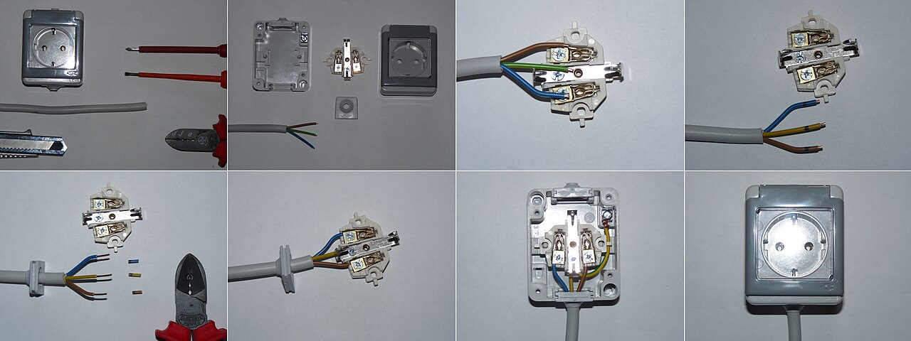
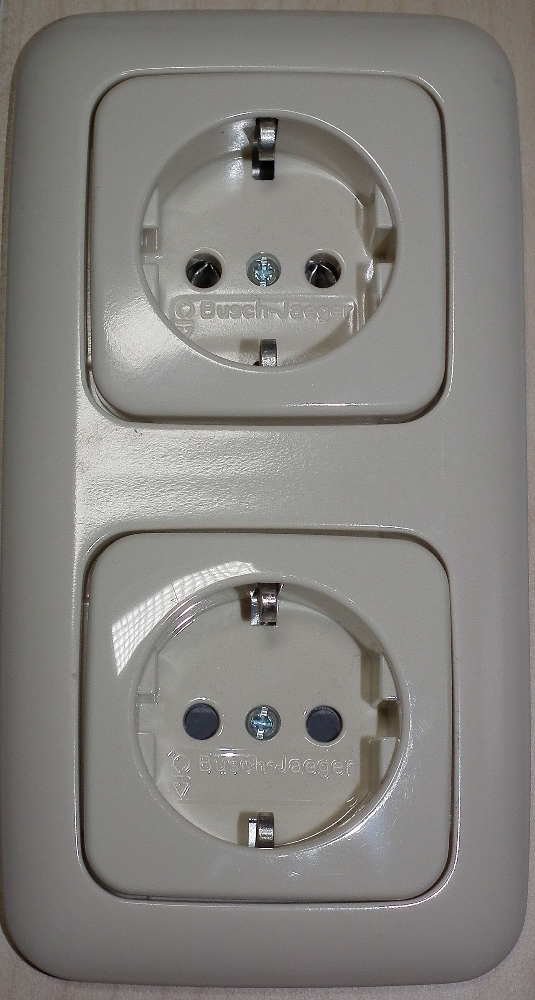
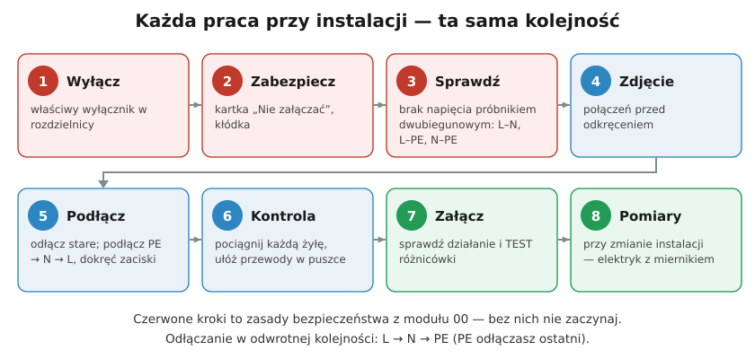
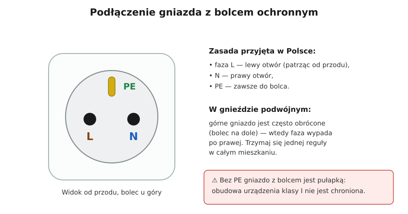

# 19.01 — Wymiana gniazda wtyczkowego

> **Moduł:** [19 — Prace krok po kroku](README.md) · **Oznaczenia:** 🏠 · **Zakres SEP:** (c) · **Status:** ✅ pełny
>
> **Czytaj:**
>
> - Pięć zasad bezpieczeństwa: [00.01](../00-bezpieczenstwo-najpierw/00.01-piec-zasad-bezpiecznej-pracy-przy-urzadzeniach.md); sprawdzanie braku napięcia: [00.02](../00-bezpieczenstwo-najpierw/00.02-sprawdzanie-braku-napiecia-probnik-dwubiegunowy.md)
> - Co wolno samemu: [00.03](../00-bezpieczenstwo-najpierw/00.03-co-wolno-zrobic-samemu-a-co-wymaga-uprawnien-i.md)
> - Gniazdo z bolcem: [06.01](../06-osprzet-instalacyjny/06.01-gniazda-wtyczkowe-jednofazowe-z-bolcem.md); złączki: [06.04](../06-osprzet-instalacyjny/06.04-zlaczki-i-laczenie-przewodow-dlaczego-nie.md)

← (początek modułu) · [spis modułu](README.md) · [następny temat →](19.02-wymiana-lacznika.md)

## Po co to jest

Pęknięte, poluzowane albo nadpalone gniazdo to najczęstsza drobna naprawa w domu. Wymiana gniazda na takie samo to naprawa, nie zmiana instalacji. Ale to też praca przy przewodach, które za chwilę znów będą pod napięciem. Ten temat prowadzi przez nią krok po kroku i pokazuje, czego szukać w puszce, zanim zamkniesz ją na kolejne 20 lat.

## Po ludzku

Każda praca zaczyna się tak samo: **wyłącz, zabezpiecz, sprawdź brak napięcia** ([00.01](../00-bezpieczenstwo-najpierw/00.01-piec-zasad-bezpiecznej-pracy-przy-urzadzeniach.md)). Dopiero potem odkręcasz.

**Co możesz zastać w puszce:**

- **trzy żyły** (brązowa/czarna L, niebieska N, żółto-zielona PE) — typowa instalacja,
- **sześć żył** — gniazdo „przelotowe”: przewód z rozdzielnicy wchodzi i drugi wychodzi do następnego gniazda. Pod każdym zaciskiem są dwie żyły tego samego rodzaju,
- **dwie żyły i mostek** z zacisku N do bolca — stara instalacja z „zerowaniem” ([21.03](../21-stare-instalacje/21.03-mostkowanie-bolca-ochronnego-w-gniazdku.md)). Nie odtwarzaj mostka w nowym gnieździe,
- **przewód aluminiowy** (srebrny) — kruchy; nie zginaj go kilka razy ([21.02](../21-stare-instalacje/21.02-przewody-aluminiowe-zagrozenia-i-postepowanie.md)),
- **ślady nadpalenia** na izolacji — odetnij przegrzany fragment; jeśli przewód jest za krótki, potrzebna jest naprawa w puszce, a może i przyczyna dalej ([20.06](../20-diagnostyka-usterek/20.06-grzejace-sie-zaciski-i-zapach-spalenizny.md)).

**Podłączenie nowego gniazda:**

- **PE** na zacisk bolca (oznaczenie ⏚) — podłączasz go **pierwszy**, odłączasz **ostatni**;
- **L i N** na zaciski robocze. W Polsce przyjęło się, że patrząc na gniazdo z bolcem u góry, **faza jest po lewej** ([06.01](../06-osprzet-instalacyjny/06.01-gniazda-wtyczkowe-jednofazowe-z-bolcem.md));
- **zaciski bezśrubowe (wciskowe)** — tylko drut, odizolowany na długość z oznaczenia na gnieździe; **zaciski śrubowe** — drut albo linka w tulejce ([19.07](19.07-zakanczanie-przewodow-tulejki-zaciski-momenty.md));
- **przelot** — tylko jeśli gniazdo ma podwójne zaciski. Inaczej łączysz żyły złączką i wyprowadzasz jedną do gniazda.

## Jak to wygląda

*Na co patrzeć: przewody przycięte na równą długość z zapasem, żyły odizolowane dokładnie na długość zacisku, żółto-zielona na środkowym zacisku bolca. Na ostatnim zdjęciu pokrywa przykrywa wszystkie części pod napięciem.*

*Na co patrzeć: w gnieździe z przesłonami otwory zasłaniają plastikowe klapki, które otwierają się tylko przy włożeniu obu kołków wtyczki naraz. To ochrona przed wkładaniem drutu czy spinki — warto wybrać takie, gdy w domu są dzieci.*

## Schemat

## Pojęcia

| Pojęcie | Po ludzku | Termin normowy / symbol |
|---------|-----------|-------------------------|
| Gniazdo przelotowe | Gniazdo, przez które zasilane jest następne | — |
| Zacisk bezśrubowy | Zacisk ze sprężyną, wciskasz drut | zacisk bezgwintowy |
| Przesłony torów prądowych | Klapki zasłaniające otwory gniazda | ochrona przed dziećmi |
| Mocowanie łapkowe / wkrętami | Sposób trzymania gniazda w puszce | — |

## Liczby do zapamiętania

| Wielkość | Wartość | Kiedy obowiązuje | Źródło |
|----------|---------|------------------|--------|
| Kolejność podłączania | **PE → N → L** (odłączanie odwrotnie) | zawsze | praktyka, [15.07](../15-rozdzielnica-mieszkaniowa/15.07-montaz-i-porzadek-przewodow-w-rozdzielnicy.md) |
| Faza w gnieździe | **lewy** otwór przy bolcu u góry | konwencja w Polsce | [06.01](../06-osprzet-instalacyjny/06.01-gniazda-wtyczkowe-jednofazowe-z-bolcem.md) |
| Gniazdo jednofazowe | **16 A, 250 V** | typowe gniazdo domowe | PN-IEC 60884-1 |
| Długość odizolowania | wg oznaczenia na gnieździe, zwykle **8–12 mm** | — | instrukcje producentów |
| Zapas przewodu w puszce | tyle, żeby wyjąć gniazdo przed puszkę (kilka–kilkanaście cm) | — | praktyka |

## W praktyce

1. **Wyłącz obwód** (albo całą rozdzielnicę, jeśli nie wiesz, który) i powieś kartkę „Nie załączać”.
2. **Sprawdź brak napięcia** próbnikiem dwubiegunowym: L–N, L–PE, N–PE — w gnieździe, zanim go odkręcisz. Wcześniej sprawdź próbnik na działającym gnieździe.
3. **Zdejmij ramkę i odkręć mechanizm.** Wyjmij gniazdo przed puszkę, **jeszcze raz sprawdź brak napięcia** na zaciskach (bywa, że w puszce jest przewód z innego obwodu).
4. **Zrób zdjęcie** połączeń.
5. **Odłącz** żyły: L, N, na końcu PE.
6. **Oceń przewody**: kolory, przelot, mostek, aluminium, nadpalenia. Jeśli coś się nie zgadza z tym, czego się spodziewasz — przerwij ([00.04](../00-bezpieczenstwo-najpierw/00.04-czerwone-flagi-kiedy-przerwac-prace-i-wezwac.md)).
7. **Przygotuj końcówki**: przytnij do równej długości, odizoluj na długość zacisku.
8. **Podłącz**: PE, N, L. Dokręć śruby, pociągnij każdą żyłę.
9. **Ułóż przewody** w puszce bez zgniatania, wkręć gniazdo, załóż ramkę.
10. **Załącz** i sprawdź gniazdo próbnikiem lub testerem gniazd; jeśli obwód ma RCD — naciśnij TEST.

## Błędy i zagrożenia

- ⚠️ **Praca „na żywo”** albo po wyłączeniu nie tego wyłącznika — sprawdzenie braku napięcia jest obowiązkowe zawsze.
- ⚠️ **Odtworzenie mostka N–bolec** w nowym gnieździe — patrz [21.03](../21-stare-instalacje/21.03-mostkowanie-bolca-ochronnego-w-gniazdku.md).
- **Linka bez tulejki w zacisku śrubowym** — druciki się rozchodzą, połączenie się luzuje.
- **Przelot przez jeden zacisk dwoma żyłami**, gdy gniazdo tego nie przewiduje — luźny drugi przewód, grzanie i przerwa w dalszych gniazdach ([20.02](../20-diagnostyka-usterek/20.02-nie-dziala-gniazdo-albo-caly-obwod.md)).
- **Gniazdo luźne w puszce** — przy wyciąganiu wtyczki wychodzi razem z nią, przewody pracują i pękają.

## Przykład

**Zadanie.** Po zdjęciu starego gniazda widzisz: brązową żyłę na lewym zacisku, niebieską na prawym i kawałek drutu od prawego zacisku do bolca. Żółto-zielonej żyły w puszce nie ma. Co robisz?

**Rozwiązanie.** To mostek N–bolec — instalacja dwuprzewodowa. Nowe gniazdo z bolcem **bez mostka** pozostawiłoby bolec bez ochrony, a **z mostkiem** odtworzyłoby zagrożenie. Właściwe rozwiązanie to doprowadzenie PE (nowy przewód z rozdzielnicy). Rozwiązanie przejściowe: gniazdo **bez bolca** i obwód za RCD 30 mA — oraz informacja dla domowników, że urządzenia klasy I (pralka, czajnik z metalową obudową) nie mają tu ochrony. Zaplanuj modernizację ([21.04](../21-stare-instalacje/21.04-modernizacja-czesciowa.md)).

## Pytania SEP

1. **Jak bezpiecznie wymienić gniazdo wtyczkowe w instalacji mieszkaniowej?**

Odpowiedź

Wyłączyć zasilanie obwodu właściwym zabezpieczeniem, zabezpieczyć przed ponownym załączeniem (tablica, blokada), sprawdzić brak napięcia sprawdzonym wskaźnikiem dwubiegunowym między wszystkimi przewodami. Odłączyć stare gniazdo (L, N, na końcu PE), ocenić stan przewodów, przygotować końcówki, podłączyć nowe gniazdo w kolejności PE, N, L, dokręcić zaciski i sprawdzić je mechanicznie, zamontować gniazdo w puszce i założyć osłony. Po załączeniu sprawdzić poprawność podłączenia i działanie ochrony różnicowoprądowej.

## Sprawdź się

1. Dlaczego brak napięcia sprawdzasz drugi raz — na zaciskach wyjętego gniazda?

Odpowiedź

Bo w puszce może być drugi przewód z innego obwodu (np. przelot do gniazda z innej grupy) albo gniazdo podwójne zasilane z dwóch obwodów. Pierwsze sprawdzenie w otworach gniazda tego nie wykaże.

## Źródła

- PN-IEC 60884-1 — wtyczki i gniazda wtyczkowe do użytku domowego i podobnego.
- PN-HD 60364-5-55 — inny osprzęt (gniazda wtyczkowe).
- Instrukcje montażu osprzętu (długości odizolowania, przelot).

---

← (początek modułu) · [spis modułu](README.md) · [następny temat →](19.02-wymiana-lacznika.md)
