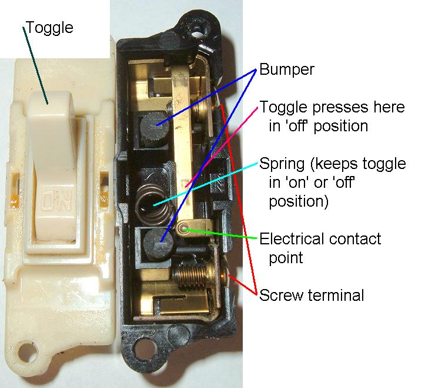
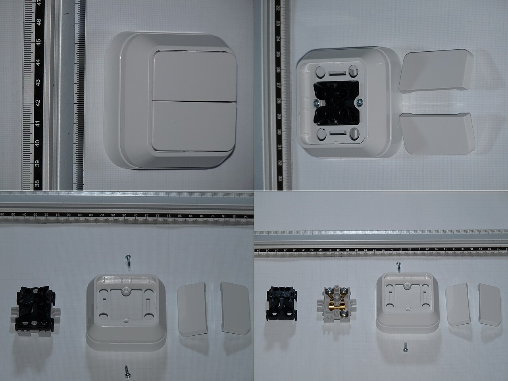
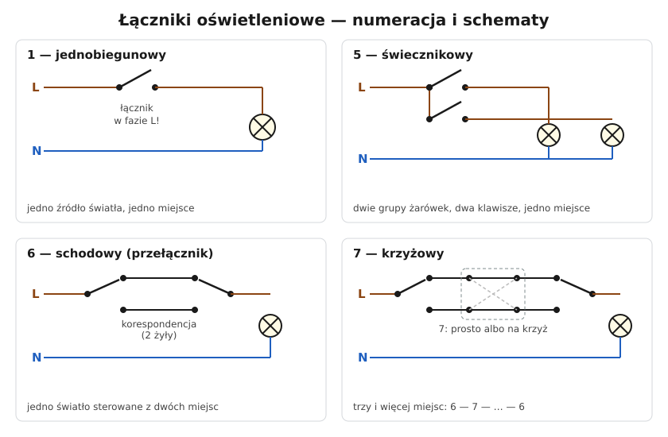

# 19.02 — Wymiana łącznika

> **Moduł:** [19 — Prace krok po kroku](README.md) · **Oznaczenia:** 🏠 · **Zakres SEP:** (c) · **Status:** ✅ pełny
>
> **Czytaj:**
>
> - Łączniki i schematy: [18.02](../18-oswietlenie/18.02-lacznik-jednobiegunowy-i-swiecznikowy-schematy.md), [18.03](../18-oswietlenie/18.03-uklad-schodowy-i-krzyzowy-schematy.md)
> - N w puszce łącznika: [27.02](../27-inteligentny-dom/27.02-przewod-neutralny-w-puszce-lacznika.md)

[← poprzedni temat](19.01-wymiana-gniazda-wtyczkowego.md) · [spis modułu](README.md) · [następny temat →](19.03-montaz-lampy-i-oprawy.md)

## Po co to jest

Łącznik zużywa się mechanicznie — klawisz się zacina, styk iskrzy, obudowa pęka. Wymiana jest prosta przy łączniku pojedynczym, ale przy świecznikowym i schodowym łatwo pomylić zaciski. Do tego coraz częściej łącznik zamienia się na elektroniczny albo „inteligentny”, który ma inne wymagania.

## Po ludzku

**Najpierw ustal, jaki to łącznik** ([18.02](../18-oswietlenie/18.02-lacznik-jednobiegunowy-i-swiecznikowy-schematy.md)):

| Ile żył w łączniku | Ile klawiszy | Co to jest |
|--------------------|--------------|------------|
| 2 | 1 | jednobiegunowy (1) |
| 3 | 2 | świecznikowy (5) — jeden zacisk wspólny L |
| 3 | 1 | schodowy (6) — jeden zacisk wspólny |
| 4 | 1 | krzyżowy (7) |

**Zacisk wspólny** w łącznikach 5 i 6 jest oznaczony: literą **L**, strzałką, kropką albo śrubą w innym kolorze. **Zanim odłączysz przewód z zacisku wspólnego — oznacz go taśmą.** To jedyny przewód, którego nie wolno pomylić. Pozostałe dwie żyły (korespondencje albo wyjścia do lamp) można najwyżej zamienić — skutkiem będzie odwrotne działanie klawiszy.

**Łącznik elektroniczny** (z czujnikiem ruchu, ściemniacz, smart) często potrzebuje **przewodu N** w puszce. Jeśli w puszce są tylko dwa przewody (L i przewód do lampy), wybierz model bez N (dwuprzewodowy) albo dociągnij N ([27.02](../27-inteligentny-dom/27.02-przewod-neutralny-w-puszce-lacznika.md)).

**Łącznik w łazience** — tylko poza strefami 0–2 ([17.01](../17-pomieszczenia-szczegolne/17.01-lazienka-strefy-0-1-i-2.md)).

## Jak to wygląda

*Na co patrzeć: zaciski śrubowe są z boku mechanizmu. Gdy klawisz „chodzi” ciężko albo słychać trzaski, zużyty jest mechanizm ze sprężyną — naprawia się to tylko wymianą łącznika.*

*Na co patrzeć: po zdjęciu klawiszy widać mechanizm i zaciski. Oznaczenie zacisku wspólnego (L, strzałka) jest zwykle na korpusie przy zacisku.*

## Schemat

## Pojęcia

| Pojęcie | Po ludzku | Termin normowy / symbol |
|---------|-----------|-------------------------|
| Zacisk wspólny | Zacisk łączony raz z jednym, raz z drugim wyjściem | L, ↓ |
| Mechanizm | Część łącznika z zaciskami, mocowana w puszce | wkład łącznika |
| Łącznik dwuprzewodowy | Łącznik elektroniczny działający bez N | — |
| 10 AX | Łącznik do obciążeń z dużym prądem załączania | PN-EN 60669-1 |

## Liczby do zapamiętania

| Wielkość | Wartość | Kiedy obowiązuje | Źródło |
|----------|---------|------------------|--------|
| Prąd łącznika | typowo **10 A** (10 AX), 250 V | łączniki oświetleniowe | PN-EN 60669-1 |
| Zaciski | 1 → **2**, 5 → **3**, 6 → **3**, 7 → **4** | — | — |
| Wysokość | ok. **105 cm** | — | [16.05](../16-planowanie-obwodow/16.05-wysokosci-montazu-i-liczba-gniazd.md) |
| Moc LED na łączniku/ściemniaczu | wg katalogu (często mniejsza niż dla żarówek) | LED | instrukcje |

## W praktyce

1. Wyłącz obwód oświetlenia, zabezpiecz, sprawdź brak napięcia na zaciskach łącznika (w puszce łącznika bywa faza z innego obwodu).
2. Zrób zdjęcie, **oznacz przewód z zacisku wspólnego** taśmą.
3. Odłącz, sprawdź końcówki (nadpalenia, pęknięte druty), w razie potrzeby przytnij i odizoluj na nowo.
4. Podłącz do nowego łącznika: przewód oznaczony → zacisk wspólny, pozostałe → wyjścia.
5. Zamontuj, załącz, sprawdź działanie z każdego miejsca (przy schodowym — wszystkie kombinacje).
6. Jeśli lampa po wyłączeniu się żarzy — sprawdź, czy łącznik przerywa L, a nie N ([20.07](../20-diagnostyka-usterek/20.07-migajace-i-zarzace-sie-led.md)).

## Błędy i zagrożenia

- ⚠️ **Łącznik podłączony w przewodzie N** — lampa po wyłączeniu ma fazę ([18.02](../18-oswietlenie/18.02-lacznik-jednobiegunowy-i-swiecznikowy-schematy.md)).
- **Pomylony zacisk wspólny w schodowym** — działa tylko z jednego miejsca albo „dziwnie”.
- **Żyła PE użyta jako przewód łącznikowy** przy montażu łącznika elektronicznego „bo brakuje N” — PE nigdy nie służy jako N ani jako faza.
- **Łącznik elektroniczny zasilany przez lampę LED** (bez N) przy zbyt małym obciążeniu — mruganie, żarzenie.

## Przykład

**Zadanie.** Wymieniasz podwójny klawisz w przedpokoju. W puszce są 3 żyły: brązowa, czarna, szara. Klawisze sterują dwiema różnymi lampami. Co to za łącznik i jak go podłączyć?

**Rozwiązanie.** 3 żyły, 2 klawisze, dwie lampy — **świecznikowy (5)**. Brązowa to najpewniej L (sprawdź: po załączeniu obwodu tylko ona ma napięcie przy wyłączonych klawiszach — pomiar wykonujesz ostrożnie, przed wyjęciem mechanizmu, albo zanotuj, który zacisk był wspólny). Brązowa → zacisk wspólny L, czarna i szara → wyjścia 1 i 2. Jeśli klawisze sterują lampami „na odwrót” — zamień czarną z szarą.

## Pytania SEP

1. **Jakie czynności należy wykonać przy wymianie łącznika oświetleniowego?**

Odpowiedź

Wyłączyć obwód i zabezpieczyć przed załączeniem, sprawdzić brak napięcia, oznaczyć przewody (zwłaszcza dochodzący do zacisku wspólnego), odłączyć stary łącznik, sprawdzić stan żył, podłączyć nowy łącznik tego samego typu tak, by przerywał przewód fazowy, zamontować go i założyć osłony, załączyć zasilanie i sprawdzić działanie.

## Sprawdź się

1. W puszce łącznika schodowego są trzy żyły, ale żadna nie jest oznaczona. Jak bezpiecznie ustalić, która była na zacisku wspólnym?

Odpowiedź

Najprościej — przed odłączeniem odczytać oznaczenie zacisku wspólnego na starym łączniku (L, strzałka, inny kolor śruby). Jeśli jest nieczytelne: odłączyć wszystkie żyły, rozsunąć je i zaizolować końce, załączyć obwód i wskaźnikiem dwubiegunowym względem PE sprawdzić, która ma stale napięcie (to faza albo przewód „wspólny” do lampy z drugiego łącznika). Pomiar przy odsłoniętych żyłach to praca w pobliżu napięcia — jeśli nie masz pewności, poproś elektryka.

## Źródła

- PN-EN 60669-1 — łączniki do stałych instalacji elektrycznych domowych i podobnych.
- Instrukcje montażu łączników (oznaczenia zacisków, obciążalność LED).

---

[← poprzedni temat](19.01-wymiana-gniazda-wtyczkowego.md) · [spis modułu](README.md) · [następny temat →](19.03-montaz-lampy-i-oprawy.md)
