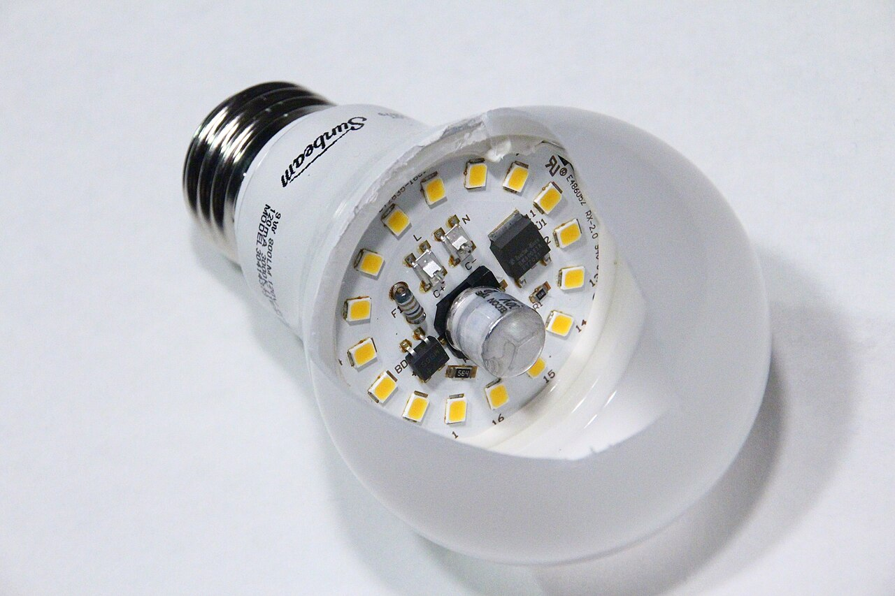
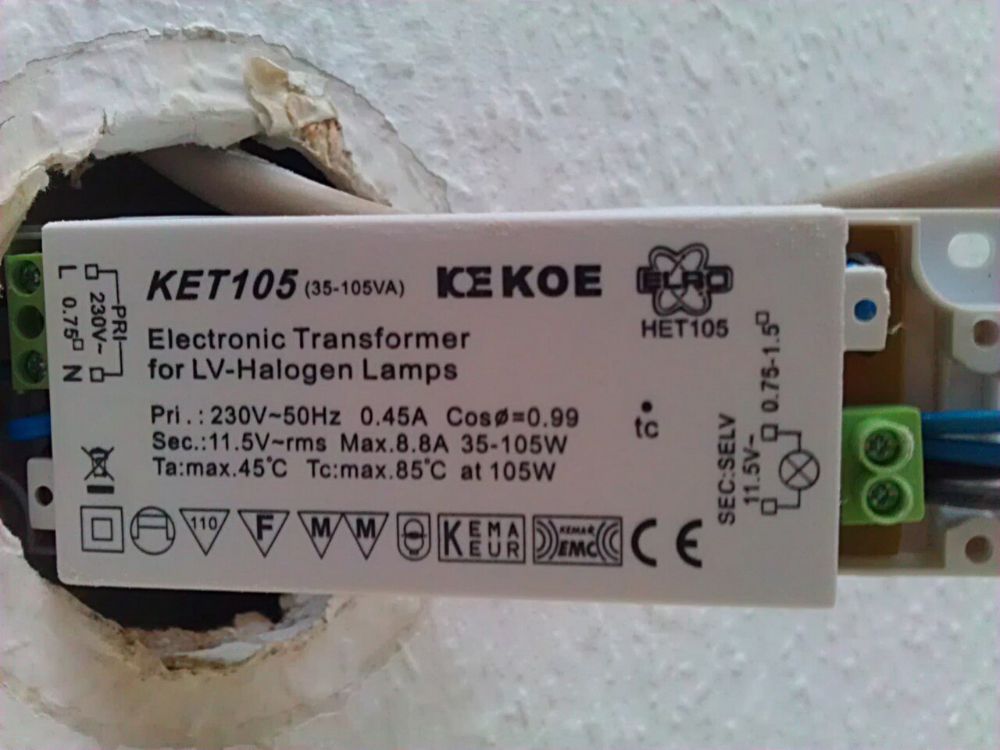
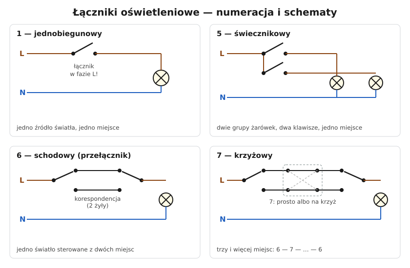

# 19.03 — Montaż lampy i oprawy

> **Moduł:** [19 — Prace krok po kroku](README.md) · **Oznaczenia:** 🏠 · **Zakres SEP:** (c) · **Status:** ✅ pełny
>
> **Czytaj:**
>
> - PN-EN 60598-1 — oprawy oświetleniowe (oznaczenia, klasy ochronności)
> - Klasy ochronności: [06.06](../06-osprzet-instalacyjny/06.06-klasy-ochronnosci-urzadzen-0-i-ii-iii.md); źródła światła: [18.01](../18-oswietlenie/18.01-zrodla-swiatla-i-zasilacze-led.md)

[← poprzedni temat](19.02-wymiana-lacznika.md) · [spis modułu](README.md) · [następny temat →](19.04-podlaczenie-plyty-indukcyjnej.md)

## Po co to jest

Lampa sufitowa wisi nad głową, często na wysokości, z której łatwo spaść. Jest ciężka, nagrzewa się i ma metalowe części, których się dotyka. Montaż to nie tylko trzy przewody, ale też mocowanie, ochrona przed porażeniem i dobór oprawy do miejsca.

## Po ludzku

**Co jest w suficie:** zwykle przewód z 3 żyłami: **przewód łącznikowy** (od łącznika — czarny lub brązowy), **N** (niebieski), **PE** (żółto-zielony). Przy łączniku świecznikowym — 4 żyły (dwa przewody łącznikowe). W starych blokach często tylko 2 żyły bez PE.

**Klasa oprawy** ([06.06](../06-osprzet-instalacyjny/06.06-klasy-ochronnosci-urzadzen-0-i-ii-iii.md)):

- **klasa I** — ma zacisk ⏚, metalowe części trzeba połączyć z PE;
- **klasa II** — symbol ⧈ (podwójny kwadrat), nie ma zacisku PE; żyłę PE w suficie izoluje się i zostawia;
- **klasa III** — zasilana bardzo niskim napięciem (np. 12 V z zasilacza SELV).

**Połączenie** — w kostce oprawy albo złączkami. Linka lampy (giętka) w złączce dźwigniowej lub w zacisku śrubowym w tulejce ([19.07](19.07-zakanczanie-przewodow-tulejki-zaciski-momenty.md)). Wszystkie połączenia muszą się zmieścić pod osłoną (rozetą) oprawy.

**Mocowanie** — hak lub kołki dobrane do sufitu i masy lampy. W stropie z płyt kanałowych łatwo trafić w kanał — kołek „wisi w powietrzu”. W płycie g-k — kołki do płyt (motylkowe) lub mocowanie do profilu; ciężkie lampy tylko do konstrukcji.

**Oprawy wpuszczane** (downlighty) w sufit podwieszany: zasilacz musi być **dostępny przez otwór oprawy**, ciepło musi mieć gdzie uciec — nie przykrywaj oprawy wełną, jeśli producent na to nie pozwala.

**Bezpieczeństwo pracy na wysokości** — stabilna drabina, druga osoba do podania lampy; nie podtrzymuj ciężkiej lampy na przewodach.

## Jak to wygląda

*Na co patrzeć: źródło LED ma w środku elektronikę, która się grzeje. Oprawa zamknięta bez wentylacji skraca jej życie — sprawdź na opakowaniu, czy źródło nadaje się do opraw zamkniętych.*

*Na co patrzeć: zasilacz oprawy wpuszczanej wyciągnięty przez otwór w suficie — tak ma być: dostępny bez rozbierania sufitu. Strona 230 V i strona 12 V są wyraźnie opisane.*

## Schemat

## Pojęcia

| Pojęcie | Po ludzku | Termin normowy / symbol |
|---------|-----------|-------------------------|
| Oprawa klasy I / II / III | Z PE / z podwójną izolacją / na bardzo niskim napięciu | PN-EN 60598-1 |
| Rozeta | Osłona przy suficie, pod którą są połączenia | — |
| Linka lampowa | Giętki przewód w oprawie | H03VV-F, H05VV-F |
| Oprawa wpuszczana | Oprawa schowana w suficie | downlight |

## Liczby do zapamiętania

| Wielkość | Wartość | Kiedy obowiązuje | Źródło |
|----------|---------|------------------|--------|
| Żyły przy lampie | **3** (łącznikowy, N, PE), przy świeczniku **4** | — | [18.02](../18-oswietlenie/18.02-lacznik-jednobiegunowy-i-swiecznikowy-schematy.md) |
| Klasa I | zacisk ⏚ — **musi** być PE | oprawy metalowe | PN-EN 60598-1 |
| Klasa II | symbol ⧈ — **bez** PE | — | jw. |
| Obwód oświetlenia | typowo **B10**, 1,5 mm² | — | [16.02](../16-planowanie-obwodow/16.02-dobor-przekroju-i-zabezpieczenia-procedura-krok.md) |

## W praktyce

1. Wyłącz **obwód** w rozdzielnicy (nie tylko łącznik!) i sprawdź brak napięcia na wszystkich żyłach w suficie.
2. Zamocuj podstawę lub hak, sprawdź nośność.
3. Zawieś lampę na haku lub łańcuszku montażowym — nie na przewodach.
4. Połącz: PE (jeśli oprawa klasy I), N, przewód łącznikowy. Przy dwóch obwodach w lampie (świecznik) — zgodnie z opisem oprawy.
5. Schowaj połączenia pod rozetą, przykręć.
6. Załącz i sprawdź; po wyłączeniu łącznikiem sprawdź próbnikiem, że na oprawie nie ma fazy.

## Błędy i zagrożenia

- ⚠️ **Praca po wyłączeniu tylko łącznika** — faza jest stale doprowadzona do puszki, a łącznik może być w N.
- ⚠️ **Metalowa oprawa klasy I bez PE** — przy uszkodzeniu izolacji oprawa pod napięciem.
- **Linka bez tulejki w zacisku śrubowym**, połączenia „na skrętkę” owinięte taśmą.
- **Lampa na kołku w kanale stropu** — spada razem z przewodami.
- **Downlight przykryty wełną** — przegrzanie zasilacza i źródła.

## Przykład

**Zadanie.** W suficie są 3 żyły: czarna, niebieska, żółto-zielona. Nowa lampa ma metalową obudowę, zacisk ⏚ i kostkę z oznaczeniami L, N. Jak podłączyć?

**Rozwiązanie.** Czarna (przewód łącznikowy) → **L**, niebieska → **N**, żółto-zielona → **⏚**. Oprawa klasy I — PE jest konieczny. Po montażu: łącznikiem wyłącz lampę i sprawdź wskaźnikiem, że na zacisku L oprawy nie ma napięcia względem PE (czyli łącznik przerywa fazę).

## Pytania SEP

1. **Jak podłącza się oprawę oświetleniową I klasy ochronności?**

Odpowiedź

Do zacisku L oprawy dołącza się przewód łącznikowy (fazowy przerywany łącznikiem), do zacisku N — przewód neutralny, a do zacisku ochronnego oznaczonego symbolem uziemienia — przewód ochronny PE. Połączenia wykonuje się po wyłączeniu obwodu i sprawdzeniu braku napięcia, umieszcza w osłonie oprawy, a oprawę mocuje mechanicznie niezależnie od przewodów.

## Sprawdź się

1. Nowa lampa ma symbol podwójnego kwadratu i nie ma zacisku ⏚. Co zrobić z żółto-zieloną żyłą w suficie?

Odpowiedź

Zaizolować jej koniec (np. pustym torem złączki) i zostawić — może się przydać przy wymianie lampy na klasę I. Nie podłączać jej do N ani do L.

## Źródła

- PN-EN 60598-1 — oprawy oświetleniowe. Wymagania ogólne i badania.
- Instrukcje montażu opraw (masa, sposób mocowania, dopuszczalne przykrycie izolacją).

---

[← poprzedni temat](19.02-wymiana-lacznika.md) · [spis modułu](README.md) · [następny temat →](19.04-podlaczenie-plyty-indukcyjnej.md)
