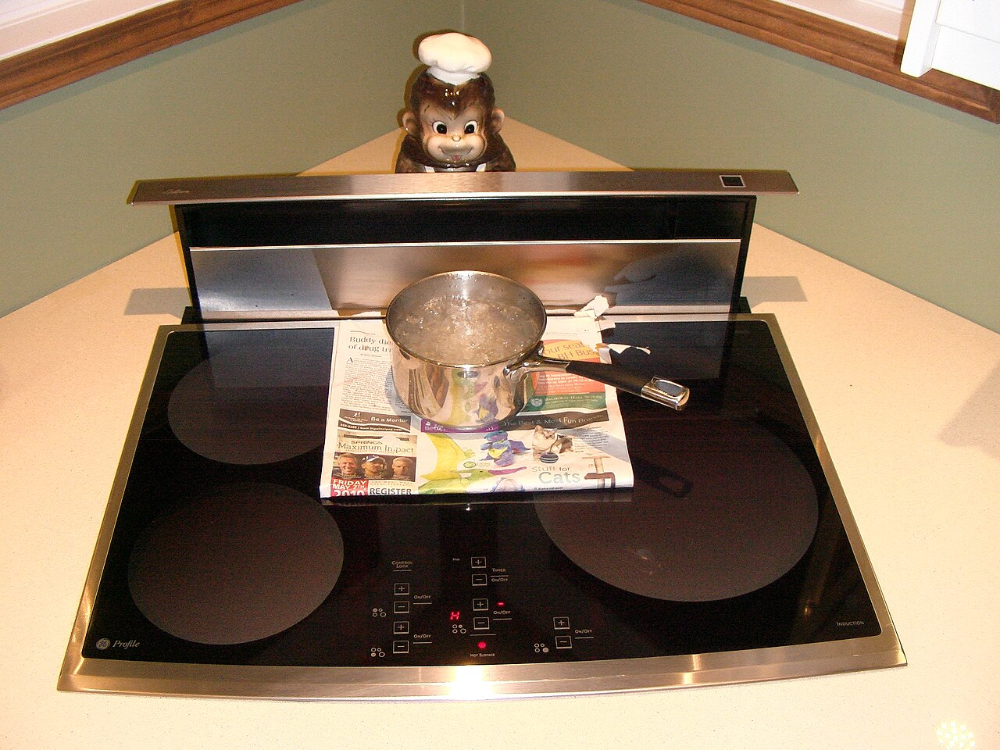
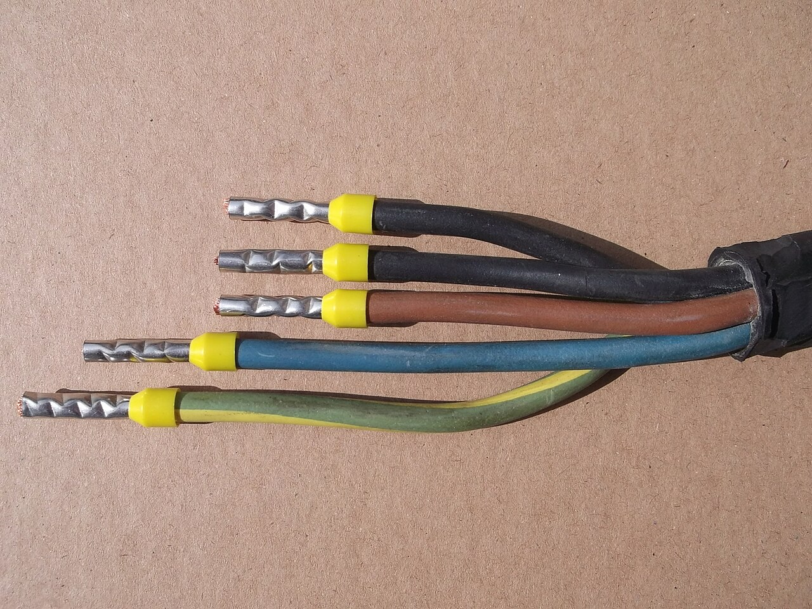
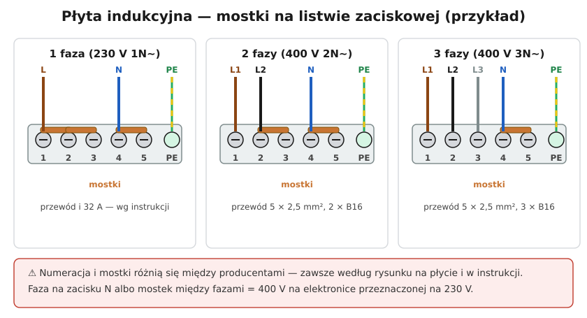

# 19.04 — Podłączenie płyty indukcyjnej

> **Moduł:** [19 — Prace krok po kroku](README.md) · **Oznaczenia:** 🏠 · **Zakres SEP:** (c) · **Status:** ✅ pełny
>
> **Czytaj:**
>
> - Obwód płyty: [16.06](../16-planowanie-obwodow/16.06-obwody-wydzielone-plyta-piekarnik-pralka.md)
> - Instrukcja montażu płyty — rozdział „Podłączenie elektryczne” (zawsze przed pracą)

[← poprzedni temat](19.03-montaz-lampy-i-oprawy.md) · [spis modułu](README.md) · [następny temat →](19.05-dodanie-nowego-obwodu-w-rozdzielnicy.md)

## Po co to jest

Płytę indukcyjną kupuje się zwykle z krótkim przewodem albo bez przewodu, a jej listwa zaciskowa ma mostki, które trzeba ustawić. Pomyłka może spalić elektronikę płyty (400 V tam, gdzie powinno być 230 V) albo przegrzać przewód. To praca, którą bardzo często wykonuje się w domu po remoncie kuchni — i często z błędami.

## Po ludzku

**Płyta indukcyjna** ma w środku zwykle dwa (czasem więcej) niezależne moduły grzewcze, każdy na 230 V. Listwa zaciskowa ma kilka zacisków fazowych, zaciski N i PE. **Mostki** (blaszki) łączą zaciski w zależności od tego, ile faz doprowadzasz:

- **3 fazy (400 V 3N~)** — fazy rozdziela się na moduły; mostek na zaciskach N;
- **2 fazy (400 V 2N~)** — dwie fazy, mostek między częścią zacisków fazowych i na N;
- **1 faza (230 V 1N~)** — wszystkie zaciski fazowe zmostkowane; prąd przy pełnej mocy ok. 30 A — wymaga **większego przekroju i zabezpieczenia** albo ograniczenia mocy w płycie.

**Układ mostków różni się między producentami.** Rysunek jest na płycie (przy listwie) i w instrukcji — tylko on się liczy.

**Co przygotować:**

- obwód: przewód **5 × 2,5 mm²** do puszki pod blatem, **3 × B16** (lub wg instrukcji) za RCD ([16.06](../16-planowanie-obwodow/16.06-obwody-wydzielone-plyta-piekarnik-pralka.md));
- przewód przyłączeniowy płyty: zwykle **H05VV-F 5G2,5** lub ten dołączony przez producenta, odpowiedniej długości, żeby płytę dało się wyjąć z blatu;
- tulejki na końcówki linki ([19.07](19.07-zakanczanie-przewodow-tulejki-zaciski-momenty.md));
- złączki w puszce pod blatem (albo gniazdo i wtyczka siłowa, jeśli producent dopuszcza).

## Jak to wygląda

*Na co patrzeć: płyta leży w wycięciu blatu i ma wentylator, który zasysa powietrze od spodu. Producent podaje odstępy od szuflady czy piekarnika pod spodem — bez nich płyta się przegrzewa i wyłącza.*

*Na co patrzeć: przewód pięciożyłowy z linkami — każda żyła w tulejce, zaciśniętej zaciskarką. Tak przygotowane końcówki wkłada się do zacisków listwy płyty.*

## Schemat

## Pojęcia

| Pojęcie | Po ludzku | Termin normowy / symbol |
|---------|-----------|-------------------------|
| Listwa zaciskowa | Zaciski z tyłu płyty | — |
| Mostek | Blaszka łącząca dwa zaciski | zwora |
| 400 V 3N~ | Trzy fazy i N | oznaczenie zasilania |
| 230 V 1N~ | Jedna faza i N | jw. |

## Liczby do zapamiętania

| Wielkość | Wartość | Kiedy obowiązuje | Źródło |
|----------|---------|------------------|--------|
| Obwód płyty | **5 × 2,5 mm²**, **3 × B16** | typowa płyta 7–7,5 kW, 3 fazy | instrukcje producentów |
| Prąd przy 1 fazie | ok. **30–32 A** | 7–7,4 kW na 230 V | $I = P/U$ |
| Przewód przyłączeniowy | np. **H05VV-F 5G2,5** | wg instrukcji | jw. |
| Mostki | wg rysunku **na płycie** | zawsze | jw. |

## W praktyce

1. **Przeczytaj instrukcję** — rozdział o podłączeniu: wariant zasilania, mostki, przekrój, zabezpieczenie.
2. **Wyłącz obwód płyty (3 × B16)** w rozdzielnicy, zabezpiecz, **sprawdź brak napięcia** w puszce między wszystkimi żyłami (L1–L2, L2–L3, L1–L3, każda L–N, L–PE).
3. **Ustaw mostki** na listwie płyty zgodnie z rysunkiem dla Twojego wariantu.
4. **Podłącz przewód do płyty**: PE, N, fazy. Tulejki na linkach, dokręć, zamknij pokrywę listwy i zaciśnij odciążkę przewodu.
5. **Połącz przewód płyty z instalacją** w puszce: kolory do kolorów, faza do fazy (L1 brązowa, L2 czarna, L3 szara), N, PE.
6. **Włóż płytę do blatu**, zostaw zapas przewodu.
7. **Załącz** i sprawdź każde pole grzewcze (płyta przy włączaniu robi autotest).
8. Przy nowym obwodzie — **pomiary** (izolacja, pętla, RCD) przez elektryka ([19.05](19.05-dodanie-nowego-obwodu-w-rozdzielnicy.md)).

## Błędy i zagrożenia

- ⚠️ **Faza na zacisku N** albo mostek łączący dwie fazy — 400 V na module 230 V: spalona elektronika, możliwy pożar.
- ⚠️ **Płyta na jednej fazie przez 3 × 2,5 mm² i B16 „podniesione” do B32** — przegrzany przewód.
- **Linka bez tulejek** w zaciskach listwy — luzowanie, grzanie przy kilkunastu amperach przez godzinę.
- **Brak przerwy wentylacyjnej** pod płytą — płyta się wyłącza albo psuje.
- **Przewód płyty za krótki** — nie da się wyjąć płyty bez rozłączania na ślepo.

## Przykład

**Zadanie.** Na tabliczce płyty: „400 V 2N~ 50 Hz, 7,4 kW”. W kuchni jest obwód 5 × 2,5 mm² z 3 × B16. Jak podłączyć?

**Rozwiązanie.** Płyta przewiduje **dwie fazy** (2N~). Z pięciożyłowego przewodu wykorzystujesz **L1, L2, N, PE**; trzecią fazę (szarą) zaizoluj w puszce. Mostki — wg rysunku dla 2N~. Prąd: $7400 / (2 \cdot 230) \approx 16$ A na fazę — przy pełnej mocy B16 jest na granicy, ale płyty mają zarządzanie mocą, które to uwzględnia; wartości zabezpieczeń podaje instrukcja. Wyłącznik trójfazowy B16 może zostać — trzecia faza będzie po prostu nieobciążona.

## Pytania SEP

1. **Jak podłączyć kuchenną płytę indukcyjną do instalacji trójfazowej?**

Odpowiedź

Po wyłączeniu obwodu i sprawdzeniu braku napięcia ustawia się mostki na listwie zaciskowej płyty zgodnie z rysunkiem producenta dla zasilania 400 V 3N~, podłącza przewód przyłączeniowy (typowo 5 × 2,5 mm²): fazy L1, L2, L3, przewód N i przewód PE do odpowiednich zacisków, zabezpiecza przewód odciążką i zamyka osłonę listwy. Przewód łączy się z instalacją w puszce przyłączeniowej. Obwód zabezpiecza się wyłącznikiem 3 × B16 (wg instrukcji) i obejmuje ochroną różnicowoprądową. Po podłączeniu sprawdza się działanie i wykonuje pomiary.

## Sprawdź się

1. Dlaczego przy płycie zasilanej jedną fazą nie wystarczy przewód 3 × 2,5 mm² i B16?

Odpowiedź

Bo przy pełnej mocy (ok. 7 kW) prąd wynosi ok. 30 A. B16 będzie działał przy gotowaniu na kilku polach, a zwiększenie zabezpieczenia do B32 przy przekroju 2,5 mm² przegrzeje przewód. Potrzebny jest większy przekrój i zabezpieczenie wg instrukcji albo ograniczenie mocy płyty w jej ustawieniach.

## Źródła

- Instrukcje montażu płyt indukcyjnych — rozdział „Podłączenie elektryczne” (np. Amica, Bosch, Electrolux).
- PN-HD 60364-4-43 — dobór zabezpieczenia do przewodu.

---

[← poprzedni temat](19.03-montaz-lampy-i-oprawy.md) · [spis modułu](README.md) · [następny temat →](19.05-dodanie-nowego-obwodu-w-rozdzielnicy.md)
