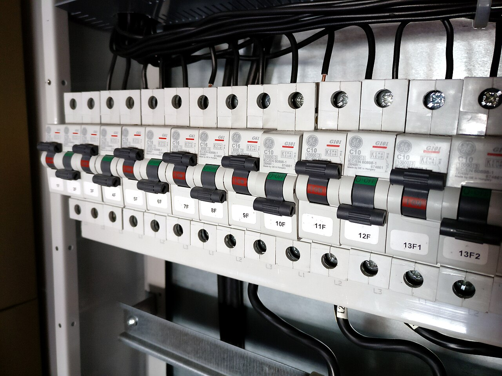
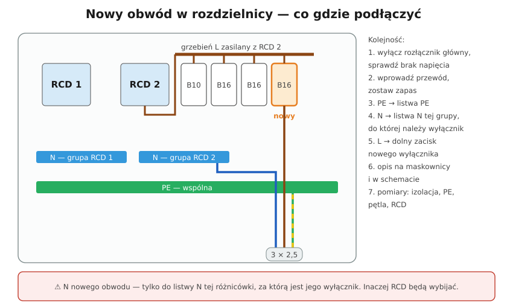

# 19.05 — Dodanie nowego obwodu w rozdzielnicy

> **Moduł:** [19 — Prace krok po kroku](README.md) · **Oznaczenia:** 🏠 · **Zakres SEP:** (c) · **Status:** ✅ pełny
>
> **Czytaj:**
>
> - Rozdzielnica i listwy N: [15.01](../15-rozdzielnica-mieszkaniowa/15.01-budowa-rozdzielnicy-obudowa-szyna-th35-listwy-n.md), [15.07](../15-rozdzielnica-mieszkaniowa/15.07-montaz-i-porzadek-przewodow-w-rozdzielnicy.md), [08.07](../08-wylaczniki-roznicowopradowe/08.07-podzial-obwodow-miedzy-wylaczniki.md)
> - Pomiary po zmianie instalacji: [moduł 23](../23-pomiary-odbiorcze-i-okresowe/README.md)

[← poprzedni temat](19.04-podlaczenie-plyty-indukcyjnej.md) · [spis modułu](README.md) · [następny temat →](19.06-bruzdy-puszki-i-prowadzenie-przewodow-w-scianie.md)

## Po co to jest

Nowy obwód to klasyczna praca przy remoncie: kuchnia, klimatyzacja, wallbox, warsztat. To już **zmiana instalacji**, nie naprawa — po jej wykonaniu potrzebne są pomiary ([00.03](../00-bezpieczenstwo-najpierw/00.03-co-wolno-zrobic-samemu-a-co-wymaga-uprawnien-i.md)). Ten temat pokazuje, co dzieje się w rozdzielnicy i gdzie najłatwiej o błąd.

## Po ludzku

**Zanim otworzysz rozdzielnicę:**

1. **Projekt obwodu** — moc, przekrój, zabezpieczenie, RCD, trasa ([16.02](../16-planowanie-obwodow/16.02-dobor-przekroju-i-zabezpieczenia-procedura-krok.md)).
2. **Miejsce w rozdzielnicy** — wolny moduł na wyłącznik (albo RCBO), wolny zacisk na listwie N właściwej grupy i na listwie PE.
3. **Moc przyłączeniowa** — czy nowy odbiornik (np. wallbox) zmieści się w mocy umownej ([14.05](../14-od-slupa-do-gniazdka/14.05-moc-przylaczeniowa-i-taryfy.md)).

**Uwaga na napięcie w rozdzielnicy.** Wyłączenie rozłącznika głównego odcina aparaty **za nim**. **Zaciski wejściowe rozłącznika i przewody WLZ dalej są pod napięciem** (zasila je licznik). Pracujesz w ich pobliżu — osłony zostają na miejscu, narzędzia izolowane.

**Najważniejsza zasada:** przewód N nowego obwodu idzie na **listwę N tej różnicówki, za którą stoi jego wyłącznik**. N na innej listwie = RCD wybijają ([08.07](../08-wylaczniki-roznicowopradowe/08.07-podzial-obwodow-miedzy-wylaczniki.md)). Przy RCBO — N obwodu przez zacisk N RCBO.

**Kolejność w rozdzielnicy:** PE → listwa PE, N → listwa N grupy, L → wyłącznik. Zasilanie wyłącznika — grzebień, nie „mostki z drutu” ([15.07](../15-rozdzielnica-mieszkaniowa/15.07-montaz-i-porzadek-przewodow-w-rozdzielnicy.md)).

**Po podłączeniu:** opis obwodu na maskownicy i w schemacie ([15.03](../15-rozdzielnica-mieszkaniowa/15.03-oznaczanie-obwodow-i-opis-rozdzielnicy.md)), pomiary: ciągłość PE, rezystancja izolacji, impedancja pętli, działanie RCD ([moduł 23](../23-pomiary-odbiorcze-i-okresowe/README.md)).

## Jak to wygląda

*Na co patrzeć: listwy N i PE są zapełnione — przed dodaniem obwodu sprawdź, czy na listwie N właściwej grupy jest wolny zacisk. Jeden zacisk = jeden przewód.*

*Na co patrzeć: każdy wyłącznik ma opis obwodu. Nowy wyłącznik dostawia się obok istniejących w tej samej grupie RCD i od razu opisuje — sprawdź też, czy grzebień ma wolny ząb.*

## Schemat

## Pojęcia

| Pojęcie | Po ludzku | Termin normowy / symbol |
|---------|-----------|-------------------------|
| Grupa RCD | Wyłączniki za jedną różnicówką | — |
| Listwa N grupy | Zaciski N przewodów jednej grupy | — |
| Zmiana instalacji | Dodanie lub przebudowa obwodu | wymaga sprawdzenia (PN-HD 60364-6) |
| Protokół z pomiarów | Dokument z wynikami badań | [23.08](../23-pomiary-odbiorcze-i-okresowe/23.08-protokol-z-pomiarow-i-terminy-badan-okresowych.md) |

## Liczby do zapamiętania

| Wielkość | Wartość | Kiedy obowiązuje | Źródło |
|----------|---------|------------------|--------|
| Kolejność podłączania | **PE → N → L** | rozdzielnica | praktyka |
| N nowego obwodu | listwa N **tej samej** grupy RCD | zawsze | [08.07](../08-wylaczniki-roznicowopradowe/08.07-podzial-obwodow-miedzy-wylaczniki.md) |
| Pod napięciem mimo wyłączenia rozłącznika | **zaciski wejściowe rozłącznika i WLZ** | zawsze | — |
| Po zmianie instalacji | **pomiary** przed oddaniem do użytku | nowy obwód | PN-HD 60364-6 |
| Rezystancja izolacji | ≥ **1 MΩ** przy 500 V DC | obwody do 500 V | PN-HD 60364-6, tab. 6.1 |

## W praktyce

1. Wyłącz **rozłącznik główny**, zabezpiecz, sprawdź brak napięcia na aparatach i listwach (pamiętaj o zaciskach wejściowych).
2. Zdejmij maskownicę, wprowadź przewód przez przepust, ułóż go wzdłuż innych, **z zapasem**.
3. Załóż wyłącznik (lub RCBO) na szynę, sprawdź grzebień.
4. Podłącz: PE → listwa PE, N → listwa N grupy, L → zacisk wyłącznika. Dokręć momentem z instrukcji ([19.07](19.07-zakanczanie-przewodow-tulejki-zaciski-momenty.md)).
5. Opisz obwód, wytnij otwór w maskownicy, załóż maskownicę.
6. Załącz: rozłącznik → RCD → nowy wyłącznik. Naciśnij TEST.
7. **Pomiary** i wpis do dokumentacji.

## Błędy i zagrożenia

- ⚠️ **Praca w rozdzielnicy „bo rozłącznik wyłączony”** bez pamiętania o zaciskach wejściowych pod napięciem.
- ⚠️ **N do złej listwy** (albo do listwy PE) — wybijająca różnicówka albo różnicówka, która nie zadziała, gdy trzeba.
- **Dwa przewody pod jednym zaciskiem** wyłącznika lub listwy, gdy producent tego nie przewiduje.
- **Brak opisu** — za rok nikt nie wie, co zasila nowy B16.
- **Nowy obwód bez pomiarów** — nie wiadomo, czy ochrona przeciwporażeniowa działa.

## Przykład

**Zadanie.** Chcesz dodać obwód klimatyzatora 1,2 kW (B16, 3 × 2,5 mm²). W rozdzielnicy są: RCD 1 (oświetlenie, gniazda pokoi), RCD 2 (kuchnia, łazienka), jedno wolne miejsce w rzędzie z RCD 2. Listwa N grupy RCD 2 ma jeden wolny zacisk. Gdzie podłączyć?

**Rozwiązanie.** Wyłącznik w wolnym miejscu rzędu RCD 2, zasilany z grzebienia za RCD 2. N → **wolny zacisk listwy N grupy RCD 2**. PE → listwa PE. Sprawdź jeszcze, czy RCD 2 nie ma już zbyt wielu obwodów z prądami upływu (klimatyzator z falownikiem ma swój upływ) — alternatywą jest RCBO dla klimatyzatora z N na jego zacisku ([08.04](../08-wylaczniki-roznicowopradowe/08.04-rcbo-wylacznik-nadpradowy-z-czlonem.md)).

## Pytania SEP

1. **Jakie czynności należy wykonać po dołączeniu nowego obwodu do istniejącej rozdzielnicy?**

Odpowiedź

Sprawdzić poprawność połączeń (N do listwy grupy RCD, PE do listwy PE, momenty dokręcenia), opisać obwód w rozdzielnicy i w dokumentacji (schemat), a przed oddaniem do użytku wykonać sprawdzenie odbiorcze zgodnie z PN-HD 60364-6: oględziny, ciągłość przewodów ochronnych, rezystancję izolacji, skuteczność samoczynnego wyłączenia (impedancja pętli zwarcia), badanie wyłącznika różnicowoprądowego. Wyniki zapisać w protokole.

## Sprawdź się

1. Wyłączyłeś rozłącznik główny w rozdzielnicy mieszkaniowej. Które elementy w rozdzielnicy nadal mogą być pod napięciem?

Odpowiedź

Zaciski wejściowe rozłącznika i przewody zasilające rozdzielnicę (WLZ), a czasem także obwody zasilane przed rozłącznikiem (np. ogranicznik przepięć podłączony przed nim, obwody innego zasilania, fotowoltaika). Dlatego sprawdza się brak napięcia na wszystkim, przy czym się pracuje.

## Źródła

- PN-HD 60364-6 — sprawdzanie (odbiorcze i okresowe).
- PN-EN 61439-3 — rozdzielnice do obsługi przez osoby niewykwalifikowane.
- Instrukcje aparatów (momenty, przekroje).

---

[← poprzedni temat](19.04-podlaczenie-plyty-indukcyjnej.md) · [spis modułu](README.md) · [następny temat →](19.06-bruzdy-puszki-i-prowadzenie-przewodow-w-scianie.md)
