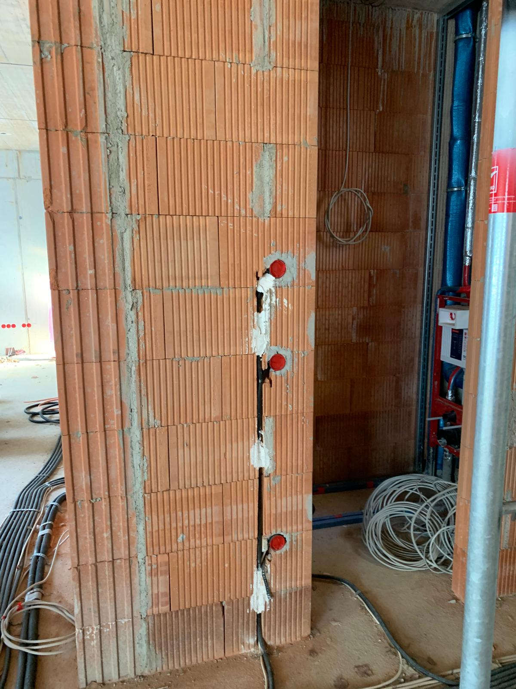
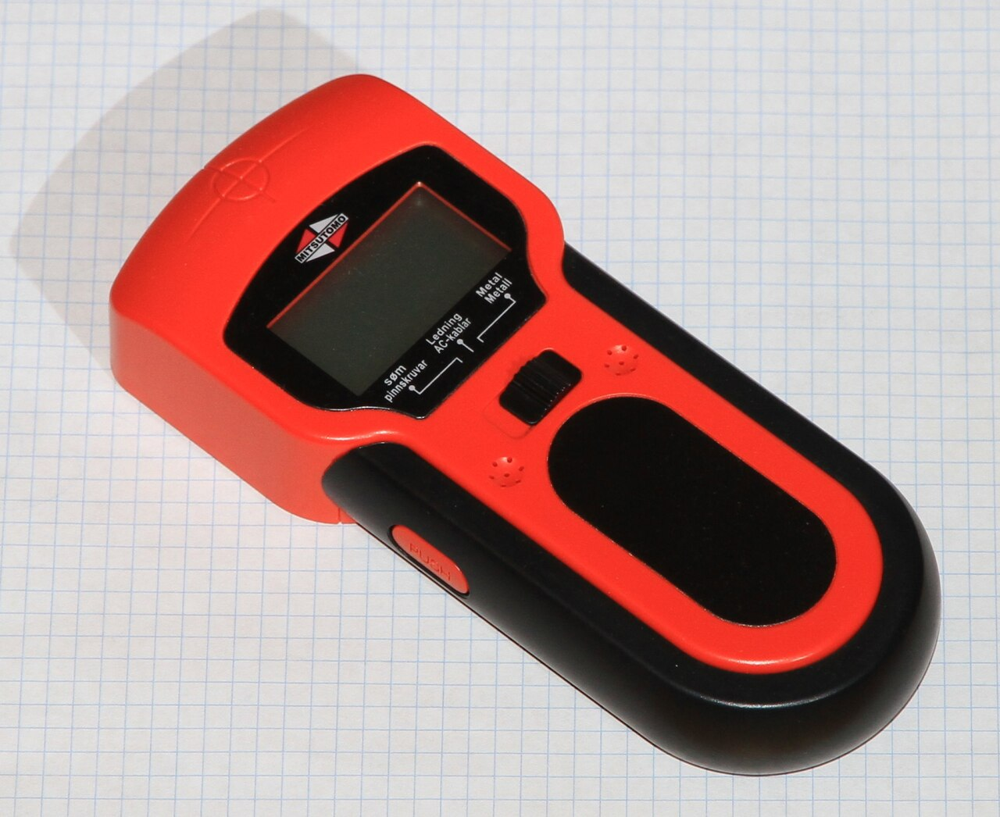
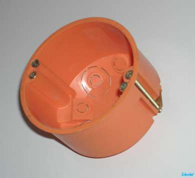
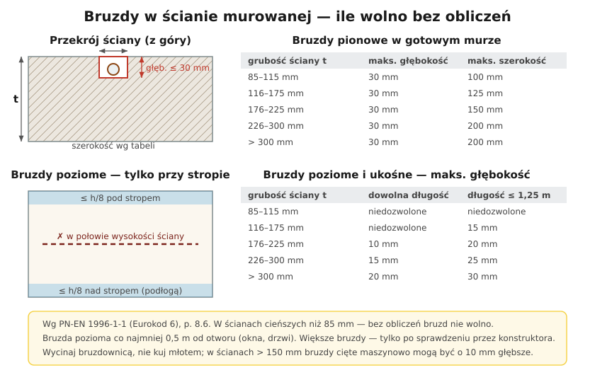

# 19.06 — Bruzdy, puszki i prowadzenie przewodów w ścianie

> **Moduł:** [19 — Prace krok po kroku](README.md) · **Oznaczenia:** 🏠 · **Zakres SEP:** (c) · **Status:** ✅ pełny
>
> **Czytaj:**
>
> - PN-EN 1996-1-1 (Eurokod 6), p. 8.6 — bruzdy i wnęki; [Inżynier Budownictwa — bruzdy i wnęki](https://inzynierbudownictwa.pl/?p=9815)
> - Strefy instalacyjne: [16.04](../16-planowanie-obwodow/16.04-strefy-instalacyjne-i-trasy-przewodow.md); puszki: [06.03](../06-osprzet-instalacyjny/06.03-puszki-instalacyjne-i-rozgalezne.md)

[← poprzedni temat](19.05-dodanie-nowego-obwodu-w-rozdzielnicy.md) · [spis modułu](README.md) · [następny temat →](19.07-zakanczanie-przewodow-tulejki-zaciski-momenty.md)

## Po co to jest

Bruzda to rowek w ścianie, w który kładzie się przewód. Wykonana źle osłabia ścianę, a przewód w niej może trafić pod wiertło. Przy remoncie to najwięcej pracy fizycznej i najwięcej kurzu. Trzeba wiedzieć, jak głęboko wolno ciąć, gdzie, i jak osadzić puszki, żeby osprzęt potem równo przylegał.

## Po ludzku

**Gdzie** — tylko w strefach instalacyjnych ([16.04](../16-planowanie-obwodow/16.04-strefy-instalacyjne-i-trasy-przewodow.md)): poziomo przy suficie, pionowo do osprzętu.

**Jak głęboko** — Eurokod 6 podaje, jakie bruzdy w murze wolno wykonać **bez obliczeń** konstruktora:

- **pionowe** w gotowym murze — głębokość do **30 mm**, szerokość od 100 do 200 mm (zależnie od grubości ściany);
- **poziome i ukośne** — dużo płytsze: w ścianach do 115 mm **nie wolno wcale**, w grubszych 10–30 mm; tylko w pasie **1/8 wysokości ściany** przy stropie lub podłodze; co najmniej **0,5 m** od otworów okiennych i drzwiowych.

Przewód YDYp 3 × 1,5 ma ok. 5 × 10 mm — bruzda 20–25 mm głębokości w zupełności wystarcza. Peszel 16–20 mm wymaga ok. 25–30 mm.

**Czym** — **bruzdownica** (dwie tarcze tnące + dłuto do wybicia środka) z odkurzaczem przemysłowym. W betonie komórkowym — ręczny rylec. Kucie młotem i przecinakiem w pustakach z drążeniami rozbija ściankę pustaka i robi dziurę.

**Przed cięciem:**

- wykryj istniejące instalacje (przewody, rury) wykrywaczem i z planu,
- wyłącz obwody, które mogą biec w tej ścianie,
- zaznacz trasy poziomicą lub laserem.

**Puszki** — otwór koronką, puszka osadzona na gips lub zaprawę, **licem z powierzchnią gotowej ściany** (po tynku i gładzi). Za głęboko — osprzęt się nie przykręci; za płytko — ramka odstaje. W ścianach g-k — puszki do płyt z łapkami ([06.03](../06-osprzet-instalacyjny/06.03-puszki-instalacyjne-i-rozgalezne.md)).

**Przewód w bruździe** — mocowany punktowo gipsem lub klipsami, bez naprężenia, z zapasem w puszkach. Rurka osłonowa (peszel) pozwala go kiedyś wymienić.

## Jak to wygląda

*Na co patrzeć: bruzda jest pionowa, wąska i biegnie dokładnie między puszkami. Przewód leży w bruździe bez pętli, a puszki są w jednej linii — po tynku nikt nie zgadnie, że tam są, ale każdy elektryk wie, gdzie szukać.*

*Na co patrzeć: wykrywacz pokazuje przewody pod napięciem (pole elektryczne) i metal. Przewód bez napięcia albo głęboko w ścianie może przeoczyć — traktuj go jako pomoc, nie gwarancję.*

*Na co patrzeć: puszka do płyt g-k trzyma się na łapkach rozpieranych śrubami. W ścianie murowanej używa się puszek bez łapek, osadzanych na gips.*

## Schemat

## Pojęcia

| Pojęcie | Po ludzku | Termin normowy / symbol |
|---------|-----------|-------------------------|
| Bruzda | Rowek w ścianie na przewód | bruzda (PN-EN 1996-1-1) |
| Wnęka | Większe zagłębienie, np. na rozdzielnicę | wnęka |
| Bruzdownica | Elektronarzędzie z dwiema tarczami do cięcia bruzd | frezarka do bruzd |
| Koronka | Otwornica do otworów pod puszki | — |
| Peszel | Karbowana rurka osłonowa | rura instalacyjna giętka |

## Liczby do zapamiętania

| Wielkość | Wartość | Kiedy obowiązuje | Źródło |
|----------|---------|------------------|--------|
| Bruzda pionowa | głęb. ≤ **30 mm**; szer. **100–200 mm** wg grubości ściany | gotowy mur, bez obliczeń | PN-EN 1996-1-1, tab. 8.2; [IB](https://inzynierbudownictwa.pl/?p=9815) |
| Bruzda pozioma | ściana ≤ 115 mm: **niedozwolona**; 116–175 mm: **15 mm** (do 1,25 m); 176–225 mm: **10/20 mm** | bez obliczeń | PN-EN 1996-1-1, tab. 8.3 |
| Położenie bruzd poziomych | w pasie **1/8 wysokości ściany** przy stropie | — | jw., p. 8.6.3 |
| Odstęp od otworu | ≥ **0,5 m** (bruzda pozioma) | — | jw. |
| Ściana < 85 mm | bez obliczeń bruzd **nie wolno** | — | jw. |

## W praktyce

- **Ściany nośne i cienkie działowe** — przy większych bruzdach konsultuj konstruktora; w ścianach z cegły kratówki i pustaków z drążeniami tnij tylko tarczą.
- **Kurz** — bruzdownica bez odkurzacza zasypuje całe mieszkanie pyłem krzemionkowym; maska przeciwpyłowa (co najmniej FFP2) i okulary.
- **Kolejność**: trasy → bruzdy → puszki → przewody → zdjęcia ścian z miarką → tynk/gładź.
- **Bruzdy w posadzce** — w warstwie wylewki, przewody w peszlach; przed wylaniem zdjęcia.
- **Gładzie i malowanie** — zabezpiecz puszki, żeby nie zalał ich gips; potem łatwiej montować osprzęt.

## Błędy i zagrożenia

- ⚠️ **Cięcie bruzdy przez istniejący przewód pod napięciem** — porażenie przez tarczę i korpus narzędzia; zawsze najpierw wykrywacz i wyłączenie obwodów.
- ⚠️ **Długa pozioma bruzda w połowie wysokości cienkiej ściany** — osłabienie konstrukcji, pęknięcia.
- **Puszki za głęboko** — osprzęt trzyma się na łapkach w powietrzu, ramka się rusza.
- **Przewód napięty w bruździe** — pęka przy osiadaniu tynku.
- **Kucie młotem pustaków** — wyrwy, które trzeba potem uzupełniać zaprawą.

## Przykład

**Zadanie.** Ściana działowa z cegły pełnej, grubość 12 cm (120 mm), wysokość 2,6 m. Chcesz poprowadzić przewód poziomo 1,2 m nad podłogą od gniazda do gniazda (2 m). Czy możesz?

**Rozwiązanie.** Grubość 120 mm mieści się w przedziale 116–175 mm: bruzdy poziome są dopuszczalne tylko **do 1,25 m długości** i **15 mm** głębokości, i tylko w pasie **1/8 wysokości** przy stropie lub podłodze ($2{,}6 / 8 \approx 0{,}33$ m). Wysokość 1,2 m to środek ściany, a bruzda ma 2 m — **nie wolno** bez obliczeń. Rozwiązanie: przewód poziomo w pasie przy suficie (albo przy podłodze, do 33 cm), a do gniazd pionowo w dół.

## Pytania SEP

1. **Jakie zasady obowiązują przy wykonywaniu bruzd na przewody w ścianach murowanych?**

Odpowiedź

Bruzdy prowadzi się w strefach instalacyjnych, w liniach pionowych i poziomych. Ich wymiary nie mogą przekraczać wartości dopuszczonych bez obliczeń statycznych wg PN-EN 1996-1-1: bruzdy pionowe w gotowym murze do 30 mm głębokości i szerokości zależnej od grubości ściany; bruzdy poziome są płytsze, w cienkich ścianach niedozwolone, i umieszcza się je w pasie 1/8 wysokości ściany przy stropie, w odległości co najmniej 0,5 m od otworów. Bruzdy wycina się mechanicznie (bruzdownicą), a przed ich wykonaniem lokalizuje istniejące instalacje.

## Sprawdź się

1. W tabeli bruzd poziomych znajdź, od jakiej grubości ściany wolno wykonać bruzdę poziomą dowolnej długości.

Odpowiedź

Od **176 mm** — wtedy do 10 mm głębokości (dowolna długość) albo 20 mm przy długości do 1,25 m. W cieńszych ścianach — tylko krótkie (116–175 mm) albo wcale (do 115 mm).

## Źródła

- PN-EN 1996-1-1+A1:2013 (Eurokod 6) — Projektowanie konstrukcji murowych, p. 8.6 — bruzdy i wnęki.
- Ł. Drobiec, [Wykonywanie bruzd i wnęk pod instalacje w murowanych ścianach — Inżynier Budownictwa](https://inzynierbudownictwa.pl/?p=9815).
- [Jak ukryć kable w ścianie: bezpieczne wymiary bruzd — Murator](https://muratordom.pl/budowa/sciany-murowane/jak-ukryc-kable-w-scianie-bezpieczne-wymiary-bruzd-aa-o2oR-mrNE-bKpc.html).

---

[← poprzedni temat](19.05-dodanie-nowego-obwodu-w-rozdzielnicy.md) · [spis modułu](README.md) · [następny temat →](19.07-zakanczanie-przewodow-tulejki-zaciski-momenty.md)
