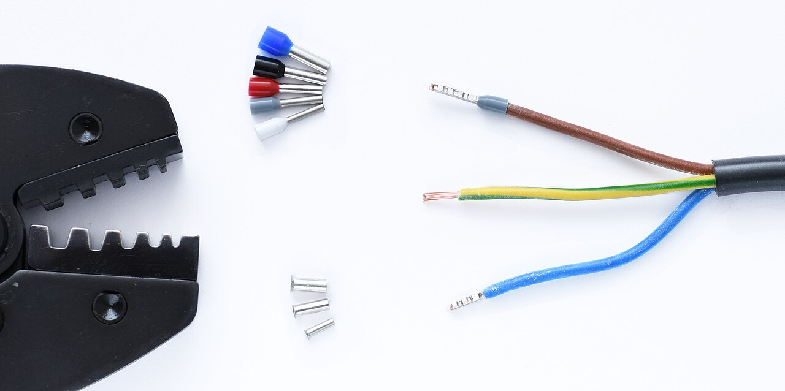
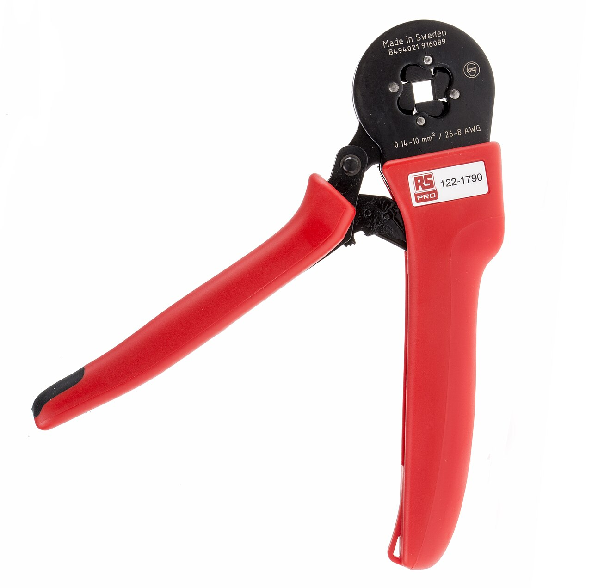
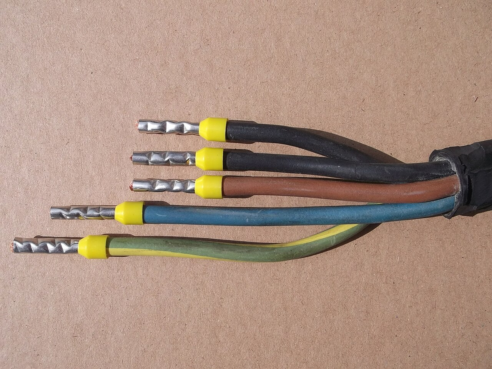
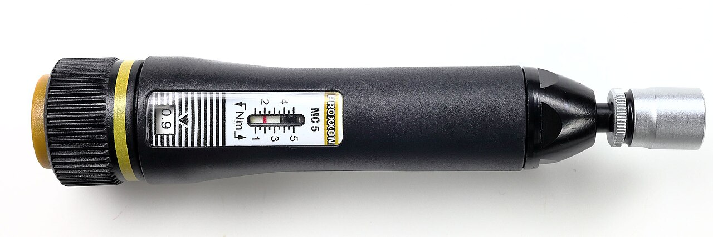
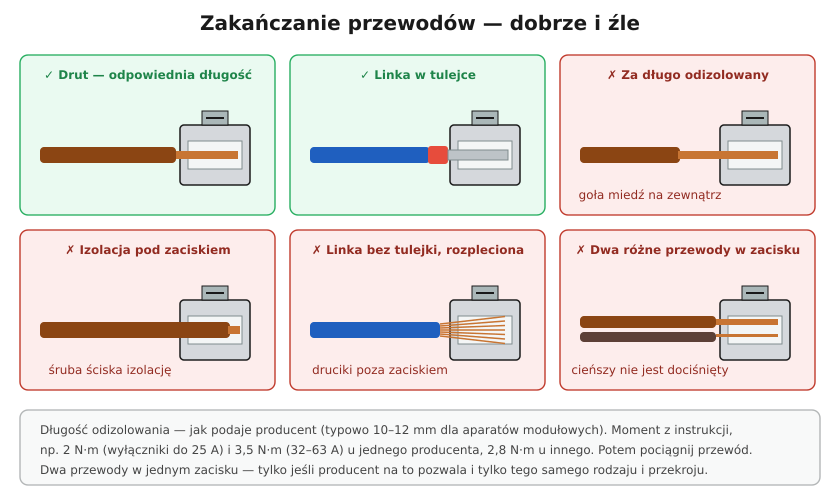

# 19.07 — Zakańczanie przewodów: tulejki, zaciski, momenty dokręcania

> **Moduł:** [19 — Prace krok po kroku](README.md) · **Oznaczenia:** 🏠 · **Zakres SEP:** (c) · **Status:** ✅ pełny
>
> **Czytaj:**
>
> - Złączki i połączenia: [06.04](../06-osprzet-instalacyjny/06.04-zlaczki-i-laczenie-przewodow-dlaczego-nie.md)
> - [Schneider Electric — momenty dokręcania wyłączników](https://www.se.com/pl/pl/faqs/FAQ000269417); [Hager — karta wyłącznika MBN520E](https://hager.com/pl/katalog/produkt/mbn520e-mcb-6ka-1p-n-b-20a)

[← poprzedni temat](19.06-bruzdy-puszki-i-prowadzenie-przewodow-w-scianie.md) · [spis modułu](README.md) · (koniec modułu) →

## Po co to jest

Większość pożarów od instalacji zaczyna się w połączeniu, nie w przewodzie: luźny zacisk, linka rozpleciona pod śrubą, izolacja pod zaciskiem. Takie połączenie działa latami, a potem się grzeje ([20.06](../20-diagnostyka-usterek/20.06-grzejace-sie-zaciski-i-zapach-spalenizny.md)). Porządne zakończenie przewodu to kilka sekund pracy i najtańsza ochrona przeciwpożarowa.

## Po ludzku

**Drut** (żyła jednodrutowa, YDY, H07V-U) — odizolowany na długość zacisku i wsunięty do końca. Nie zginaj w „oczko” pod zaciskiem płytkowym, jeśli zacisk tego nie wymaga.

**Linka** (żyła wielodrutowa, H07V-K, H05VV-F) — w zacisku śrubowym **zawsze w tulejce** (końcówce tulejkowej), zaciśniętej **zaciskarką**, nie kombinerkami. Bez tulejki druciki rozchodzą się pod śrubą, część nie jest dociśnięta, a z czasem linka „siada” i połączenie się luzuje. Niektóre zaciski sprężynowe przyjmują linkę bez tulejki — sprawdź oznaczenie zacisku.

**Długość odizolowania** — tyle, ile ma zacisk (zwykle 8–12 mm; na osprzęcie często jest wzornik). Za długo — goła miedź poza zaciskiem. Za krótko — śruba ściska izolację.

**Moment dokręcania** — producenci aparatów podają go w N·m:

- jeden producent: **2 N·m** dla wyłączników do 25 A, **3,5 N·m** dla 32–63 A,
- inny: **2,8 N·m** dla wyłącznika 20 A.

Za słabo — luźny zacisk, grzanie. Za mocno — uszkodzony zacisk, ścięta żyła. Przy pracy w rozdzielnicy warto mieć **wkrętak dynamometryczny**. Po dokręceniu — **pociągnij** każdą żyłę.

**Dwa przewody w jednym zacisku** — tylko jeśli producent na to pozwala, i tylko tego samego rodzaju i przekroju. Inaczej cieńszy nie jest dociśnięty. Do łączenia kilku żył — złączki ([06.04](../06-osprzet-instalacyjny/06.04-zlaczki-i-laczenie-przewodow-dlaczego-nie.md)) albo grzebień.

**Kolory tulejek** — zależą od systemu (DIN albo „francuski”); w systemie DIN np. 1,5 mm² — czarna, 2,5 mm² — niebieska, 6 mm² — żółta. Zawsze patrz na przekrój na opakowaniu.

## Jak to wygląda

*Na co patrzeć: tulejka izolowana ma plastikowy kołnierz w kolorze przekroju. Brązowa żyła ma już zaciśniętą tulejkę — druciki są w środku, nie wystają. Na dwóch pozostałych widać, jak rozchodzą się druciki linki bez tulejki.*

*Na co patrzeć: szczęka zaciska tulejkę z czterech stron w kwadrat. Taka tulejka dobrze trzyma się w zacisku śrubowym. Kombinerkami tulejkę tylko się spłaszcza.*

*Na co patrzeć: przy 6 mm² tulejki są żółte (system DIN). Wszystkie żyły mają tulejki tej samej długości, a izolacja kończy się dokładnie przy kołnierzu.*

*Na co patrzeć: na rękojeści ustawia się moment w N·m. Po jego osiągnięciu wkrętak „przeskakuje” — nie da się dokręcić mocniej. W rozdzielnicach to standard u starannych elektryków.*

## Schemat

## Pojęcia

| Pojęcie | Po ludzku | Termin normowy / symbol |
|---------|-----------|-------------------------|
| Tulejka | Metalowa rurka zaciskana na lince | końcówka tulejkowa (DIN 46228) |
| Zaciskarka | Szczypce do tulejek | — |
| Moment dokręcania | Siła dokręcenia śruby | N·m |
| Wkrętak dynamometryczny | Wkrętak z nastawą momentu | — |
| Drut / linka | Żyła jedno- / wielodrutowa | klasa 1 / klasy 2, 5 (PN-EN 60228) |

## Liczby do zapamiętania

| Wielkość | Wartość | Kiedy obowiązuje | Źródło |
|----------|---------|------------------|--------|
| Długość odizolowania | zwykle **8–12 mm** (wg zacisku) | osprzęt, aparaty | instrukcje producentów |
| Moment — przykład 1 | **2 N·m** (0,5–25 A), **3,5 N·m** (32–63 A) | wyłączniki jednego producenta | [Schneider Electric](https://www.se.com/pl/pl/faqs/FAQ000269417) |
| Moment — przykład 2 | **2,8 N·m** | wyłącznik B20 innego producenta | [Hager](https://hager.com/pl/katalog/produkt/mbn520e-mcb-6ka-1p-n-b-20a) |
| Tulejki (DIN) | 1,5 mm² **czarna**, 2,5 mm² **niebieska**, 6 mm² **żółta** | system DIN | DIN 46228-4 |
| Przewodów w zacisku | **1**, chyba że producent pozwala na 2 tego samego przekroju | — | instrukcje |

## W praktyce

- **Ściągacz izolacji** z ogranicznikiem długości oszczędza czas i nie nacina żył.
- **Nacięta żyła** (od noża) — odetnij i odizoluj jeszcze raz: nacięcie to miejsce, gdzie drut pęknie.
- **Aluminium** — dokręcanie ponowne po czasie i złączki do Al ([21.02](../21-stare-instalacje/21.02-przewody-aluminiowe-zagrozenia-i-postepowanie.md)).
- **Przegląd rozdzielnicy** — przy okresowej kontroli sprawdza się dokręcenie zacisków (po wyłączeniu napięcia), a kamera termowizyjna pod obciążeniem pokazuje grzejące się miejsca ([22.06](../22-przyrzady-pomiarowe/22.06-kamera-termowizyjna-kiedy-sie-przydaje.md)).

## Błędy i zagrożenia

- ⚠️ **Linka bez tulejki w zacisku śrubowym** — z czasem luźna, grzeje się; przy dużym prądzie — pożar.
- ⚠️ **Cynowanie końcówki linki** przed włożeniem do zacisku śrubowego — cyna „płynie” pod naciskiem i połączenie się luzuje.
- **Za długo odizolowany przewód** — goła miedź obok innych zacisków.
- **Śruba dokręcona na izolacji** — połączenie przez kilka drucików, iskrzenie.
- **Dokręcanie „na czuja” z całej siły** — pęknięty zacisk aparatu.

## Przykład

**Zadanie.** Podłączasz przewód H05VV-F 3G2,5 (linka) do zacisku śrubowego wyłącznika B16. Co przygotować?

**Rozwiązanie.** Zdejmij powłokę, odizoluj żyły na długość tulejki (dla tulejki izolowanej 2,5 mm² z częścią metalową 10 mm — ok. 10 mm), nałóż tulejki **2,5 mm²** (w systemie DIN niebieskie), zaciśnij zaciskarką. Włóż do zacisku do oporu, dokręć momentem z instrukcji wyłącznika (np. 2 N·m), pociągnij przewód. PE i N — tak samo, do listew.

## Pytania SEP

1. **W jaki sposób należy przygotować i przyłączyć przewód wielodrutowy do zacisku śrubowego?**

Odpowiedź

Odizolować żyłę na długość odpowiadającą zaciskowi (lub tulejce), nie nacinając drutów, nałożyć końcówkę tulejkową o przekroju odpowiadającym żyle i zacisnąć ją narzędziem do tego przeznaczonym, wprowadzić do zacisku do oporu i dokręcić momentem podanym przez producenta aparatu, a następnie sprawdzić mechanicznie pewność połączenia. Nie wolno cynować końcówek linki przeznaczonych do zacisków śrubowych ani pozostawiać drutów poza zaciskiem.

## Sprawdź się

1. Na schemacie wskaż dwa błędy, które prowadzą do grzania zacisku, i jeden, który grozi porażeniem.

Odpowiedź

Grzanie: linka bez tulejki (część drucików niedociśnięta) i izolacja pod zaciskiem (mała powierzchnia styku); także dwa różne przewody w jednym zacisku. Porażenie / zwarcie: przewód odizolowany za długo — goła miedź poza zaciskiem, którą można dotknąć albo która może zetknąć się z sąsiednim zaciskiem.

## Źródła

- [Moment dokręcania zacisków wyłączników — Schneider Electric FAQ](https://www.se.com/pl/pl/faqs/FAQ000269417).
- [Karta wyłącznika MBN520E — Hager](https://hager.com/pl/katalog/produkt/mbn520e-mcb-6ka-1p-n-b-20a).
- DIN 46228 — końcówki tulejkowe; PN-EN 60999-1 — zaciski do przyłączania przewodów.

---

[← poprzedni temat](19.06-bruzdy-puszki-i-prowadzenie-przewodow-w-scianie.md) · [spis modułu](README.md) · (koniec modułu) →
