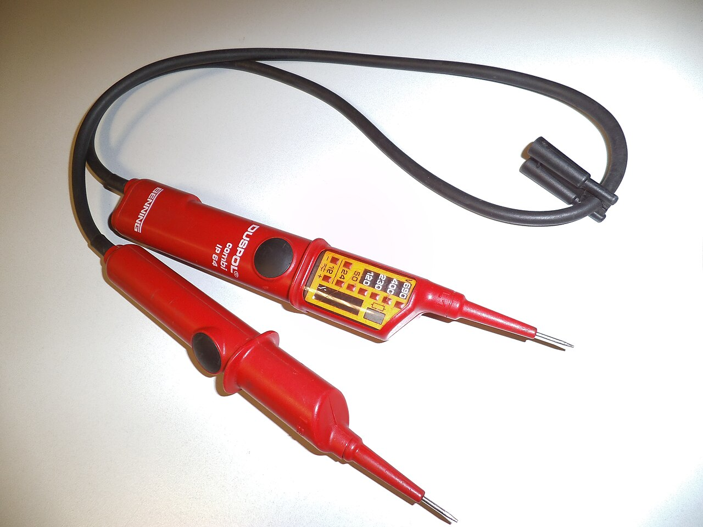
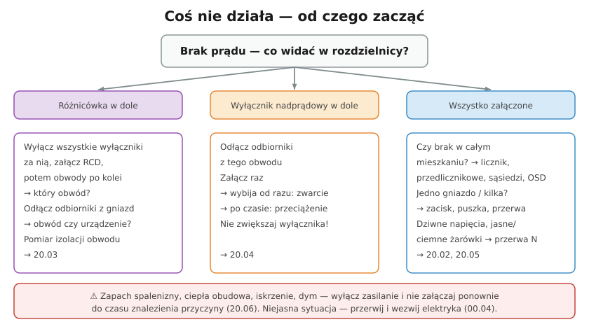

# 20.01 — Metoda szukania usterek

> **Moduł:** [20 — Diagnostyka usterek](README.md) · **Oznaczenia:** 🏠📋 · **Zakres SEP:** (c) (e) · **Status:** ✅ pełny
>
> **Czytaj:**
>
> - Czerwone flagi: [00.04](../00-bezpieczenstwo-najpierw/00.04-czerwone-flagi-kiedy-przerwac-prace-i-wezwac.md)
> - Przyrządy: [22.02](../22-przyrzady-pomiarowe/22.02-multimetr-co-i-jak-mierzy.md), [22.04](../22-przyrzady-pomiarowe/22.04-wskazniki-napiecia-i-probniki.md), [22.05](../22-przyrzady-pomiarowe/22.05-miernik-parametrow-instalacji-mpi-przeglad.md)

← (początek modułu) · [spis modułu](README.md) · [następny temat →](20.02-nie-dziala-gniazdo-albo-caly-obwod.md)

## Po co to jest

Usterki w instalacji rzadko są tajemnicze — zwykle to luźny zacisk, uszkodzony odbiornik, wilgoć albo przerwa w przewodzie. Kłopot w tym, że szuka się ich chaotycznie: odkręca losowe gniazda i podnosi wyłączniki „na próbę”. Metoda pozwala znaleźć usterkę szybciej i bezpieczniej. Komisja SEP w zakresie (e) pyta o postępowanie przy awarii.

## Po ludzku

**Pięć kroków szukania usterki:**

1. **Bezpieczeństwo.** Zapach spalenizny, dym, iskrzenie, ciepła obudowa, mokra instalacja → wyłącz zasilanie i nie załączaj, dopóki nie znasz przyczyny ([00.04](../00-bezpieczenstwo-najpierw/00.04-czerwone-flagi-kiedy-przerwac-prace-i-wezwac.md)).
2. **Wywiad.** Co dokładnie nie działa? Od kiedy? Po czym (burza, deszcz, nowe urządzenie, remont, wiercenie)? Zawsze, czy czasem? Ludzie wiedzą więcej, niż mówią — dopytaj.
3. **Oględziny.** Co jest wyłączone w rozdzielnicy? Ślady nadpalenia, stopione obudowy, wilgoć, świeże wiercenia w ścianie.
4. **Zawężanie.** Cała instalacja → rozdzielnica → obwód → odcinek obwodu → element. Odłączanie odbiorników, wyłączanie obwodów po kolei, **połowienie** łańcucha gniazd ([20.02](20.02-nie-dziala-gniazdo-albo-caly-obwod.md)).
5. **Potwierdzenie i naprawa.** Pomiar potwierdza przyczynę (napięcie, ciągłość, izolacja), naprawa usuwa przyczynę, a nie objaw. Po naprawie — sprawdzenie działania i ochrony.

**Zasada:** nigdy nie „naprawiaj” zabezpieczenia. Wyłącznik, który działa, ma powód. Większy wyłącznik, mostek na różnicówce, drut zamiast wkładki — to ukrywanie usterki, która potem kończy się pożarem lub porażeniem.

**Czym mierzyć:**

- **wskaźnik dwubiegunowy** — czy jest napięcie ([22.04](../22-przyrzady-pomiarowe/22.04-wskazniki-napiecia-i-probniki.md));
- **multimetr** — wartość napięcia, ciągłość przewodu (po wyłączeniu!) ([22.02](../22-przyrzady-pomiarowe/22.02-multimetr-co-i-jak-mierzy.md));
- **cęgi** — prąd w przewodzie, prąd upływu ([22.03](../22-przyrzady-pomiarowe/22.03-cegi-pradowe.md));
- **miernik izolacji / MPI** — rezystancja izolacji, pętla zwarcia, RCD ([22.05](../22-przyrzady-pomiarowe/22.05-miernik-parametrow-instalacji-mpi-przeglad.md));
- **kamera termowizyjna** — grzejące się zaciski ([22.06](../22-przyrzady-pomiarowe/22.06-kamera-termowizyjna-kiedy-sie-przydaje.md)).

Wkrętak z neonówką („próbnik jednobiegunowy”) pokazuje tylko, że coś „ma fazę” — nie nadaje się do sprawdzania braku napięcia.

## Jak to wygląda

*Na co patrzeć: podstawowe narzędzie diagnosty. Mierzy napięcie między dwoma punktami (L–N, L–PE, N–PE), więc pokaże też przerwę w N — czego jednobiegunowa neonówka nie potrafi.*

## Schemat

## Pojęcia

| Pojęcie | Po ludzku | Termin normowy / symbol |
|---------|-----------|-------------------------|
| Wywiad | Rozmowa o objawach i okolicznościach | — |
| Oględziny | Ocena wzrokowa bez pomiarów | [23.01](../23-pomiary-odbiorcze-i-okresowe/23.01-ogledziny-instalacji.md) |
| Połowienie | Sprawdzanie środka łańcucha i zawężanie | metoda bisekcji |
| Objaw a przyczyna | Wybijający wyłącznik to objaw, zwarcie — przyczyna | — |

## Liczby do zapamiętania

| Wielkość | Wartość | Kiedy obowiązuje | Źródło |
|----------|---------|------------------|--------|
| Kroki | bezpieczeństwo → wywiad → oględziny → zawężanie → pomiar i naprawa | każda usterka | praktyka |
| Połowienie | **n** gniazd → ok. **log₂ n** sprawdzeń (8 gniazd → 3) | łańcuch gniazd | — |
| Napięcie w gnieździe | **230 V ± 10 %** (207–253 V) | sieć nN | PN-EN 50160 |
| Ponowne załączenie po zadziałaniu | **raz**, po odłączeniu odbiorników | wyłącznik nadprądowy, RCD | [07.01](../07-zabezpieczenia-nadpradowe/07.01-przeciazenie-i-zwarcie-z-punktu-widzenia.md) |

## W praktyce

- **Zapisuj**, co sprawdziłeś i z jakim wynikiem — przy usterkach „co jakiś czas” to jedyny sposób na znalezienie wzoru.
- **Zmieniaj jedną rzecz naraz** — po każdej zmianie sprawdź efekt.
- **Usterki przerywane** (wybija raz w tygodniu) — szukaj korelacji: pogoda, pora dnia, konkretne urządzenie.
- **Nie zakładaj**, że instalacja jest zgodna z kolorami — w starych instalacjach każdą żyłę identyfikuj pomiarem ([05.03](../05-przewody-i-kable/05.03-kolory-zyl-i-ich-znaczenie.md)).

## Błędy i zagrożenia

- ⚠️ **Wielokrotne załączanie wyłącznika na zwarcie** — każde to łuk; uszkodzenie aparatu, ryzyko poparzenia przy rozdzielnicy.
- ⚠️ **Mostkowanie różnicówki „żeby działało”** — usuwa ochronę przed porażeniem.
- **Wymiana wyłącznika na większy** — przewód nie jest chroniony przed przeciążeniem.
- **Szukanie przerwy w N wkrętakiem z neonówką** — wskazuje „fazę” na N i myli.

## Przykład

**Zadanie.** Zgłoszenie: „W kuchni wybija prąd, zwykle rano”. Jak to rozpisać na kroki?

**Rozwiązanie.**

1. **Wywiad:** co wybija — różnicówka czy wyłącznik? „Rano” — czyli przy czajniku, ekspresie, tosterze naraz? Od kiedy — po zakupie nowego ekspresu?
2. **Oględziny rozdzielnicy:** w dole jest B16 gniazd kuchennych, RCD załączona → **przeciążenie** lub zwarcie w obwodzie, nie upływ.
3. **Zawężanie:** jeśli wybija po kilku minutach jednoczesnej pracy czajnika i ekspresu → przeciążenie (2,2 + 1,5 + 0,9 kW ≈ 20 A na B16). Jeśli od razu przy włączeniu jednego urządzenia → zwarcie w urządzeniu.
4. **Naprawa:** rozdzielenie urządzeń na dwa obwody ([17.02](../17-pomieszczenia-szczegolne/17.02-kuchnia.md)) albo — jeśli zwarcie — naprawa urządzenia. **Nie** wymiana B16 na B20.

## Pytania SEP

1. **Jak postępować przy lokalizacji uszkodzenia w instalacji elektrycznej?**

Odpowiedź

Najpierw zapewnić bezpieczeństwo (wyłączyć zasilanie przy objawach przegrzania, dymu, zawilgocenia). Zebrać informacje o objawach i okolicznościach, wykonać oględziny rozdzielnicy i instalacji. Zawężać obszar: ustalić zadziałane zabezpieczenie, obwód, odłączyć odbiorniki, wyłączać kolejne obwody lub odcinki. Potwierdzić przyczynę pomiarami (napięcie, ciągłość, rezystancja izolacji, impedancja pętli), usunąć przyczynę, a po naprawie sprawdzić działanie i skuteczność ochrony. Nie wolno zwiększać zabezpieczeń ani mostkować wyłączników różnicowoprądowych.

## Sprawdź się

1. Dlaczego wkrętak z neonówką nie wystarcza do diagnozowania instalacji?

Odpowiedź

Pokazuje tylko obecność potencjału względem ciała (przez pojemność), nie mierzy napięcia między przewodami. Świeci na N przy przerwie N, może nie świecić przy słabym kontakcie z ciałem i nie pokazuje braku napięcia w sposób pewny. Do diagnozy potrzebny jest wskaźnik dwubiegunowy lub multimetr.

## Źródła

- PN-HD 60364-6 — sprawdzanie instalacji.
- PN-EN 50160 — parametry napięcia w sieciach publicznych.
- Instrukcje przyrządów pomiarowych.

---

← (początek modułu) · [spis modułu](README.md) · [następny temat →](20.02-nie-dziala-gniazdo-albo-caly-obwod.md)
