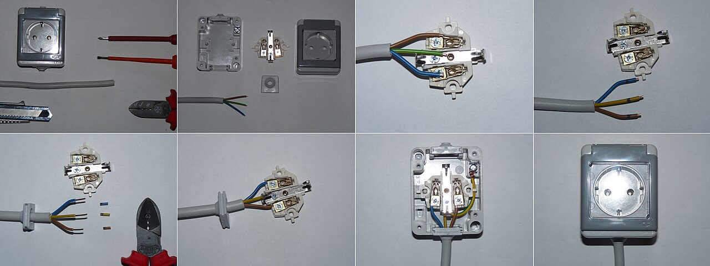
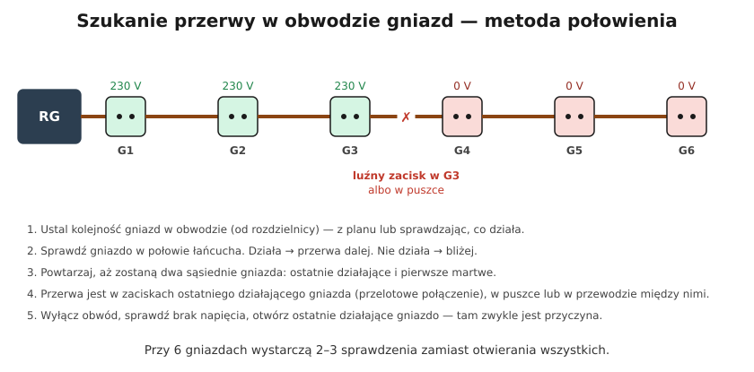

# 20.02 — Nie działa gniazdo albo cały obwód

> **Moduł:** [20 — Diagnostyka usterek](README.md) · **Oznaczenia:** 🏠📋 · **Zakres SEP:** (c) (e) · **Status:** ✅ pełny
>
> **Czytaj:**
>
> - Gniazda i przelot: [19.01](../19-prace-krok-po-kroku/19.01-wymiana-gniazda-wtyczkowego.md)
> - Przerwa w N: [20.05](20.05-przerwa-w-przewodzie-neutralnym.md)

[← poprzedni temat](20.01-metoda-szukania-usterek.md) · [spis modułu](README.md) · [następny temat →](20.03-wybija-wylacznik-roznicowopradowy.md)

## Po co to jest

„Nie działa gniazdo” to najczęstsze zgłoszenie. Przyczyną bywa zadziałane zabezpieczenie, ale bardzo często — luźny zacisk w poprzednim gnieździe łańcucha, przerwa w puszce albo w przewodzie N. Kilka pomiarów wskaźnikiem dwubiegunowym mówi, co się stało.

## Po ludzku

**Najpierw rozdzielnica.** Czy wszystkie wyłączniki i różnicówki są załączone? Jeśli coś jest w dole — to inna historia ([20.03](20.03-wybija-wylacznik-roznicowopradowy.md), [20.04](20.04-wybija-wylacznik-nadpradowy.md)).

**Potem trzy pomiary w martwym gnieździe** (wskaźnikiem dwubiegunowym):

| L–N | L–PE | N–PE | Co to znaczy |
|-----|------|------|--------------|
| 230 V | 230 V | 0 V | gniazdo ma napięcie — winne jest urządzenie albo jego przewód |
| 0 V | 0 V | 0 V | brak fazy: wyłącznik, przerwa L, luźny zacisk L w poprzednim gnieździe |
| 0 V | 230 V | 230 V* | **przerwa N** (faza „przechodzi” przez odbiorniki na N) |
| 230 V | 0 V | 230 V | **przerwa PE** albo zamienione N z PE — groźne, ochrona nie działa |

\* przy włączonych odbiornikach w obwodzie; bez nich N–PE może pokazać mniej.

**Najczęstsza przyczyna:** gniazda w obwodzie są połączone **przelotowo** — jedno za drugim. Luźny zacisk w jednym gnieździe odcina wszystkie dalsze. Martwe są gniazda „za” usterką, a przyczyna jest w **ostatnim działającym** gnieździe albo w puszce między nimi. Szukasz ją **połowieniem**.

## Jak to wygląda

*Na co patrzeć: przy gnieździe przelotowym pod każdym zaciskiem są dwie żyły. Jeśli jedna z nich jest luźna, gniazdo działa, a następne w łańcuchu — nie. Po otwarciu takiego gniazda szukaj przebarwień i luźnej żyły.*

## Schemat

## Pojęcia

| Pojęcie | Po ludzku | Termin normowy / symbol |
|---------|-----------|-------------------------|
| Przelot | Zasilanie gniazda przez zaciski poprzedniego | — |
| Połowienie | Sprawdzanie środka łańcucha | — |
| Przerwa | Brak ciągłości przewodu | — |
| Napięcie „pływające” | Napięcie na przewodzie bez połączenia | napięcie indukowane |

## Liczby do zapamiętania

| Wielkość | Wartość | Kiedy obowiązuje | Źródło |
|----------|---------|------------------|--------|
| L–N 0, L–PE 0 | **brak fazy** | martwe gniazdo | — |
| L–N 0, L–PE 230 V | **przerwa N** | jw. | — |
| L–N 230, L–PE 0 | **przerwa PE** — groźne | jw. | — |
| Połowienie | 6 gniazd → **2–3** sprawdzenia | — | — |

## W praktyce

1. Sprawdź rozdzielnicę.
2. Sprawdź martwe gniazdo (trzy pomiary) i **sąsiednie** gniazda — ustal, które działają.
3. Ustal kolejność gniazd w obwodzie (plan, intuicja: od rozdzielnicy, wzdłuż ściany).
4. **Połowienie**: sprawdzaj gniazda w środku łańcucha, aż znajdziesz granicę „działa / nie działa”.
5. **Wyłącz obwód**, sprawdź brak napięcia, otwórz **ostatnie działające** gniazdo. Szukaj luźnej żyły, przebarwień, pękniętego drutu (często aluminiowego).
6. Napraw (nowe zaciski, złączka, wymiana gniazda), przy przegrzaniu — odetnij uszkodzony fragment.
7. Sprawdź wszystkie gniazda obwodu.

## Błędy i zagrożenia

- ⚠️ **Przerwa PE niezauważona** — gniazdo „działa”, ale ochrona przeciwporażeniowa nie. Dlatego mierzy się też L–PE i N–PE.
- **Otwieranie martwego gniazda zamiast ostatniego działającego** — w martwym zwykle nie ma przyczyny.
- **Neonówka na N „świeci”** → wniosek „N ma fazę, ktoś zamienił przewody”, a to przerwa N.
- **Naprawa „na skręcenie” w puszce** zamiast złączki.

## Przykład

**Zadanie.** W sypialni nie działają dwa gniazda przy łóżku, działa gniazdo przy drzwiach i przy biurku. Pomiar w martwym: L–N 0 V, L–PE 0 V, N–PE 0 V. Wyłącznik załączony. Co dalej?

**Rozwiązanie.** Brak fazy w martwych gniazdach przy załączonym wyłączniku → **przerwa L** przed nimi. Gniazda przy łóżku są dalej w łańcuchu niż te przy drzwiach i biurku. Ostatnie działające (przy biurku, jeśli jest bliżej łóżka) — wyłącz obwód, otwórz je i sprawdź zacisk L z przelotem do gniazd przy łóżku. Jeśli tam wszystko jest dobrze — szukaj puszki rozgałęźnej na trasie.

## Pytania SEP

1. **Jak zlokalizować przerwę w obwodzie gniazd wtyczkowych?**

Odpowiedź

Sprawdzić stan zabezpieczeń, następnie zmierzyć napięcia L–N, L–PE i N–PE w gniazdach, ustalając, które gniazda mają napięcie, a które nie, i jaki przewód jest przerwany. Ustalić kolejność gniazd w obwodzie i metodą kolejnych sprawdzeń (połowienia) znaleźć granicę między gniazdami działającymi a niedziałającymi. Po wyłączeniu zasilania sprawdzić zaciski ostatniego działającego gniazda i puszki między nimi, naprawić połączenie i sprawdzić działanie oraz ciągłość przewodu ochronnego.

## Sprawdź się

1. W martwym gnieździe: L–N 0 V, L–PE 230 V, N–PE 230 V. Który przewód jest przerwany i gdzie szukać?

Odpowiedź

**N.** Faza dochodzi, a przez włączone odbiorniki w obwodzie pojawia się też na odciętym kawałku N. Szukaj w ostatnim działającym gnieździe (zacisk N przelotu), w puszkach, na listwie N w rozdzielnicy ([20.05](20.05-przerwa-w-przewodzie-neutralnym.md)).

## Źródła

- PN-HD 60364-6 — sprawdzanie ciągłości przewodów.
- Instrukcje wskaźników napięcia (pomiary L–N, L–PE, N–PE).

---

[← poprzedni temat](20.01-metoda-szukania-usterek.md) · [spis modułu](README.md) · [następny temat →](20.03-wybija-wylacznik-roznicowopradowy.md)
