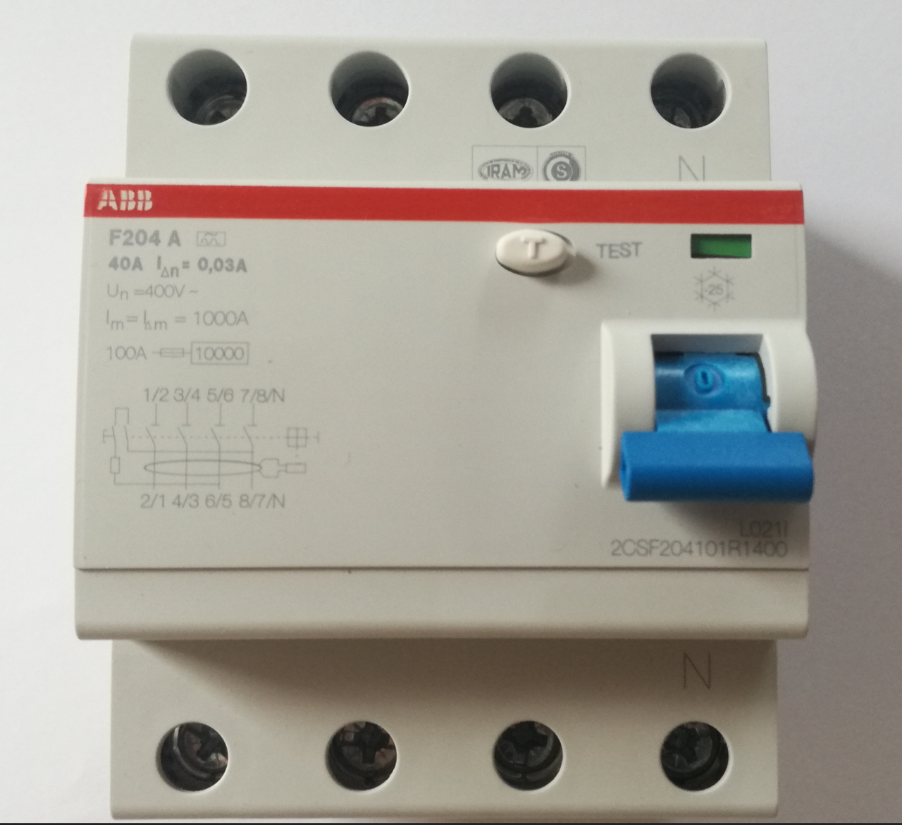
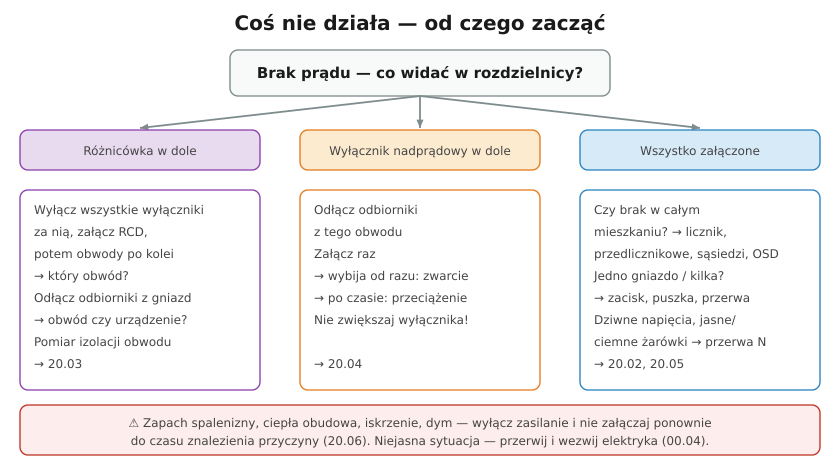

# 20.03 — Wybija wyłącznik różnicowoprądowy

> **Moduł:** [20 — Diagnostyka usterek](README.md) · **Oznaczenia:** 🏠📋 · **Zakres SEP:** (c) (e) · **Status:** ✅ pełny
>
> **Czytaj:**
>
> - Przyczyny zadziałania RCD: [08.06](../08-wylaczniki-roznicowopradowe/08.06-dlaczego-roznicowka-wybija-przyczyny-i-szukanie.md)
> - Pomiar rezystancji izolacji: [23.03](../23-pomiary-odbiorcze-i-okresowe/23.03-rezystancja-izolacji.md)

[← poprzedni temat](20.02-nie-dziala-gniazdo-albo-caly-obwod.md) · [spis modułu](README.md) · [następny temat →](20.04-wybija-wylacznik-nadpradowy.md)

## Po co to jest

W [08.06](../08-wylaczniki-roznicowopradowe/08.06-dlaczego-roznicowka-wybija-przyczyny-i-szukanie.md) poznałeś przyczyny, dla których różnicówka wybija. Tu jest procedura szukania — od rozdzielnicy do konkretnego urządzenia albo puszki. Różnicówka, która wybija, prawie zawsze ma rację: gdzieś prąd ucieka do ziemi.

## Po ludzku

**Krok 1 — od razu czy po czasie?** Spróbuj załączyć różnicówkę:

- **nie da się załączyć** (wybija natychmiast) → stały upływ albo N–PE / pomieszane N;
- **trzyma, wybija przy czymś** → urządzenie albo sytuacja (deszcz, burza).

**Krok 2 — który obwód?** Wyłącz **wszystkie** wyłączniki nadprądowe za różnicówką. Załącz różnicówkę. Załączaj obwody **po jednym**:

- wybija po załączeniu obwodu X → usterka w obwodzie X (lub w urządzeniu w nim);
- **wybija nawet przy wszystkich wyłączonych** → usterka w przewodzie **N** (wyłączniki 1P nie odłączają N!) — N–PE w którymś obwodzie albo pomieszane N z innej grupy.

**Krok 3 — obwód czy urządzenie?** W podejrzanym obwodzie wyjmij wszystkie wtyczki, wyłącz odbiorniki stałe (bojler, piekarnik — ich wyłącznikiem lub odłączając). Załącz:

- trzyma → urządzenie; podłączaj je po jednym i znajdź winne;
- wybija → instalacja (przewód, puszka, gniazdo, oprawa).

**Krok 4 — pomiar izolacji** (miernik izolacji, 500 V DC, **po wyłączeniu napięcia i odłączeniu odbiorników**): L–PE, N–PE i L–N. Wynik poniżej **1 MΩ** wskazuje uszkodzenie ([23.03](../23-pomiary-odbiorcze-i-okresowe/23.03-rezystancja-izolacji.md)). Pomiar N–PE wymaga odłączenia N obwodu od listwy N. To praca dla elektryka z miernikiem.

**Krok 5 — sumaryczny upływ.** Jeśli nie ma wyraźnej usterki, a różnicówka wybija losowo — zmierz cęgami upływowymi prąd upływu grupy (L i N razem w cęgach). Kilka–kilkanaście mA na RCD 30 mA → podziel obwody na więcej różnicówek albo daj RCBO ([08.07](../08-wylaczniki-roznicowopradowe/08.07-podzial-obwodow-miedzy-wylaczniki.md)).

## Jak to wygląda

*Na co patrzeć: po zadziałaniu dźwignia jest w dole. Jeśli nie da się jej podnieść i utrzymać — upływ jest stały. Przycisk TEST sprawdza samą różnicówkę, nie instalację.*

## Schemat

## Pojęcia

| Pojęcie | Po ludzku | Termin normowy / symbol |
|---------|-----------|-------------------------|
| Upływ | Prąd uciekający z L/N do PE lub ziemi | prąd różnicowy |
| Cęgi upływowe | Cęgi mierzące różnicę prądów | miernik prądu upływu |
| Pomieszane N | N obwodu z innej grupy RCD | — |
| Rezystancja izolacji | Opór izolacji między żyłami | $R_{iso}$ |

## Liczby do zapamiętania

| Wielkość | Wartość | Kiedy obowiązuje | Źródło |
|----------|---------|------------------|--------|
| Rezystancja izolacji | ≥ **1 MΩ** przy **500 V DC** | obwody do 500 V | PN-HD 60364-6, tab. 6.1 |
| Upływ za RCD 30 mA | ≤ **0,3 IΔn** ≈ **9 mA** | zalecenie | PN-HD 60364-5-53 |
| Upływ urządzenia z filtrem | **0,5–3 mA** | komputery, RTV, AGD | [08.06](../08-wylaczniki-roznicowopradowe/08.06-dlaczego-roznicowka-wybija-przyczyny-i-szukanie.md) |
| RCD zadziała | między **0,5 IΔn** a **IΔn** (15–30 mA) | RCD 30 mA | PN-EN 61008-1 |

## W praktyce

- **Wilgoć** — sprawdź obwody zewnętrzne, łazienkę, piwnicę, gniazda na balkonie. Po wyschnięciu usterka „znika”, ale wraca.
- **Bojler, pralka, zmywarka, piekarnik** — grzałki z uszkodzoną izolacją to najczęstsze urządzenia „wybijające”.
- **Nowa usterka po remoncie** — gwóźdź lub kołek w przewodzie, pomieszane N w nowej rozdzielnicy.
- **Wybija tylko przy burzy** — przepięcia; ograniczniki przepięć przed różnicówką, ewentualnie RCD odporne na udary (typ G/KV) ([09.04](../09-ochrona-przeciwprzepieciowa/09.04-montaz-ogranicznika-dlugosc-polaczen-i.md)).

## Błędy i zagrożenia

- ⚠️ **Zmostkowanie lub zastąpienie RCD rozłącznikiem** „bo wybija” — usunięta ochrona przed porażeniem dokładnie w chwili, gdy instalacja ma upływ.
- ⚠️ **Pomiar izolacji 500 V z podłączonymi urządzeniami elektronicznymi** — uszkodzone zasilacze, ładowarki.
- **Szukanie tylko w obwodach L** — wyłączniki 1P nie odłączają N; usterka N–PE jest aktywna mimo wyłączenia wszystkich wyłączników.
- **Wymiana RCD na 100 mA** w mieszkaniu — utrata ochrony uzupełniającej.

## Przykład

**Zadanie.** Różnicówka grupy łazienka + kuchnia wybija od razu. Po wyłączeniu wszystkich wyłączników za nią — **dalej wybija**. Co to oznacza?

**Rozwiązanie.** Wyłączniki 1P odcięły L, ale nie N. Wybijanie przy wyłączonych obwodach oznacza, że **prąd ucieka przez N**: połączenie N–PE w którymś obwodzie grupy (np. zalana puszka, gwóźdź przebijający N i PE, oprawa z mostkiem) albo N tej grupy połączony z N innej grupy, przez który płynie prąd odbiorników z drugiej różnicówki. Szukanie: odłączaj kolejno przewody N obwodów od listwy N grupy (po wyłączeniu napięcia) i próbuj załączyć — obwód, po odłączeniu którego RCD trzyma, jest winny. Potem pomiar izolacji N–PE w tym obwodzie.

## Pytania SEP

1. **Jak ustalić przyczynę częstego zadziałania wyłącznika różnicowoprądowego?**

Odpowiedź

Ustalić okoliczności (stałe, przy konkretnym urządzeniu, przy wilgoci, przy burzy). Wyłączyć wszystkie obwody za RCD i załączać je kolejno, aby wskazać obwód; w obwodzie odłączyć odbiorniki i sprawdzić, czy przyczyną jest urządzenie czy instalacja. Wykonać pomiar rezystancji izolacji (500 V DC, wymagane co najmniej 1 MΩ) między L, N i PE po odłączeniu odbiorników; sprawdzić, czy przewody N nie są połączone z PE ani z N innej grupy. Przy losowych zadziałaniach zmierzyć prąd upływu grupy i w razie potrzeby rozdzielić obwody na więcej wyłączników. Sprawdzić też sam RCD miernikiem (prąd i czas zadziałania).

## Sprawdź się

1. Dlaczego przy szukaniu przyczyny wybijania RCD wyłączenie wszystkich wyłączników nadprądowych 1P nie odcina całej instalacji za RCD?

Odpowiedź

Wyłączniki jednobiegunowe przerywają tylko przewód L. Przewody N wszystkich obwodów nadal są połączone z listwą N i przez RCD. Połączenie N–PE albo N z innej grupy nadal powoduje różnicę prądów w RCD.

## Źródła

- PN-HD 60364-6 — rezystancja izolacji (tab. 6.1).
- PN-HD 60364-5-53 — dobór RCD, prądy upływowe.
- PN-EN 61008-1 — wyłączniki różnicowoprądowe.

---

[← poprzedni temat](20.02-nie-dziala-gniazdo-albo-caly-obwod.md) · [spis modułu](README.md) · [następny temat →](20.04-wybija-wylacznik-nadpradowy.md)
