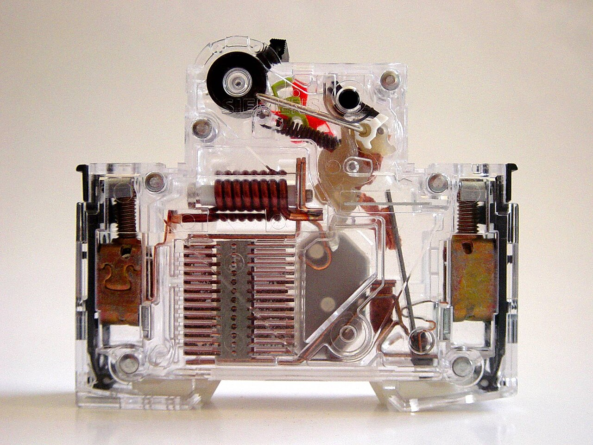
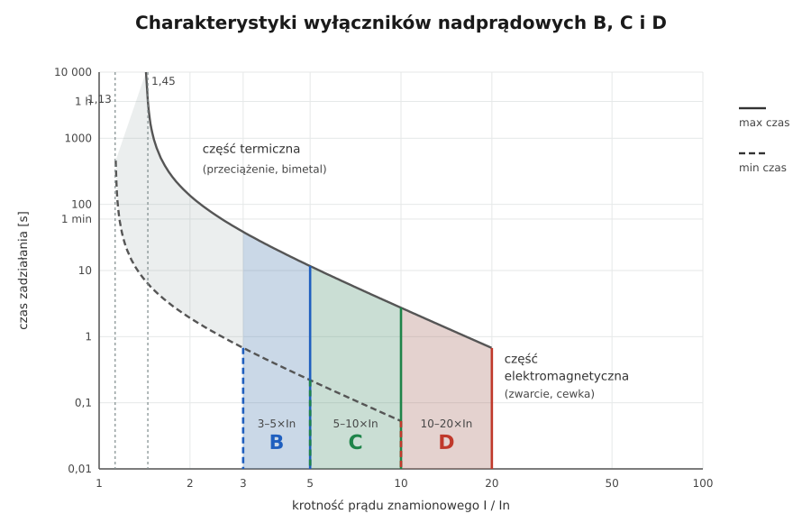

# 20.04 — Wybija wyłącznik nadprądowy

> **Moduł:** [20 — Diagnostyka usterek](README.md) · **Oznaczenia:** 🏠📋 · **Zakres SEP:** (c) (e) · **Status:** ✅ pełny
>
> **Czytaj:**
>
> - Przeciążenie a zwarcie: [01.07](../01-prad-napiecie-opor/01.07-przeciazenie-a-zwarcie-dwie-rozne-awarie.md); charakterystyki: [07.04](../07-zabezpieczenia-nadpradowe/07.04-charakterystyki-b-c-i-d.md)
> - Budowa wyłącznika: [07.03](../07-zabezpieczenia-nadpradowe/07.03-wylacznik-nadpradowy-budowa-i-dwa-wyzwalacze.md)

[← poprzedni temat](20.03-wybija-wylacznik-roznicowopradowy.md) · [spis modułu](README.md) · [następny temat →](20.05-przerwa-w-przewodzie-neutralnym.md)

## Po co to jest

Wyłącznik nadprądowy chroni przewód. Gdy działa, mówi jedno z dwojga: **za dużo prądu przez dłuższy czas** (przeciążenie) albo **bardzo dużo prądu nagle** (zwarcie). Odróżnienie ich to połowa diagnozy. Druga połowa — sprawdzić, czy wyłącznik działa dlatego, że musi, czy dlatego, że coś go podgrzewa albo jest zużyty.

## Po ludzku

**Kiedy wybija?**

| Objaw | Najprawdopodobniej | Wyzwalacz |
|-------|--------------------|-----------|
| natychmiast po załączeniu, bez odbiorników | **zwarcie w instalacji** (przewód, gniazdo, puszka) | elektromagnetyczny |
| natychmiast, gdy włączasz konkretne urządzenie | **zwarcie w urządzeniu** albo duży prąd rozruchu | elektromagnetyczny |
| po minutach pracy kilku urządzeń | **przeciążenie** | termiczny (bimetal) |
| przy włączaniu oświetlenia LED (wiele opraw) | **prąd załączania** zasilaczy ([18.01](../18-oswietlenie/18.01-zrodla-swiatla-i-zasilacze-led.md)) | elektromagnetyczny |
| „sam z siebie”, wyłącznik ciepły w dotyku | **luźny zacisk** na wyłączniku podgrzewa bimetal; albo zużyty aparat | termiczny |

**Przeciążenie** — policz moc: ile urządzeń pracuje naraz na tym obwodzie? B16 przy 230 V to ok. 3,7 kW; długo trzyma do ok. 1,13 × 16 = 18 A, a po przekroczeniu 1,45 × 16 = 23 A wyłączy w czasie do godziny. Rozwiązanie: rozdzielenie odbiorników na obwody, a nie większy wyłącznik.

**Zwarcie** — odłącz wszystkie odbiorniki z obwodu i załącz **raz**:

- wybija → zwarcie w instalacji: pomiar rezystancji izolacji L–N (po wyłączeniu), połowienie, oględziny (gwóźdź, kołek, zalana puszka);
- trzyma → podłączaj urządzenia po jednym; winne odłącz i oddaj do naprawy.

**Rozruch silników** (odkurzacz, piła, kompresor) — wyłącznik B może zadziałać przy włączeniu, choć urządzenie jest sprawne. Dopuszczalne rozwiązanie: **charakterystyka C** — po sprawdzeniu, że impedancja pętli na to pozwala ([12.03](../12-ochrona-przeciwporazeniowa/12.03-warunek-skutecznosci-samoczynnego-wylaczenia.md)).

## Jak to wygląda

*Na co patrzeć: cewka to wyzwalacz elektromagnetyczny — reaguje na nagły duży prąd zwarcia, a komora z płytkami gasi łuk. Wyzwalacz termiczny (bimetal) leży przy zacisku — dlatego ciepło luźnego zacisku potrafi „oszukać” wyłącznik.*

## Schemat

## Pojęcia

| Pojęcie | Po ludzku | Termin normowy / symbol |
|---------|-----------|-------------------------|
| Wyzwalacz termiczny | Bimetal — reaguje na przeciążenie | człon przeciążeniowy |
| Wyzwalacz elektromagnetyczny | Cewka — reaguje na zwarcie | człon zwarciowy |
| Prąd rozruchu | Duży prąd przy włączaniu silnika | prąd rozruchowy |
| Prąd załączania | Skok prądu przy włączaniu zasilaczy | inrush |

## Liczby do zapamiętania

| Wielkość | Wartość | Kiedy obowiązuje | Źródło |
|----------|---------|------------------|--------|
| Nie zadziała przez 1 h | **1,13 In** | wyłączniki nadprądowe | PN-EN 60898-1 |
| Zadziała w < 1 h | **1,45 In** | jw. | jw. |
| Natychmiast | B **3–5 In**, C **5–10 In**, D **10–20 In** | jw. | jw. |
| Moc na B16 | ok. **3,7 kW** przy 230 V | cos φ = 1 | $P = U \cdot I$ |
| Ponowne załączenie | **raz**, po odłączeniu odbiorników | — | [07.01](../07-zabezpieczenia-nadpradowe/07.01-przeciazenie-i-zwarcie-z-punktu-widzenia.md) |

## W praktyce

- **Ciepły wyłącznik** — sprawdź (po wyłączeniu) dokręcenie zacisków i ich stan; przebarwienia → wymiana aparatu i końcówek przewodu.
- **Stary wyłącznik** po wielu zwarciach — styki wypalone, charakterystyka się zmienia; wymień.
- **Cęgi prądowe** — zmierz realny prąd obwodu przy typowym obciążeniu ([22.03](../22-przyrzady-pomiarowe/22.03-cegi-pradowe.md)).
- **Zwarcie w przewodzie** — często po wierceniu; najpierw sprawdź świeże otwory w ścianach na trasie obwodu.

## Błędy i zagrożenia

- ⚠️ **B16 → B20/B25 „bo wybija”** — przewód 2,5 mm² przestaje być chroniony przed przeciążeniem; pożar w ścianie.
- ⚠️ **Wielokrotne załączanie na zwarcie** — łuk w miejscu usterki i w aparacie.
- **Zmiana B na C bez sprawdzenia pętli** — wyłącznik może nie zadziałać w 0,4 s przy zwarciu na obudowie.
- **Szukanie zwarcia z podłączonymi urządzeniami** — każde może być winne.

## Przykład

**Zadanie.** B16 obwodu gniazd w pokoju wybija po ok. 20 minutach, kiedy pracują grzejnik olejowy 2,5 kW i suszarka do ubrań 2 kW. Co to jest i co zrobić?

**Rozwiązanie.** $I = 4500/230 \approx 19{,}6$ A — więcej niż 1,13 × 16 ≈ 18 A, więc wyłącznik **ma prawo** zadziałać po kilkunastu minutach. Zadziałanie **po czasie** → **przeciążenie** (wyzwalacz termiczny). Potwierdź cęgami prądowymi. Rozwiązanie: grzejnik na innym obwodzie, nie większy wyłącznik. Gdyby cęgi pokazały np. 12 A, a wyłącznik był ciepły — przyczyną byłby luźny zacisk lub zużyty aparat.

## Pytania SEP

1. **Po czym rozpoznać, czy wyłącznik nadprądowy zadziałał z powodu przeciążenia, czy zwarcia?**

Odpowiedź

Przy zwarciu wyłącznik zadziała natychmiast (wyzwalacz elektromagnetyczny), często po załączeniu bez odbiorników lub w chwili włączenia uszkodzonego urządzenia. Przy przeciążeniu zadziała z opóźnieniem — po kilku lub kilkudziesięciu minutach pracy odbiorników o łącznym prądzie większym od znamionowego (wyzwalacz termiczny). Diagnozę potwierdza odłączenie odbiorników i ponowne jednorazowe załączenie, pomiar prądu cęgami oraz pomiar rezystancji izolacji.

## Sprawdź się

1. Wyłącznik zadziałał przy prądzie 12 A, a jest to B16. Podaj dwie możliwe przyczyny.

Odpowiedź

(1) Luźny lub utleniony zacisk na wyłączniku, który nagrzewa bimetal z zewnątrz. (2) Zużyty lub uszkodzony wyłącznik. Także wysoka temperatura w rozdzielnicy (aparaty ściśnięte, przegrzane). Nie jest to przeciążenie przewodu.

## Źródła

- PN-EN 60898-1 — wyłączniki nadprądowe (prądy umowne, charakterystyki).
- PN-HD 60364-4-43 — ochrona przed prądem przetężeniowym.

---

[← poprzedni temat](20.03-wybija-wylacznik-roznicowopradowy.md) · [spis modułu](README.md) · [następny temat →](20.05-przerwa-w-przewodzie-neutralnym.md)
