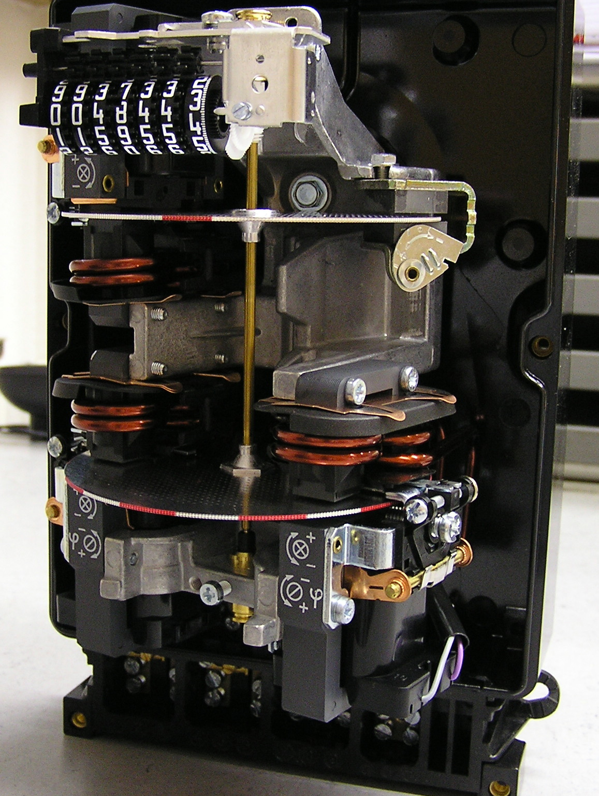
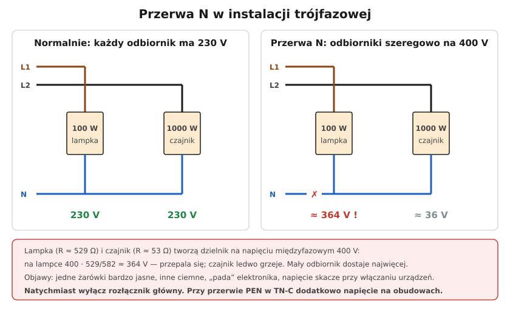

# 20.05 — Przerwa w przewodzie neutralnym

> **Moduł:** [20 — Diagnostyka usterek](README.md) · **Oznaczenia:** 🏠📋 · **Zakres SEP:** (c) (e) · **Status:** ✅ pełny
>
> **Czytaj:**
>
> - Układ TN-C i przerwa PEN: [11.02](../11-uklady-sieci/11.02-uklad-tn-c.md)
> - Przekaźniki zaniku fazy i nadnapięciowe: [10.04](../10-aparatura-modulowa/10.04-kontrolki-faz-przekazniki-zaniku-fazy-i.md)

[← poprzedni temat](20.04-wybija-wylacznik-nadpradowy.md) · [spis modułu](README.md) · [następny temat →](20.06-grzejace-sie-zaciski-i-zapach-spalenizny.md)

## Po co to jest

Przerwa w przewodzie neutralnym to jedna z najgroźniejszych i najdroższych usterek. W instalacji trójfazowej odbiorniki z różnych faz łączą się szeregowo na napięciu 400 V — jedne dostają za dużo, inne za mało. W kilka minut potrafi spalić telewizor, lodówkę i zasilacze. Przy przerwie PEN w układzie TN-C dochodzi do tego napięcie na obudowach.

## Po ludzku

**W obwodzie jednofazowym** przerwa N po prostu wyłącza odbiorniki „za” przerwą. Ale odcięty kawałek N ma **fazę** — przechodzi przez włączone odbiorniki. Kto dotknie N, myśląc, że to „zero”, dostanie napięcie.

**W instalacji trójfazowej** (przerwa wspólnego N przed rozdzielnicą: w WLZ, w złączu, na listwie N) — dzieje się więcej:

- odbiorniki z faz L1, L2, L3 tracą wspólny punkt N,
- łączą się **szeregowo** między fazami, na napięciu **400 V**,
- napięcie dzieli się **odwrotnie** do mocy: **mały odbiornik dostaje dużo, duży — mało** (dzielnik napięcia, [01.05](../01-prad-napiecie-opor/01.05-polaczenie-szeregowe-i-rownolegle.md)).

Lampka 100 W szeregowo z czajnikiem 1000 W na 400 V: lampka dostaje ok. 364 V, czajnik ok. 36 V. Lampka się przepala, a ładowarka czy telewizor na tej samej fazie — też.

**Objawy:**

- jedne żarówki bardzo jasne, inne ledwo świecą,
- napięcie skacze przy włączaniu urządzeń na innej fazie,
- „padają” zasilacze, ładowarki, elektronika,
- silniki dziwnie buczą,
- w gniazdach napięcia L–N wyraźnie inne niż 230 V (np. 150 V i 300 V).

**Gdzie bywa przerwa:** luźny zacisk N na listwie w rozdzielnicy, w złączu, na zacisku licznika, w WLZ, w sieci operatora (przerwany PEN w linii napowietrznej).

**Co robić:** **natychmiast wyłączyć rozłącznik główny**. Jeśli przerwa jest przed licznikiem — zgłosić do pogotowia energetycznego operatora (OSD). Jeśli w instalacji — elektryk.

## Jak to wygląda

*Na co patrzeć: zaciski licznika (w tym N) to jedno z miejsc, gdzie luźne połączenie może przerwać N całej instalacji. Licznik i złącze należą do operatora — tam pracuje tylko on.*

## Schemat

## Pojęcia

| Pojęcie | Po ludzku | Termin normowy / symbol |
|---------|-----------|-------------------------|
| Przerwa N | Brak ciągłości przewodu neutralnego | — |
| Przesunięcie punktu neutralnego | „Pływające” N przy niesymetrycznym obciążeniu | — |
| Przekaźnik nadnapięciowy | Aparat wyłączający przy zbyt wysokim napięciu | [10.04](../10-aparatura-modulowa/10.04-kontrolki-faz-przekazniki-zaniku-fazy-i.md) |
| PEN | Przewód ochronno-neutralny w TN-C | [11.02](../11-uklady-sieci/11.02-uklad-tn-c.md) |

## Liczby do zapamiętania

| Wielkość | Wartość | Kiedy obowiązuje | Źródło |
|----------|---------|------------------|--------|
| Napięcie między fazami | **400 V** | sieć 230/400 V | — |
| Przykład 100 W + 1000 W | ok. **364 V / 36 V** | przerwa N, odbiorniki na różnych fazach | obliczenie |
| Dopuszczalne napięcie sieci | **230 V ± 10 %** | normalna praca | PN-EN 50160 |
| Pierwsza czynność | **wyłączyć rozłącznik główny** | podejrzenie przerwy N | — |

## W praktyce

- **Diagnoza w gnieździe**: L–N wyraźnie różne od 230 V, a L–PE ok. 230 V → problem z N (przy TN-S PE jest „dobre”, a N pływa).
- **Pomiar w rozdzielnicy** przy obciążeniu: napięcie N–PE kilkadziesiąt woltów → przerwa lub bardzo zły styk N przed punktem pomiaru.
- **Ochrona elektroniki**: przekaźnik nadnapięciowy / kontroli napięć w rozdzielnicy wyłączy instalację, zanim napięcie zniszczy urządzenia ([10.04](../10-aparatura-modulowa/10.04-kontrolki-faz-przekazniki-zaniku-fazy-i.md)).
- **Po usunięciu usterki** — sprawdzenie urządzeń, często wymiana ograniczników przepięć; dokumentacja na potrzeby ubezpieczenia.

## Błędy i zagrożenia

- ⚠️ **Dotknięcie „zerowego” przewodu** przy przerwie N — ma potencjał fazy.
- ⚠️ **Przerwa PEN w TN-C** (stare instalacje, zerowanie) — napięcie na obudowach urządzeń ([21.03](../21-stare-instalacje/21.03-mostkowanie-bolca-ochronnego-w-gniazdku.md)).
- **Czekanie, aż „samo przejdzie”** — każda minuta to kolejne spalone urządzenia.
- **Dokręcanie zacisków N w złączu lub liczniku samemu** — to urządzenia operatora (plomby).

## Przykład

**Zadanie.** W domu z zasilaniem trójfazowym nagle: w kuchni żarówki świecą bardzo jasno, w salonie ledwo, lodówka buczy. Pomiar w gnieździe kuchni: L–N 290 V, L–PE 232 V. Co się stało?

**Rozwiązanie.** L–PE prawidłowe, L–N za duże → **przerwa N** (lub bardzo słaby styk) w części wspólnej — prawdopodobnie na głównej listwie N, w WLZ albo w złączu. Natychmiast **wyłączyć rozłącznik główny**. Sprawdzić (elektryk) zaciski N w rozdzielnicy głównej; jeśli są w porządku — zgłosić do OSD (przerwa przed licznikiem lub w sieci).

## Pytania SEP

1. **Jakie są skutki przerwy w przewodzie neutralnym w instalacji trójfazowej?**

Odpowiedź

Odbiorniki jednofazowe zasilane z różnych faz tracą wspólny punkt neutralny i łączą się szeregowo między fazami na napięciu międzyfazowym 400 V. Napięcia na odbiornikach zależą od ich obciążenia: na odbiornikach o małej mocy napięcie rośnie (może przekroczyć 230 V nawet znacznie), na dużych maleje. Prowadzi to do uszkodzenia urządzeń, zwłaszcza elektronicznych, przegrzewania i nieprawidłowej pracy silników. Przewód N za przerwą może mieć potencjał fazy. W układzie TN-C przerwa PEN powoduje dodatkowo pojawienie się napięcia na częściach przewodzących dostępnych.

## Sprawdź się

1. Na schemacie: dlaczego przepala się lampka, a nie czajnik?

Odpowiedź

Bo lampka ma dużą rezystancję (ok. 529 Ω), a czajnik małą (ok. 53 Ω). W połączeniu szeregowym na większej rezystancji odkłada się większe napięcie: lampka dostaje ok. 364 V, czajnik ok. 36 V.

## Źródła

- PN-EN 50160 — parametry napięcia zasilającego.
- PN-HD 60364-4-44 — ochrona przed zaburzeniami napięciowymi.
- [11.02 — Układ TN-C](../11-uklady-sieci/11.02-uklad-tn-c.md).

---

[← poprzedni temat](20.04-wybija-wylacznik-nadpradowy.md) · [spis modułu](README.md) · [następny temat →](20.06-grzejace-sie-zaciski-i-zapach-spalenizny.md)
