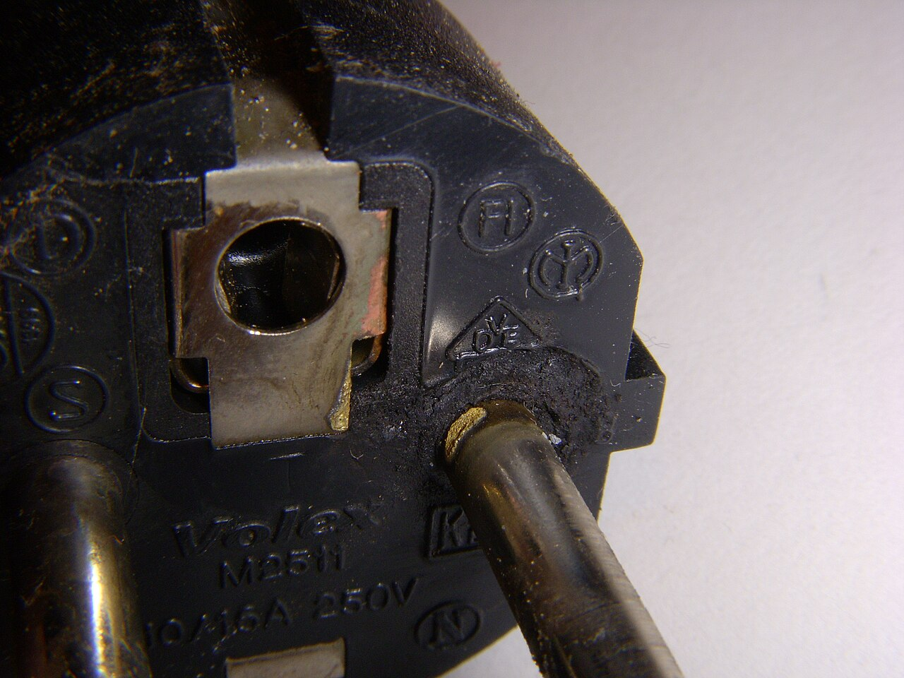
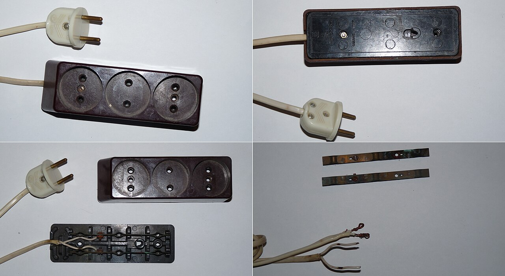
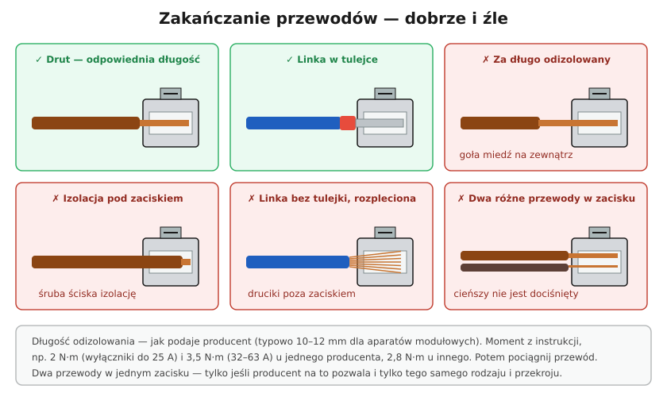

# 20.06 — Grzejące się zaciski i zapach spalenizny

> **Moduł:** [20 — Diagnostyka usterek](README.md) · **Oznaczenia:** 🏠📋 · **Zakres SEP:** (c) (e) · **Status:** ✅ pełny
>
> **Czytaj:**
>
> - Luźne połączenia: [06.04](../06-osprzet-instalacyjny/06.04-zlaczki-i-laczenie-przewodow-dlaczego-nie.md), [19.07](../19-prace-krok-po-kroku/19.07-zakanczanie-przewodow-tulejki-zaciski-momenty.md)
> - AFDD: [10.05](../10-aparatura-modulowa/10.05-detektory-iskrzenia-afdd.md); termowizja: [22.06](../22-przyrzady-pomiarowe/22.06-kamera-termowizyjna-kiedy-sie-przydaje.md)

[← poprzedni temat](20.05-przerwa-w-przewodzie-neutralnym.md) · [spis modułu](README.md) · [następny temat →](20.07-migajace-i-zarzace-sie-led.md)

## Po co to jest

Grzejące się połączenie to cichy początek pożaru. Wyłącznik nadprądowy go nie widzi (prąd jest normalny), różnicówka też nie (nic nie ucieka). Widać je po przebarwieniach, czuć po zapachu, czasem słychać trzaski. Trzeba umieć rozpoznać objawy i wiedzieć, co wymienić — bo samo dokręcenie przegrzanego zacisku często nie wystarczy.

## Po ludzku

**Dlaczego połączenie się grzeje?** Moc wydzielana na styku to $P = I^2 \cdot R_{styku}$. Przy 16 A i oporze styku zaledwie 0,1 Ω to ok. **26 W** — jak lutownica zamknięta w puszce ([06.04](../06-osprzet-instalacyjny/06.04-zlaczki-i-laczenie-przewodow-dlaczego-nie.md)). Ciepło utlenia miedź, opór rośnie, grzeje się jeszcze bardziej — błędne koło.

**Najczęstsze przyczyny:**

- **luźny zacisk** — niedokręcony, poluzowany przez lata (cykle nagrzewania), linka bez tulejki;
- **aluminium** — płynie pod śrubą, utlenia się ([21.02](../21-stare-instalacje/21.02-przewody-aluminiowe-zagrozenia-i-postepowanie.md));
- **zmęczone styki gniazda** — sprężyny trzymające kołki wtyczki są luźne; wtyczka „wypada”;
- **przeciążony rozgałęźnik** — grzejnik przez rozgałęźnik przez przedłużacz;
- **wtyczka wypalona** łukiem — wżery na kołkach, nalot;
- **skręcane połączenia** w puszkach w starych instalacjach.

**Objawy:**

- zapach gorącego plastiku albo „ryby” (tak pachną niektóre tworzywa przy przegrzaniu),
- przebarwienia: brązowe, czarne ślady wokół otworu gniazda, na wtyczce, na izolacji,
- ciepła obudowa gniazda, łącznika, aparatu w rozdzielnicy,
- trzaski, migotanie światła przy obciążeniu,
- wtyczka gorąca po kilku minutach pracy czajnika.

**Co robić:**

1. **Wyłącz obwód** — natychmiast, jeśli czujesz spaleniznę.
2. **Wymień element** (gniazdo, łącznik, złączkę, aparat). Przegrzany zacisk ma utlenioną powierzchnię i osłabioną sprężynę — dokręcenie to półśrodek.
3. **Odetnij przegrzaną końcówkę przewodu** (izolacja twarda, przebarwiona) — do zdrowej miedzi.
4. **Wymień wtyczkę** urządzenia, jeśli kołki są wypalone — inaczej zniszczy nowe gniazdo.
5. **Znajdź przyczynę**: przeciążenie? aluminium? rozgałęźnik?

## Jak to wygląda

*Na co patrzeć: przebarwienia i nalot na kołku to ślad łuku i grzania przy słabym styku w gnieździe. Taka wtyczka „przeniesie” problem do każdego nowego gniazda — wymienia się ją razem z gniazdem.*

*Na co patrzeć: czarne, skorodowane blaszki stykowe — każda z nich ma duży opór styku i grzeje się pod obciążeniem. Rozgałęźnik w takim stanie trafia do kosza.*

## Schemat

## Pojęcia

| Pojęcie | Po ludzku | Termin normowy / symbol |
|---------|-----------|-------------------------|
| Rezystancja styku | Opór w miejscu połączenia | $R_{styku}$ |
| Łuk szeregowy | Iskrzenie w przerwie jednego przewodu | [10.05](../10-aparatura-modulowa/10.05-detektory-iskrzenia-afdd.md) |
| AFDD | Aparat wykrywający iskrzenie | detektor zwarć łukowych |
| Termowizja | Obraz temperatury | [22.06](../22-przyrzady-pomiarowe/22.06-kamera-termowizyjna-kiedy-sie-przydaje.md) |

## Liczby do zapamiętania

| Wielkość | Wartość | Kiedy obowiązuje | Źródło |
|----------|---------|------------------|--------|
| Moc na styku | $P = I^2 R$; 0,1 Ω przy 16 A → **26 W** | — | [06.04](../06-osprzet-instalacyjny/06.04-zlaczki-i-laczenie-przewodow-dlaczego-nie.md) |
| Temperatura pracy izolacji PVC | **70 °C** | praca ciągła | [05.01](../05-przewody-i-kable/05.01-budowa-przewodu-i-kabla-zyla-izolacja-powloka.md) |
| MCB / RCD | **nie wykrywają** luźnego połączenia | — | — |
| AFDD | wykrywa łuk szeregowy | — | [10.05](../10-aparatura-modulowa/10.05-detektory-iskrzenia-afdd.md) |

## W praktyce

- **Dotykając, sprawdzaj wierzchem dłoni** obudowę (osłonę) — nie zaciski. Lepiej: termometr bezdotykowy lub kamera termowizyjna pod obciążeniem.
- **Gniazdo z luźnymi stykami** (wtyczka wypada sama) — wymień, zanim zacznie się grzać.
- **Rozdzielnica** — przy przeglądzie dokręcić zaciski (po wyłączeniu) i obejrzeć przebarwienia przy aparatach.
- **Urządzenia grzejne** (czajnik, grzejnik, pralka przy grzaniu) najszybciej ujawniają słaby styk — ich wtyczki obserwuj.

## Błędy i zagrożenia

- ⚠️ **Ignorowanie zapachu spalenizny** „bo nic nie wybija” — to właśnie usterka, której zabezpieczenia nie widzą.
- ⚠️ **Dokręcenie przegrzanego zacisku i zostawienie gniazda** — utleniony styk, osłabiona sprężyna, problem wraca.
- **Grzejnik lub czajnik przez rozgałęźnik** — kilkanaście amperów przez dwa dodatkowe styki.
- **Taśma izolacyjna na nadpalonej izolacji** — zamiast odcięcia uszkodzonego fragmentu.

## Przykład

**Zadanie.** Wtyczka czajnika jest gorąca po zagotowaniu wody, a wokół jednego otworu gniazda widać brązowy ślad. Co robisz?

**Rozwiązanie.** Wyłącz obwód. Wymień **gniazdo** (styk przegrzany, sprężyna osłabiona). Obejrzyj żyły w puszce — przebarwione końcówki odetnij. Obejrzyj **wtyczkę czajnika** — przebarwiony kołek lub nalot → wymiana wtyczki (lub przewodu) przez serwis. Sprawdź, czy czajnik nie był podłączony przez rozgałęźnik. Po naprawie wtyczka po zagotowaniu powinna być co najwyżej lekko ciepła.

## Pytania SEP

1. **Jakie są przyczyny nagrzewania się połączeń w instalacji i jak im zapobiegać?**

Odpowiedź

Przyczyny: zwiększona rezystancja styku wskutek niedostatecznego dokręcenia, poluzowania przy cyklach cieplnych, utlenienia (zwłaszcza aluminium), nieprawidłowego zakończenia żył (linka bez tulejki, izolacja pod zaciskiem), zmęczenia sprężyn styków gniazd oraz przeciążenia. Zapobieganie: prawidłowy dobór i wykonanie połączeń (złączki, tulejki, momenty dokręcania wg producenta), unikanie połączeń Al–Cu bez odpowiednich złączek, okresowe przeglądy i dokręcanie zacisków, pomiary termowizyjne, wymiana zużytego osprzętu, unikanie przeciążania gniazd i rozgałęźników; dodatkowo detektory iskrzenia (AFDD).

## Sprawdź się

1. Dlaczego wyłącznik nadprądowy nie zadziała przy grzejącym się zacisku w gnieździe?

Odpowiedź

Bo prąd w obwodzie nie jest większy niż normalnie — grzeje się tylko jedno miejsce o zwiększonym oporze. Wyłącznik reaguje na prąd, nie na temperaturę zacisku w gnieździe (chyba że luźny zacisk jest na samym wyłączniku i podgrzewa jego bimetal).

## Źródła

- PN-HD 60364-4-42 — ochrona przed skutkami oddziaływania cieplnego.
- PN-HD 60364-5-52 — połączenia elektryczne (526).
- [10.05 — AFDD](../10-aparatura-modulowa/10.05-detektory-iskrzenia-afdd.md).

---

[← poprzedni temat](20.05-przerwa-w-przewodzie-neutralnym.md) · [spis modułu](README.md) · [następny temat →](20.07-migajace-i-zarzace-sie-led.md)
