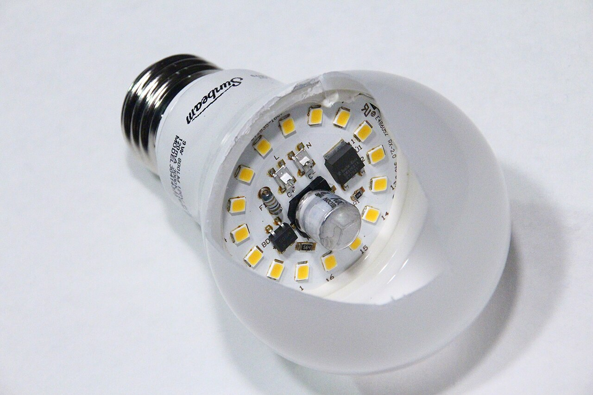
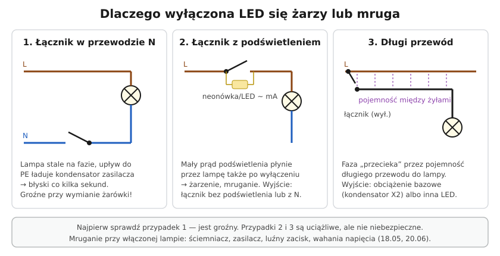

# 20.07 — Migające i żarzące się LED

> **Moduł:** [20 — Diagnostyka usterek](README.md) · **Oznaczenia:** 🏠📋 · **Zakres SEP:** (c) (e) · **Status:** ✅ pełny
>
> **Czytaj:**
>
> - Łączniki i LED: [18.01](../18-oswietlenie/18.01-zrodla-swiatla-i-zasilacze-led.md), [18.02](../18-oswietlenie/18.02-lacznik-jednobiegunowy-i-swiecznikowy-schematy.md), [18.05](../18-oswietlenie/18.05-sciemniacze-i-wspolpraca-z-led.md)

[← poprzedni temat](20.06-grzejace-sie-zaciski-i-zapach-spalenizny.md) · [spis modułu](README.md) · (koniec modułu) →

## Po co to jest

LED zużywa tak mało prądu, że wystarczą mu miliampery, żeby się zażarzyć albo mrugnąć. Prądy, których zwykła żarówka „nie zauważała”, przy LED dają widoczny efekt. Większość przyczyn jest niegroźna, ale jedna — łącznik w przewodzie N — oznacza fazę na oprawie przy wymianie żarówki.

## Po ludzku

**Lampa wyłączona, a się żarzy lub błyska co kilka sekund:**

1. **Łącznik przerywa N zamiast L** — oprawa stale ma fazę. Przez pojemności zasilacza i upływ ładuje się kondensator, aż zasilacz błyśnie. **Groźne** — sprawdź pierwsze ([18.02](../18-oswietlenie/18.02-lacznik-jednobiegunowy-i-swiecznikowy-schematy.md)).
2. **Łącznik z podświetleniem** (lampka neonowa lub LED w klawiszu) — podświetlenie jest połączone równolegle do styku i przez lampę płynie mały prąd także po wyłączeniu.
3. **Długi przewód łącznikowy** biegnący obok przewodu fazowego (np. w jednym przewodzie do łącznika schodowego) — pojemność między żyłami „przenosi” trochę prądu.
4. **Łącznik elektroniczny bez N** (dwuprzewodowy: czujnik ruchu, ściemniacz, smart) — zasila się przez lampę.

**Lampa włączona, a mruga:**

- **ściemniacz** niezgodny z LED albo poniżej mocy minimalnej ([18.05](../18-oswietlenie/18.05-sciemniacze-i-wspolpraca-z-led.md)),
- **tani zasilacz** w żarówce — tętnienia 100 Hz widoczne na kamerze telefonu, stroboskop przy wirujących maszynach,
- **luźny zacisk** w oprawie, łączniku albo puszce ([20.06](20.06-grzejace-sie-zaciski-i-zapach-spalenizny.md)),
- **wahania napięcia** — przy włączaniu dużych odbiorników na tej samej fazie; jeśli silne — sprawdź N ([20.05](20.05-przerwa-w-przewodzie-neutralnym.md)),
- **transformator do halogenów** pod LED 12 V — za małe obciążenie ([18.01](../18-oswietlenie/18.01-zrodla-swiatla-i-zasilacze-led.md)).

**Jak to naprawić (przy wyłączonej lampie):**

| Przyczyna | Rozwiązanie |
|-----------|-------------|
| łącznik w N | przełożyć łącznik do L — **obowiązkowo** |
| podświetlenie | łącznik bez podświetlenia albo z podświetleniem zasilanym z N |
| pojemność długiego przewodu | element obciążający równolegle do lampy (dedykowany kondensator X2 / „kompensator LED”), inna żarówka, przekaźnik przy lampie |
| łącznik elektroniczny bez N | dociągnąć N i wybrać model z N; ewentualnie obciążenie bazowe zalecane przez producenta |

## Jak to wygląda

*Na co patrzeć: w środku jest zasilacz z kondensatorami. Wystarczy mu kilka miliamperów, żeby naładować kondensator i krótko błysnąć — dlatego LED „widzi” prądy, przy których żarówka tradycyjna była ciemna.*

## Schemat

## Pojęcia

| Pojęcie | Po ludzku | Termin normowy / symbol |
|---------|-----------|-------------------------|
| Żarzenie (ghosting) | Słabe świecenie wyłączonej LED | — |
| Sprzężenie pojemnościowe | Przenikanie prądu między żyłami przez izolację | — |
| Obciążenie bazowe | Element pobierający mały prąd równolegle do lampy | — |
| Tętnienia | Wahania jasności z częstotliwością 100 Hz | migotanie, flicker |

## Liczby do zapamiętania

| Wielkość | Wartość | Kiedy obowiązuje | Źródło |
|----------|---------|------------------|--------|
| Prąd wystarczający do żarzenia LED | rząd **miliamperów** i mniej | — | — |
| Częstotliwość migotania | **100 Hz** (dwa razy częstotliwość sieci) | tanie zasilacze | — |
| Łącznik musi przerywać | **L** | zawsze | [18.02](../18-oswietlenie/18.02-lacznik-jednobiegunowy-i-swiecznikowy-schematy.md) |

## W praktyce

1. Wyłącz lampę łącznikiem. **Wskaźnikiem dwubiegunowym** sprawdź napięcie na oprawie (L–N, L–PE). Jest ok. 230 V → łącznik w N → popraw.
2. Łącznik podświetlany? Wymień na zwykły i sprawdź.
3. Wkręć inną żarówkę (innego producenta) — jeśli problem znika, przyczyną była czułość zasilacza.
4. Długi przewód do łącznika schodowego — rozważ obciążenie bazowe lub przekaźnik ([18.04](../18-oswietlenie/18.04-przekaznik-impulsowy-zamiast-lacznikow.md)).
5. Mruganie przy włączonej — ściemniacz, zasilacz, zaciski, napięcie.

## Błędy i zagrożenia

- ⚠️ **Wymiana żarówki „przy wyłączonym łączniku”**, gdy łącznik jest w N — dotknięcie fazy w oprawce.
- **Kondensator „z elektroniki” zamiast elementu do pracy na 230 V AC** (X2) — może się zapalić lub eksplodować.
- **Ignorowanie mrugania przy włączonej lampie** — może to być luźny zacisk, który się grzeje.

## Przykład

**Zadanie.** W przedpokoju układ schodowy z dwoma łącznikami, przewody między nimi po 8 m. Po wymianie żarówek na LED lampa po wyłączeniu słabo świeci. Łączniki bez podświetlenia. Co robisz?

**Rozwiązanie.** Najpierw sprawdź, czy przy wyłączonej lampie na oprawie nie ma fazy (łącznik w N) — to byłoby groźne. Jeśli faza jest prawidłowo przerywana, przyczyną jest **pojemność długich korespondencji**: przewód fazowy i korespondencja leżą obok siebie na kilkunastu metrach. Rozwiązania: element obciążający przy lampie (dedykowany kompensator LED / kondensator X2), żarówka mniej czuła na mały prąd albo przebudowa na przekaźnik impulsowy przy lampie.

## Pytania SEP

1. **Jakie mogą być przyczyny świecenia lub migania lamp LED po wyłączeniu łącznikiem?**

Odpowiedź

Łącznik przerywający przewód neutralny zamiast fazowego (oprawa stale pod napięciem — sytuacja niebezpieczna), łącznik z podświetleniem przewodzący mały prąd przez lampę, sprzężenie pojemnościowe między przewodem fazowym a łącznikowym w długich przewodach, łącznik elektroniczny zasilany przez obciążenie (bez przewodu N). Pierwszą przyczynę usuwa się przez przeniesienie łącznika do przewodu fazowego, pozostałe — zmianą łącznika, zastosowaniem obciążenia bazowego lub zmianą źródła światła.

## Sprawdź się

1. Która z trzech przyczyn na schemacie jest groźna dla człowieka i dlaczego?

Odpowiedź

Łącznik w przewodzie N: oprawa jest stale połączona z fazą, więc przy wymianie żarówki można dotknąć części pod napięciem, mimo że lampa „jest wyłączona”.

## Źródła

- PN-EN 60669-1 — łączniki.
- PN-EN 60384-14 — kondensatory przeciwzakłóceniowe (klasy X i Y).
- Instrukcje łączników elektronicznych (praca z N i bez N, obciążenie minimalne).

---

[← poprzedni temat](20.06-grzejace-sie-zaciski-i-zapach-spalenizny.md) · [spis modułu](README.md) · (koniec modułu) →
