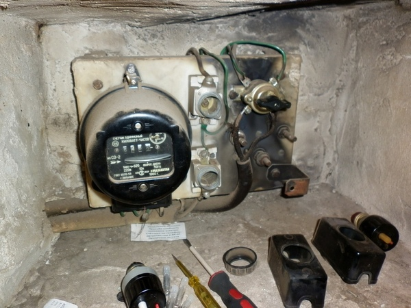
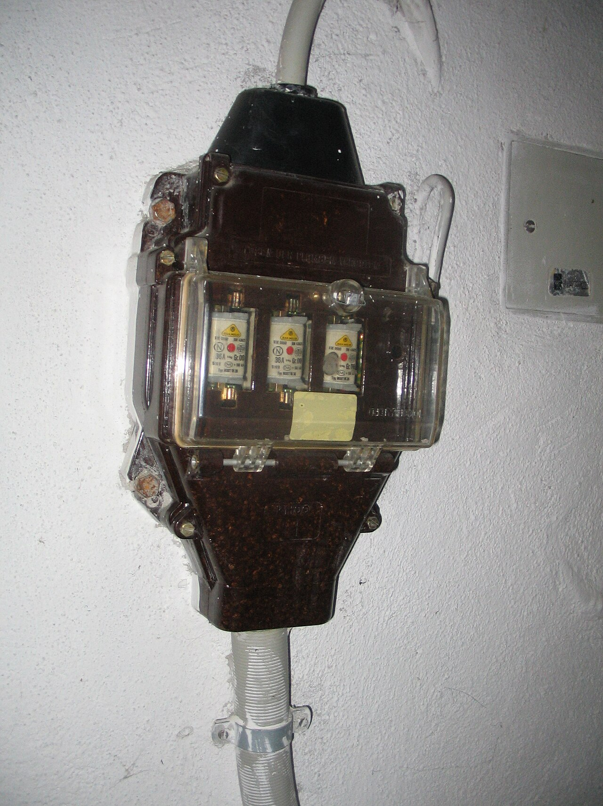
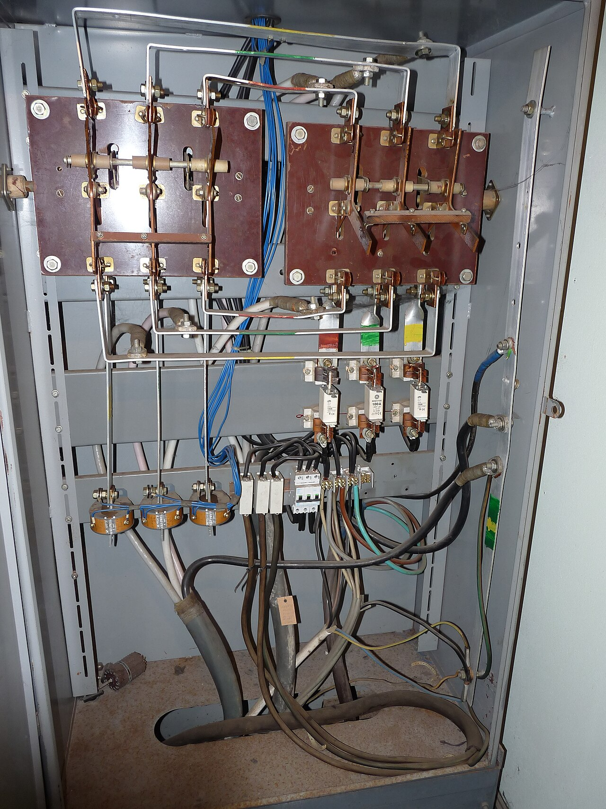
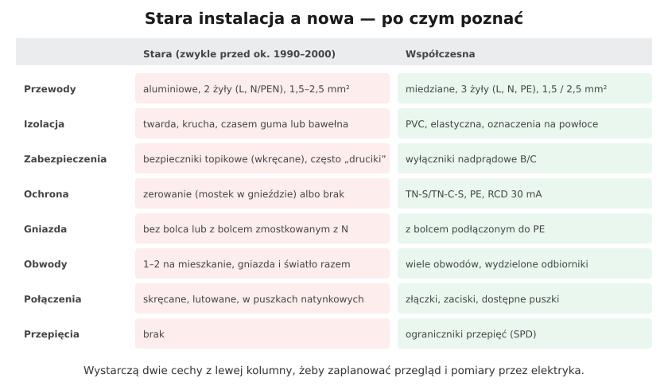

# 21.01 — Jak rozpoznać starą instalację

> **Moduł:** [21 — Stare instalacje](README.md) · **Oznaczenia:** 🏠📋 · **Zakres SEP:** (a) (c) (e) · **Status:** ✅ pełny
>
> **Czytaj:**
>
> - [Remont instalacji elektrycznej — Murator](https://muratordom.pl/remont-domu/remonty-instalacji/remont-instalacji-elektrycznej-koszt-wymiany-instalacji-aa-Mz6S-YDpK-fpNM.html)
> - Oględziny: [23.01](../23-pomiary-odbiorcze-i-okresowe/23.01-ogledziny-instalacji.md); kolory w starych instalacjach: [05.03](../05-przewody-i-kable/05.03-kolory-zyl-i-ich-znaczenie.md)

← (początek modułu) · [spis modułu](README.md) · [następny temat →](21.02-przewody-aluminiowe-zagrozenia-i-postepowanie.md)

## Po co to jest

Miliony mieszkań w Polsce mają instalacje z lat 60.–90.: aluminiowe przewody, dwie żyły, bezpieczniki topikowe, gniazda z mostkiem. Działały latami, ale nie mają ochrony, której dziś oczekujemy — a połączenia się starzeją. Przy kupnie mieszkania, remoncie albo pierwszej usterce trzeba umieć szybko ocenić, z czym masz do czynienia.

## Po ludzku

**Gdzie patrzeć:**

1. **Tablica / rozdzielnica** (często na klatce przy liczniku albo w przedpokoju):
   - bezpieczniki **topikowe wkręcane** (porcelanowe gniazda, wkładki z wziernikiem) zamiast wyłączników nadprądowych,
   - brak **różnicówki** (nie ma aparatu z przyciskiem TEST),
   - brak listwy **PE**; wszystko na jednym „zerze”,
   - wkładki „naprawiane” drutem — ⚠️ natychmiast do wymiany.
2. **Gniazdo** (po wyłączeniu i sprawdzeniu braku napięcia):
   - **dwie żyły** zamiast trzech,
   - **mostek** z zacisku N do bolca ([21.03](21.03-mostkowanie-bolca-ochronnego-w-gniazdku.md)),
   - gniazda **bez bolca**.
3. **Przewody:**
   - **srebrne żyły** — aluminium ([21.02](21.02-przewody-aluminiowe-zagrozenia-i-postepowanie.md)),
   - izolacja twarda, krucha, pękająca przy zginaniu,
   - kolory „nienormowe” (np. dwie czarne, szara jako N).
4. **Puszki** — połączenia skręcane, lutowane, owinięte taśmą; porcelanowe kostki.
5. **Obwody** — 1–2 na całe mieszkanie, gniazda i światło razem.

**Co to oznacza:** stara instalacja nie musi być od razu groźna — ale **nie ma ochrony przy uszkodzeniu** (brak PE, brak RCD), a jej połączenia mają za sobą dziesiątki lat nagrzewania. Ocenia ją elektryk: **oględziny + pomiary** (izolacja, ciągłość PE, pętla zwarcia). Wynik decyduje: modernizacja częściowa ([21.04](21.04-modernizacja-czesciowa.md)) czy wymiana ([21.05](21.05-wymiana-instalacji-plan-prac.md)).

## Jak to wygląda

*Na co patrzeć: licznik i porcelanowe gniazda bezpieczników wkręcanych w jednej wnęce, przewody w twardej izolacji. Tak wygląda zasilanie mieszkania sprzed kilkudziesięciu lat — bez różnicówki i bez PE.*

*Na co patrzeć: stara żeliwna obudowa bezpieczników (tzw. pancerna). Nie ma w niej miejsca na nic poza wkładkami — ani na różnicówkę, ani na listwę PE.*

*Na co patrzeć: przewody biegną bez ładu, część połączeń jest bezpośrednio na zaciskach rozłączników. Taka tablica nie spełnia dzisiejszych wymagań co do ochrony przed dotykiem ani podziału obwodów.*

## Schemat

## Pojęcia

| Pojęcie | Po ludzku | Termin normowy / symbol |
|---------|-----------|-------------------------|
| Instalacja dwuprzewodowa | Bez osobnego przewodu PE | TN-C w obwodach |
| Zerowanie | Bolec połączony z N | [12.06](../12-ochrona-przeciwporazeniowa/12.06-dawne-nazwy-zerowanie-uziemienie-ochronne.md) |
| Wkładka topikowa | Bezpiecznik z drucikiem w środku | [07.02](../07-zabezpieczenia-nadpradowe/07.02-bezpieczniki-topikowe-wkladki-gg-gwintowe-i.md) |
| Ocena stanu | Oględziny + pomiary | PN-HD 60364-6 |

## Liczby do zapamiętania

| Wielkość | Wartość | Kiedy obowiązuje | Źródło |
|----------|---------|------------------|--------|
| Kontrola instalacji w budynku | co najmniej raz na **5 lat** | budynki | art. 62 Prawa budowlanego |
| Wymóg żył miedzianych (dawne WT, § 183) | do **10 mm²** | nowe instalacje | rozporządzenie z 2002 r. |
| Typowe stare przewody | Al **1,5–4 mm²**, **2 żyły** | ok. lata 60.–90. | praktyka |
| Rezystancja izolacji | ≥ **1 MΩ** (500 V) | obwody do 500 V | PN-HD 60364-6 |

## W praktyce

- **Przy kupnie mieszkania** — otwórz jedno gniazdo (po wyłączeniu zasilania) i zajrzyj do tablicy; to 10 minut, które mówią, czy w budżecie remontu jest wymiana instalacji.
- **Zamów pomiary** u elektryka z uprawnieniami — protokół pokaże izolację i skuteczność ochrony.
- **Nie dokładaj nowych odbiorników** dużej mocy (płyta, bojler, klimatyzacja) do starych obwodów aluminiowych bez oceny.
- **Szybkie poprawki bez remontu**: wymiana bezpieczników na wyłączniki nadprądowe i dodanie RCD — tylko po ocenie, czy w instalacji nie ma mostków i wspólnych N ([21.04](21.04-modernizacja-czesciowa.md)).

## Błędy i zagrożenia

- ⚠️ **Wkładka „naprawiona” drutem** — obwód praktycznie bez zabezpieczenia; przewód może się stopić w ścianie.
- ⚠️ **Gniazda z mostkiem N–bolec** — przy przerwie N obudowa pralki ma 230 V ([21.03](21.03-mostkowanie-bolca-ochronnego-w-gniazdku.md)).
- **Uznanie instalacji za dobrą, „bo działa”** — połączenia aluminiowe działają, dopóki się nie przegrzeją.
- **Identyfikacja żył po kolorach** — w starych instalacjach kolory nie znaczą tego, co dziś. Każdą żyłę sprawdź pomiarem.

## Przykład

**Zadanie.** Mieszkanie z 1978 r. W przedpokoju tablica z czterema bezpiecznikami wkręcanymi 10 A, w gnieździe dwie srebrne żyły i mostek do bolca. Oceń i zaproponuj kolejne kroki.

**Rozwiązanie.** Cechy starej instalacji: **aluminium, dwie żyły, zerowanie, bezpieczniki topikowe, brak RCD**. Kroki: (1) pomiary przez elektryka (izolacja, pętla, stan połączeń), (2) sprawdzenie WLZ (czy jest PEN o przekroju pozwalającym na rozdział), (3) decyzja: przy remoncie — **wymiana całej instalacji** ([21.05](21.05-wymiana-instalacji-plan-prac.md)); bez remontu — modernizacja częściowa: nowa rozdzielnica, nowe obwody dla kuchni i łazienki, usunięcie mostków ([21.04](21.04-modernizacja-czesciowa.md)).

## Pytania SEP

1. **Po czym rozpoznać instalację wymagającą modernizacji?**

Odpowiedź

Po przewodach aluminiowych lub w kruchej, zestarzałej izolacji, instalacji dwuprzewodowej bez przewodu ochronnego (ochrona przez zerowanie, mostki w gniazdach), braku wyłączników różnicowoprądowych, zabezpieczeniach topikowych (zwłaszcza „naprawianych”), małej liczbie obwodów, połączeniach skręcanych w puszkach, śladach przegrzania, a przede wszystkim po wynikach pomiarów: zbyt małej rezystancji izolacji, braku ciągłości przewodów ochronnych lub niespełnionym warunku samoczynnego wyłączenia.

## Sprawdź się

1. W tabeli „stara a nowa” wybierz dwie cechy, które najbardziej wpływają na bezpieczeństwo ludzi (porażenie).

Odpowiedź

Brak przewodu PE (zerowanie, mostki w gniazdach) i brak wyłącznika różnicowoprądowego. Razem oznaczają, że przy uszkodzeniu izolacji obudowa może mieć napięcie, a nic tego szybko nie wyłączy.

## Źródła

- [Remont instalacji elektrycznej — koszt i zakres wymiany — Murator](https://muratordom.pl/remont-domu/remonty-instalacji/remont-instalacji-elektrycznej-koszt-wymiany-instalacji-aa-Mz6S-YDpK-fpNM.html).
- Prawo budowlane, art. 62 — kontrole okresowe.
- PN-HD 60364-6 — sprawdzanie.

---

← (początek modułu) · [spis modułu](README.md) · [następny temat →](21.02-przewody-aluminiowe-zagrozenia-i-postepowanie.md)
