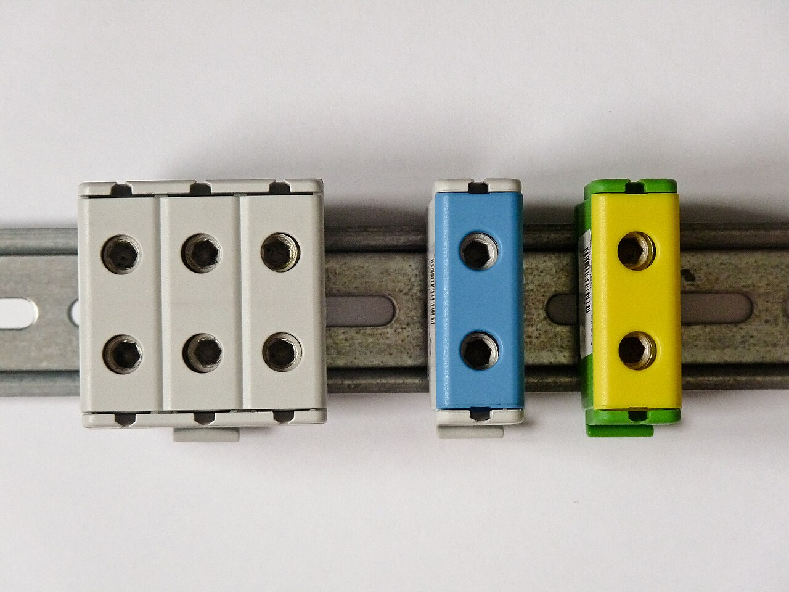
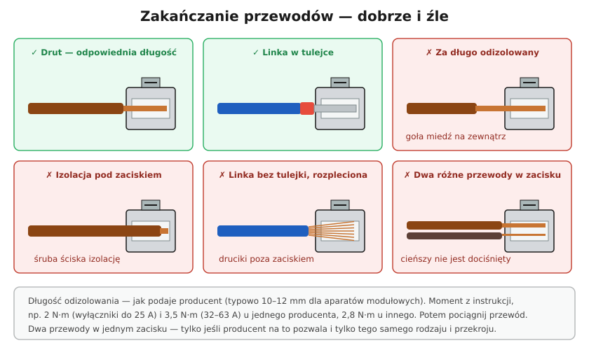

# 21.02 — Przewody aluminiowe — zagrożenia i postępowanie

> **Moduł:** [21 — Stare instalacje](README.md) · **Oznaczenia:** 🏠📋 · **Zakres SEP:** (a) (c) (e) · **Status:** ✅ pełny
>
> **Czytaj:**
>
> - Miedź a aluminium: [05.07](../05-przewody-i-kable/05.07-miedz-a-aluminium.md)
> - Grzejące się połączenia: [20.06](../20-diagnostyka-usterek/20.06-grzejace-sie-zaciski-i-zapach-spalenizny.md)

[← poprzedni temat](21.01-jak-rozpoznac-stara-instalacje.md) · [spis modułu](README.md) · [następny temat →](21.03-mostkowanie-bolca-ochronnego-w-gniazdku.md)

## Po co to jest

Przewody aluminiowe w mieszkaniach to dziedzictwo lat 60.–90. Samo aluminium dobrze przewodzi prąd — problemem są **połączenia**: utleniają się, luzują i grzeją. Przy każdej pracy w starej instalacji trzeba wiedzieć, jak się z nim obchodzić, żeby nie pogorszyć sytuacji, i kiedy powiedzieć „to trzeba wymienić”.

## Po ludzku

Przypomnienie z [05.07](../05-przewody-i-kable/05.07-miedz-a-aluminium.md) — aluminium:

- **utlenia się** od razu (tlenek jest izolatorem),
- **płynie** pod śrubą (zacisk się luzuje),
- **rozszerza się** z temperaturą bardziej niż miedź,
- **pęka** po kilkukrotnym zgięciu,
- **koroduje** w styku z miedzią przy wilgoci.

**Jak postępować przy pracy z aluminium:**

1. **Nie zginaj** żyły kilka razy w tym samym miejscu. Wyjmując gniazdo, prowadź przewody ostrożnie.
2. **Pęknięta lub nadłamana żyła** — odetnij do zdrowego miejsca; jeśli za krótka — przedłużenie w puszce **złączką dopuszczoną do Al–Cu** (z oznaczeniem Al, często z pastą kontaktową).
3. **Nie łącz Al z Cu bezpośrednio** (skręcenie, wspólny zacisk bez dopuszczenia do Al) — korozja galwaniczna.
4. **Złączki sprężynowe** — tylko te, które producent dopuszcza do aluminium (wiele popularnych złączek dźwigniowych jest **tylko do miedzi** — sprawdź opakowanie).
5. **Zaciski śrubowe** — oczyść żyłę z tlenku, użyj pasty kontaktowej, dokręć; po kilku tygodniach sprawdź dokręcenie (przy aparatach dopuszczonych do Al).
6. **Przegląd** — przy instalacji aluminiowej okresowo sprawdzaj ślady przegrzania w gniazdach i puszkach.

**Kiedy wymiana, a nie łatanie?** Gdy przewody pękają przy dotknięciu, izolacja się kruszy, w kilku miejscach są ślady przegrzania, pomiary izolacji są złe, albo planujesz remont z tynkowaniem — wtedy wymiana na miedź jest jedynym sensownym rozwiązaniem ([21.05](21.05-wymiana-instalacji-plan-prac.md)).

## Jak to wygląda

*Na co patrzeć: złączki przeznaczone do łączenia Al z Cu mają osobne otwory i zaciski z materiału odpornego na korozję. Na złączce lub w katalogu jest oznaczenie Al/Cu — bez niego złączka nie nadaje się do aluminium.*

## Schemat

## Pojęcia

| Pojęcie | Po ludzku | Termin normowy / symbol |
|---------|-----------|-------------------------|
| Tlenek glinu | Twarda, izolująca warstwa na aluminium | Al₂O₃ |
| Płynięcie | Powolne „uciekanie” metalu spod docisku | pełzanie (creep) |
| Złączka Al/Cu | Złączka dopuszczona do aluminium i miedzi | — |
| Pasta kontaktowa | Pasta usuwająca tlenek i chroniąca styk | — |
| ADY, ALY | Dawne oznaczenia przewodów aluminiowych | — |

## Liczby do zapamiętania

| Wielkość | Wartość | Kiedy obowiązuje | Źródło |
|----------|---------|------------------|--------|
| Rezystywność Al | **0,0286 Ω·mm²/m** (ok. 1,6 × Cu) | 20 °C | [05.07](../05-przewody-i-kable/05.07-miedz-a-aluminium.md) |
| Odpowiednik przekroju | Al 4 mm² ≈ Cu 2,5 mm² | obciążalność | PN-HD 60364-5-52 |
| PEN aluminiowy | ≥ **16 mm²** | instalacje stałe | PN-HD 60364-5-54 |
| Wymóg Cu w nowych instalacjach (dawne WT) | do **10 mm²** | budynki | § 183 rozp. z 2002 r. |

## W praktyce

- **Wymiana gniazda na żyłach Al** — dobierz gniazdo z zaciskami śrubowymi dopuszczonymi do Al albo połącz Al z krótkim odcinkiem Cu złączką Al/Cu w puszce, a gniazdo podłącz miedzią.
- **Puszki** — skręcane połączenia Al zastąp złączkami Al/Cu; ślady przegrzania → odetnij przegrzane końce.
- **Rozdzielnica** — przy wymianie tablicy na nową, żyły Al podłącz przez złączki szynowe Al/Cu, a do aparatów idź miedzią.
- **Nie obciążaj** starych obwodów Al dużymi odbiornikami (płyta, bojler, grzejnik) — dla nich nowy obwód z miedzi.

## Błędy i zagrożenia

- ⚠️ **Skręcenie Al z Cu** i owinięcie taśmą — korozja, grzanie, pożar w puszce.
- ⚠️ **Złączka „tylko do Cu”** na aluminium — dobra złączka, źle użyta.
- **Kilkukrotne zginanie** przy wyjmowaniu gniazda — pęknięcie wewnątrz izolacji, przerwa „bez powodu”.
- **Dokręcanie zacisku „na siłę”** — aluminium się spłaszcza i potem bardziej płynie.

## Przykład

**Zadanie.** W kuchni z instalacją Al 2,5 mm² (2 żyły) chcesz podłączyć zmywarkę 2,2 kW. Czy wystarczy wymienić gniazdo?

**Rozwiązanie.** Nie. Obwód aluminiowy 2,5 mm² obsługuje zwykle kilka gniazd; dodanie zmywarki (ok. 10 A przez dłuższy czas) obciąży stare połączenia, które najłatwiej się grzeją. Do tego brak PE — zmywarka z metalowymi częściami w wilgotnym otoczeniu. Właściwie: **nowy obwód miedziany 3 × 2,5 mm²** z rozdzielnicy (z punktu rozdziału PEN, [21.04](21.04-modernizacja-czesciowa.md)), B16, RCD 30 mA typ A.

## Pytania SEP

1. **Jakie zagrożenia stwarzają przewody aluminiowe w starych instalacjach i jak z nimi postępować?**

Odpowiedź

Aluminium utlenia się, płynie pod naciskiem zacisku, ma dużą rozszerzalność cieplną i jest kruche przy wielokrotnym zginaniu; w styku z miedzią przy wilgoci koroduje. Prowadzi to do wzrostu rezystancji połączeń, ich nagrzewania i ryzyka pożaru oraz do przerw w przewodach. Postępowanie: unikać zginania, łączyć Al z Cu wyłącznie złączkami do tego przeznaczonymi (z pastą), oczyszczać żyły, dokręcać zaciski i okresowo sprawdzać połączenia, nie dociążać obwodów aluminiowych, a przy remoncie wymieniać instalację na miedzianą.

## Sprawdź się

1. Dlaczego połączenie Al skręcone z Cu w puszce przy łazience grzeje się po kilku latach, choć na początku działało?

Odpowiedź

Wilgoć tworzy na styku Al–Cu ogniwo galwaniczne — aluminium koroduje. Do tego aluminium utlenia się i płynie, a każde nagrzanie i ostygnięcie luzuje skręcenie. Rezystancja styku rośnie, połączenie grzeje się coraz bardziej.

## Źródła

- [05.07 — Miedź a aluminium](../05-przewody-i-kable/05.07-miedz-a-aluminium.md).
- PN-HD 60364-5-52 — połączenia elektryczne (526).
- Instrukcje złączek (dopuszczenie do Al, pasty kontaktowe).

---

[← poprzedni temat](21.01-jak-rozpoznac-stara-instalacje.md) · [spis modułu](README.md) · [następny temat →](21.03-mostkowanie-bolca-ochronnego-w-gniazdku.md)
