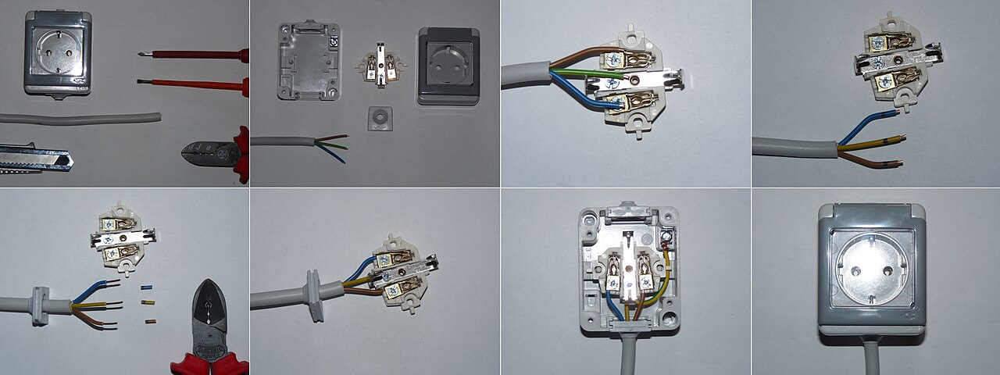
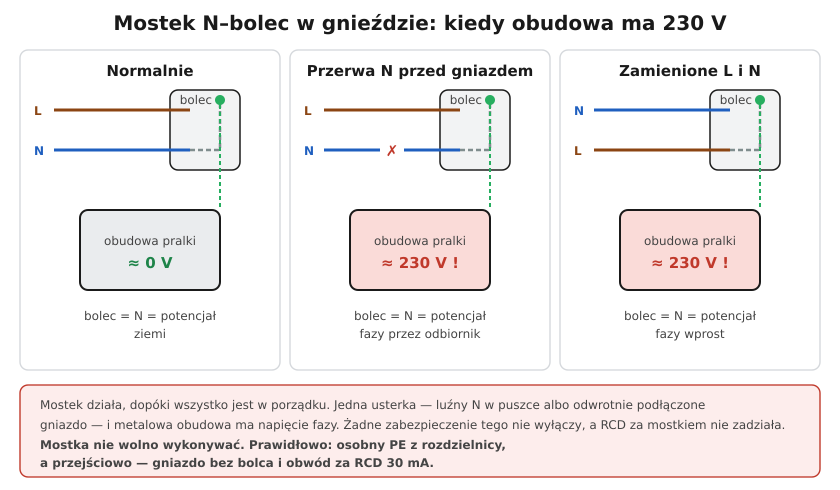

# 21.03 — Mostkowanie bolca ochronnego w gniazdku — dlaczego zabija

> **Moduł:** [21 — Stare instalacje](README.md) · **Oznaczenia:** 🏠📋 · **Zakres SEP:** (a) (c) (e) · **Status:** ✅ pełny
>
> **Czytaj:**
>
> - Zerowanie i dawne nazwy: [12.06](../12-ochrona-przeciwporazeniowa/12.06-dawne-nazwy-zerowanie-uziemienie-ochronne.md)
> - Układ TN-C: [11.02](../11-uklady-sieci/11.02-uklad-tn-c.md); gniazdo: [06.01](../06-osprzet-instalacyjny/06.01-gniazda-wtyczkowe-jednofazowe-z-bolcem.md)

[← poprzedni temat](21.02-przewody-aluminiowe-zagrozenia-i-postepowanie.md) · [spis modułu](README.md) · [następny temat →](21.04-modernizacja-czesciowa.md)

## Po co to jest

„Mostek” to kawałek drutu w gnieździe, który łączy zacisk N z bolcem ochronnym. Tak robiono „zerowanie” w instalacjach dwuprzewodowych i tak niektórzy robią dziś, „żeby było z bolcem”. Działa, dopóki nic się nie zepsuje. Wystarczy jedna typowa usterka, żeby metalowa obudowa pralki miała pełne napięcie fazy. To zagadnienie, o które pyta komisja i które spotkasz w każdym starym bloku.

## Po ludzku

W gnieździe z mostkiem **bolec = przewód N**. A przewód N:

- **ma potencjał bliski ziemi tylko wtedy, gdy jest ciągły** aż do punktu uziemienia sieci,
- **niesie prąd roboczy** — na nim jest spadek napięcia (kilka woltów na obudowie przy pracy dużego odbiornika),
- **może się przerwać** — luźny zacisk w puszce, w poprzednim gnieździe, na listwie.

**Trzy scenariusze:**

1. **Wszystko sprawne** — obudowa ma ok. 0 V (plus kilka woltów spadku na N). „Działa”.
2. **Przerwa N przed gniazdem** — odbiornik nie pracuje, ale przez jego uzwojenia/grzałkę faza przechodzi na odcięty N, a więc **na bolec i obudowę: ok. 230 V**. Nic tego nie wyłączy — nie ma zwarcia ani dużego prądu.
3. **Zamienione L i N** (ktoś podłączył gniazdo odwrotnie, zamienione żyły w puszce) — bolec dostaje **fazę wprost**. Obudowa urządzenia klasy I jest pod napięciem od chwili włożenia wtyczki.

**Dlaczego różnicówka nie pomoże?** Za mostkiem prąd uszkodzenia z obudowy wraca przez bolec do N — czyli przez RCD. Różnicówka widzi równe prądy w L i N i nie reaguje.

**Co robić z mostkiem:**

- **docelowo** — doprowadzić **osobny PE** z rozdzielnicy (punkt rozdziału PEN, [21.04](21.04-modernizacja-czesciowa.md)),
- **przejściowo** — **usunąć mostek**, założyć gniazdo **bez bolca** (albo zostawić bolec niepodłączony i oznaczyć gniazdo) i objąć obwód **RCD 30 mA**. Urządzenia klasy I nie mają wtedy ochrony przy uszkodzeniu, ale RCD zadziała, gdy prąd popłynie przez człowieka do ziemi. To rozwiązanie na czas do modernizacji, nie na zawsze.

**Nie wolno** wykonywać nowych mostków ani „odtwarzać” ich przy wymianie gniazda.

## Jak to wygląda

*Na co patrzeć: w prawidłowym gnieździe do zacisku bolca dochodzi osobna żółto-zielona żyła z rozdzielnicy. W gnieździe z mostkiem jest tam krótki drucik od zacisku N — i tylko dwie żyły w puszce.*

## Schemat

## Pojęcia

| Pojęcie | Po ludzku | Termin normowy / symbol |
|---------|-----------|-------------------------|
| Mostek | Drut łączący N z bolcem w gnieździe | „zerowanie” w gnieździe |
| PEN w obwodzie | Jedna żyła jako N i PE | TN-C (niedopuszczalne < 10 mm² Cu) |
| Urządzenie klasy I | Z metalową obudową połączoną z PE | [06.06](../06-osprzet-instalacyjny/06.06-klasy-ochronnosci-urzadzen-0-i-ii-iii.md) |
| Rozwiązanie przejściowe | Gniazdo bez bolca + RCD | — |

## Liczby do zapamiętania

| Wielkość | Wartość | Kiedy obowiązuje | Źródło |
|----------|---------|------------------|--------|
| PEN — minimalny przekrój | **10 mm² Cu / 16 mm² Al** | instalacje stałe | PN-HD 60364-5-54 |
| Napięcie na obudowie przy przerwie N | ok. **230 V** | gniazdo z mostkiem | — |
| RCD za mostkiem | **nie działa** przy uszkodzeniu obudowy | — | [08.01](../08-wylaczniki-roznicowopradowe/08.01-zasada-dzialania-wylacznika-roznicowopradowego.md) |

## W praktyce

- **Znalazłeś mostek** przy wymianie gniazda — nie odtwarzaj go; zastosuj rozwiązanie przejściowe i zaplanuj modernizację.
- **Sprawdź całe mieszkanie** — mostki bywają we wszystkich gniazdach albo tylko w niektórych („bo pralka miała wtyczkę z bolcem”).
- **Tester gniazd** pokaże „PE OK” przy mostku — bo bolec ma potencjał N, bliski ziemi. Mostek widać dopiero po otwarciu gniazda (po wyłączeniu zasilania).

## Błędy i zagrożenia

- ⚠️ **Mostek w gnieździe pralki lub czajnika** — metalowa obudowa, woda, przerwa N = porażenie.
- ⚠️ **Mostek za różnicówką** — RCD nie działa, a dodatkowo prąd roboczy płynie po obudowach.
- **Zostawienie „pustego” bolca bez informacji** — domownik myśli, że gniazdo ma ochronę.
- **„Uziemienie” bolca do rury wodnej lub grzejnika** — niedopuszczalne jako przewód ochronny.

## Przykład

**Zadanie.** Pralka w łazience w bloku z lat 70. podłączona do gniazda z mostkiem. Sąsiad zgłosił, że „kopie” przy dotknięciu pralki i wanny jednocześnie, ale tylko czasem. Co się dzieje?

**Rozwiązanie.** Najpewniej **słaby styk N** (utleniony zacisk aluminiowy w puszce) przed gniazdem: przy pracy pralki na rezystancji styku odkłada się kilkanaście–kilkadziesiąt woltów, które przez mostek trafiają na obudowę pralki. Wanna ma potencjał ziemi (rury) → napięcie między pralką a wanną. Przy całkowitej przerwie N byłoby ok. 230 V. **Natychmiast**: odłączyć pralkę, wyłączyć obwód, usunąć mostek, naprawić połączenia N; docelowo nowy obwód z PE i RCD 30 mA dla łazienki ([17.01](../17-pomieszczenia-szczegolne/17.01-lazienka-strefy-0-1-i-2.md)).

## Pytania SEP

1. **Dlaczego nie wolno łączyć styku ochronnego gniazda z przewodem neutralnym w gnieździe?**

Odpowiedź

Bo bolec ochronny przyjmuje wtedy potencjał przewodu N, który niesie prąd roboczy i może się przerwać lub zostać zamieniony z fazą. Przy przerwie N przed gniazdem na obudowie urządzenia klasy I pojawia się napięcie fazowe przez odbiornik, przy zamianie L z N — faza wprost; żadne zabezpieczenie tego nie wyłączy, a wyłącznik różnicowoprądowy za takim mostkiem nie wykryje prądu uszkodzenia. Przewód PEN o przekroju mniejszym niż 10 mm² Cu jest niedopuszczalny, więc obwody odbiorcze muszą mieć osobny przewód PE.

## Sprawdź się

1. Na schemacie, w trzecim panelu: dlaczego obudowa ma napięcie od razu, a nie dopiero po usterce?

Odpowiedź

Bo zamienione L i N oznaczają, że mostek łączy bolec z **fazą**. Obudowa urządzenia klasy I dostaje napięcie fazowe w chwili włożenia wtyczki — bez żadnej dodatkowej usterki.

## Źródła

- PN-HD 60364-5-54 — przewody ochronne i PEN (543.4).
- PN-HD 60364-4-41 — samoczynne wyłączenie zasilania.
- [12.06 — Dawne nazwy: zerowanie](../12-ochrona-przeciwporazeniowa/12.06-dawne-nazwy-zerowanie-uziemienie-ochronne.md).

---

[← poprzedni temat](21.02-przewody-aluminiowe-zagrozenia-i-postepowanie.md) · [spis modułu](README.md) · [następny temat →](21.04-modernizacja-czesciowa.md)
