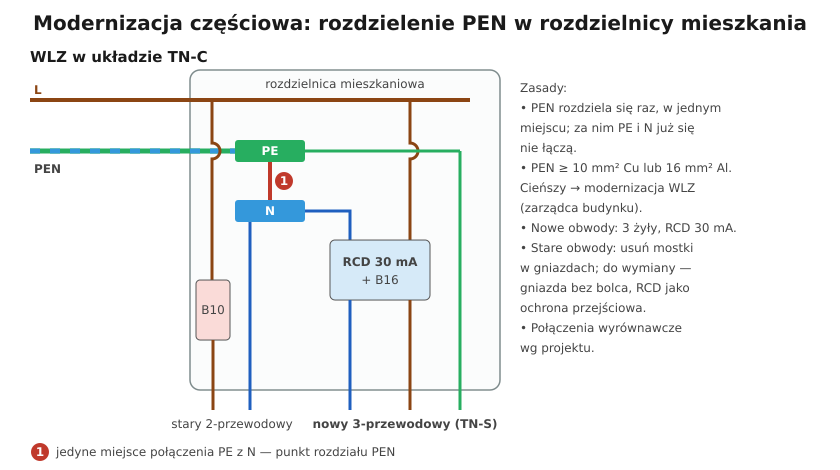

# 21.04 — Modernizacja częściowa

> **Moduł:** [21 — Stare instalacje](README.md) · **Oznaczenia:** 🏠📋 · **Zakres SEP:** (a) (c) (e) · **Status:** ✅ pełny
>
> **Czytaj:**
>
> - Punkt rozdziału PEN: [11.04](../11-uklady-sieci/11.04-uklad-tn-c-s-i-punkt-rozdzialu-pen.md)
> - [Remont instalacji — Murator](https://muratordom.pl/remont-domu/remonty-instalacji/remont-instalacji-elektrycznej-koszt-wymiany-instalacji-aa-Mz6S-YDpK-fpNM.html)

[← poprzedni temat](21.03-mostkowanie-bolca-ochronnego-w-gniazdku.md) · [spis modułu](README.md) · [następny temat →](21.05-wymiana-instalacji-plan-prac.md)

## Po co to jest

Nie zawsze da się od razu wymienić całą instalację — mieszkanie jest umeblowane, budżet ograniczony, remont dotyczy tylko kuchni. Modernizacja częściowa podnosi bezpieczeństwo tam, gdzie zysk jest największy. Ale ma swoje pułapki: nowe elementy muszą współpracować ze starymi, a niektóre „ulepszenia” (np. różnicówka na instalacji z mostkami) nie zadziałają.

## Po ludzku

**Kolejność, od największego zysku:**

1. **Ocena** — pomiary, sprawdzenie WLZ i przekroju PEN ([21.01](21.01-jak-rozpoznac-stara-instalacje.md)).
2. **Nowa rozdzielnica** z wyłącznikami nadprądowymi, różnicówkami, listwami PE i N, ogranicznikiem przepięć — w miejscu starej tablicy. **PEN rozdziela się tu na PE i N** (jeśli WLZ na to pozwala).
3. **Nowe obwody dla miejsc najbardziej narażonych** — łazienka, kuchnia, pralka, zmywarka, płyta — **trzyżyłowe, miedziane, z RCD 30 mA**.
4. **Stare obwody** zostają do czasu remontu, ale:
   - **usuń mostki** w gniazdach ([21.03](21.03-mostkowanie-bolca-ochronnego-w-gniazdku.md)),
   - przegląd połączeń (aluminium, puszki),
   - jeśli możliwe — **RCD 30 mA** także na nie.
5. **Wymiana całości** przy najbliższym remoncie ([21.05](21.05-wymiana-instalacji-plan-prac.md)).

**Rozdzielenie PEN — zasady** ([11.04](../11-uklady-sieci/11.04-uklad-tn-c-s-i-punkt-rozdzialu-pen.md)):

- PEN dzieli się na PE i N **raz**, w jednym miejscu (listwa PE + listwa N z mostkiem). **Za tym punktem PE i N nigdy się już nie łączą.**
- PEN musi mieć co najmniej **10 mm² Cu albo 16 mm² Al**. W starych blokach WLZ do mieszkania bywa cieńsza — wtedy potrzebna jest **modernizacja WLZ** (sprawa zarządcy budynku / spółdzielni).
- PE z punktu rozdziału łączy się z połączeniami wyrównawczymi budynku zgodnie z projektem.

**Pułapki przy dokładaniu RCD do starych obwodów:**

- **mostek w gnieździe za RCD** — RCD nie wykryje uszkodzenia obudowy; trzeba usunąć mostki;
- **wspólne N kilku obwodów** (częste w starych instalacjach: jeden N na dwa obwody) — jeśli te obwody trafią za różne RCD, oba będą wybijać; trzeba je razem objąć jedną różnicówką albo rozdzielić N;
- **wilgotne, zużyte instalacje** — RCD od razu ujawni upływ (i dobrze — to usterka, którą trzeba naprawić, a nie powód do rezygnacji z RCD).

## Jak to wygląda

*Na co patrzeć: osobne listwy N i PE — to po modernizacji. Stare obwody dwuprzewodowe podłącza się tylko do listwy N (bez PE), nowe — do obu. Mostek PE–N jest tylko w jednym miejscu: w punkcie rozdziału PEN.*

## Schemat

## Pojęcia

| Pojęcie | Po ludzku | Termin normowy / symbol |
|---------|-----------|-------------------------|
| Punkt rozdziału PEN | Miejsce podziału PEN na PE i N | TN-C-S, [11.04](../11-uklady-sieci/11.04-uklad-tn-c-s-i-punkt-rozdzialu-pen.md) |
| Modernizacja częściowa | Poprawa wybranych elementów instalacji | — |
| Wspólny N | Jeden przewód N dla kilku obwodów | niedopuszczalne przy RCD w różnych grupach |
| WLZ | Linia od licznika do mieszkania | [14.04](../14-od-slupa-do-gniazdka/14.04-wewnetrzna-linia-zasilajaca-wlz.md) |

## Liczby do zapamiętania

| Wielkość | Wartość | Kiedy obowiązuje | Źródło |
|----------|---------|------------------|--------|
| Przekrój PEN | ≥ **10 mm² Cu / 16 mm² Al** | rozdział w rozdzielnicy | PN-HD 60364-5-54 |
| Połączenie PE z N | **tylko** w punkcie rozdziału | zawsze | jw. |
| RCD dla nowych obwodów | **30 mA**, typ A | gniazda, łazienka, kuchnia | PN-HD 60364-4-41, 7-701 |
| Priorytet | łazienka, kuchnia, pralka | najwyższe ryzyko | praktyka |

## W praktyce

- **Uzgodnij z zarządcą budynku** stan WLZ — czy można rozdzielić PEN w mieszkaniu, czy jest plan modernizacji pionów.
- **Opisz w rozdzielnicy**, które obwody są stare (bez PE) — następny elektryk musi to wiedzieć.
- **Dokumentuj pomiary** przed i po — pokazują, co się poprawiło i gdzie zostało ryzyko.
- **Nie łącz nowego PE ze starym N** gdziekolwiek poza punktem rozdziału — nawet „tymczasowo”.

## Błędy i zagrożenia

- ⚠️ **Rozdzielenie PEN, a potem mostek PE–N w puszce lub gnieździe** — prąd roboczy płynie po PE, RCD wybija albo nie działa.
- ⚠️ **Rozdział PEN przy zbyt cienkim WLZ** — przerwa PEN w WLZ daje napięcie na wszystkich obudowach podłączonych do PE.
- **RCD na obwodach z mostkami** — fałszywe poczucie bezpieczeństwa.
- **Nowa rozdzielnica bez rezerwy** — kolejne etapy modernizacji nie mają gdzie się zmieścić.

## Przykład

**Zadanie.** Mieszkanie w bloku: WLZ 4 × 16 mm² Al (L1, L2, L3, PEN), tablica z bezpiecznikami, instalacja dwuprzewodowa Al. Planujesz remont tylko łazienki i kuchni. Co zrobić?

**Rozwiązanie.**

1. PEN 16 mm² Al — **można** rozdzielić w rozdzielnicy mieszkania (≥ 16 mm² Al).
2. Nowa rozdzielnica: rozłącznik, SPD, listwy PE i N z jednym mostkiem (punkt rozdziału), 2 × RCD 30 mA typ A, wyłączniki.
3. Nowe obwody 3-żyłowe Cu: łazienka (gniazda, oświetlenie), kuchnia (gniazda nad blatem, płyta 3-faz., zmywarka), pralka.
4. Stare obwody pokoi: przegląd, **usunięcie mostków**, podłączenie do listwy N; jeśli N obwodów nie są wspólne — za RCD.
5. Pomiary i protokół; w opisie rozdzielnicy — które obwody są stare.

## Pytania SEP

1. **Na czym polega modernizacja instalacji dwuprzewodowej w budynku mieszkalnym?**

Odpowiedź

Na przejściu z układu TN-C w obwodach odbiorczych na TN-C-S: w rozdzielnicy (przy odpowiednim przekroju PEN — co najmniej 10 mm² Cu lub 16 mm² Al) rozdziela się PEN na PE i N, po czym prowadzi nowe obwody trzyprzewodowe z osobnym PE, chronione wyłącznikami nadprądowymi i różnicowoprądowymi 30 mA. Za punktem rozdziału nie wolno ponownie łączyć PE z N. Usuwa się mostki w gniazdach, wymienia przewody aluminiowe na miedziane, wykonuje połączenia wyrównawcze i ochronę przeciwprzepięciową, a całość sprawdza pomiarami.

2. **Dlaczego po rozdzieleniu PEN na PE i N nie wolno ich ponownie połączyć?**

Odpowiedź

Bo część prądu roboczego popłynęłaby przewodem PE i połączonymi z nim częściami przewodzącymi (obudowy, rury), wyłączniki różnicowoprądowe działałyby nieprawidłowo (zbędne zadziałania albo brak zadziałania), a przerwa w N mogłaby przenieść napięcie na obudowy. Układ wróciłby do wad TN-C.

## Sprawdź się

1. Na schemacie znajdź jedyne miejsce, gdzie PE łączy się z N. Co by się stało, gdyby ktoś dodał drugi mostek w gnieździe nowego obwodu?

Odpowiedź

Mostek oznaczony „1” między listwą PE a listwą N. Drugi mostek w gnieździe za RCD sprawiłby, że część prądu N wracałaby przez PE — różnicówka wykryłaby różnicę i by wybijała (a przy uszkodzeniu obudowy mogłaby nie zadziałać prawidłowo).

## Źródła

- PN-HD 60364-5-54 — przewody ochronne i PEN.
- PN-HD 60364-4-41 — ochrona przeciwporażeniowa.
- [Remont instalacji elektrycznej — Murator](https://muratordom.pl/remont-domu/remonty-instalacji/remont-instalacji-elektrycznej-koszt-wymiany-instalacji-aa-Mz6S-YDpK-fpNM.html).

---

[← poprzedni temat](21.03-mostkowanie-bolca-ochronnego-w-gniazdku.md) · [spis modułu](README.md) · [następny temat →](21.05-wymiana-instalacji-plan-prac.md)
