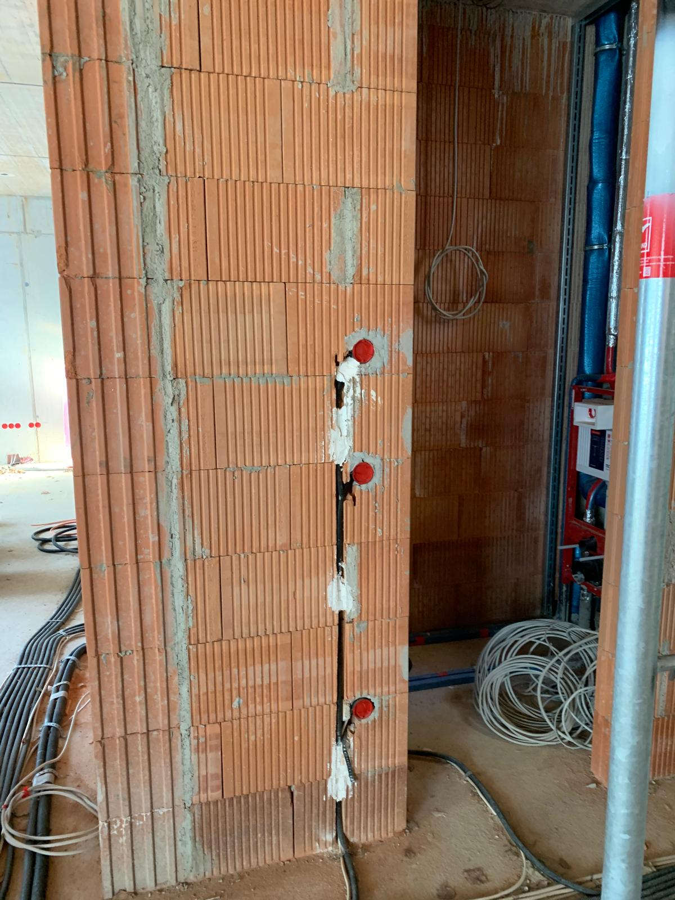
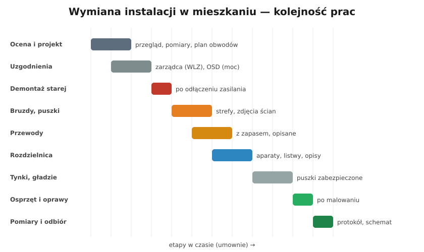

# 21.05 — Wymiana instalacji — plan prac

> **Moduł:** [21 — Stare instalacje](README.md) · **Oznaczenia:** 🏠📋 · **Zakres SEP:** (a) (c) (e) · **Status:** ✅ pełny
>
> **Czytaj:**
>
> - [Pełna przebudowa instalacji — Murator](https://muratordom.pl/remont-domu/remonty-instalacji/pelna-przebudowa-instalacji-aa-PsoJ-HUeA-CRVV.html)
> - Planowanie: [moduł 16](../16-planowanie-obwodow/README.md); rozdzielnica: [moduł 15](../15-rozdzielnica-mieszkaniowa/README.md); pomiary: [moduł 23](../23-pomiary-odbiorcze-i-okresowe/README.md)

[← poprzedni temat](21.04-modernizacja-czesciowa.md) · [spis modułu](README.md) · (koniec modułu) →

## Po co to jest

Wymiana instalacji to praca na kilka tygodni, z kuciem, tynkami i odbiorem. Źle zaplanowana kończy się bruzdami w świeżych gładziach, brakującym obwodem na klimatyzację albo mieszkaniem bez prądu przez miesiąc. Ten temat zbiera wszystkie poprzednie w jeden plan.

## Po ludzku

**Etapy:**

1. **Ocena i projekt.** Pomiary starej instalacji, sprawdzenie WLZ i mocy przyłączeniowej. Plan obwodów ([16.01](../16-planowanie-obwodow/16.01-podzial-instalacji-na-obwody.md)), rozmieszczenie gniazd i łączników ([16.05](../16-planowanie-obwodow/16.05-wysokosci-montazu-i-liczba-gniazd.md)) z planem mebli, schemat rozdzielnicy ([15.02](../15-rozdzielnica-mieszkaniowa/15.02-schemat-jednokreskowy-jak-czytac-i-jak-rysowac.md)), przewody słaboprądowe (sieć, antena, domofon).
2. **Uzgodnienia.** Zarządca budynku (WLZ, prace w częściach wspólnych, hałas), operator (zwiększenie mocy, [14.05](../14-od-slupa-do-gniazdka/14.05-moc-przylaczeniowa-i-taryfy.md)).
3. **Zasilanie tymczasowe.** Na czas prac — rozdzielnica tymczasowa z RCD 30 mA i kilkoma gniazdami dla ekip.
4. **Demontaż starej instalacji** — po odłączeniu; przewody, których nie da się wyjąć, odciąć i zaizolować na obu końcach (żeby nikt ich nie podłączył przez pomyłkę).
5. **Trasy, bruzdy, puszki** — w strefach ([16.04](../16-planowanie-obwodow/16.04-strefy-instalacyjne-i-trasy-przewodow.md), [19.06](../19-prace-krok-po-kroku/19.06-bruzdy-puszki-i-prowadzenie-przewodow-w-scianie.md)).
6. **Przewody** — z zapasem w puszkach i rozdzielnicy, **opisane na obu końcach**. Zdjęcia ścian z miarką.
7. **Rozdzielnica** — aparaty, listwy, grzebienie, opisy ([15.07](../15-rozdzielnica-mieszkaniowa/15.07-montaz-i-porzadek-przewodow-w-rozdzielnicy.md)).
8. **Pomiar izolacji przed tynkowaniem** — uszkodzony przewód łatwo wymienić teraz, nie po gładziach.
9. **Tynki, gładzie, malowanie** — puszki zabezpieczone.
10. **Osprzęt i oprawy** — po malowaniu.
11. **Pomiary odbiorcze i dokumentacja** — protokół, schemat rozdzielnicy, zdjęcia tras ([moduł 23](../23-pomiary-odbiorcze-i-okresowe/README.md)).

**Kto co robi:** elektryk z uprawnieniami (eksploatacja; pomiary — z odpowiednim zakresem), dla części wspólnych i WLZ — zarządca i jego wykonawca; przy liczniku i złączu — tylko operator.

## Jak to wygląda

*Na co patrzeć: etap „przewody w ścianach, przed tynkiem”. Teraz robi się zdjęcia z miarką i pomiar izolacji — po tynkowaniu każda poprawka to kucie.*

## Schemat

## Pojęcia

| Pojęcie | Po ludzku | Termin normowy / symbol |
|---------|-----------|-------------------------|
| Projekt instalacji | Plan obwodów, tras i rozdzielnicy | — |
| Zasilanie tymczasowe | Prąd dla ekip na czas remontu | — |
| Dokumentacja powykonawcza | Schemat, zdjęcia, protokół | — |
| Sprawdzenie odbiorcze | Pomiary przed oddaniem do użytku | PN-HD 60364-6 |

## Liczby do zapamiętania

| Wielkość | Wartość | Kiedy obowiązuje | Źródło |
|----------|---------|------------------|--------|
| Minimalna liczba obwodów oświetl. + gniazd | 2–6 wg metrażu (+ obwody wydzielone) | mieszkania | N SEP-E-002, [16.01](../16-planowanie-obwodow/16.01-podzial-instalacji-na-obwody.md) |
| Rezerwa w rozdzielnicy | **20–30 %** | — | [15.01](../15-rozdzielnica-mieszkaniowa/15.01-budowa-rozdzielnicy-obudowa-szyna-th35-listwy-n.md) |
| Rezystancja izolacji | ≥ **1 MΩ** (500 V) | przed tynkiem i przy odbiorze | PN-HD 60364-6 |
| Kontrola okresowa | co **5 lat** | budynki | art. 62 Prawa budowlanego |

## W praktyce

- **Zaplanuj więcej, niż potrzebujesz dziś**: przewód do miejsca na klimatyzację, puszka pod wallbox w garażu, przewód sieciowy do każdego pokoju, rezerwa w rozdzielnicy.
- **Przewody opisane na obu końcach** (np. „G3 sypialnia”) — oszczędzają godziny przy podłączaniu rozdzielnicy.
- **Pomiar przed tynkowaniem** — to najtańszy moment na wykrycie przewodu przeciętego bruzdownicą.
- **Dokumentację zostaw w mieszkaniu** — schemat w drzwiczkach rozdzielnicy, zdjęcia i protokół u właściciela.

## Błędy i zagrożenia

- ⚠️ **Stare przewody zostawione w ścianie i podłączone „przy okazji”** — mieszanka starej i nowej instalacji, której nikt nie zna.
- **Osprzęt montowany przed malowaniem** — zamalowane gniazda, farba w mechanizmach.
- **Brak zdjęć tras** — za rok nikt nie wie, gdzie bezpiecznie wiercić.
- **Prace bez uzgodnienia z zarządcą** — wyłączenia na klatce, ingerencja w WLZ.

## Przykład

**Zadanie.** Kawalerka 32 m² w bloku, instalacja Al dwuprzewodowa, WLZ 1-faz. 10 mm² Cu (L, PEN). Kolejność i zakres wymiany?

**Rozwiązanie.**

1. Pomiary i projekt: PEN 10 mm² Cu — rozdział możliwy; obwody: oświetlenie (2), gniazda pokój, gniazda kuchnia, łazienka, płyta (1-faz. — ograniczenie mocy płyty lub uzgodnienie zwiększenia mocy), pralka, rezerwa.
2. Zarządca — zgoda na prace, informacja o stanie WLZ.
3. Zasilanie tymczasowe, demontaż starej instalacji.
4. Bruzdy, puszki, przewody Cu 3-żyłowe, zdjęcia.
5. Rozdzielnica: rozłącznik, SPD, 2 × RCD 30 mA typ A, wyłączniki, punkt rozdziału PEN ([15.04](../15-rozdzielnica-mieszkaniowa/15.04-przyklad-kawalerka-zasilanie-jednofazowe.md)).
6. Pomiar izolacji, tynki, malowanie, osprzęt.
7. Pomiary odbiorcze, protokół, schemat w rozdzielnicy.

## Pytania SEP

1. **Jakie czynności obejmuje wymiana instalacji elektrycznej w mieszkaniu?**

Odpowiedź

Ocenę stanu istniejącej instalacji i zasilania (WLZ, moc przyłączeniowa), opracowanie projektu (podział na obwody, dobór przewodów i zabezpieczeń, rozdzielnica, trasy), uzgodnienia z zarządcą i operatorem, demontaż starej instalacji po odłączeniu zasilania, wykonanie bruzd i osadzenie puszek, ułożenie przewodów, montaż rozdzielnicy z rozdziałem PEN, połączenia wyrównawcze, montaż osprzętu, a na końcu sprawdzenie odbiorcze (oględziny i pomiary) i przekazanie dokumentacji powykonawczej z protokołem pomiarów.

## Sprawdź się

1. Dlaczego warto zmierzyć rezystancję izolacji przed tynkowaniem, skoro i tak mierzy się ją przy odbiorze?

Odpowiedź

Bo uszkodzenie przewodu (przecięcie bruzdownicą, przebicie kołkiem) wykryte przed tynkowaniem naprawia się w kilka minut. Po tynkach i gładziach trzeba kuć ścianę i powtarzać wykończenie.

## Źródła

- [Pełna przebudowa instalacji — Murator](https://muratordom.pl/remont-domu/remonty-instalacji/pelna-przebudowa-instalacji-aa-PsoJ-HUeA-CRVV.html).
- N SEP-E-002 — instalacje w budynkach mieszkalnych.
- PN-HD 60364-6 — sprawdzanie odbiorcze.

---

[← poprzedni temat](21.04-modernizacja-czesciowa.md) · [spis modułu](README.md) · (koniec modułu) →
