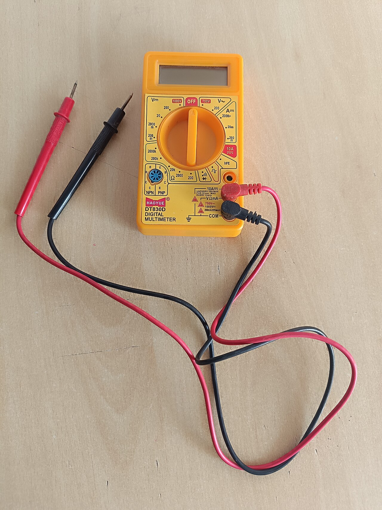
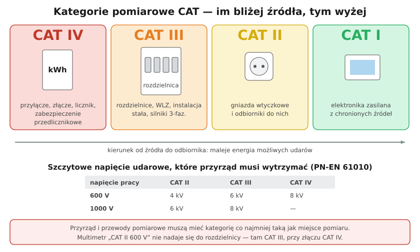

# 22.01 — Kategorie pomiarowe CAT II–IV i bezpieczeństwo przyrządów

> **Moduł:** [22 — Przyrządy pomiarowe](README.md) · **Oznaczenia:** 🏠📋 · **Zakres SEP:** (a) (c) (d) · **Status:** ✅ pełny
>
> **Czytaj:**
>
> - PN-EN 61010-1, PN-EN 61010-2-030 — wymagania bezpieczeństwa przyrządów pomiarowych
> - [Fluke — bezpieczeństwo przyrządów pomiarowych (PL)](https://images.a.fluke.com/Web/FlukeCorporation/{ae5c184e-150a-4614-b77b-898cdc214834}_PLPL-safety_pages.pdf)
> - Kategorie przepięć instalacji: [09.02](../09-ochrona-przeciwprzepieciowa/09.02-kategorie-wytrzymalosci-udarowej-iiv.md)

← (początek modułu) · [spis modułu](README.md) · [następny temat →](22.02-multimetr-co-i-jak-mierzy.md)

## Po co to jest

Miernik to przedmiot, który trzymasz w ręku, przykładając go do części pod napięciem. Jeśli w tej chwili w sieci pojawi się przepięcie, a miernik nie jest do tego miejsca przystosowany, może się zapalić łuk w jego wnętrzu — prosto przed twarzą mierzącego. Kategoria pomiarowa CAT mówi, gdzie wolno przyrządem mierzyć. Na egzaminie to pytanie z zakresu bezpieczeństwa pracy (d).

## Po ludzku

**Problem to nie 230 V, tylko udary.** W sieci co jakiś czas pojawiają się krótkie przepięcia o wartości kilku tysięcy woltów — od wyładowań, przełączeń, silników ([09.01](../09-ochrona-przeciwprzepieciowa/09.01-skad-biora-sie-przepiecia.md)). Im bliżej źródła zasilania, tym są silniejsze, a sieć jest w stanie „dostarczyć” więcej energii do łuku.

**Kategorie** dzielą instalację według odległości od źródła:

- **CAT IV** — początek instalacji: przyłącze, złącze, licznik, zabezpieczenie przedlicznikowe, linia napowietrzna do budynku;
- **CAT III** — instalacja stała w budynku: rozdzielnice, WLZ, szyny, obwody do silników i odbiorników stałych;
- **CAT II** — gniazda wtyczkowe i odbiorniki podłączone wtyczką (gniazda dalej niż ok. 10 m od CAT III);
- **CAT I** — elektronika zasilana z chronionych obwodów (dziś często oznaczana po prostu „bez kategorii”).

**Jak czytać oznaczenie:** „**CAT III 1000 V / CAT IV 600 V**” — miernik można stosować w instalacji stałej do 1000 V i przy złączu do 600 V (napięcie względem ziemi). Liczy się **i kategoria, i napięcie**. Wyższa kategoria to wyższe napięcie udarowe, które przyrząd musi wytrzymać.

**Przewody pomiarowe też mają kategorię.** Cały zestaw — miernik, przewody, sondy, krokodylki — ma kategorię najsłabszego elementu. Do rozdzielnic: sondy z osłoną, krótka metalowa końcówka (osłonki na ostrza), przewody z podwójną izolacją.

**Bezpiecznik w mierniku.** Gniazda prądowe chroni bezpiecznik o dużej zdolności wyłączania (HRC). Zwykły „szklany” bezpiecznik włożony zamiast oryginalnego przy przypadkowym zwarciu nie zgasi łuku.

## Jak to wygląda

*Na co patrzeć: oznaczenie kategorii (CAT II/III/IV i napięcie) jest nadrukowane przy gniazdach przewodów. Szukaj też znaków niezależnych laboratoriów badawczych — sam napis producenta „CAT III” bez certyfikatu niewiele znaczy.*

## Schemat

## Pojęcia

| Pojęcie | Po ludzku | Termin normowy / symbol |
|---------|-----------|-------------------------|
| Kategoria pomiarowa | Miejsce w instalacji, gdzie wolno mierzyć | CAT I–IV, PN-EN 61010 |
| Napięcie udarowe | Krótkie przepięcie, które przyrząd musi wytrzymać | impulsowe napięcie probiercze |
| Bezpiecznik HRC | Bezpiecznik o dużej zdolności wyłączania | — |
| Podwójna izolacja | Klasa II przyrządu | ⧈ |

## Liczby do zapamiętania

| Wielkość | Wartość | Kiedy obowiązuje | Źródło |
|----------|---------|------------------|--------|
| Napięcie udarowe 600 V | CAT II **4 kV**, CAT III **6 kV**, CAT IV **8 kV** | wg napięcia pracy względem ziemi | PN-EN 61010; [Fluke](https://images.a.fluke.com/Web/FlukeCorporation/{ae5c184e-150a-4614-b77b-898cdc214834}_PLPL-safety_pages.pdf) |
| Napięcie udarowe 1000 V | CAT II **6 kV**, CAT III **8 kV** | jw. | jw. |
| Do rozdzielnicy mieszkaniowej | min. **CAT III 300 V** (zwykle CAT III 600/1000 V) | 230/400 V | jw. |
| Przy złączu i liczniku | **CAT IV** | 230/400 V | jw. |
| Rezystancja sprawnych przewodów | ok. **0,1–0,3 Ω** | test zwarcia sond | jw. |

## W praktyce

- **Kupując przyrząd**, wybierz najwyższą kategorię, w której będziesz pracować: do instalacji domowej co najmniej **CAT III 600 V**, lepiej z **CAT IV 300/600 V**.
- **Przed pracą**: obejrzyj obudowę i przewody (pęknięcia, przetarcia), sprawdź baterię, zewrzyj sondy (ciągłość ~0,1–0,3 Ω), sprawdź przyrząd na znanym źródle.
- **Podczas pomiaru**: jedna ręka, druga z dala od części przewodzących; miernik powieszony lub położony, nie trzymany przy twarzy; nie przekraczaj zakresu.
- **Uszkodzony przyrząd** (pęknięta obudowa, przegrzany, zalany) — wycofaj z użycia.

## Błędy i zagrożenia

- ⚠️ **Tani multimetr „CAT II” w rozdzielnicy** — przy przepięciu może zapalić się łuk wewnątrz miernika.
- ⚠️ **Zamiana bezpiecznika miernika na zwykły** — brak ochrony przy zwarciu przez gniazdo prądowe.
- **Przewody bez osłon** w rozdzielnicy — długi metalowy grot zwiera dwa sąsiednie zaciski.
- **Kategoria wydrukowana bez certyfikatu** — nie ma pewności, że przyrząd ją spełnia.

## Przykład

**Zadanie.** Masz multimetr „CAT III 600 V / CAT IV 300 V” z przewodami „CAT II 1000 V”. Czy możesz zmierzyć napięcie na zaciskach wyjściowych licznika w złączu 230/400 V?

**Rozwiązanie.** Miernik — tak (CAT IV 300 V wystarcza, bo napięcie względem ziemi to 230 V). Ale **zestaw** ma kategorię najsłabszego elementu — przewody to tylko **CAT II**. Do złącza potrzebne są przewody co najmniej CAT IV 300 V (najlepiej z osłonkami ostrzy). Do tego: licznik i złącze należą do operatora — pomiar wykonuje się tylko z uprawnieniami i bez ingerencji w plomby.

## Pytania SEP

1. **Co oznaczają kategorie pomiarowe CAT II, CAT III i CAT IV?**

Odpowiedź

Określają miejsce w instalacji, w którym wolno używać przyrządu, w zależności od narażenia na przepięcia przejściowe (PN-EN 61010). CAT II — obwody odbiorcze przyłączane do gniazd (urządzenia domowe, narzędzia przenośne); CAT III — instalacje stałe w budynku (rozdzielnice, linie zasilające, silniki i odbiorniki stałe); CAT IV — źródło instalacji (przyłącze, złącze, licznik, zabezpieczenia przedlicznikowe, linie napowietrzne). Każdej kategorii przy danym napięciu odpowiada wyższe napięcie udarowe, które przyrząd musi wytrzymać. Przyrząd i jego przewody pomiarowe muszą mieć kategorię co najmniej taką, jak miejsce pomiaru.

## Sprawdź się

1. Dlaczego multimetr „CAT II 1000 V” może być mniej bezpieczny w rozdzielnicy niż „CAT III 600 V”?

Odpowiedź

Bo o bezpieczeństwie decyduje odporność na udary w danym miejscu, a nie tylko napięcie pracy. CAT II 1000 V wytrzymuje udar 6 kV, CAT III 600 V — także 6 kV, ale jest projektowany do miejsc o większej energii zwarciowej i udarowej (instalacja stała). W rozdzielnicy wymagana jest kategoria III; przyrząd CAT II nie jest do niej przeznaczony.

## Źródła

- PN-EN 61010-1, PN-EN 61010-2-030 — wymagania bezpieczeństwa elektrycznych przyrządów pomiarowych.
- [Bezpieczeństwo przyrządów pomiarowych — Fluke (PL)](https://images.a.fluke.com/Web/FlukeCorporation/{ae5c184e-150a-4614-b77b-898cdc214834}_PLPL-safety_pages.pdf).
- [Przygotowanie bezpiecznych przyrządów do użycia — Fluke (PL)](https://fluke.com/pl-pl/nauka/blog/bezpieczenstwo/bezpieczne-przyrzady-pomiarowe-do-uzycia-w-rzeczywistych-warunkach).

---

← (początek modułu) · [spis modułu](README.md) · [następny temat →](22.02-multimetr-co-i-jak-mierzy.md)
