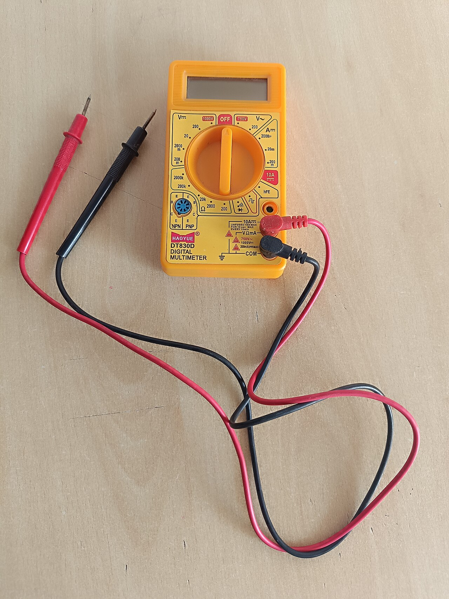
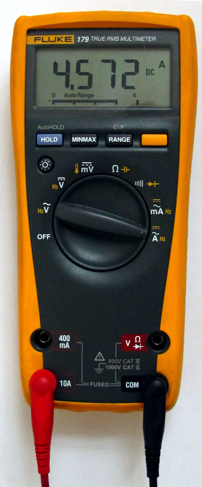
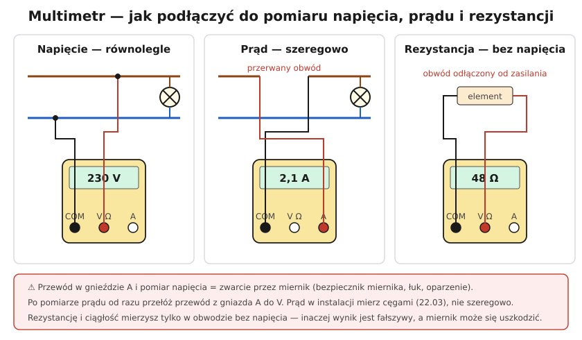

# 22.02 — Multimetr — co i jak mierzy

> **Moduł:** [22 — Przyrządy pomiarowe](README.md) · **Oznaczenia:** 🏠📋 · **Zakres SEP:** (a) (c) (d) · **Status:** ✅ pełny
>
> **Czytaj:**
>
> - Podstawy: [01.02](../01-prad-napiecie-opor/01.02-napiecie-roznica-cisnien-miedzy-dwoma-punktami.md), [01.03](../01-prad-napiecie-opor/01.03-opor-i-prawo-ohma.md)
> - Instrukcja posiadanego multimetru (zakresy, kategorie, bezpieczniki)

[← poprzedni temat](22.01-kategorie-pomiarowe-cat-iiiv-i-bezpieczenstwo.md) · [spis modułu](README.md) · [następny temat →](22.03-cegi-pradowe.md)

## Po co to jest

Multimetr to podstawowy przyrząd każdego, kto pracuje przy instalacji: sprawdza napięcie w gnieździe, ciągłość przewodu, rezystancję grzałki, bezpiecznik w urządzeniu. Trzeba wiedzieć, jak go podłączyć w każdym trybie — pomyłka (pomiar napięcia z przewodem w gnieździe prądowym) to zwarcie w dłoni.

## Po ludzku

**Gniazda multimetru:**

- **COM** — wspólne, czarny przewód zawsze tutaj,
- **V Ω** (często też diody, ciągłość, pojemność) — czerwony przewód do napięcia i rezystancji,
- **A** lub **mA/µA** — czerwony przewód do pomiaru prądu (gniazda chronione bezpiecznikami).

**Napięcie (V~ / V⎓)** — miernik **równolegle**, przewody na dwóch punktach. Ma bardzo dużą rezystancję wewnętrzną (rzędu MΩ), więc prawie nic nie pobiera. **Ważne:** taka czułość sprawia, że na odłączonym przewodzie, biegnącym obok innego pod napięciem, multimetr może pokazać kilkadziesiąt–sto kilkadziesiąt woltów „napięcia indukowanego”. To nie jest prawdziwe zasilanie — ale też nie wolno uznać, że przewód „ma 230 V”. Wskaźnik dwubiegunowy z obciążeniem (niską impedancją, „LoZ”) takie napięcie zignoruje ([22.04](22.04-wskazniki-napiecia-i-probniki.md)).

**Prąd (A)** — miernik **szeregowo**, obwód trzeba przerwać. Rezystancja wewnętrzna w trybie A jest bliska zeru — dlatego przewód w gnieździe A przyłożony do gniazdka 230 V to **zwarcie**. W instalacji prąd mierzy się **cęgami** ([22.03](22.03-cegi-pradowe.md)), a multimetrem — w obwodach elektronicznych i małych odbiornikach.

**Rezystancja (Ω) i ciągłość (♪)** — tylko w obwodzie **bez napięcia**. Multimetr wymusza mały prąd z baterii i mierzy spadek napięcia. Napięcie z zewnątrz fałszuje wynik i może uszkodzić miernik.

**True RMS** — miernik „prawdziwej wartości skutecznej” mierzy poprawnie przebiegi odkształcone (zasilacze, LED, falowniki). Tańsze mierniki (uśredniające) przy takich przebiegach mogą się mylić o kilkadziesiąt procent ([02.01](../02-prad-przemienny-230-400/02.01-sinusoida-50-hz-i-wartosc-skuteczna.md)).

## Jak to wygląda

*Na co patrzeć: pokrętło z zakresami V~, V⎓, Ω, A; trzy lub cztery gniazda na dole. Czarny przewód zawsze w COM, czerwony — zależnie od tego, co mierzysz.*

*Na co patrzeć: przy pomiarze prądu czerwony przewód jest w gnieździe A. Miernik w tym ustawieniu ma prawie zerową rezystancję — po pomiarze przewód wraca do gniazda V.*

## Schemat

## Pojęcia

| Pojęcie | Po ludzku | Termin normowy / symbol |
|---------|-----------|-------------------------|
| COM | Gniazdo wspólne (czarny przewód) | — |
| Rezystancja wewnętrzna | Ile miernik „obciąża” obwód | $R_{we}$ |
| True RMS | Prawdziwa wartość skuteczna | TRMS |
| Napięcie indukowane | „Fałszywe” napięcie na odłączonym przewodzie | napięcie pasożytnicze (ghost voltage) |
| LoZ | Tryb niskiej impedancji wejściowej | — |

## Liczby do zapamiętania

| Wielkość | Wartość | Kiedy obowiązuje | Źródło |
|----------|---------|------------------|--------|
| Rezystancja wewnętrzna przy V | rząd **10 MΩ** | typowe multimetry cyfrowe | instrukcje |
| Rezystancja przy A | bliska **0 Ω** | gniazdo A | — |
| Napięcie w gnieździe | **230 V ± 10 %** (207–253 V) | sieć nN | PN-EN 50160 |
| Pomiar Ω | tylko **bez napięcia** | zawsze | — |

## W praktyce

- **Zawsze sprawdź pokrętło i gniazda** przed przyłożeniem sond.
- **Zacznij od najwyższego zakresu**, jeśli miernik nie ma automatycznego.
- **Ciągłość przewodu** w ścianie: odłącz obwód, zewrzyj na jednym końcu dwie żyły, zmierz rezystancję na drugim końcu.
- **Bezpiecznik urządzenia**: wyjęty z urządzenia, pomiar Ω — sprawny ~0 Ω, spalony — „OL”.
- **Pomiar napięcia przy wkładce**: na obu końcach wkładki względem N — jeśli z jednej strony 230 V, z drugiej 0 V, wkładka jest przepalona.

## Błędy i zagrożenia

- ⚠️ **Pomiar napięcia z przewodem w gnieździe A** — zwarcie przez miernik, łuk, poparzenie rąk i twarzy.
- ⚠️ **Multimetr jako jedyny dowód braku napięcia** przy rozładowanej baterii albo złym zakresie — do sprawdzenia braku napięcia służy wskaźnik dwubiegunowy sprawdzony przed i po ([00.02](../00-bezpieczenstwo-najpierw/00.02-sprawdzanie-braku-napiecia-probnik-dwubiegunowy.md)).
- **Pomiar rezystancji pod napięciem** — fałszywy wynik, uszkodzony miernik.
- **Odczyt napięcia indukowanego jako „jest faza”** — błędna diagnoza.

## Przykład

**Zadanie.** Odłączony przewód w puszce (żyła czarna) — multimetr pokazuje między nim a PE 87 V. Wskaźnik dwubiegunowy nic nie pokazuje. Co to jest?

**Rozwiązanie.** To **napięcie indukowane** (sprzężenie pojemnościowe z żyłą pod napięciem biegnącą obok). Multimetr ma wejście ok. 10 MΩ i „widzi” bardzo mały prąd, wskaźnik z obciążeniem — nie. Żyła nie jest podłączona do fazy, ale **zanim jej dotkniesz**, i tak sprawdź pomiar ponownie po wyłączeniu obwodów, z którymi biegnie, i traktuj ją jak będącą pod napięciem, dopóki nie wiesz, skąd pochodzi.

## Pytania SEP

1. **Jak mierzy się napięcie, prąd i rezystancję multimetrem?**

Odpowiedź

Napięcie — miernik dołączony równolegle do mierzonego elementu, przewody w gniazdach COM i V, odpowiedni zakres (AC/DC). Prąd — miernik włączony szeregowo w przerwany obwód, przewód w gnieździe A (mA), zakres nie mniejszy niż spodziewany prąd; w instalacjach lepiej cęgami. Rezystancja — wyłącznie w obwodzie odłączonym od zasilania, przewody w COM i Ω. Przed pomiarem sprawdza się stan przyrządu i przewodów oraz kategorię pomiarową.

## Sprawdź się

1. Dlaczego multimetr w trybie prądowym przyłożony do gniazda 230 V powoduje zwarcie?

Odpowiedź

Bo w trybie prądowym miernik ma rezystancję bliską zeru (bocznik). Przyłożony do dwóch punktów o różnicy 230 V zwiera je — płynie ogromny prąd ograniczony tylko bezpiecznikiem miernika i impedancją pętli.

## Źródła

- PN-EN 61010-2-033 — wymagania dla multimetrów ręcznych.
- PN-EN 50160 — parametry napięcia.
- Instrukcje multimetrów (zakresy, bezpieczniki, kategorie).

---

[← poprzedni temat](22.01-kategorie-pomiarowe-cat-iiiv-i-bezpieczenstwo.md) · [spis modułu](README.md) · [następny temat →](22.03-cegi-pradowe.md)
