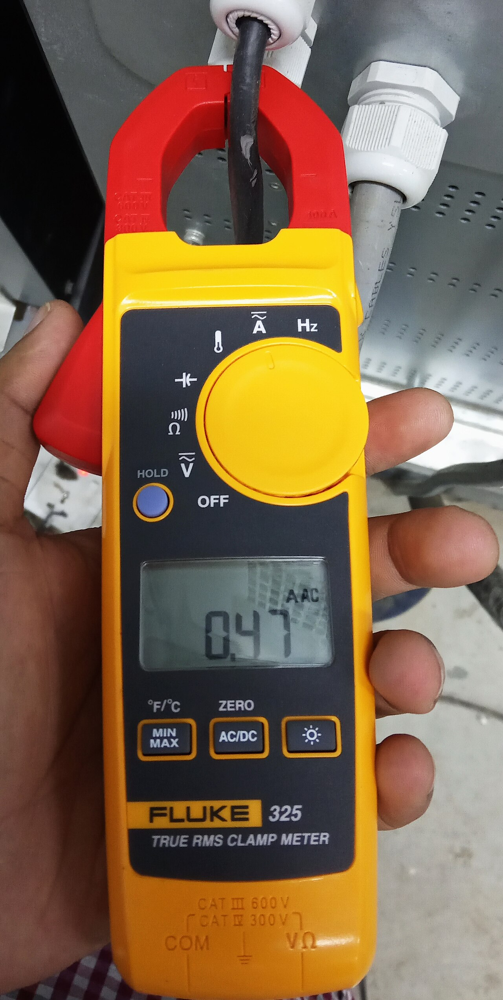
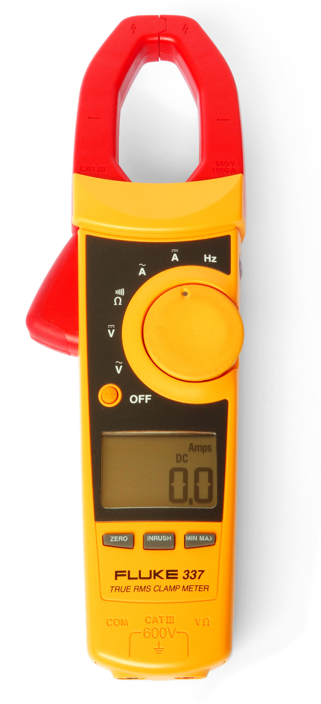
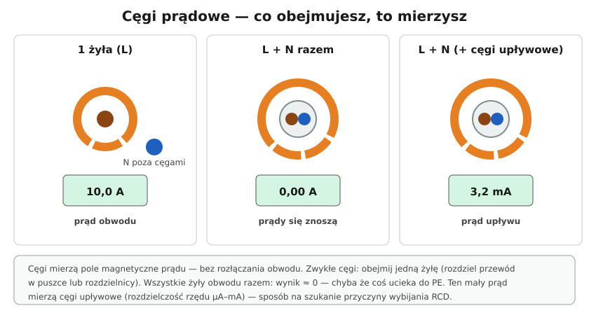

# 22.03 — Cęgi prądowe

> **Moduł:** [22 — Przyrządy pomiarowe](README.md) · **Oznaczenia:** 🏠📋 · **Zakres SEP:** (a) (c) (d) · **Status:** ✅ pełny
>
> **Czytaj:**
>
> - PN-EN 61010-2-032 — cęgi pomiarowe
> - Szukanie upływu: [20.03](../20-diagnostyka-usterek/20.03-wybija-wylacznik-roznicowopradowy.md)

[← poprzedni temat](22.02-multimetr-co-i-jak-mierzy.md) · [spis modułu](README.md) · [następny temat →](22.04-wskazniki-napiecia-i-probniki.md)

## Po co to jest

Cęgi mierzą prąd **bez przerywania obwodu** — wystarczy objąć przewód. To najwygodniejszy sposób sprawdzenia, ile prądu pobiera obwód, czy fazy są równo obciążone, czy wyłącznik działa słusznie. Cęgi upływowe pozwalają znaleźć przyczynę wybijania różnicówki bez wyłączania instalacji.

## Po ludzku

**Zasada:** prąd w przewodzie wytwarza wokół niego pole magnetyczne ([03.01](../03-elektromagnetyzm-w-praktyce/03.01-pole-magnetyczne-pradu-i-cewka.md)). Szczęki cęgów zbierają to pole i przyrząd przelicza je na prąd.

**Najważniejsze: co obejmujesz.**

- **Jedna żyła** (L) → prąd obwodu.
- **Cały przewód** (L i N razem) → prądy płyną w przeciwne strony, pola się znoszą, wynik **≈ 0**. To nie usterka cęgów — to fizyka.
- **Cały przewód** cęgami **upływowymi** (bardzo czułe, zakres mA) → różnica prądów, czyli **prąd upływu** — to samo, co „widzi” różnicówka ([08.01](../08-wylaczniki-roznicowopradowe/08.01-zasada-dzialania-wylacznika-roznicowopradowego.md)).
- **Przewód PE** cęgami upływowymi → prąd płynący przewodem ochronnym (w sprawnej instalacji mały).

**Rodzaje:**

- **cęgi AC** — przekładnik prądowy, tylko prąd przemienny,
- **cęgi AC/DC** — czujnik Halla, mierzą też prąd stały (fotowoltaika, akumulatory),
- **cęgi upływowe** — rozdzielczość µA–mA, duże szczęki ekranowane,
- **cęgi z funkcją multimetru** — także napięcie, rezystancja.

**Prąd rozruchu (inrush)** — wiele cęgów ma funkcję pomiaru prądu w pierwszych ~100 ms po włączeniu: przydatne przy silnikach i zasilaczach LED ([20.04](../20-diagnostyka-usterek/20.04-wybija-wylacznik-nadpradowy.md)).

## Jak to wygląda

*Na co patrzeć: szczęki obejmują jeden przewód, a nie cały kabel. Przewód powinien być mniej więcej na środku szczęk — wtedy pomiar jest najdokładniejszy.*

*Na co patrzeć: pokrętło ma zakresy A~ i A⎓ (prąd stały — cęgi z czujnikiem Halla), a także napięcie. Na obudowie — kategoria pomiarowa, jak przy multimetrze.*

## Schemat

## Pojęcia

| Pojęcie | Po ludzku | Termin normowy / symbol |
|---------|-----------|-------------------------|
| Cęgi prądowe | Miernik prądu obejmujący przewód | cęgi pomiarowe |
| Przekładnik prądowy | Rdzeń z uzwojeniem w szczękach | — |
| Czujnik Halla | Czujnik pola magnetycznego (też DC) | — |
| Prąd upływu | Różnica prądów w L i N | prąd różnicowy |
| Inrush | Prąd w chwili włączenia | prąd załączania |

## Liczby do zapamiętania

| Wielkość | Wartość | Kiedy obowiązuje | Źródło |
|----------|---------|------------------|--------|
| L + N w cęgach | **≈ 0 A** | sprawny obwód | — |
| Upływ za RCD 30 mA | ≤ **ok. 9 mA** (0,3 IΔn) | zalecenie | PN-HD 60364-5-53 |
| Upływ urządzenia z filtrem | **0,5–3 mA** | typowo | [08.06](../08-wylaczniki-roznicowopradowe/08.06-dlaczego-roznicowka-wybija-przyczyny-i-szukanie.md) |
| Moc z prądu | $P \approx 230 \cdot I \cdot \cos\varphi$ | 1 faza | — |

## W praktyce

- **Pomiar w rozdzielnicy** — obejmij przewód wychodzący z wyłącznika (L obwodu). Pracujesz przy częściach czynnych — rękawice, osłony, kategoria CAT III.
- **Rozkład obciążenia faz** — pomiar L1, L2, L3 na zasilaniu rozdzielnicy pokazuje, czy fazy są równo obciążone.
- **Szukanie upływu**: cęgi upływowe na przewody każdego obwodu (L i N razem) po kolei — obwód z największym upływem to podejrzany.
- **Małe prądy** — kilka zwojów przewodu przez szczęki zwiększa wskazanie (podziel wynik przez liczbę zwojów).

## Błędy i zagrożenia

- **Obejmowanie całego przewodu** zwykłymi cęgami i wniosek „nic nie płynie”.
- **Cęgi AC na obwodzie DC** (PV) — wynik zero mimo prądu.
- **Pomiar przy nieosłoniętych szynach** bez środków ochrony — dotyk szczękami części czynnych.

## Przykład

**Zadanie.** Różnicówka 30 mA w kuchni wybija losowo. Cęgami upływowymi mierzysz przewody obwodów (L i N razem): gniazda blat 1,2 mA, zmywarka 9,5 mA, lodówka 0,8 mA, piekarnik 1,0 mA. Wniosek?

**Rozwiązanie.** Suma ok. 12,5 mA — powyżej zalecanych ~9 mA dla RCD 30 mA, a sama **zmywarka 9,5 mA** to dużo jak na jedno urządzenie. Najpierw sprawdź zmywarkę (grzałka, pompa, zawilgocenie). Jeśli jest sprawna (upływ wynika z filtrów), daj jej osobne RCBO ([08.07](../08-wylaczniki-roznicowopradowe/08.07-podzial-obwodow-miedzy-wylaczniki.md)).

## Pytania SEP

1. **Na jakiej zasadzie działają cęgi prądowe i jak nimi mierzyć?**

Odpowiedź

Mierzą pole magnetyczne wytwarzane przez prąd w przewodzie objętym szczękami (przekładnik prądowy dla AC lub czujnik Halla dla AC/DC), więc nie wymagają przerywania obwodu. Szczękami obejmuje się jeden przewód (np. fazowy); objęcie przewodów L i N razem daje wynik bliski zeru, bo ich pola się znoszą — tak mierzy się natomiast cęgami upływowymi prąd upływu. Przyrząd musi mieć odpowiednią kategorię pomiarową, a pomiar przy częściach czynnych wymaga środków ochrony.

## Sprawdź się

1. Dlaczego zwykłe cęgi na przewodzie zasilającym pralkę (YDY 3 × 2,5) pokazują 0 A, choć pralka grzeje wodę?

Odpowiedź

Bo szczęki obejmują jednocześnie L i N, w których płyną równe prądy w przeciwnych kierunkach — pola się znoszą. Trzeba objąć tylko jedną żyłę (np. w puszce albo w rozdzielnicy) albo użyć rozgałęźnika pomiarowego z rozdzielonymi żyłami.

## Źródła

- PN-EN 61010-2-032 — wymagania dla cęgów pomiarowych.
- Instrukcje cęgów (AC, AC/DC, upływowe).
- PN-HD 60364-5-53 — prądy upływu za RCD.

---

[← poprzedni temat](22.02-multimetr-co-i-jak-mierzy.md) · [spis modułu](README.md) · [następny temat →](22.04-wskazniki-napiecia-i-probniki.md)
