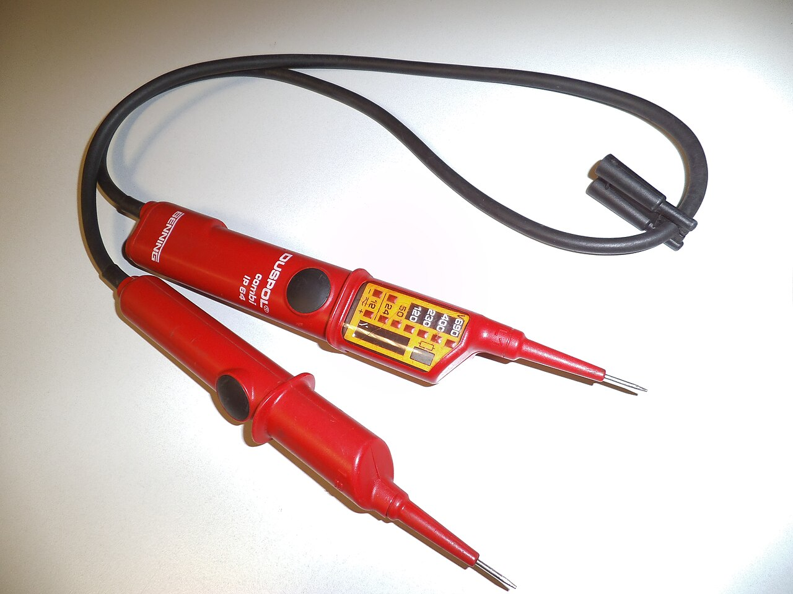
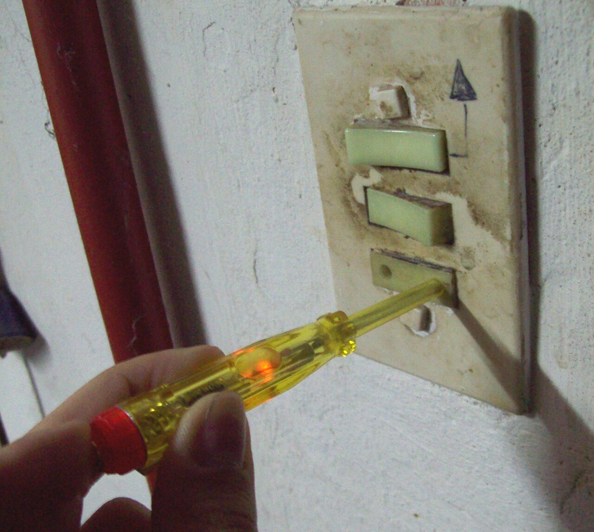
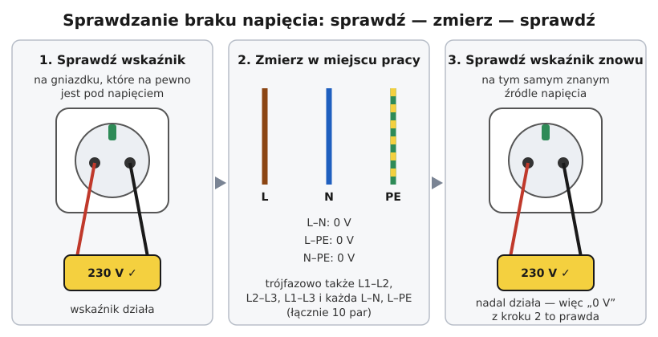

# 22.04 — Wskaźniki napięcia i próbniki

> **Moduł:** [22 — Przyrządy pomiarowe](README.md) · **Oznaczenia:** 🏠📋 · **Zakres SEP:** (a) (c) (d) · **Status:** ✅ pełny
>
> **Czytaj:**
>
> - PN-EN 61243-3 — dwubiegunowe wskaźniki napięcia niskiego
> - Sprawdzanie braku napięcia: [00.02](../00-bezpieczenstwo-najpierw/00.02-sprawdzanie-braku-napiecia-probnik-dwubiegunowy.md)

[← poprzedni temat](22.03-cegi-pradowe.md) · [spis modułu](README.md) · [następny temat →](22.05-miernik-parametrow-instalacji-mpi-przeglad.md)

## Po co to jest

Sprawdzenie braku napięcia to jedna z pięciu zasad bezpiecznej pracy ([00.01](../00-bezpieczenstwo-najpierw/00.01-piec-zasad-bezpiecznej-pracy-przy-urzadzeniach.md)). Narzędzie do tego musi być pewne. W sklepach jest kilka rodzajów „próbników”, a tylko jeden nadaje się do stwierdzenia, że można dotknąć przewodu. Komisja pyta o to w części bezpieczeństwa.

## Po ludzku

**Rodzaje:**

| Przyrząd | Jak działa | Do czego się nadaje |
|----------|------------|---------------------|
| **Wskaźnik dwubiegunowy** (PN-EN 61243-3) | dwie sondy, mierzy napięcie między nimi, często z obciążeniem (niska impedancja), sygnalizuje diodami/wyświetlaczem | **sprawdzanie braku napięcia** — tak |
| **Multimetr** | dwie sondy, duża impedancja wejściowa | pomiar wartości — tak; jako jedyny dowód braku napięcia — ostrożnie (bateria, zakres, napięcia indukowane) |
| **Neonówka (wkrętak z lampką)** | jedna sonda, obwód przez ciało | orientacyjnie „czy jest faza” — **nie** do braku napięcia |
| **Wskaźnik bezdotykowy** (długopis) | pole elektryczne wokół przewodu | szukanie przewodów, orientacyjnie — **nie** do braku napięcia |
| **Tester gniazd** | wtyczka z diodami | poprawność podłączenia gniazda — nie do braku napięcia |

**Wskaźnik dwubiegunowy dobrej klasy:**

- działa **bez baterii** w podstawowej funkcji (wskazanie napięcia) albo ma test baterii,
- ma **obciążenie** (przy naciśnięciu przycisków albo stałe) — ignoruje napięcia indukowane, pozwala sprawdzić RCD,
- ma kategorię **CAT III / CAT IV**, osłonki ostrzy,
- często dodatkowo: wskaźnik fazy (jedną sondą), kolejność faz, ciągłość.

**Procedura** (z [00.02](../00-bezpieczenstwo-najpierw/00.02-sprawdzanie-braku-napiecia-probnik-dwubiegunowy.md)): **sprawdź — zmierz — sprawdź** na znanym źródle; mierz między **wszystkimi parami** przewodów (L–N, L–PE, N–PE).

## Jak to wygląda

*Na co patrzeć: dwie rękojeści, skala diodowa z kolejnymi wartościami napięcia. To narzędzie, którym sprawdza się brak napięcia przed dotknięciem przewodu.*

*Na co patrzeć: neonówka świeci, bo prąd płynie przez nią i ciało do ziemi. Gdy nie świeci — niczego to nie dowodzi (gumowe buty, drewniana drabina).*

## Schemat

## Pojęcia

| Pojęcie | Po ludzku | Termin normowy / symbol |
|---------|-----------|-------------------------|
| Wskaźnik dwubiegunowy | „Próbnik” z dwiema sondami | wskaźnik napięcia, PN-EN 61243-3 |
| Neonówka | Wkrętak z lampką | próbnik jednobiegunowy |
| Wskaźnik bezdotykowy | „Długopis” piszczący przy przewodzie | — |
| Obciążenie wskaźnika | Mała rezystancja włączana przy pomiarze | niska impedancja |

## Liczby do zapamiętania

| Wielkość | Wartość | Kiedy obowiązuje | Źródło |
|----------|---------|------------------|--------|
| Pary pomiaru 1-faz. | **3** (L–N, L–PE, N–PE) | sprawdzenie braku napięcia | [00.02](../00-bezpieczenstwo-najpierw/00.02-sprawdzanie-braku-napiecia-probnik-dwubiegunowy.md) |
| Pary pomiaru 3-faz. z N i PE | **10** | jw. | jw. |
| Kolejność | **sprawdź — zmierz — sprawdź** | zawsze | jw. |
| Norma wskaźników dwubiegunowych | **PN-EN 61243-3** | do 1000 V AC / 1500 V DC | PN-EN 61243-3 |

## W praktyce

- **Trzymaj wskaźnik w dobrym stanie**: przewód między rękojeściami bez przetarć, osłonki na ostrzach.
- **Wskaźnik z obciążeniem** naciśnięty między L i PE w obwodzie z RCD 30 mA może go wyzwolić — to też szybki test, że PE i RCD działają.
- **Długopis bezdotykowy** — dobry do szukania przewodu w ścianie lub przerwanej żyły w przedłużaczu, ale nigdy jako „wszystko wyłączone”.

## Błędy i zagrożenia

- ⚠️ **„Neonówka nie świeci, więc nie ma napięcia”** — klasyczna przyczyna porażeń.
- ⚠️ **Długopis bezdotykowy jako dowód braku napięcia** — nie wykrywa napięcia w ekranowanym przewodzie, przy słabym sprzężeniu, przy rozładowanej baterii.
- **Pomiar tylko L–N** — przerwany N daje „0 V”, choć L ma 230 V względem ziemi.
- **Brak sprawdzenia wskaźnika po pomiarze** — nie wiesz, czy działał w chwili pomiaru.

## Przykład

**Zadanie.** Elektryk wyłączył obwód, długopis bezdotykowy „milczy”, neonówka nie świeci. Czy może dotknąć przewodów w puszce?

**Rozwiązanie.** **Nie.** Ani długopis, ani neonówka nie stwierdzają braku napięcia. Potrzebny jest **wskaźnik dwubiegunowy**: sprawdzony na znanym źródle, pomiar L–N, L–PE, N–PE w puszce (także na przewodach przelotowych), ponowne sprawdzenie wskaźnika. Dopiero wtedy — praca.

## Pytania SEP

1. **Jakim przyrządem i w jaki sposób sprawdza się brak napięcia przed rozpoczęciem pracy?**

Odpowiedź

Wskaźnikiem napięcia dwubiegunowym (zgodnym z PN-EN 61243-3) o odpowiednim napięciu znamionowym i kategorii pomiarowej. Przed użyciem sprawdza się jego działanie na źródle, o którym wiadomo, że jest pod napięciem, następnie sprawdza brak napięcia między wszystkimi przewodami w miejscu pracy (fazowymi, neutralnym i ochronnym), a po pomiarze ponownie sprawdza działanie wskaźnika. Neonówki i wskaźniki bezdotykowe nie nadają się do stwierdzania braku napięcia.

## Sprawdź się

1. Dlaczego wskaźnik z obciążeniem (niską impedancją) nie pokaże napięcia indukowanego na odłączonym przewodzie, a multimetr pokaże?

Odpowiedź

Napięcie indukowane pochodzi ze sprzężenia pojemnościowego — może dostarczyć tylko znikomy prąd. Multimetr o impedancji ok. 10 MΩ prawie go nie obciąża i pokazuje wysokie napięcie. Wskaźnik z obciążeniem pobiera większy prąd, przy którym to „napięcie” spada prawie do zera.

## Źródła

- PN-EN 61243-3 — Prace pod napięciem. Wskaźniki napięcia. Dwubiegunowe wskaźniki napięcia niskiego.
- [00.02 — Sprawdzanie braku napięcia](../00-bezpieczenstwo-najpierw/00.02-sprawdzanie-braku-napiecia-probnik-dwubiegunowy.md).

---

[← poprzedni temat](22.03-cegi-pradowe.md) · [spis modułu](README.md) · [następny temat →](22.05-miernik-parametrow-instalacji-mpi-przeglad.md)
