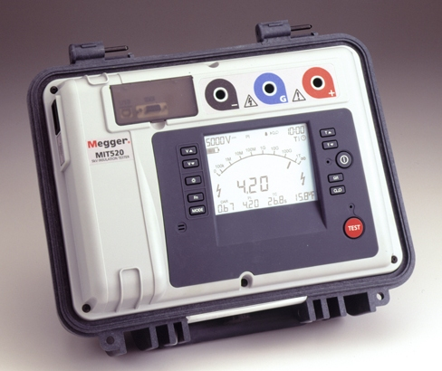
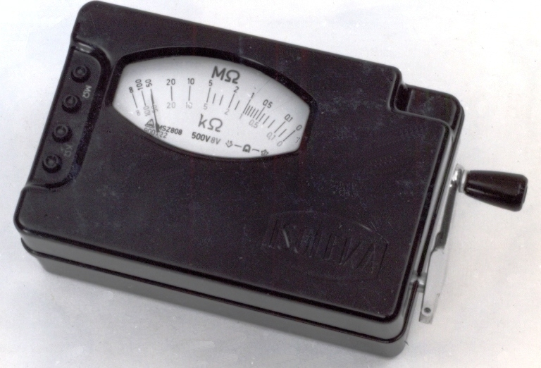

# 22.05 — Miernik parametrów instalacji (MPI) — przegląd funkcji

> **Moduł:** [22 — Przyrządy pomiarowe](README.md) · **Oznaczenia:** 🏠📋 · **Zakres SEP:** (a) (c) (d) · **Status:** ✅ pełny
>
> **Czytaj:**
>
> - PN-EN 61557 (części 1–10) — przyrządy do sprawdzania ochrony w sieciach do 1000 V
> - Badania: [moduł 23](../23-pomiary-odbiorcze-i-okresowe/README.md)

[← poprzedni temat](22.04-wskazniki-napiecia-i-probniki.md) · [spis modułu](README.md) · [następny temat →](22.06-kamera-termowizyjna-kiedy-sie-przydaje.md)

## Po co to jest

Miernik parametrów instalacji (MPI, „miernik wielofunkcyjny”) to przyrząd, którym wykonuje się pomiary odbiorcze i okresowe: ciągłość PE, izolację, pętlę zwarcia, różnicówki, uziemienie. Bez niego nie da się sprawdzić, czy ochrona przeciwporażeniowa działa. Zakres (b) i (c) egzaminu SEP wymaga znajomości tych pomiarów, a w praktyce — ich wykonania.

## Po ludzku

MPI to kilka przyrządów w jednej obudowie, każdy zgodny z odpowiednią częścią **PN-EN 61557**:

| Funkcja | Co mierzy | Część PN-EN 61557 | Temat |
|---------|-----------|-------------------|-------|
| Ciągłość (R_CONT, R±200 mA) | rezystancja PE i połączeń wyrównawczych, prądem ≥ 0,2 A | -4 | [23.02](../23-pomiary-odbiorcze-i-okresowe/23.02-ciaglosc-przewodow-ochronnych-i-wyrownawczych.md) |
| Izolacja (R_ISO) | rezystancja izolacji, 250/500/1000 V DC | -2 | [23.03](../23-pomiary-odbiorcze-i-okresowe/23.03-rezystancja-izolacji.md) |
| Pętla zwarcia (Z_S, Z_L-N) | impedancja pętli, spodziewany prąd zwarcia | -3 | [23.04](../23-pomiary-odbiorcze-i-okresowe/23.04-impedancja-petli-zwarcia.md) |
| RCD | czas i prąd zadziałania, napięcie dotykowe | -6 | [23.05](../23-pomiary-odbiorcze-i-okresowe/23.05-badanie-wylacznikow-roznicowopradowych.md) |
| Uziemienie (R_E) | rezystancja uziemienia metodą techniczną lub cęgową | -5 | [23.06](../23-pomiary-odbiorcze-i-okresowe/23.06-rezystancja-uziemienia.md) |
| Kolejność faz | kierunek wirowania pola | -7 | [23.07](../23-pomiary-odbiorcze-i-okresowe/23.07-kolejnosc-faz.md) |
| Napięcie, częstotliwość | parametry sieci | — | — |

**Pamięć i protokół** — wyniki zapisuje się w pamięci (po obiektach, obwodach, punktach) i przenosi do programu, który drukuje protokół ([23.08](../23-pomiary-odbiorcze-i-okresowe/23.08-protokol-z-pomiarow-i-terminy-badan-okresowych.md)).

**Wzorcowanie** — wyniki z przyrządu mają wartość dowodową, jeśli przyrząd ma aktualne **świadectwo wzorcowania** (zwykle co rok–dwa, wg producenta i przyjętych zasad firmy).

**Osobne przyrządy** bywają lepsze w swojej funkcji: miernik izolacji o wyższym napięciu (2,5–5 kV dla kabli i silników), miernik uziemień z czterema zaciskami, rejestratory parametrów sieci.

## Jak to wygląda

*Na co patrzeć: miernik izolacji wysokiego napięcia (do 5 kV) — do kabli, silników, transformatorów. W instalacjach mieszkaniowych wystarcza 500 V, które ma każdy MPI.*

*Na co patrzeć: dawniej napięcie probiercze wytwarzał mały generator kręcony korbką — stąd potoczna nazwa „induktor” albo „megger”. Dziś robi to elektronika, ale nazwa została.*

## Schemat

## Pojęcia

| Pojęcie | Po ludzku | Termin normowy / symbol |
|---------|-----------|-------------------------|
| MPI | Miernik wielofunkcyjny do instalacji | przyrząd wg PN-EN 61557 |
| Świadectwo wzorcowania | Dokument potwierdzający dokładność przyrządu | — |
| Napięcie probiercze | Napięcie, którym bada się izolację | $U_{iso}$ |
| Spodziewany prąd zwarcia | Prąd, który popłynie przy zwarciu | $I_k$ |

## Liczby do zapamiętania

| Wielkość | Wartość | Kiedy obowiązuje | Źródło |
|----------|---------|------------------|--------|
| Ciągłość | źródło **4–24 V**, prąd **≥ 0,2 A** | PE, połączenia wyrównawcze | PN-EN 61557-4 |
| Izolacja | **250 / 500 / 1000 V DC**, prąd znamionowy ≥ 1 mA | wg napięcia obwodu | PN-EN 61557-2 |
| Dopuszczalny błąd przyrządu | **± 30 %** (ciągłość, izolacja, pętla) | wg części 61557 | PN-EN 61557 |
| Wzorcowanie | zwykle co **1–2 lata** | praktyka, zalecenia producentów | — |

## W praktyce

- **Przed pomiarem**: kompensacja (zerowanie) przewodów pomiarowych, sprawdzenie baterii, kategoria przyrządu (CAT III/IV).
- **Kolejność badań** ma znaczenie — izolację mierzy się bez napięcia, pętlę i RCD pod napięciem ([23.01](../23-pomiary-odbiorcze-i-okresowe/23.01-ogledziny-instalacji.md)).
- **Pętla w obwodach z RCD** — MPI ma tryb „bez wyzwalania RCD” (mały prąd pomiarowy), mniej dokładny, ale nie wyłącza obwodu.
- **Przyrząd bez wzorcowania** — wyniki do własnej diagnostyki, nie do protokołu.

## Błędy i zagrożenia

- ⚠️ **Pomiar izolacji 500 V przy podłączonej elektronice** — uszkodzenie urządzeń; przy dotknięciu badanego obwodu — nieprzyjemne porażenie napięciem probierczym.
- **Pomiar pętli „klasyczny” w obwodzie z RCD** — wyłącza obwód (i np. lodówkę na noc).
- **Brak kompensacji przewodów** — wynik ciągłości zawyżony o rezystancję przewodów.

## Przykład

**Zadanie.** Dostajesz zlecenie: pomiary okresowe w mieszkaniu (TN-S, 10 obwodów, 2 RCD). Jakie funkcje MPI wykorzystasz?

**Rozwiązanie.** Ciągłość PE (bolce gniazd, oprawy klasy I, połączenia wyrównawcze w łazience), rezystancja izolacji każdego obwodu (500 V, po odłączeniu odbiorników), impedancja pętli zwarcia w każdym obwodzie (najdalszy punkt; tryb bez wyzwalania RCD), badanie obu RCD (czas przy IΔn, prąd zadziałania, napięcie dotykowe). Uziemienie — jeśli instalacja ma własny uziom do oceny (dom, TT). Wyniki w pamięci → protokół.

## Pytania SEP

1. **Jakie pomiary można wykonać miernikiem parametrów instalacji i jakim wymaganiom muszą odpowiadać przyrządy?**

Odpowiedź

Ciągłość przewodów ochronnych i wyrównawczych, rezystancję izolacji, impedancję pętli zwarcia, parametry wyłączników różnicowoprądowych (czas i prąd zadziałania, napięcie dotykowe), rezystancję uziemienia, kolejność faz oraz napięcie i częstotliwość. Przyrządy muszą spełniać wymagania odpowiednich części PN-EN 61557 (m.in. ciągłość prądem co najmniej 0,2 A, izolacja napięciem stałym 250/500/1000 V, dopuszczalny błąd roboczy) i PN-EN 61010 (bezpieczeństwo, kategoria pomiarowa), a do pomiarów dokumentowanych powinny mieć aktualne świadectwo wzorcowania.

## Sprawdź się

1. Dlaczego pętlę zwarcia w obwodzie z RCD 30 mA mierzy się specjalnym trybem MPI?

Odpowiedź

Bo klasyczny pomiar obciąża obwód między L a PE prądem rzędu kilku–kilkunastu amperów — dla RCD to prąd różnicowy, więc różnicówka zadziała. Tryb „bez wyzwalania” używa bardzo małego prądu (poniżej połowy IΔn) albo prowadzi pomiar przez L–N, kosztem dokładności.

## Źródła

- PN-EN 61557-1…-10 — Bezpieczeństwo elektryczne w niskonapięciowych sieciach elektroenergetycznych. Przyrządy do sprawdzania, mierzenia lub monitorowania środków ochronnych.
- [Kontrola stanu instalacji elektrycznych niskiego napięcia — SEP (PDF)](https://sep.com.pl/opracowania/Kontrola%20stanu%20instalacji%20elektrycznych%20niskiego%20napiecia.pdf).

---

[← poprzedni temat](22.04-wskazniki-napiecia-i-probniki.md) · [spis modułu](README.md) · [następny temat →](22.06-kamera-termowizyjna-kiedy-sie-przydaje.md)
