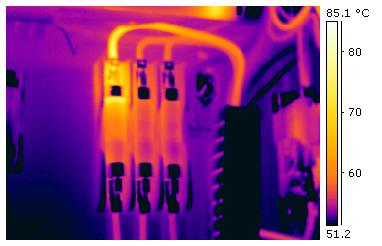
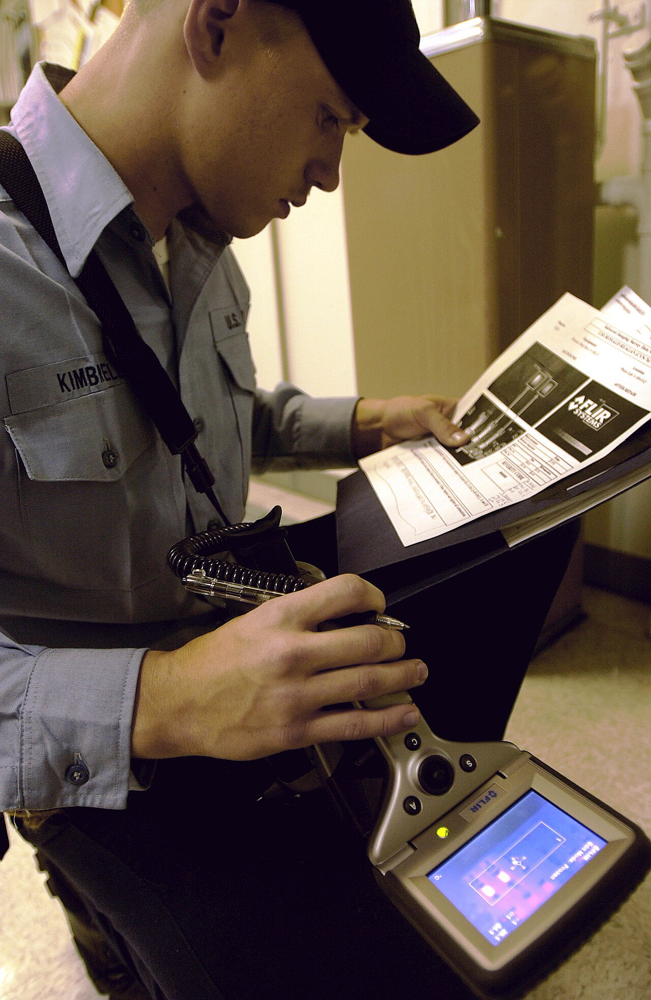
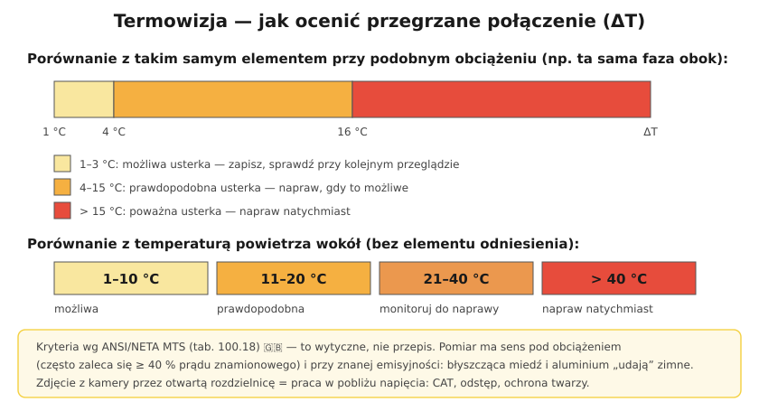

# 22.06 — Kamera termowizyjna — kiedy się przydaje

> **Moduł:** [22 — Przyrządy pomiarowe](README.md) · **Oznaczenia:** 🏠📋 · **Zakres SEP:** (a) (c) (d) · **Status:** ✅ pełny
>
> **Czytaj:**
>
> - 🇬🇧 [Delta-T severity criteria (ANSI/NETA MTS)](https://open-exam-prep.com/study-guides/itc-ir-level-1/electrical-equipment-severity-evaluation/delta-t-severity-criteria)
> - [Fluke — kamery termowizyjne w inspekcjach elektrycznych](https://fluke.com/pl-pl/nauka/blog/termografia/instalacje-elektryczne)
> - Grzejące się połączenia: [20.06](../20-diagnostyka-usterek/20.06-grzejace-sie-zaciski-i-zapach-spalenizny.md)

[← poprzedni temat](22.05-miernik-parametrow-instalacji-mpi-przeglad.md) · [spis modułu](README.md) · (koniec modułu) →

## Po co to jest

Połączenie, które się grzeje, nie wyłącza żadnego zabezpieczenia ([20.06](../20-diagnostyka-usterek/20.06-grzejace-sie-zaciski-i-zapach-spalenizny.md)). Kamera termowizyjna pokazuje je z odległości, bez dotykania i bez wyłączania instalacji. W rozdzielnicach zakładów i większych budynków przegląd termowizyjny to standard; w domu — świetne narzędzie przy diagnostyce.

## Po ludzku

**Co widzi kamera:** promieniowanie podczerwone powierzchni i przelicza je na temperaturę. Obraz to „mapa temperatur”.

**Kiedy się przydaje:**

- przegląd rozdzielnicy — luźne zaciski, przegrzane aparaty, nierówne obciążenie faz,
- gniazda, puszki, przedłużacze pod obciążeniem,
- silniki (łożyska, uzwojenia), styczniki, transformatory,
- ogrzewanie podłogowe (przebieg przewodów grzewczych), straty ciepła budynku.

**Jak oceniać:** liczy się **różnica temperatur ΔT**, nie sama temperatura:

- porównanie z **takim samym elementem** przy tym samym obciążeniu (np. ta sama faza na sąsiednim wyłączniku): 1–3 °C — możliwa usterka; 4–15 °C — prawdopodobna, naprawić w dogodnym terminie; **> 15 °C** — naprawić **natychmiast**;
- porównanie z **powietrzem** wokół: 1–10 / 11–20 / 21–40 / > 40 °C — od „możliwej” do „natychmiast”.

(Kryteria ANSI/NETA — wytyczne, nie przepis.)

**Pułapki:**

- **Emisyjność** — błyszczący metal (miedź, aluminium, cynk) odbija promieniowanie i na obrazie wydaje się zimny albo pokazuje odbicie innego źródła. Najlepiej mierzyć izolację, obudowy, matowe elementy — albo nakleić taśmę o znanej emisyjności.
- **Obciążenie** — połączenie bez prądu się nie grzeje; przegląd ma sens przy dużym obciążeniu.
- **Kąt i odległość** — mały element z daleka „rozmywa się” z tłem.

**Bezpieczeństwo:** zdjęcie przez otwartą rozdzielnicę pod napięciem to praca w pobliżu części czynnych — odległość, osłony, ochrona twarzy, nie zdejmuj osłon, jeśli nie trzeba.

## Jak to wygląda

*Na co patrzeć: trzy podobne bezpieczniki przy podobnym obciążeniu, a lewy górny i jego przewód są wyraźnie cieplejsze (jasne). Różnica kilkunastu–kilkudziesięciu stopni między elementami tego samego typu to sygnał do naprawy.*

*Na co patrzeć: kamera daje obraz od razu na ekranie; wyniki zapisuje się z opisem miejsca i obciążenia, żeby przy kolejnym przeglądzie porównać zmiany.*

## Schemat

## Pojęcia

| Pojęcie | Po ludzku | Termin normowy / symbol |
|---------|-----------|-------------------------|
| Termogram | Obraz temperatur | — |
| Emisyjność | Jak dobrze powierzchnia „świeci” w podczerwieni | ε (0–1) |
| ΔT | Różnica temperatur | — |
| Gorący punkt | Miejsce wyraźnie cieplejsze od otoczenia | hot spot |

## Liczby do zapamiętania

| Wielkość | Wartość | Kiedy obowiązuje | Źródło |
|----------|---------|------------------|--------|
| ΔT do podobnego elementu | **1–3** możliwa · **4–15** prawdopodobna · **> 15 °C** natychmiast | podobne obciążenie | ANSI/NETA MTS, tab. 100.18 🇬🇧 |
| ΔT do otoczenia | **1–10 · 11–20 · 21–40 · > 40 °C** | brak elementu odniesienia | jw. |
| Emisyjność błyszczącej miedzi | bardzo mała (rzędu **0,1** i mniej) | pomiar „zaniżony” | dane materiałowe |
| Temperatura pracy PVC | **70 °C** | izolacja przewodów | [05.01](../05-przewody-i-kable/05.01-budowa-przewodu-i-kabla-zyla-izolacja-powloka.md) |

## W praktyce

- **Przegląd pod obciążeniem** — zaplanuj go na godziny szczytu pracy obiektu.
- **Zapisuj**: termogram + zwykłe zdjęcie, opis miejsca, prąd obciążenia (cęgami), temperatura otoczenia.
- **Porównuj fazy** — w trójfazowej rozdzielnicy różnica między fazami często od razu wskazuje problem.
- **Kamera w smartfonie** — tania nakładka wystarcza do wstępnej diagnostyki w domu.

## Błędy i zagrożenia

- ⚠️ **Otwieranie osłon pod napięciem tylko po to, by zrobić zdjęcie** — ryzyko porażenia i łuku.
- **Ocena „wszystko zimne”** przy małym obciążeniu — usterka ujawni się dopiero przy dużym prądzie.
- **Odczyt temperatury z błyszczącej szyny** — zaniżony; ocena tylko przez porównanie lub na matowej powierzchni.

## Przykład

**Zadanie.** W rozdzielnicy trójfazowej kamera pokazuje zaciski: L1 42 °C, L2 44 °C, L3 63 °C przy podobnych prądach (cęgi: 18, 19, 18 A). Otoczenie 25 °C. Co robić?

**Rozwiązanie.** Porównanie z podobnymi elementami: ΔT = 63 − 44 = **19 °C > 15 °C** → **poważna usterka, naprawa natychmiast**. Prądy są podobne, więc przyczyną nie jest przeciążenie, tylko zacisk L3 (luźny, utleniony). Po wyłączeniu napięcia: sprawdzenie i dokręcenie, ocena przebarwień, ewentualnie wymiana aparatu i końcówki przewodu. Potem ponowny pomiar pod obciążeniem.

## Pytania SEP

1. **Do czego wykorzystuje się badania termowizyjne w eksploatacji urządzeń elektrycznych?**

Odpowiedź

Do bezdotykowego wykrywania miejsc nadmiernego nagrzewania: luźnych lub utlenionych połączeń, przeciążonych przewodów i aparatów, nierównomiernego obciążenia faz, uszkodzonych łożysk i uzwojeń silników, przegrzewających się transformatorów. Badanie prowadzi się przy obciążeniu, ocenia się różnicę temperatur względem podobnych elementów lub otoczenia, uwzględnia emisyjność powierzchni, a wyniki dokumentuje. Pozwala planować naprawy przed awarią.

## Sprawdź się

1. Dlaczego błyszcząca miedziana szyna może wyglądać na zimną, choć jest gorąca?

Odpowiedź

Ma bardzo małą emisyjność — prawie nie promieniuje własnego ciepła w podczerwieni, za to odbija promieniowanie otoczenia. Kamera nastawiona na emisyjność typowej izolacji pokaże temperaturę dużo niższą od rzeczywistej.

## Źródła

- 🇬🇧 ANSI/NETA MTS — [Delta-T severity criteria](https://open-exam-prep.com/study-guides/itc-ir-level-1/electrical-equipment-severity-evaluation/delta-t-severity-criteria).
- [Korzystanie z kamer termowizyjnych do inspekcji elektrycznych — Fluke](https://fluke.com/pl-pl/nauka/blog/termografia/instalacje-elektryczne).
- [Termowizja w ocenie ryzyka technicznego — Warta](https://www.warta.pl/korpo/artykul/termowizja-w-ocenie-ryzyka-technicznego/).

---

[← poprzedni temat](22.05-miernik-parametrow-instalacji-mpi-przeglad.md) · [spis modułu](README.md) · (koniec modułu) →
