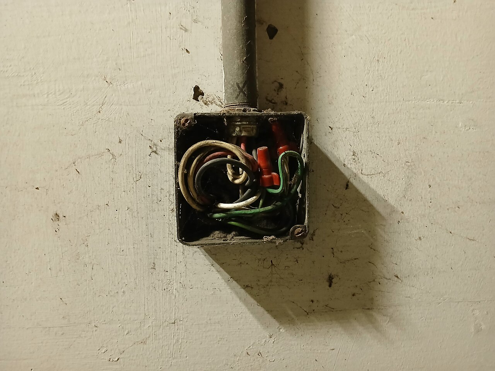
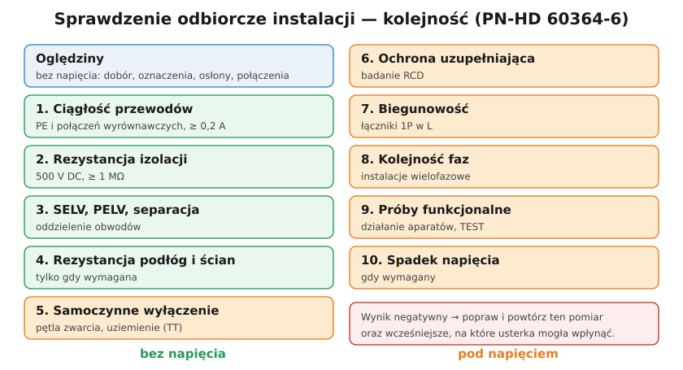

# 23.01 — Oględziny instalacji

> **Moduł:** [23 — Pomiary odbiorcze i okresowe](README.md) · **Oznaczenia:** 📋 · **Zakres SEP:** (b) (c) · **Status:** ✅ pełny
>
> **Czytaj:**
>
> - PN-HD 60364-6:2016 — Sprawdzanie (6.4.2 — oględziny)
> - [Kontrola stanu instalacji elektrycznych niskiego napięcia — SEP](https://sep.com.pl/opracowania/Kontrola%20stanu%20instalacji%20elektrycznych%20niskiego%20napiecia.pdf)

← (początek modułu) · [spis modułu](README.md) · [następny temat →](23.02-ciaglosc-przewodow-ochronnych-i-wyrownawczych.md)

## Po co to jest

Oględziny to pierwszy etap każdego sprawdzenia — odbiorczego i okresowego. Wykonuje się je przed pomiarami, zwykle przy wyłączonym zasilaniu. Wiele usterek widać gołym okiem: brak osłon, nieopisane obwody, przegrzane zaciski, zły przekrój. Pomiar nie zastąpi oględzin, a oględziny nie zastąpią pomiaru.

## Po ludzku

**Oględziny** to sprawdzenie wzrokowe (i dotykiem po wyłączeniu napięcia), czy instalacja:

- jest wykonana zgodnie z projektem i przepisami,
- ma właściwie dobrane i niezniszczone urządzenia,
- nie ma widocznych uszkodzeń zagrażających bezpieczeństwu.

**Co sprawdza się (lista wg PN-HD 60364-6, w skrócie):**

1. **Ochrona przeciwporażeniowa** — osłony, obudowy, zaślepki w rozdzielnicy ([12.01](../12-ochrona-przeciwporazeniowa/12.01-ochrona-podstawowa-izolacja-obudowy-przegrody.md)), obecność przewodów PE i połączeń wyrównawczych, RCD tam, gdzie wymagane.
2. **Dobór przewodów** — przekroje do zabezpieczeń, sposób ułożenia, kolory (N niebieski, PE żółto-zielony).
3. **Zabezpieczenia** — rodzaj, prąd, charakterystyka zgodne ze schematem; brak „drutów” we wkładkach.
4. **Aparaty odłączające i łączące** — rozłącznik główny, łączniki w przewodach L, wyłączniki awaryjne.
5. **Dobór do wpływów zewnętrznych** — IP w łazience, na zewnątrz, w garażu ([06.05](../06-osprzet-instalacyjny/06.05-stopnie-ochrony-ip.md)); strefy w łazience ([17.01](../17-pomieszczenia-szczegolne/17.01-lazienka-strefy-0-1-i-2.md)).
6. **Oznaczenia** — opisy obwodów, schemat rozdzielnicy, oznaczenia przewodów N i PE.
7. **Połączenia** — dokręcenie, ślady przegrzania, sposób łączenia (złączki, tulejki).
8. **Ochrona przeciwpożarowa** — przepusty ogniowe, odległości od materiałów palnych.
9. **Dostępność** — do rozdzielnicy, puszek, aparatów; dokumentacja na miejscu.

Wyniki oględzin wpisuje się do protokołu ([23.08](23.08-protokol-z-pomiarow-i-terminy-badan-okresowych.md)) — także te pozytywne.

## Jak to wygląda

*Na co patrzeć podczas oględzin: czy przewody są opisane, czy listwy N i PE są oddzielne dla grup RCD, czy nie ma przebarwień przy zaciskach, czy przekroje pasują do wyłączników.*

*Na co patrzeć: brak pokrywy puszki, przewody w nieznanym stanie — oględziny kończą się tu wynikiem negatywnym jeszcze przed jakimkolwiek pomiarem.*

## Schemat

## Pojęcia

| Pojęcie | Po ludzku | Termin normowy / symbol |
|---------|-----------|-------------------------|
| Oględziny | Sprawdzenie wzrokowe bez przyrządów | oględziny (PN-HD 60364-6, 6.4.2) |
| Próby | Pomiary i badania przyrządami | próby (6.4.3) |
| Sprawdzenie odbiorcze | Przed oddaniem do użytku | sprawdzanie odbiorcze |
| Sprawdzenie okresowe | Co określony czas w eksploatacji | sprawdzanie okresowe |

## Liczby do zapamiętania

| Wielkość | Wartość | Kiedy obowiązuje | Źródło |
|----------|---------|------------------|--------|
| Kolejność | **oględziny przed próbami** | każde sprawdzenie | PN-HD 60364-6 |
| Zasilanie przy oględzinach | zwykle **wyłączone** | — | jw. |
| Barwy | N **niebieski**, PE **żółto-zielony** | instalacje | PN-EN 60445 |
| Kontrola instalacji w budynku | co najmniej co **5 lat** | budynki | art. 62 Prawa budowlanego |

## W praktyce

- **Lista kontrolna** w protokole — punkt po punkcie, każdy z wynikiem „+/–/nie dotyczy”.
- **Zdjęcia** usterek — dołączone do protokołu, łatwiej je potem pokazać właścicielowi.
- **Porównanie ze schematem** — czy stan faktyczny zgadza się z dokumentacją; rozbieżność też jest wynikiem.

## Błędy i zagrożenia

- **Pominięcie oględzin**, „bo pomiary wyszły dobrze” — pomiary nie pokażą brakującej zaślepki, gniazda w strefie 1 ani mostka N–bolec.
- **Oględziny pod napięciem z dotykaniem** zacisków — oglądać można, dotykać tylko po wyłączeniu.
- **Brak wpisu oględzin** do protokołu — protokół niekompletny.

## Przykład

**Zadanie.** Oględziny mieszkania: w rozdzielnicy brak dwóch zaślepek, B20 na przewodzie 1,5 mm² (oświetlenie), gniazdo w łazience 40 cm od wanny, przewody opisane. Jaki wynik?

**Rozwiązanie.** **Negatywny** — trzy usterki: (1) brak zaślepek → dostęp do części czynnych (ochrona podstawowa), (2) B20 na 1,5 mm² → przewód nie chroniony przed przeciążeniem, (3) gniazdo w strefie 2 łazienki. Każdą wpisuje się do protokołu z zaleceniem usunięcia; pomiary wykonuje się, ale instalacja nie nadaje się do eksploatacji do czasu poprawek.

## Pytania SEP

1. **Na czym polegają oględziny instalacji elektrycznej i co się podczas nich sprawdza?**

Odpowiedź

To sprawdzenie bez użycia przyrządów, wykonywane przed próbami, zwykle przy odłączonym zasilaniu, czy instalacja jest zgodna z wymaganiami, prawidłowo dobrana i nieuszkodzona. Obejmuje m.in.: sposób ochrony przed porażeniem (osłony, obudowy, przewody ochronne, RCD), dobór przewodów i zabezpieczeń, aparatów odłączających i łączących, dobór urządzeń do wpływów zewnętrznych (IP, strefy), oznaczenie przewodów N i PE i obwodów, obecność schematów, stan połączeń, przegrody ogniowe, dostępność urządzeń. Wyniki zapisuje się w protokole.

2. **Jakie pomiary wykonuje się w ramach sprawdzenia odbiorczego i w jakiej kolejności?**

Odpowiedź

Po oględzinach, zgodnie z PN-HD 60364-6: ciągłość przewodów ochronnych i połączeń wyrównawczych, rezystancja izolacji, sprawdzenie ochrony przez SELV, PELV lub separację, rezystancja podłóg i ścian (gdy wymagana), sprawdzenie samoczynnego wyłączenia zasilania (impedancja pętli zwarcia, w TT rezystancja uziemienia), sprawdzenie ochrony uzupełniającej (RCD), biegunowość, kolejność faz, próby funkcjonalne i — gdy wymagany — spadek napięcia. Próby bez napięcia wykonuje się przed próbami pod napięciem; po wyniku negatywnym usterkę usuwa się i powtarza dany pomiar oraz wcześniejsze, na które mogła wpłynąć.

## Sprawdź się

1. Wymień trzy usterki, które oględziny wykryją, a pomiary nie.

Odpowiedź

Np. brak zaślepek w maskownicy rozdzielnicy, gniazdo zamontowane w strefie 1 lub 2 łazienki, mostek N–bolec w gnieździe (pomiar pętli wyjdzie dobrze), brak opisu obwodów, zbyt duży wyłącznik w stosunku do przekroju, brak przegrody ogniowej.

## Źródła

- PN-HD 60364-6:2016 — Instalacje elektryczne niskiego napięcia. Część 6: Sprawdzanie.
- [Kontrola stanu instalacji elektrycznych niskiego napięcia — SEP](https://sep.com.pl/opracowania/Kontrola%20stanu%20instalacji%20elektrycznych%20niskiego%20napiecia.pdf).

---

← (początek modułu) · [spis modułu](README.md) · [następny temat →](23.02-ciaglosc-przewodow-ochronnych-i-wyrownawczych.md)
