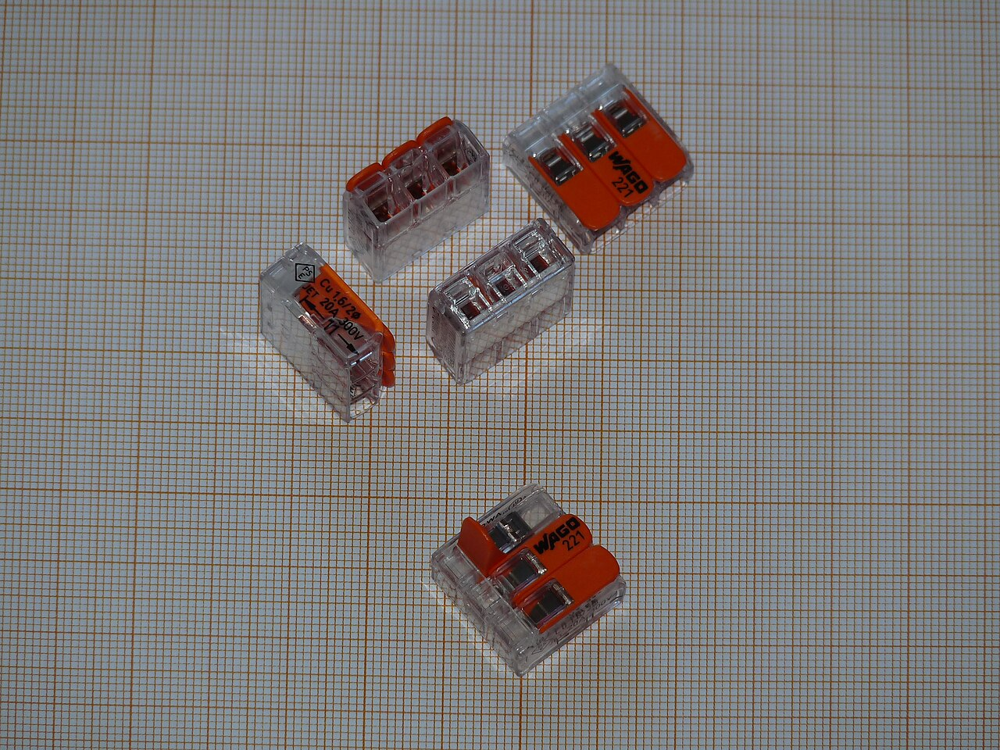
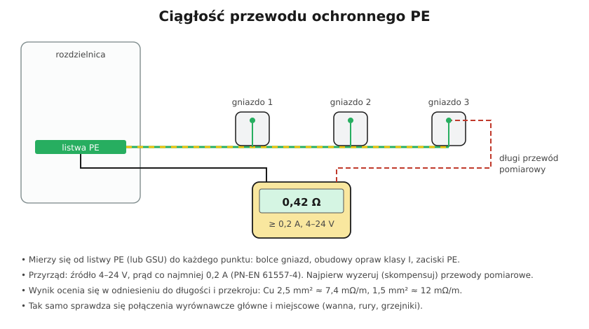

# 23.02 — Ciągłość przewodów ochronnych i wyrównawczych

> **Moduł:** [23 — Pomiary odbiorcze i okresowe](README.md) · **Oznaczenia:** 📋 · **Zakres SEP:** (b) (c) · **Status:** ✅ pełny
>
> **Czytaj:**
>
> - PN-HD 60364-6, 6.4.3.2 — ciągłość przewodów; PN-EN 61557-4 — przyrządy
> - Połączenia wyrównawcze: [13.04](../13-uziemienia-i-wyrownanie/13.04-polaczenia-wyrownawcze-ochronne-glowne.md), [13.05](../13-uziemienia-i-wyrownanie/13.05-polaczenia-wyrownawcze-miejscowe.md)

[← poprzedni temat](23.01-ogledziny-instalacji.md) · [spis modułu](README.md) · [następny temat →](23.03-rezystancja-izolacji.md)

## Po co to jest

Przewód PE działa tylko wtedy, gdy jest **ciągły** — od rozdzielnicy do każdego bolca i każdej obudowy klasy I. Przerwany PE nie daje żadnych objawów w codziennym użytkowaniu, ujawnia się dopiero przy uszkodzeniu izolacji — wtedy obudowa ma napięcie. Dlatego ciągłość mierzy się jako **pierwszą** próbę.

## Po ludzku

**Co się mierzy:** rezystancję przewodu ochronnego od **listwy PE** (lub głównej szyny uziemiającej) do każdego punktu, który ma być z nim połączony:

- bolce gniazd,
- zaciski PE opraw i urządzeń klasy I,
- połączenia wyrównawcze główne (rury, konstrukcje) i miejscowe (łazienka).

**Przyrząd:** źródło **4–24 V**, prąd pomiarowy **co najmniej 0,2 A** (PN-EN 61557-4). Mały prąd z multimetru nie wystarczy — mógłby „przejść” przez kilka nadpalonych drucików, które przy prądzie zwarcia się przepalą.

**Dwie metody:**

1. **Długi przewód pomiarowy** — jeden koniec na listwie PE, drugi przykładany po kolei do punktów. Przed pomiarem kompensuje się (zeruje) rezystancję przewodu pomiarowego.
2. **Metoda R1 + R2** — w rozdzielnicy łączy się na chwilę L obwodu z PE (po wyłączeniu!), a w gniazdach mierzy L–PE. Wynik to rezystancja fazowego i ochronnego razem — przydaje się do oceny pętli zwarcia. Po pomiarze zwora **musi** zostać usunięta.

**Ocena wyniku:** norma nie podaje jednej wartości. Wynik porównuje się z rezystancją wynikającą z długości i przekroju przewodu (np. Cu 2,5 mm² ok. 7,4 mΩ/m). Wynik znacznie większy niż obliczony → luźny zacisk, złe połączenie. Dla dodatkowych połączeń wyrównawczych: $R \le 50\ \mathrm{V} / I_a$ ([13.05](../13-uziemienia-i-wyrownanie/13.05-polaczenia-wyrownawcze-miejscowe.md)).

## Jak to wygląda

*Na co patrzeć: każde połączenie na drodze PE (złączka, zacisk, listwa) dodaje rezystancję. Pomiar ciągłości prądem 0,2 A sprawdza je wszystkie naraz — od rozdzielnicy do bolca.*

## Schemat

## Pojęcia

| Pojęcie | Po ludzku | Termin normowy / symbol |
|---------|-----------|-------------------------|
| Ciągłość | Nieprzerwane połączenie | ciągłość elektryczna |
| R1 + R2 | Rezystancja przewodu fazowego i ochronnego obwodu | — |
| Kompensacja przewodów | Odjęcie rezystancji przewodów pomiarowych | zerowanie (AUTO-ZERO) |
| R±200 mA | Pomiar prądem 200 mA w obu kierunkach | PN-EN 61557-4 |

## Liczby do zapamiętania

| Wielkość | Wartość | Kiedy obowiązuje | Źródło |
|----------|---------|------------------|--------|
| Źródło pomiarowe | **4–24 V**, prąd **≥ 0,2 A** | ciągłość PE | PN-EN 61557-4 |
| Błąd przyrządu | ≤ **± 30 %** w zakresie 0,2–2 Ω | — | jw. |
| Rezystancja Cu (20 °C) | 1,5 mm² **12,1 mΩ/m**, 2,5 mm² **7,41**, 4 mm² **4,61**, 6 mm² **3,08** | — | PN-EN 60228 |
| Połączenia wyrównawcze dodatkowe | $R \le 50\ \mathrm{V} / I_a$ | — | PN-HD 60364-4-41, 415.2 |

## W praktyce

- **Pomiar w obu kierunkach** (±) — przyrząd uśrednia wynik, eliminując wpływ napięć termoelektrycznych.
- **Rury i konstrukcje** — mierz od GSU do każdego połączenia wyrównawczego; przy rurach z tworzywa nic tam nie powinno być podłączone.
- **Gniazda wielokrotne** — każde gniazdo osobno; ramka podwójna może mieć jeden przewód PE dla dwóch gniazd.
- **Wynik „OL” (przerwa)** — szukaj od ostatniego dobrego punktu (połowienie, [20.02](../20-diagnostyka-usterek/20.02-nie-dziala-gniazdo-albo-caly-obwod.md)).

## Błędy i zagrożenia

- ⚠️ **Zostawiona zwora L–PE** po metodzie R1+R2 — po załączeniu zwarcie albo faza na obudowach.
- **Pomiar multimetrem z małym prądem** — przejdzie przez nadpalone, ledwo trzymające się druciki.
- **Brak kompensacji przewodów** — wynik zawyżony o 0,1–0,5 Ω.
- **Pomiar pod napięciem** — fałszywe wyniki, ryzyko uszkodzenia przyrządu.

## Przykład

**Zadanie.** Obwód gniazd: przewód 3 × 2,5 mm², długość do ostatniego gniazda 24 m. Wynik ciągłości PE do tego gniazda: 0,95 Ω. Ocena?

**Rozwiązanie.** Spodziewana rezystancja PE: $24 \cdot 0{,}00741 \approx 0{,}18\ \Omega$ (plus kilka setnych na zaciskach). Wynik **0,95 Ω** to ok. pięć razy więcej → **złe połączenie** gdzieś na drodze PE (luźny zacisk w gnieździe przelotowym, utleniona złączka). Mierz kolejne gniazda od rozdzielnicy — skok wyniku wskaże miejsce.

## Pytania SEP

1. **Jak sprawdza się ciągłość przewodów ochronnych i jakim przyrządem?**

Odpowiedź

Miernikiem rezystancji małych wartości spełniającym PN-EN 61557-4 — źródłem napięcia 4–24 V (AC lub DC) i prądem co najmniej 0,2 A. Mierzy się rezystancję między główną szyną uziemiającą (listwą PE rozdzielnicy) a każdym punktem, który powinien być połączony z przewodem ochronnym: stykami ochronnymi gniazd, zaciskami ochronnymi urządzeń, częściami przewodzącymi obcymi objętymi połączeniami wyrównawczymi. Przewody pomiarowe kompensuje się przed pomiarem, a wynik porównuje z wartością wynikającą z długości i przekroju przewodu.

## Sprawdź się

1. Dlaczego pomiar ciągłości wykonuje się prądem co najmniej 0,2 A, a nie zwykłym omomierzem?

Odpowiedź

Bo mały prąd z omomierza pokaże dobrą ciągłość nawet wtedy, gdy połączenie trzyma się na kilku drucikach albo ma utlenioną powierzchnię. Prąd 0,2 A lepiej oddaje rzeczywisty stan połączenia, które przy zwarciu musi przewodzić duży prąd.

## Źródła

- PN-HD 60364-6 — 6.4.3.2 Ciągłość przewodów.
- PN-EN 61557-4 — Rezystancja przewodów uziemiających, ochronnych i wyrównawczych.
- PN-EN 60228 — Żyły przewodów (rezystancje).

---

[← poprzedni temat](23.01-ogledziny-instalacji.md) · [spis modułu](README.md) · [następny temat →](23.03-rezystancja-izolacji.md)
