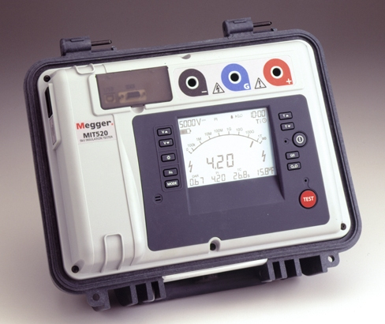
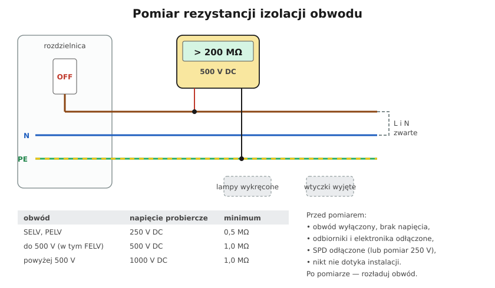

# 23.03 — Rezystancja izolacji

> **Moduł:** [23 — Pomiary odbiorcze i okresowe](README.md) · **Oznaczenia:** 📋 · **Zakres SEP:** (b) (c) · **Status:** ✅ pełny
>
> **Czytaj:**
>
> - PN-HD 60364-6, 6.4.3.3, tab. 6.1; PN-EN 61557-2
> - [Kontrola stanu instalacji — SEP](https://sep.com.pl/opracowania/Kontrola%20stanu%20instalacji%20elektrycznych%20niskiego%20napiecia.pdf)

[← poprzedni temat](23.02-ciaglosc-przewodow-ochronnych-i-wyrownawczych.md) · [spis modułu](README.md) · [następny temat →](23.04-impedancja-petli-zwarcia.md)

## Po co to jest

Izolacja przewodów oddziela części czynne od siebie i od ziemi. Z czasem się starzeje, pęka, wilgotnieje, bywa przebita gwoździem. Pomiar rezystancji izolacji pokazuje jej stan, zanim usterka zamieni się w zwarcie, upływ czy pożar. To jedno z najczęstszych pytań egzaminacyjnych — trzeba znać napięcie probiercze i wartości minimalne.

## Po ludzku

**Jak to działa:** miernik przykłada **wysokie napięcie stałe** (np. 500 V DC) między przewody i mierzy znikomy prąd płynący przez izolację. Z prawa Ohma: $R_{iso} = U / I$. Sprawna izolacja ma setki MΩ i więcej.

**Wymagania (PN-HD 60364-6, tab. 6.1):**

| Obwód | Napięcie probiercze DC | Minimalna rezystancja |
|-------|-----------------------|-----------------------|
| SELV, PELV | **250 V** | **0,5 MΩ** |
| do 500 V (w tym FELV) — instalacje 230/400 V | **500 V** | **1,0 MΩ** |
| powyżej 500 V | **1000 V** | **1,0 MΩ** |

**Przygotowanie:**

1. **Wyłącz obwód** i sprawdź brak napięcia.
2. **Odłącz odbiorniki** — wyjmij wtyczki, wykręć źródła światła lub odłącz oprawy, odłącz elektronikę (zasilacze, ściemniacze, czujniki, sterowniki, RCD z elektroniką). 500 V może je uszkodzić, a ich obecność fałszuje wynik.
3. **Ograniczniki przepięć (SPD)** — odłącz; jeśli się nie da, wolno mierzyć napięciem **250 V**, ale wynik dalej musi być **≥ 1 MΩ**.
4. **Łączniki** w obwodzie oświetlenia — załączone (żeby zmierzyć przewody za nimi).

**Pomiar:** zwykle **L i N zwarte razem względem PE** (jeden pomiar zamiast trzech). W pomieszczeniach z zagrożeniem pożarowym — także między każdą parą przewodów (L–N, L–PE, N–PE).

**Po pomiarze:** długi przewód to kondensator — miernik rozładowuje go automatycznie; nie dotykaj żył przed rozładowaniem.

## Jak to wygląda

*Na co patrzeć: wyświetlacz pokazuje rezystancję w MΩ (lub GΩ) i napięcie probiercze. Gniazda mają oznaczenia + i − — biegun „−” zwykle przykłada się do badanych żył, „+” do PE / uziemienia.*

## Schemat

## Pojęcia

| Pojęcie | Po ludzku | Termin normowy / symbol |
|---------|-----------|-------------------------|
| Rezystancja izolacji | Opór między żyłami / do ziemi | $R_{iso}$ |
| Napięcie probiercze | Napięcie pomiaru | $U_{iso}$ |
| Megaom | Milion omów | MΩ |
| Rozładowanie | Usunięcie ładunku z przewodu po pomiarze | — |

## Liczby do zapamiętania

| Wielkość | Wartość | Kiedy obowiązuje | Źródło |
|----------|---------|------------------|--------|
| Obwody 230/400 V | **500 V DC**, ≥ **1,0 MΩ** | do 500 V | PN-HD 60364-6, tab. 6.1 |
| SELV / PELV | **250 V DC**, ≥ **0,5 MΩ** | — | jw. |
| Powyżej 500 V | **1000 V DC**, ≥ **1,0 MΩ** | — | jw. |
| Z SPD, którego nie da się odłączyć | **250 V DC**, ≥ **1 MΩ** | — | jw., 6.4.3.3 |
| Przyrząd | prąd znamionowy ≥ **1 mA**, napięcie jałowe ≤ **1,5 U_N** | — | PN-EN 61557-2 |
| Dawne wymaganie (dla porównania) | 0,5 MΩ przy 500 V | wcześniejsze wydanie | [SEP](https://sep.com.pl/opracowania/Kontrola%20stanu%20instalacji%20elektrycznych%20niskiego%20napiecia.pdf) |

## W praktyce

- **Wynik graniczny (kilka MΩ)** przy nowej instalacji to sygnał — nowa instalacja ma zwykle setki MΩ. Szukaj wilgoci lub uszkodzenia.
- **Pomiar przed tynkowaniem** — tani sposób na wykrycie przewodu przeciętego bruzdownicą ([21.05](../21-stare-instalacje/21.05-wymiana-instalacji-plan-prac.md)).
- **Szukanie upływu** — mierz obwody osobno; przy złym wyniku dziel obwód (odłączaj odcinki w puszkach).
- **Stara instalacja** — izolacja PVC twardnieje, ale zwykle ma jeszcze dobrą rezystancję; problemem są połączenia i wilgoć.

## Błędy i zagrożenia

- ⚠️ **Dotknięcie badanego obwodu podczas pomiaru** — 500 V DC, nieprzyjemne porażenie (prąd ograniczony, ale odruch może spowodować upadek).
- ⚠️ **Pomiar z podłączoną elektroniką** — zniszczone zasilacze LED, ściemniacze, sterowniki.
- **Zapomniany SPD** — zaniżony wynik, fałszywy alarm.
- **Pomiar z otwartymi łącznikami** — przewody za łącznikiem niezbadane.

## Przykład

**Zadanie.** Obwód gniazd w starym mieszkaniu: L+N względem PE — 0,6 MΩ przy 500 V. Ocena?

**Rozwiązanie.** Wymagane **≥ 1,0 MΩ** → wynik **negatywny**. Kroki: sprawdź, czy wszystko jest odłączone (np. zapomniana listwa z filtrem), zmierz osobno L–PE i N–PE, dziel obwód na odcinki (rozłączenie w puszkach), szukaj zawilgocenia (gniazdo przy oknie, zewnętrzne, w łazience). Po naprawie — powtórzenie pomiaru.

## Pytania SEP

1. **Jak mierzy się rezystancję izolacji instalacji 230/400 V? Jakim napięciem probierczym i jakie są wymagane wartości?**

Odpowiedź

Po wyłączeniu zasilania i odłączeniu odbiorników (oraz ograniczników przepięć) mierzy się rezystancję izolacji miernikiem zgodnym z PN-EN 61557-2, napięciem stałym 500 V, między przewodami czynnymi (zwykle zwartymi razem) a przewodem ochronnym, a w razie potrzeby także między przewodami czynnymi. Wymagana wartość wg PN-HD 60364-6 to co najmniej 1,0 MΩ. Dla obwodów SELV i PELV — 250 V i 0,5 MΩ, dla obwodów powyżej 500 V — 1000 V i 1,0 MΩ. Po pomiarze obwód się rozładowuje.

## Sprawdź się

1. Dlaczego przed pomiarem izolacji wykręca się źródła światła albo odłącza oprawy?

Odpowiedź

Bo źródło światła łączy L z N (żarnik, zasilacz) — przy pomiarze L–N wynik byłby „zwarciem”, a elektronika zasilaczy LED mogłaby zostać uszkodzona napięciem 500 V. Przy pomiarze L+N względem PE elektronika z filtrami do PE też zaniża wynik.

## Źródła

- PN-HD 60364-6:2016 — 6.4.3.3 Rezystancja izolacji, tab. 6.1.
- PN-EN 61557-2 — Rezystancja izolacji.
- [Kontrola stanu instalacji elektrycznych niskiego napięcia — SEP](https://sep.com.pl/opracowania/Kontrola%20stanu%20instalacji%20elektrycznych%20niskiego%20napiecia.pdf).

---

[← poprzedni temat](23.02-ciaglosc-przewodow-ochronnych-i-wyrownawczych.md) · [spis modułu](README.md) · [następny temat →](23.04-impedancja-petli-zwarcia.md)
