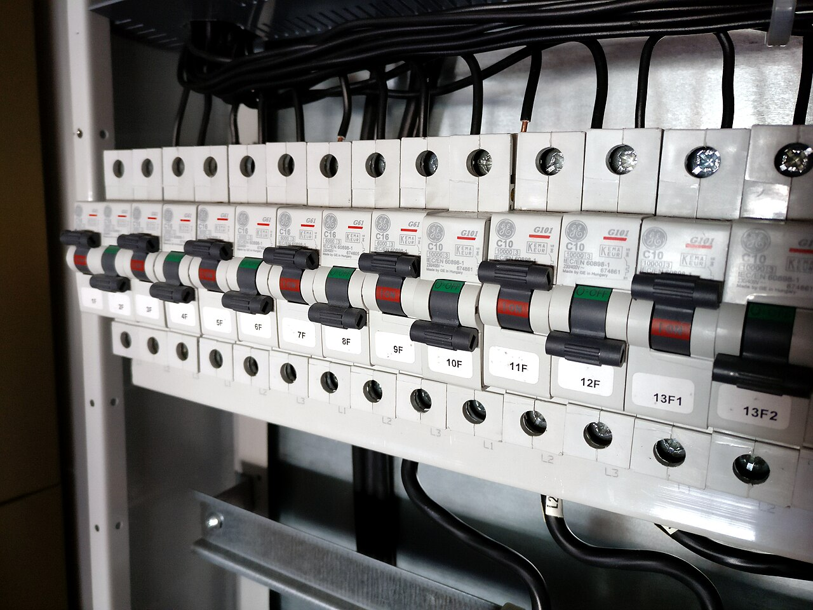
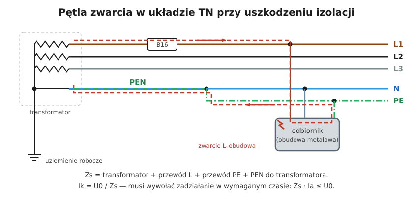

# 23.04 — Impedancja pętli zwarcia

> **Moduł:** [23 — Pomiary odbiorcze i okresowe](README.md) · **Oznaczenia:** 📋 · **Zakres SEP:** (b) (c) · **Status:** ✅ pełny
>
> **Czytaj:**
>
> - Warunek samoczynnego wyłączenia: [12.03](../12-ochrona-przeciwporazeniowa/12.03-warunek-skutecznosci-samoczynnego-wylaczenia.md)
> - PN-EN 61557-3 — impedancja pętli zwarcia

[← poprzedni temat](23.03-rezystancja-izolacji.md) · [spis modułu](README.md) · [następny temat →](23.05-badanie-wylacznikow-roznicowopradowych.md)

## Po co to jest

Przy zwarciu fazy z obudową wyłącznik musi zadziałać w czasie krótszym niż 0,4 s ([04.04](../04-prad-a-czlowiek/04.04-maksymalne-czasy-samoczynnego-wylaczenia.md)). Zadziała tylko wtedy, gdy popłynie dostatecznie duży prąd — a ten zależy od **impedancji pętli zwarcia**. Pomiar pętli to jedyny sposób, żeby w gotowej instalacji potwierdzić, że ochrona przy uszkodzeniu działa. To kluczowy pomiar egzaminu SEP.

## Po ludzku

**Pętla zwarcia** to droga prądu przy zwarciu L–PE: transformator → linia → przyłącze → WLZ → obwód (L) → miejsce zwarcia → przewód PE → z powrotem do transformatora ([12.02](../12-ochrona-przeciwporazeniowa/12.02-ochrona-przy-uszkodzeniu-samoczynne-wylaczenie.md)). Suma impedancji tej drogi to $Z_s$.

**Jak mierzy MPI:** mierzy napięcie bez obciążenia, potem na chwilę obciąża obwód znanym prądem (między L a PE) i mierzy spadek napięcia. Z różnicy oblicza $Z_s$ oraz **spodziewany prąd zwarcia** $I_k = U_0 / Z_s$.

**Ocena (TN):**

$$Z_s \cdot I_a \le U_0 \quad\Rightarrow\quad Z_s \le \frac{230}{I_a}$$

gdzie $I_a$ — prąd, przy którym zabezpieczenie wyłączy w wymaganym czasie (dla wyłącznika B: **5 × In**, C: **10 × In**).

| Zabezpieczenie | $I_a$ | $Z_{s,max}$ | z zapasem ⅔ |
|----------------|-------|-------------|-------------|
| B10 | 50 A | 4,60 Ω | 3,07 Ω |
| B16 | 80 A | 2,88 Ω | 1,92 Ω |
| B20 | 100 A | 2,30 Ω | 1,53 Ω |
| C16 | 160 A | 1,44 Ω | 0,96 Ω |

**Zapas ⅔** — przewody przy zwarciu się nagrzewają, a ich rezystancja rośnie; pomiar „na zimno” ocenia się więc z zapasem ([12.03](../12-ochrona-przeciwporazeniowa/12.03-warunek-skutecznosci-samoczynnego-wylaczenia.md); to zalecenie informacyjne, w literaturze dyskutowane).

**Gdzie mierzyć:** w każdym obwodzie, w **najdalszym** punkcie (ostatnie gniazdo, ostatnia oprawa). W obwodach trójfazowych — dla każdej fazy.

**Pętla L–N** (Z_L-N) — mierzona do oceny prądu zwarcia L–N (zdolność zwarciowa aparatów, [07.05](../07-zabezpieczenia-nadpradowe/07.05-zdolnosc-zwarciowa-6-ka-10-ka.md)).

**Obwody z RCD** — klasyczny pomiar wyzwala różnicówkę; MPI ma tryb bez wyzwalania. Według omówień normy, gdy obwód jest chroniony RCD o IΔn ≤ 500 mA, warunek samoczynnego wyłączenia zapewnia RCD, a pomiar pętli można zastąpić sprawdzeniem ciągłości PE ([SEP](https://sep.com.pl/opracowania/Kontrola%20stanu%20instalacji%20elektrycznych%20niskiego%20napiecia.pdf)).

## Jak to wygląda

*Na co patrzeć: charakterystyka i prąd wyłącznika (np. B16) wyznaczają, jaką impedancję pętli wolno zmierzyć w jego obwodzie. Te dane trafiają do protokołu obok wyniku pomiaru.*

## Schemat

## Pojęcia

| Pojęcie | Po ludzku | Termin normowy / symbol |
|---------|-----------|-------------------------|
| Impedancja pętli zwarcia | „Opór” drogi prądu zwarciowego | $Z_s$ |
| Spodziewany prąd zwarcia | Prąd, który popłynie przy zwarciu | $I_k = U_0 / Z_s$ |
| Prąd zadziałania | Prąd wyłączający w wymaganym czasie | $I_a$ |
| Pętla L–N | Pętla zwarcia między fazą a N | $Z_{L-N}$ |

## Liczby do zapamiętania

| Wielkość | Wartość | Kiedy obowiązuje | Źródło |
|----------|---------|------------------|--------|
| Warunek | $Z_s \cdot I_a \le U_0$ | TN | PN-HD 60364-4-41, 411.4.4 |
| $I_a$ wyłącznika | B **5 × In**, C **10 × In**, D **20 × In** | 0,4 s | PN-EN 60898-1 |
| $Z_{s,max}$ B10 / B16 / B20 | **4,60 / 2,88 / 2,30 Ω** | TN, 230 V | obliczenie |
| $Z_{s,max}$ C10 / C16 | **2,30 / 1,44 Ω** | jw. | jw. |
| Ocena z zapasem | $Z_s \le \tfrac{2}{3} \cdot U_0 / I_a$ | pomiar „na zimno” | PN-HD 60364-6, zał. informacyjny |
| Błąd przyrządu | ≤ **± 30 %** | — | PN-EN 61557-3 |

## W praktyce

- **Pomiar w najdalszym gnieździe** — najgorszy przypadek; jeśli tam jest dobrze, bliżej też.
- **Wynik wyraźnie większy niż w sąsiednich gniazdach** → zły zacisk (ten sam objaw co przy ciągłości).
- **Przy granicznych wynikach** powtórz pomiar kilka razy — wahania napięcia sieci zmieniają wynik.
- **Zapisz też $I_k$** — porównaj ze zdolnością zwarciową aparatów (6 kA, 10 kA).

## Błędy i zagrożenia

- ⚠️ **Pomiar przy przerwanym PE** — miernik powinien to wykryć; jeśli nie, przewód PE pomiarowy dostaje potencjał fazy. Najpierw ciągłość PE, potem pętla.
- **Klasyczny pomiar w obwodzie z RCD** — wyłączenie obwodu (lodówka, serwer).
- **Ocena bez zapasu** granicznych wyników — w gorącej instalacji warunek może nie być spełniony.
- **Pomiar tylko przy rozdzielnicy** — nie mówi nic o końcu długiego obwodu.

## Przykład

**Zadanie.** Gniazdo na końcu obwodu B16: $Z_s = 1{,}75\ \Omega$. Spełniony warunek? A dla C16?

**Rozwiązanie.**

- B16: $Z_{s,max} = 230 / 80 = 2{,}88\ \Omega$; z zapasem ⅔: 1,92 Ω. $1{,}75 \le 1{,}92$ → **spełniony** (z zapasem). $I_k = 230/1{,}75 \approx 131$ A — wyłącznik B16 zadziała natychmiast (> 80 A).
- C16: $Z_{s,max} = 230 / 160 = 1{,}44\ \Omega$ → **niespełniony** (1,75 > 1,44). Zmiana B16 na C16 „bo wybija przy rozruchu” byłaby w tym obwodzie błędem — chyba że obwód chroni RCD 30 mA.

## Pytania SEP

1. **Jak mierzy się impedancję pętli zwarcia i jak ocenia się wynik?**

Odpowiedź

Miernikiem wg PN-EN 61557-3 metodą spadku napięcia: przyrząd mierzy napięcie przed i podczas krótkotrwałego obciążenia obwodu znaną impedancją (między przewodem fazowym a ochronnym) i oblicza impedancję pętli oraz spodziewany prąd zwarcia. Pomiar wykonuje się w najdalszym punkcie każdego obwodu. W układzie TN wynik ocenia się z warunku $Z_s \cdot I_a \le U_0$, gdzie $I_a$ jest prądem zapewniającym wyłączenie w wymaganym czasie (dla wyłącznika B — 5 In, C — 10 In); ze względu na nagrzewanie przewodów stosuje się zapas (np. $Z_s \le \tfrac{2}{3} U_0/I_a$).

## Sprawdź się

1. W obwodzie B10 zmierzono $Z_s = 3{,}5\ \Omega$. Czy warunek jest spełniony z zapasem ⅔?

Odpowiedź

$Z_{s,max} = 230/50 = 4{,}60\ \Omega$ — warunek podstawowy spełniony. Z zapasem: $\tfrac{2}{3} \cdot 4{,}60 \approx 3{,}07\ \Omega$ — **niespełniony** (3,5 > 3,07). Wynik graniczny: warto ustalić przyczynę dużej impedancji (długość, zaciski) albo zastosować RCD.

## Źródła

- PN-HD 60364-4-41 — 411.4.4 (warunek dla TN).
- PN-HD 60364-6 — 6.4.3.6 i załącznik informacyjny (ocena wyników).
- PN-EN 61557-3 — Impedancja pętli zwarcia.
- [Kontrola stanu instalacji elektrycznych niskiego napięcia — SEP](https://sep.com.pl/opracowania/Kontrola%20stanu%20instalacji%20elektrycznych%20niskiego%20napiecia.pdf).

---

[← poprzedni temat](23.03-rezystancja-izolacji.md) · [spis modułu](README.md) · [następny temat →](23.05-badanie-wylacznikow-roznicowopradowych.md)
