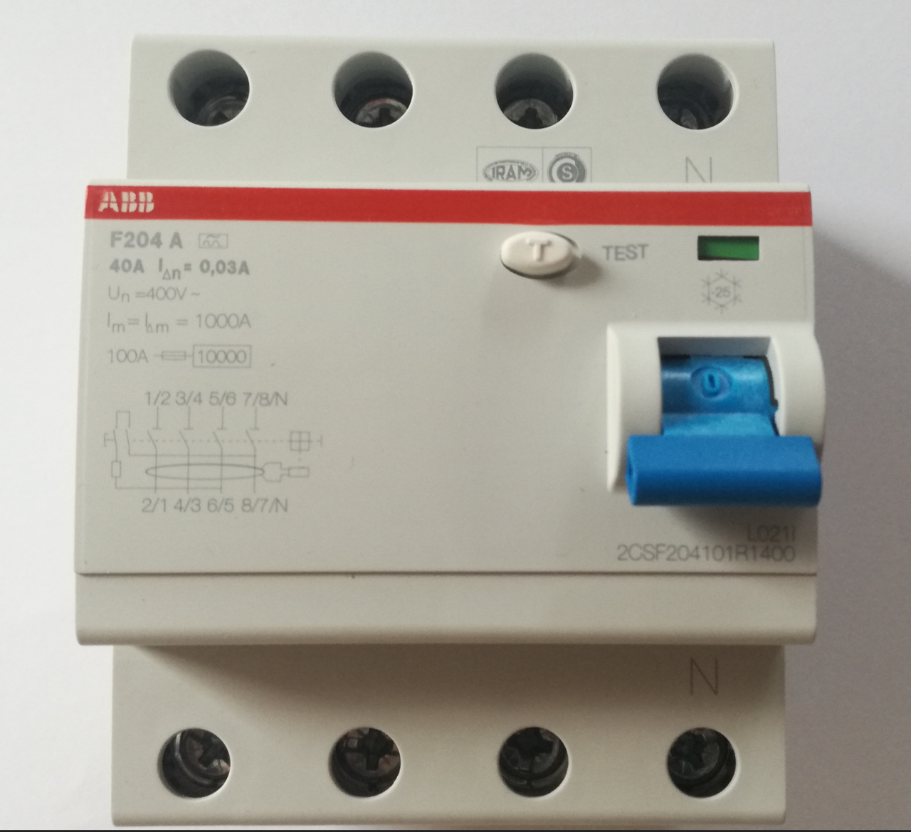
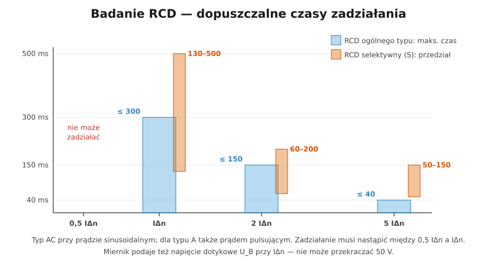

# 23.05 — Badanie wyłączników różnicowoprądowych

> **Moduł:** [23 — Pomiary odbiorcze i okresowe](README.md) · **Oznaczenia:** 📋 · **Zakres SEP:** (b) (c) · **Status:** ✅ pełny
>
> **Czytaj:**
>
> - Działanie RCD: [08.01](../08-wylaczniki-roznicowopradowe/08.01-zasada-dzialania-wylacznika-roznicowopradowego.md); przycisk TEST: [08.05](../08-wylaczniki-roznicowopradowe/08.05-przycisk-test-i-okresowe-sprawdzanie.md)
> - PN-EN 61557-6; PN-EN 61008-1 / 61009-1

[← poprzedni temat](23.04-impedancja-petli-zwarcia.md) · [spis modułu](README.md) · [następny temat →](23.06-rezystancja-uziemienia.md)

## Po co to jest

Przycisk TEST sprawdza mechanizm różnicówki, ale nie mówi, **przy jakim prądzie i jak szybko** zadziała, ani czy przewód PE w obwodzie działa. To mierzy się miernikiem. Badanie RCD to obowiązkowa część sprawdzenia odbiorczego i częste pytanie egzaminacyjne.

## Po ludzku

**Miernik RCD** (funkcja MPI) wytwarza kontrolowany prąd upływu z L do PE w gnieździe za różnicówką i mierzy:

1. **czas zadziałania** $t_A$ przy prądzie **IΔn** (i przy **5 IΔn**),
2. **prąd zadziałania** $I_A$ — prąd narasta stopniowo, aż RCD zadziała,
3. **napięcie dotykowe** $U_B$ przy IΔn — napięcie na PE podczas upływu; a z niego rezystancję uziemienia / pętli.

**Wymagania (RCD ogólnego typu):**

| Prąd testowy | Czas zadziałania |
|--------------|------------------|
| 0,5 IΔn | **nie może** zadziałać |
| IΔn | ≤ **300 ms** |
| 2 IΔn | ≤ **150 ms** |
| 5 IΔn | ≤ **40 ms** |

Selektywne (S): IΔn — 130–500 ms, 2 IΔn — 60–200 ms, 5 IΔn — 50–150 ms.

**Prąd zadziałania** typu AC: między **0,5 IΔn a IΔn** (dla 30 mA — 15–30 mA). Typ A bada się też prądem pulsującym (inne granice — miernik je zna).

**Napięcie dotykowe** $U_B$ przy IΔn nie może przekraczać **50 V**.

**Uwaga:** przed pomiarem wyłącz odbiorniki za różnicówką — ich prądy upływu dodają się do prądu testowego i zaniżają wynik prądu zadziałania.

## Jak to wygląda

*Na co patrzeć: na RCD jest IΔn (tu 0,03 A) i typ (A). Te dane wpisuje się w miernik przed pomiarem — od nich zależą prądy testowe i oceny.*

## Schemat

## Pojęcia

| Pojęcie | Po ludzku | Termin normowy / symbol |
|---------|-----------|-------------------------|
| Czas zadziałania | Jak szybko RCD wyłącza | $t_A$ |
| Prąd zadziałania | Przy jakim prądzie wyłącza | $I_A$ |
| Napięcie dotykowe | Napięcie na PE przy upływie IΔn | $U_B$ |
| Narastanie prądu | Test „rampą” | — |

## Liczby do zapamiętania

| Wielkość | Wartość | Kiedy obowiązuje | Źródło |
|----------|---------|------------------|--------|
| Czas przy IΔn / 2 IΔn / 5 IΔn | ≤ **300 / 150 / 40 ms** | RCD ogólnego typu | PN-EN 61008-1, 61009-1 |
| RCD typu S | **130–500 / 60–200 / 50–150 ms** | selektywne | jw. |
| Prąd zadziałania (AC) | **0,5–1,0 IΔn** | — | jw. |
| Napięcie dotykowe | $U_B \le$ **50 V** | przy IΔn | PN-HD 60364-4-41 |
| Błąd przyrządu (prąd) | ≤ **± 10 %** IΔn | — | PN-EN 61557-6 |
| Przycisk TEST | regularnie (np. co miesiąc–kwartał wg producenta) | użytkownik | [08.05](../08-wylaczniki-roznicowopradowe/08.05-przycisk-test-i-okresowe-sprawdzanie.md) |

## W praktyce

- **Mierz w gnieździe** za RCD (sprawdzasz też ciągłość PE do tego miejsca); przy RCD bez gniazd — na zaciskach odbiornika.
- **Faza początkowa 0° i 180°** — miernik powinien badać obie; wynik czasowy przyjmuje się gorszy.
- **RCD wybija przy 10 mA** (na granicy 0,5 IΔn) — sprawdź upływ instalacji; sam RCD może być przeczulony.
- **RCD typu B** — miernik musi mieć funkcję badania prądem stałym.

## Błędy i zagrożenia

- ⚠️ **Badanie przy przerwanym PE** — prąd testowy nie ma którędy płynąć, a obudowy mogą dostać napięcie; nowoczesne mierniki to wykrywają.
- **Pomiar z włączonymi odbiornikami** — zaniżony prąd zadziałania.
- **Uznanie RCD za sprawny tylko po przycisku TEST** — przycisk nie sprawdza czasu, prądu ani PE.
- **Badanie RCD selektywnego z kryteriami RCD ogólnego** — fałszywie negatywny wynik.

## Przykład

**Zadanie.** RCD 30 mA typ A (ogólny). Wyniki: $I_A$ = 22 mA, $t_A$ przy IΔn = 28 ms, $U_B$ = 0,9 V. Ocena?

**Rozwiązanie.** Prąd zadziałania 22 mA mieści się w 15–30 mA → **dobrze**. Czas 28 ms ≤ 300 ms → **dobrze**. Napięcie dotykowe 0,9 V ≤ 50 V → **dobrze** (bardzo mała rezystancja pętli PE). RCD sprawny.

## Pytania SEP

1. **Jak sprawdza się wyłącznik różnicowoprądowy miernikiem i jakie warunki musi spełnić?**

Odpowiedź

Miernikiem wg PN-EN 61557-6, w gnieździe lub na zaciskach odbiornika za RCD, po wyłączeniu odbiorników. Mierzy się czas zadziałania przy prądzie IΔn (dla RCD ogólnego typu nie więcej niż 300 ms, dla selektywnego 130–500 ms) i — przy badaniu odbiorczym — przy 5 IΔn (do 40 ms), prąd zadziałania przy narastającym prądzie (dla typu AC między 0,5 i 1,0 IΔn; typ A bada się także prądem pulsującym) oraz napięcie dotykowe przy IΔn, które nie może przekroczyć 50 V. Dodatkowo sprawdza się działanie przyciskiem TEST.

## Sprawdź się

1. Dlaczego przycisk TEST nie zastępuje badania miernikiem?

Odpowiedź

Przycisk wymusza upływ wewnątrz aparatu (przez rezystor między L a N za przekładnikiem). Sprawdza mechanizm i przekładnik, ale nie mierzy czasu ani prądu zadziałania i w ogóle nie sprawdza przewodu PE w instalacji.

## Źródła

- PN-EN 61008-1, PN-EN 61009-1 — wyłączniki różnicowoprądowe (czasy zadziałania).
- PN-EN 61557-6 — Skuteczność działania RCD.
- PN-HD 60364-6 — 6.4.3.7 Ochrona uzupełniająca.

---

[← poprzedni temat](23.04-impedancja-petli-zwarcia.md) · [spis modułu](README.md) · [następny temat →](23.06-rezystancja-uziemienia.md)
