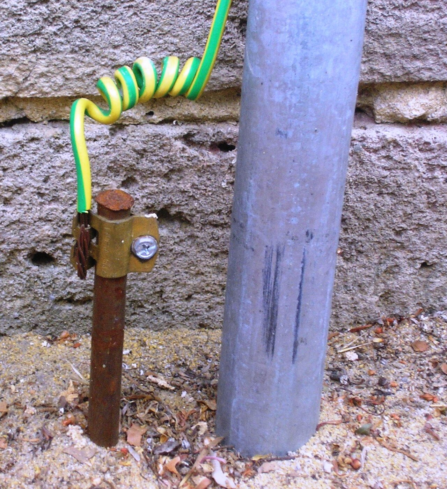
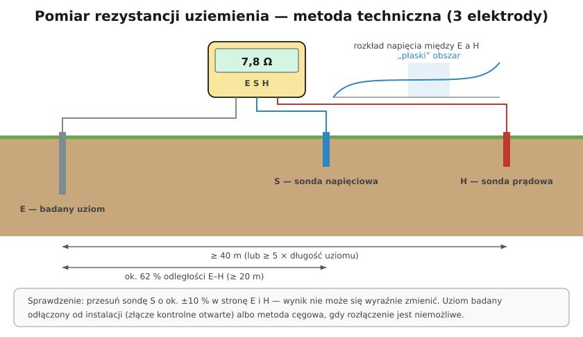

# 23.06 — Rezystancja uziemienia

> **Moduł:** [23 — Pomiary odbiorcze i okresowe](README.md) · **Oznaczenia:** 📋 · **Zakres SEP:** (b) (c) · **Status:** ✅ pełny
>
> **Czytaj:**
>
> - Uziomy: [13.01](../13-uziemienia-i-wyrownanie/13.01-uziom-fundamentowy-otokowy-pretowy.md), [13.02](../13-uziemienia-i-wyrownanie/13.02-rezystancja-uziemienia-od-czego-zalezy.md)
> - PN-EN 61557-5 — rezystancja uziemienia

[← poprzedni temat](23.05-badanie-wylacznikow-roznicowopradowych.md) · [spis modułu](README.md) · [następny temat →](23.07-kolejnosc-faz.md)

## Po co to jest

Uziom odprowadza prąd do ziemi: w układzie TT jest podstawą ochrony przeciwporażeniowej, przy instalacji odgromowej odprowadza prąd pioruna. Jego rezystancja zmienia się z wilgotnością gruntu i korozją. Pomiar rezystancji uziemienia wykonuje się przy odbiorze i okresowo — także przy kontroli instalacji odgromowej co 5 lat.

## Po ludzku

**Metoda techniczna (3 elektrody)** — podstawowa:

- **E** — badany uziom (odłączony od instalacji, np. przez otwarcie złącza kontrolnego),
- **H** (C) — sonda prądowa, daleko: zwykle **≥ 40 m** (albo co najmniej ok. 5 × długość uziomu),
- **S** (P) — sonda napięciowa, między nimi: ok. **62 %** odległości E–H (≥ 20 m).

Miernik przepuszcza prąd z E do H przez grunt i mierzy napięcie między E a S. $R_E = U_{ES} / I$. Sonda S musi stać w strefie, gdzie potencjał gruntu jest „płaski” — poza wpływem obu elektrod. Sprawdzenie: przesuń S o ok. ±10 % — wynik nie powinien się wyraźnie zmienić.

**Metoda czteroprzewodowa** — jak wyżej, ale osobny przewód do napięcia przy E eliminuje rezystancję przewodów (dokładniejsza przy małych wartościach).

**Metoda cęgowa (dwucęgowa)** — bez sond i bez rozłączania: jedne cęgi wymuszają napięcie, drugie mierzą prąd w pętli. Działa w układach z wieloma uziemieniami połączonymi równolegle (np. kilka przewodów odprowadzających LPS).

**Pomiar z pętli w TT** — MPI mierzy rezystancję pętli L–PE (uziemienie + reszta); daje wynik zawyżony, ale bezpieczny do oceny $R_A \cdot I_{\Delta n} \le 50$ V.

**Co wpływa na wynik:** wilgotność i temperatura gruntu (zima, susza — wyższa rezystancja), korozja, uszkodzenia połączeń. Wynik z mokrej jesieni bywa lepszy niż w suchym sierpniu — w ocenie bierze się to pod uwagę.

## Jak to wygląda

*Na co patrzeć: zacisk łączący przewód z uziomem — miejsce korozji. Przy pomiarze uziom odłącza się od instalacji (w złączu kontrolnym), żeby mierzyć tylko jego rezystancję.*

## Schemat

## Pojęcia

| Pojęcie | Po ludzku | Termin normowy / symbol |
|---------|-----------|-------------------------|
| Rezystancja uziemienia | Opór między uziomem a „daleką ziemią” | $R_E$, $R_A$ |
| Sonda prądowa / napięciowa | Pomocnicze pręty w gruncie | H (C) / S (P) |
| Złącze kontrolne | Rozłączalne połączenie przewodu odprowadzającego z uziomem | — |
| Metoda cęgowa | Pomiar bez sond, w pętli uziemień | — |

## Liczby do zapamiętania

| Wielkość | Wartość | Kiedy obowiązuje | Źródło |
|----------|---------|------------------|--------|
| Sonda prądowa | ≥ **40 m** (≥ ok. 5 × długość uziomu) | metoda techniczna | instrukcje mierników |
| Sonda napięciowa | ok. **62 %** odległości E–H | jw. | jw. |
| Sprawdzenie | przesunięcie S o **±10 %** | jw. | jw. |
| Warunek TT | $R_A \cdot I_{\Delta n} \le 50$ V (30 mA → do **1667 Ω**) | TT z RCD | PN-HD 60364-4-41, 411.5.3 |
| Zalecane uziemienie (LPS, ogólnie) | < **10 Ω** | zalecenie | [13.02](../13-uziemienia-i-wyrownanie/13.02-rezystancja-uziemienia-od-czego-zalezy.md) |
| Błąd przyrządu | ≤ **± 30 %** | — | PN-EN 61557-5 |

## W praktyce

- **Trasa sond** — z dala od innych uziomów, rur, kabli; w linii prostej; jeśli nie ma 40 m — kąt i krótsze odległości z kontrolą przesunięcia.
- **Dom z TT** — mierz rezystancję uziemienia instalacji i porównaj z warunkiem dla RCD.
- **Instalacja odgromowa** — każdy przewód odprowadzający po otwarciu złącza kontrolnego; wyniki porównuj z poprzednimi.
- **Zapisz warunki** — data, pogoda, wilgotność gruntu.

## Błędy i zagrożenia

- ⚠️ **Rozłączenie uziemienia instalacji pod napięciem** (np. w TT) — na czas rozłączenia brak ochrony; rób to po wyłączeniu zasilania albo metodą cęgową.
- **Sonda S za blisko E lub H** — wynik zaniżony lub zawyżony.
- **Pomiar przy zamkniętym złączu kontrolnym** — mierzysz równolegle cały system uziemień (wynik zaniżony).

## Przykład

**Zadanie.** Dom w układzie TT, RCD 30 mA (ogólny) jako ochrona przy uszkodzeniu. Zmierzona rezystancja uziemienia $R_A = 85\ \Omega$. Ocena?

**Rozwiązanie.** Warunek: $R_A \cdot I_{\Delta n} = 85 \cdot 0{,}03 = 2{,}55$ V ≤ 50 V → **spełniony**. Mimo to 85 Ω to dużo jak na uziom budynku — przy różnicówce 300 mA na przyłączu: $85 \cdot 0{,}3 = 25{,}5$ V — też spełnione. Warto rozważyć poprawę uziomu (dodatkowe pręty), zwłaszcza jeśli dom ma instalację odgromową i SPD typu 1.

## Pytania SEP

1. **Jak mierzy się rezystancję uziemienia metodą techniczną?**

Odpowiedź

Badany uziom odłącza się od instalacji (np. w złączu kontrolnym). W linii prostej wbija się sondę prądową w odległości co najmniej ok. 40 m (lub kilkukrotnej długości uziomu) i sondę napięciową w odległości ok. 62 % tej długości, w strefie potencjału zerowego. Miernik wymusza prąd między uziomem a sondą prądową i mierzy napięcie między uziomem a sondą napięciową; iloraz to rezystancja uziemienia. Poprawność sprawdza się, przesuwając sondę napięciową o ok. 10 % w obie strony — wynik nie powinien się istotnie zmienić. Wynik ocenia się z uwzględnieniem warunków gruntowych.

## Sprawdź się

1. Dlaczego przy pomiarze rezystancji uziemienia otwiera się złącze kontrolne?

Odpowiedź

Żeby zmierzyć rezystancję tylko badanego uziomu. Przy zamkniętym złączu uziom jest połączony z innymi uziomami i przewodami (instalacja, inne przewody odprowadzające, rury) i miernik pokaże ich rezystancję równoległą — mniejszą niż samego uziomu.

## Źródła

- PN-EN 61557-5 — Rezystancja uziemienia.
- PN-HD 60364-6 — 6.4.3.6.3 (pomiar rezystancji uziomu).
- PN-EN 62305-3 — ochrona odgromowa (kontrola uziemień).

---

[← poprzedni temat](23.05-badanie-wylacznikow-roznicowopradowych.md) · [spis modułu](README.md) · [następny temat →](23.07-kolejnosc-faz.md)
