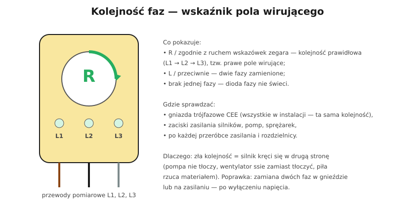

# 23.07 — Kolejność faz

> **Moduł:** [23 — Pomiary odbiorcze i okresowe](README.md) · **Oznaczenia:** 📋 · **Zakres SEP:** (b) (c) · **Status:** ✅ pełny
>
> **Czytaj:**
>
> - Układ trójfazowy: [02.03](../02-prad-przemienny-230-400/02.03-uklad-trojfazowy-230-v-i-400-v-kolejnosc-faz.md)
> - PN-EN 61557-7 — kolejność faz

[← poprzedni temat](23.06-rezystancja-uziemienia.md) · [spis modułu](README.md) · [następny temat →](23.08-protokol-z-pomiarow-i-terminy-badan-okresowych.md)

## Po co to jest

Silnik trójfazowy kręci się w kierunku zależnym od kolejności faz ([24.06](../24-silniki-i-napedy/24.06-zmiana-kierunku-obrotow.md)). Jeśli w jednym gnieździe CEE fazy są zamienione, piła stołowa czy pompa podłączona do niego kręci się w drugą stronę. Dlatego kolejność faz w instalacji wielofazowej sprawdza się przy odbiorze i po każdej przeróbce zasilania.

## Po ludzku

**Kolejność faz** (następstwo faz) mówi, w jakiej kolejności napięcia faz osiągają szczyt: **L1 → L2 → L3** to kolejność **prawidłowa**, „prawe” pole wirujące. Zamiana dowolnych dwóch faz daje kolejność odwrotną.

**Wskaźnik kolejności faz** — trzy przewody do L1, L2, L3; pokazuje:

- **R** / strzałkę w prawo / kręcącą się tarczkę zgodnie z zegarem — prawidłowo,
- **L** / w lewo — fazy zamienione,
- brak jednej fazy — zgaszona dioda.

Funkcję tę mają też MPI i lepsze wskaźniki dwubiegunowe (z jedną sondą na przewodzie wspólnym).

**Gdzie mierzyć:**

- wszystkie **gniazda trójfazowe** (CEE 16/32 A) — każde musi mieć tę samą, prawidłową kolejność,
- zaciski zasilania silników, pomp ciepła, sprężarek, wind,
- po wymianie przyłącza, licznika, WLZ, rozdzielnicy.

**Poprawka:** zamiana **dwóch** faz — w gnieździe, w rozdzielnicy albo na zaciskach silnika (po wyłączeniu napięcia).

## Jak to wygląda

*Na co patrzeć: styki wtyczki i gniazda CEE są opisane L1, L2, L3. Jeśli gniazdo podłączono z zamienionymi fazami, urządzenie z tą wtyczką kręci się w drugą stronę.*

## Schemat

## Pojęcia

| Pojęcie | Po ludzku | Termin normowy / symbol |
|---------|-----------|-------------------------|
| Kolejność faz | Kolejność szczytów napięć faz | następstwo faz |
| Prawe pole wirujące | Kolejność L1 → L2 → L3 | — |
| Wskaźnik kolejności faz | Przyrząd z trzema przewodami | PN-EN 61557-7 |

## Liczby do zapamiętania

| Wielkość | Wartość | Kiedy obowiązuje | Źródło |
|----------|---------|------------------|--------|
| Prawidłowa kolejność | **L1 → L2 → L3** (prawa) | instalacje wielofazowe | PN-HD 60364-6, 6.4.3.9 |
| Przesunięcie faz | **120°** | sieć 3-faz. | [02.03](../02-prad-przemienny-230-400/02.03-uklad-trojfazowy-230-v-i-400-v-kolejnosc-faz.md) |
| Zmiana kierunku | zamiana **dwóch** faz | — | — |

## W praktyce

- **Po każdej zmianie w zasilaniu** — sprawdź kolejność na gniazdach trójfazowych.
- **Jedno gniazdo z odwrotną kolejnością** — popraw je, nie „przestawiaj” wtyczek urządzeń (przy innym gnieździe znów kręci się źle).
- **Pompa ciepła i sprężarki spiralne** — przy złej kolejności mogą się uszkodzić; często mają własny przekaźnik kontroli faz ([10.04](../10-aparatura-modulowa/10.04-kontrolki-faz-przekazniki-zaniku-fazy-i.md)).

## Błędy i zagrożenia

- ⚠️ **Piła lub pompa kręcąca się w złą stronę** — wyrzut materiału, uszkodzenie pompy.
- **Zamiana faz we wtyczce urządzenia** zamiast w gnieździe — kolejny błąd przy innym gnieździe.
- **Brak pomiaru po wymianie licznika** lub przyłącza.

## Przykład

**Zadanie.** Po wymianie rozdzielnicy w warsztacie kompresor tłokowy (silnik 3-faz.) kręci się w drugą stronę. Co zrobić?

**Rozwiązanie.** Wskaźnikiem kolejności faz zbadaj gniazdo kompresora i inne gniazda trójfazowe. Jeśli wszystkie mają odwrotną kolejność — zamień dwie fazy na **zasilaniu rozdzielnicy** (po wyłączeniu). Jeśli tylko jedno — popraw podłączenie tego gniazda. Sprawdź ponownie wskaźnikiem i kierunek obrotów kompresora.

## Pytania SEP

1. **Dlaczego i jak sprawdza się kolejność faz?**

Odpowiedź

Kolejność faz decyduje o kierunku wirowania pola magnetycznego, a więc o kierunku obrotów silników trójfazowych; w instalacjach wielofazowych sprawdza się, czy jest zachowana (PN-HD 60364-6). Sprawdza się ją wskaźnikiem kolejności faz (PN-EN 61557-7) dołączonym do przewodów L1, L2, L3 w gniazdach trójfazowych i na zaciskach odbiorników. Prawidłowa kolejność to L1–L2–L3 (pole prawoskrętne); odwrotną poprawia się zamianą dwóch przewodów fazowych.

## Sprawdź się

1. Ile przewodów trzeba zamienić, żeby odwrócić kolejność faz? A co się stanie po zamianie wszystkich trzech „po kolei” (L1→L2, L2→L3, L3→L1)?

Odpowiedź

Wystarczy zamienić **dwa**. Przesunięcie wszystkich trzech „w kółko” nie zmienia kolejności — pole wiruje w tę samą stronę.

## Źródła

- PN-HD 60364-6 — 6.4.3.9 Kolejność faz.
- PN-EN 61557-7 — Kolejność faz.

---

[← poprzedni temat](23.06-rezystancja-uziemienia.md) · [spis modułu](README.md) · [następny temat →](23.08-protokol-z-pomiarow-i-terminy-badan-okresowych.md)
