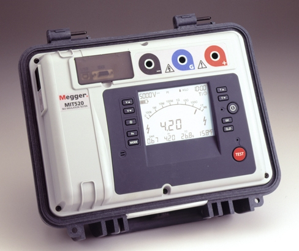
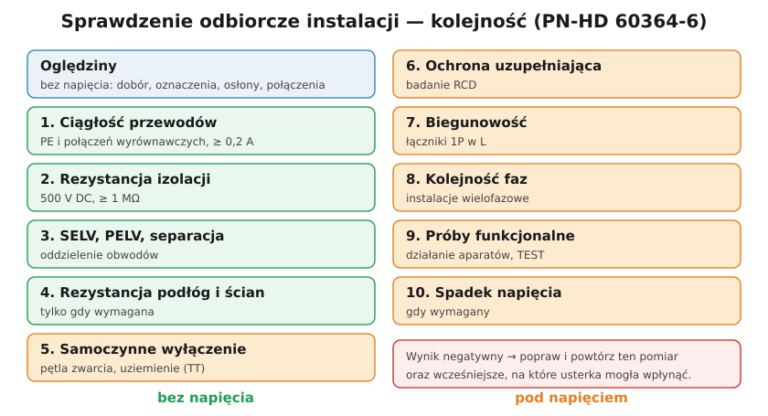

# 23.08 — Protokół z pomiarów i terminy badań okresowych

> **Moduł:** [23 — Pomiary odbiorcze i okresowe](README.md) · **Oznaczenia:** 📋 · **Zakres SEP:** (b) (c) · **Status:** ✅ pełny
>
> **Czytaj:**
>
> - Prawo budowlane, art. 62 — kontrole okresowe; [omówienie SEP](https://sep.com.pl/opracowania/Kontrola%20stanu%20instalacji%20elektrycznych%20niskiego%20napiecia.pdf)
> - Kto może wykonywać: [00.03](../00-bezpieczenstwo-najpierw/00.03-co-wolno-zrobic-samemu-a-co-wymaga-uprawnien-i.md)

[← poprzedni temat](23.07-kolejnosc-faz.md) · [spis modułu](README.md) · (koniec modułu) →

## Po co to jest

Pomiar bez protokołu nie istnieje — nikt nie udowodni, że instalacja była sprawna, ani nie porówna wyników po latach. Protokół jest podstawą odbioru instalacji, dokumentem dla ubezpieczyciela i nadzoru budowlanego. Komisja pyta, co protokół musi zawierać i jak często bada się instalacje.

## Po ludzku

**Protokół (sprawozdanie) ze sprawdzenia** zawiera co najmniej:

1. **Obiekt** — adres, rodzaj (mieszkanie, dom, zakład), zakres badania (cała instalacja / rozdzielnica / obwody).
2. **Rodzaj sprawdzenia** — odbiorcze czy okresowe, data.
3. **Dane sieci** — układ (TN-S, TN-C-S, TT), napięcie, zabezpieczenie przedlicznikowe.
4. **Wyniki oględzin** — lista kontrolna z oceną.
5. **Wyniki prób dla każdego obwodu** — numer i opis obwodu, zabezpieczenie (typ, In), przewód (przekrój), wyniki: ciągłość PE, izolacja, $Z_s$ (i ocena), RCD (IΔn, $t_A$, $I_A$, $U_B$), uziemienie, kolejność faz.
6. **Ocena** — każdego pomiaru i całości: instalacja nadaje się / nie nadaje się do eksploatacji; lista usterek i zaleceń.
7. **Przyrządy** — typ, numer fabryczny, data ważności **świadectwa wzorcowania**.
8. **Osoby** — kto wykonał i kto sprawdził, numery świadectw kwalifikacyjnych, podpisy.
9. **Termin następnego badania**.

**Jak często? — przepisy (Prawo budowlane, art. 62):**

- co najmniej **raz na 5 lat** — kontrola instalacji elektrycznej i piorunochronnej budynku: stan połączeń, osprzętu, zabezpieczeń i środków ochrony od porażeń, rezystancja izolacji, uziemienia;
- co najmniej **raz w roku** — przegląd stanu technicznego elementów narażonych na wpływy atmosferyczne i niszczące działania czynników występujących podczas użytkowania;
- **dwa razy w roku** (do 31 maja i 30 listopada) — budynki o powierzchni zabudowy powyżej 2000 m² i inne obiekty o powierzchni dachu powyżej 1000 m².

**Zalecenia normy (PN-HD 60364-6, informacyjne):** budynki mieszkalne — np. co **10 lat** i przy każdej zmianie użytkownika; inne budynki bez szczególnych warunków — co **4 lata**; częściej przy dużym ryzyku (miejsca zgromadzeń, budowy, instalacje bezpieczeństwa). W zakładach pracy częstotliwość ustala instrukcja eksploatacji ([moduł 29](../29-eksploatacja/README.md)).

**Kto:** pomiary wykonuje osoba ze świadectwem kwalifikacyjnym obejmującym czynności kontrolno-pomiarowe; kontrolę stanu technicznego instalacji budynku w ramach art. 62 — osoba z kwalifikacjami wymaganymi przy **dozorze** ([00.03](../00-bezpieczenstwo-najpierw/00.03-co-wolno-zrobic-samemu-a-co-wymaga-uprawnien-i.md)).

## Jak to wygląda

*Na co patrzeć: przyrząd z pamięcią wyników przenosi pomiary do programu, który tworzy tabelę protokołu. Numer fabryczny przyrządu i data wzorcowania trafiają do protokołu.*

## Schemat

Przykładowy wiersz tabeli wyników w protokole:

| Nr | Obwód | Zabezp. | Przewód | R_PE [Ω] | R_iso [MΩ] | Z_s [Ω] | Z_s,max·⅔ [Ω] | RCD t_A [ms] | Ocena |
|----|-------|---------|---------|----------|------------|---------|---------------|--------------|-------|
| 3 | gniazda kuchnia | B16 | 3 × 2,5 Cu | 0,21 | > 200 | 0,92 | 1,92 | 24 | pozytywna |

## Pojęcia

| Pojęcie | Po ludzku | Termin normowy / symbol |
|---------|-----------|-------------------------|
| Protokół | Dokument z wynikami | sprawozdanie (PN-HD 60364-6, 6.5) |
| Świadectwo wzorcowania | Potwierdzenie dokładności przyrządu | — |
| Kontrola okresowa | Badanie w czasie eksploatacji | art. 62 Prawa budowlanego |
| Książka obiektu budowlanego | Dokument, do którego wpisuje się kontrole | — |

## Liczby do zapamiętania

| Wielkość | Wartość | Kiedy obowiązuje | Źródło |
|----------|---------|------------------|--------|
| Kontrola instalacji elektrycznej i piorunochronnej | co najmniej co **5 lat** | budynki | art. 62 ust. 1 pkt 2 Prawa budowlanego |
| Przegląd elementów narażonych na czynniki atmosferyczne | co najmniej **raz w roku** | budynki | art. 62 ust. 1 pkt 1 |
| Duże obiekty | **2 razy w roku** (do 31.05 i 30.11) | zabudowa > 2000 m², dach > 1000 m² | art. 62 ust. 1 pkt 3 |
| Zalecenie normy — mieszkania | co **10 lat** + zmiana użytkownika | informacyjne | PN-HD 60364-6 |
| Zalecenie normy — inne budynki | co **4 lata** | informacyjne | jw. |
| Ważność świadectwa kwalifikacyjnego | **5 lat** | — | art. 54 Prawa energetycznego |

## W praktyce

- **Szablon protokołu** z programu do MPI oszczędza czas, ale oględziny i ocenę uzupełnia człowiek.
- **Usterki z terminem** — w protokole: co poprawić i do kiedy; po poprawkach — protokół uzupełniający.
- **Wpis do książki obiektu budowlanego** — dla budynków, które ją mają.
- **Archiwum** — porównanie z poprzednimi wynikami pokazuje trendy (spadek izolacji, wzrost $Z_s$).

## Błędy i zagrożenia

- **Protokół bez danych przyrządu** (numer, wzorcowanie) — wątpliwa wartość dowodowa.
- **„Wyniki pozytywne” bez wartości** — protokół musi zawierać liczby, nie tylko ocenę.
- **Kopiowanie wyników z poprzedniego badania** — fałszowanie dokumentacji; przy wypadku lub pożarze — odpowiedzialność karna i cywilna wykonawcy.
- **Brak oceny całości** — z protokołu ma wynikać, czy instalacja nadaje się do eksploatacji.

## Przykład

**Zadanie.** Właściciel domu jednorodzinnego (2015 r.) pyta, czy musi „robić pomiary”. Co mu odpowiesz?

**Rozwiązanie.** Prawo budowlane (art. 62) wymaga kontroli stanu technicznego, w tym **instalacji elektrycznej i piorunochronnej, co najmniej raz na 5 lat** — także w domach jednorodzinnych. Kontrola obejmuje m.in. skuteczność ochrony przeciwporażeniowej, rezystancję izolacji i uziemień, czyli pomiary. Wykonuje ją osoba z odpowiednimi kwalifikacjami; wynikiem jest protokół. Niezależnie od przepisu — protokół przydaje się przy szkodzie i sprzedaży domu.

## Pytania SEP

1. **Jak często wykonuje się badania okresowe instalacji elektrycznej w budynku i z jakiego przepisu to wynika?**

Odpowiedź

Prawo budowlane (art. 62 ust. 1 pkt 2) wymaga okresowej kontroli, co najmniej raz na 5 lat, stanu technicznego i przydatności do użytkowania obiektu, w tym badania instalacji elektrycznej i piorunochronnej w zakresie stanu sprawności połączeń, osprzętu, zabezpieczeń i środków ochrony od porażeń, rezystancji izolacji przewodów oraz uziemień instalacji i aparatów. Kontrolę wykonują osoby z kwalifikacjami wymaganymi przy dozorze nad eksploatacją urządzeń. Dla niektórych obiektów i warunków (zakłady pracy, pomieszczenia o zwiększonym zagrożeniu) częstotliwość określa instrukcja eksploatacji; norma PN-HD 60364-6 podaje zalecenia informacyjne.

2. **Co powinien zawierać protokół z pomiarów instalacji?**

Odpowiedź

Dane obiektu i zakres badania, rodzaj sprawdzenia i datę, dane o sieci zasilającej i układzie, wyniki oględzin, wyniki pomiarów dla poszczególnych obwodów (ciągłość, rezystancja izolacji, impedancja pętli zwarcia, parametry RCD, uziemienia, inne) wraz z wartościami dopuszczalnymi i oceną, listę stwierdzonych usterek i zaleceń, ocenę końcową przydatności instalacji do eksploatacji, dane przyrządów (typ, numer, ważność wzorcowania), dane i podpisy osób wykonujących i sprawdzających z numerami świadectw kwalifikacyjnych oraz termin następnego badania.

## Sprawdź się

1. W protokole jest: „Obwód 3, B16: Z_s = 2,4 Ω — wynik pozytywny”. Co jest nie tak?

Odpowiedź

$Z_{s,max} = 2{,}88\ \Omega$, ale z zapasem ⅔ — 1,92 Ω. Wynik 2,4 Ω spełnia warunek podstawowy, ale nie spełnia oceny z zapasem — opis „pozytywny” bez komentarza jest wątpliwy. Protokół powinien podawać kryterium oceny, a wynik graniczny — z zaleceniem (np. RCD na obwód, sprawdzenie zacisków).

## Źródła

- Ustawa Prawo budowlane, art. 62 ust. 1 i ust. 5.
- PN-HD 60364-6:2016 — 6.5 Sprawozdanie; załącznik informacyjny (częstość sprawdzeń).
- [Kontrola stanu instalacji elektrycznych niskiego napięcia — SEP](https://sep.com.pl/opracowania/Kontrola%20stanu%20instalacji%20elektrycznych%20niskiego%20napiecia.pdf).

---

[← poprzedni temat](23.07-kolejnosc-faz.md) · [spis modułu](README.md) · (koniec modułu) →
