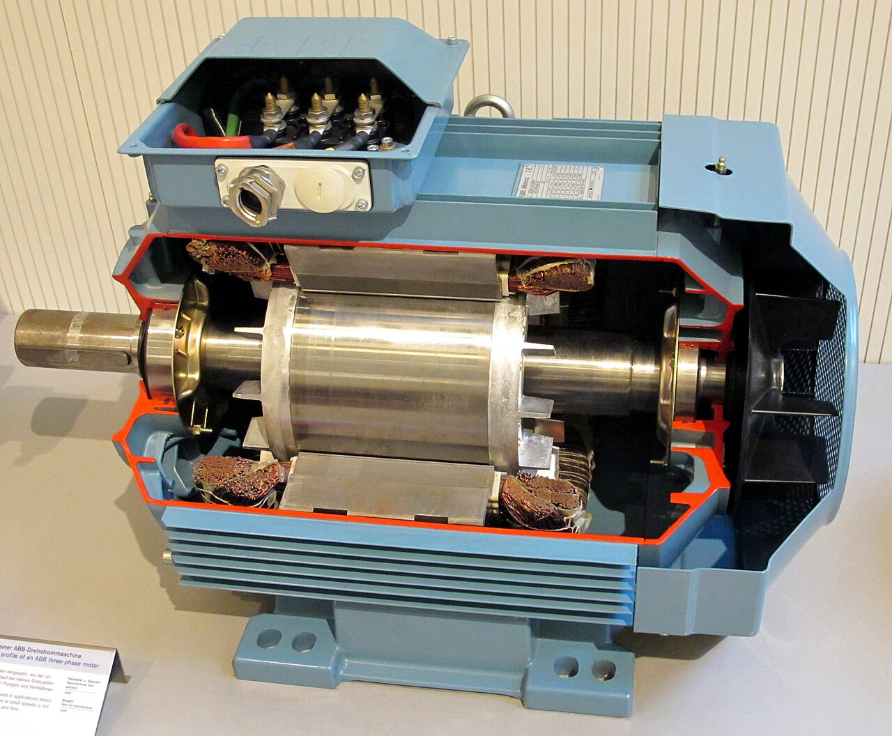
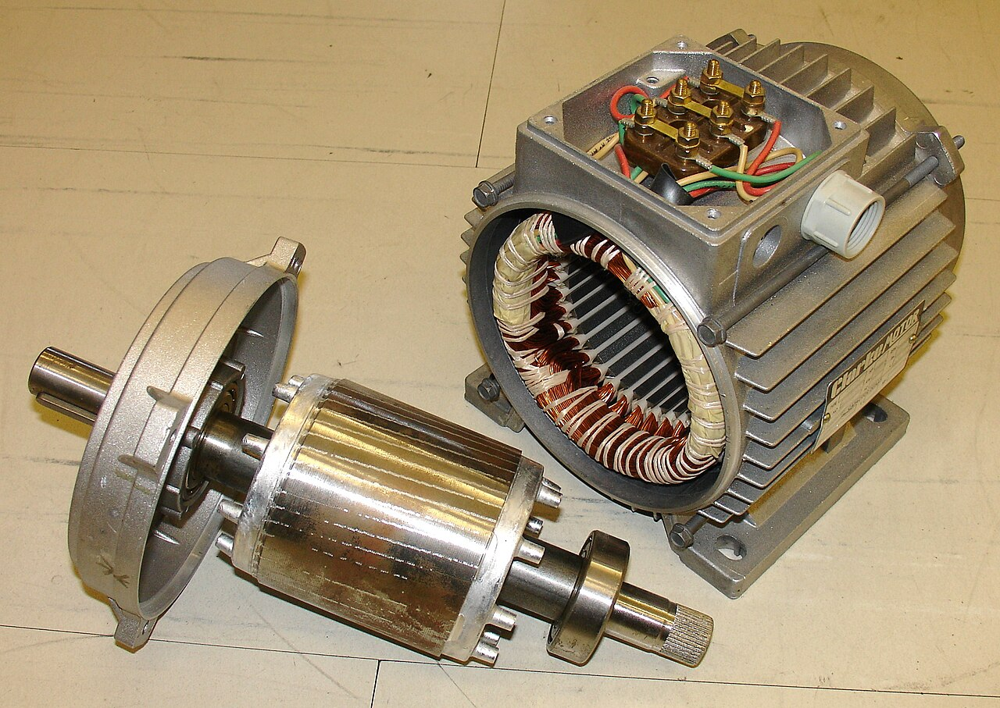
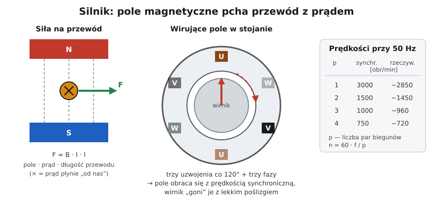

# 24.01 — Silnik indukcyjny trójfazowy

> **Moduł:** [24 — Silniki i napędy](README.md) · **Oznaczenia:** 📋 · **Zakres SEP:** (a) (b) (c) · **Status:** ✅ pełny
>
> **Czytaj:**
>
> - Intuicja: [03.04](../03-elektromagnetyzm-w-praktyce/03.04-jak-dziala-silnik-elektryczny-intuicja.md)
> - Rozporządzenie Komisji (UE) 2019/1781 — ekoprojekt silników; [ABB — Ecodesign dla silników](https://new.abb.com/motors-generators/pl/ecodesign-dla-silników)

← (początek modułu) · [spis modułu](README.md) · [następny temat →](24.02-tabliczka-znamionowa-silnika.md)

## Po co to jest

Silnik indukcyjny trójfazowy napędza pompy, wentylatory, sprężarki, obrabiarki, pompy ciepła — to najczęściej spotykany silnik w przemyśle i coraz częściej w domach. Grupa E z zakresem „urządzenia napędowe” pyta o jego budowę, działanie, rozruch i zabezpieczenia. Ten temat rozwija intuicję z [03.04](../03-elektromagnetyzm-w-praktyce/03.04-jak-dziala-silnik-elektryczny-intuicja.md) o liczby i praktykę.

## Po ludzku

**Budowa:**

- **stojan** — pakiet blach z trzema uzwojeniami przesuniętymi o 120°; końce uzwojeń wyprowadzone na **tabliczkę zaciskową** (U1–U2, V1–V2, W1–W2),
- **wirnik klatkowy** — pręty aluminiowe lub miedziane zwarte pierścieniami; brak szczotek i połączeń,
- **łożyska, wentylator** na wale, **obudowa** z żebrami chłodzącymi.

**Działanie:** trzy prądy w trzech uzwojeniach tworzą **pole wirujące** z prędkością synchroniczną:

$$n_s = \frac{60 \cdot f}{p}$$

gdzie $p$ — liczba **par** biegunów. Pole indukuje prądy w prętach wirnika, a te z polem dają moment. Wirnik kręci się nieco wolniej niż pole — o **poślizg** $s = (n_s - n) / n_s$, typowo 2–6 %.

**Charakterystyka momentu:**

- **moment rozruchowy** — przy starcie, zwykle 1,5–3 × znamionowy,
- **moment krytyczny** (maksymalny) — przy pewnym poślizgu; jeśli obciążenie go przekroczy, silnik „utyka” i staje,
- **praca** — w stabilnym zakresie przy małym poślizgu.

**Prąd rozruchowy** 5–8 × In — przez sekundy. To dlatego wyłączniki silników mają charakterystykę C/D albo są wyłącznikami silnikowymi, a większe silniki rozrusza się łagodnie ([24.04](24.04-rozruch-bezposredni-gwiazda-trojkat-softstart.md)).

**Praca na dwóch fazach** (zanik fazy) — silnik pracujący dalej się grzeje (prąd w pozostałych fazach rośnie), a zatrzymany nie ruszy, tylko buczy. Chroni przed tym przekaźnik termiczny z czułością na asymetrię albo przekaźnik kontroli faz ([10.04](../10-aparatura-modulowa/10.04-kontrolki-faz-przekazniki-zaniku-fazy-i.md)).

**Klasy sprawności IE** — od **1 lipca 2021** w UE silniki trójfazowe **0,75–1000 kW** muszą mieć co najmniej **IE3** (0,12–0,75 kW — **IE2**); od **1 lipca 2023** silniki **75–200 kW** (2, 4, 6 biegunów) — **IE4**.

## Jak to wygląda

*Na co patrzeć: uzwojenia stojana (miedź) i wirnik na wale — do wirnika nie dochodzi żaden przewód. U góry skrzynka zaciskowa, w której są końce uzwojeń; żebra obudowy odprowadzają ciepło.*

*Na co patrzeć: uzwojenia leżą w żłobkach pakietu blach stojana; wirnik wyjęty z obudowy wraz z wałem. Przy przeglądzie silnika ocenia się stan izolacji uzwojeń i łożysk.*

## Schemat

## Pojęcia

| Pojęcie | Po ludzku | Termin normowy / symbol |
|---------|-----------|-------------------------|
| Prędkość synchroniczna | Prędkość pola wirującego | $n_s$ |
| Poślizg | O ile wirnik „spóźnia się” za polem | $s$ |
| Para biegunów | Liczba „N–S” w polu stojana | $p$ |
| Moment krytyczny | Największy moment, jaki silnik wytworzy | $M_k$ |
| Klasa sprawności | Poziom sprawności wg IEC 60034-30-1 | IE1–IE5 |

## Liczby do zapamiętania

| Wielkość | Wartość | Kiedy obowiązuje | Źródło |
|----------|---------|------------------|--------|
| Prędkość synchroniczna | $n_s = 60 f / p$: **3000 / 1500 / 1000 / 750** obr/min | 50 Hz, p = 1…4 | — |
| Poślizg | **2–6 %** | znamionowo, silniki małe i średnie | katalogi |
| Prąd rozruchowy | **5–8 × In** | rozruch bezpośredni | katalogi |
| Moment rozruchowy | ok. **1,5–3 × Mn** | silniki klatkowe | katalogi |
| Wymóg IE3 | **0,75–1000 kW** od 1.07.2021 | silniki 3-faz. w UE | rozp. (UE) 2019/1781 |
| Wymóg IE4 | **75–200 kW** od 1.07.2023 | 2, 4, 6 biegunów | jw. |

## W praktyce

- **Sprawdzenie silnika miernikiem** (po odłączeniu): rezystancje trzech uzwojeń powinny być równe; izolacja uzwojeń do obudowy ≥ 1 MΩ (500 V).
- **Grzanie i hałas łożysk** — kamera termowizyjna i ucho ([22.06](../22-przyrzady-pomiarowe/22.06-kamera-termowizyjna-kiedy-sie-przydaje.md)).
- **Kierunek obrotów** zależy od kolejności faz ([23.07](../23-pomiary-odbiorcze-i-okresowe/23.07-kolejnosc-faz.md), [24.06](24.06-zmiana-kierunku-obrotow.md)).
- **Obudowa silnika** — klasa I, łączona z PE.

## Błędy i zagrożenia

- ⚠️ **Praca na dwóch fazach** bez zabezpieczenia — przegrzanie i spalenie uzwojeń.
- ⚠️ **Wirujące części bez osłon** — wciągnięcie odzieży, włosów.
- **Zbyt częste rozruchy** — uzwojenia nie zdążą ostygnąć.
- **Zabezpieczenie B dla silnika** — zadziała przy każdym rozruchu.

## Przykład

**Zadanie.** Na tabliczce: 1440 obr/min, 50 Hz. Ile biegunów i jaki poślizg?

**Rozwiązanie.** Najbliższa wyższa prędkość synchroniczna to **1500 obr/min** → $p = 60 \cdot 50 / 1500 = 2$ pary, czyli **4 bieguny**. Poślizg: $s = (1500 - 1440)/1500 = 0{,}04$ → **4 %**.

## Pytania SEP

1. **Jak zbudowany jest i jak działa silnik indukcyjny trójfazowy?**

Odpowiedź

Składa się ze stojana z trójfazowym uzwojeniem umieszczonym w żłobkach pakietu blach i wirnika (najczęściej klatkowego — pręty zwarte pierścieniami). Prądy trójfazowe w uzwojeniach stojana wytwarzają pole magnetyczne wirujące z prędkością synchroniczną $n_s = 60f/p$. Pole indukuje w prętach wirnika napięcia i prądy, które w polu magnetycznym wytwarzają moment obrotowy. Wirnik obraca się z prędkością mniejszą od synchronicznej (poślizg kilka procent) — stąd nazwa silnik asynchroniczny. Kierunek obrotów zależy od kolejności faz.

## Sprawdź się

1. Dlaczego silnik indukcyjny nie może osiągnąć prędkości synchronicznej?

Odpowiedź

Bo moment powstaje tylko wtedy, gdy pole przecina pręty wirnika i indukuje w nich prąd. Przy prędkości synchronicznej pole i wirnik obracałyby się razem, nie byłoby indukcji, prądów ani momentu.

## Źródła

- PN-EN 60034-1 — Maszyny elektryczne wirujące. Dane znamionowe i parametry.
- Rozporządzenie Komisji (UE) 2019/1781; [Ecodesign dla silników — ABB](https://new.abb.com/motors-generators/pl/ecodesign-dla-silników).
- [03.04 — Jak działa silnik elektryczny](../03-elektromagnetyzm-w-praktyce/03.04-jak-dziala-silnik-elektryczny-intuicja.md).

---

← (początek modułu) · [spis modułu](README.md) · [następny temat →](24.02-tabliczka-znamionowa-silnika.md)
