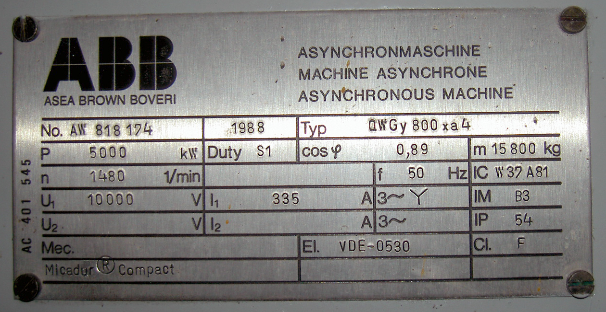
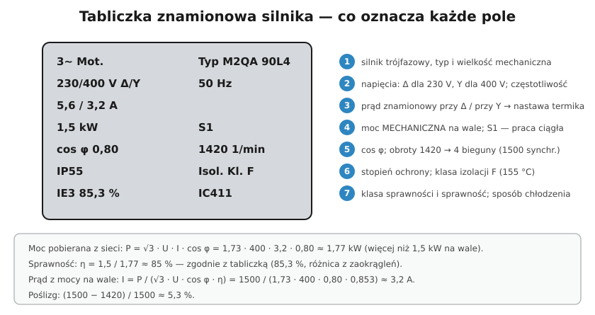

# 24.02 — Tabliczka znamionowa silnika

> **Moduł:** [24 — Silniki i napędy](README.md) · **Oznaczenia:** 📋 · **Zakres SEP:** (a) (b) (c) · **Status:** ✅ pełny
>
> **Czytaj:**
>
> - PN-EN 60034-1 — dane znamionowe; PN-EN 60034-30-1 — klasy IE

[← poprzedni temat](24.01-silnik-indukcyjny-trojfazowy.md) · [spis modułu](README.md) · [następny temat →](24.03-polaczenie-w-gwiazde-i-w-trojkat.md)

## Po co to jest

Z tabliczki znamionowej dobiera się zabezpieczenie, przekrój przewodu, nastawę przekaźnika termicznego i sposób połączenia uzwojeń. Pomylenie mocy na wale z mocą pobieraną albo prądu dla trójkąta z prądem dla gwiazdy kończy się źle dobranym zabezpieczeniem albo spalonym silnikiem. Na egzaminie każą „przeczytać” tabliczkę.

## Po ludzku

**Najważniejsze pola:**

- **3~ Mot.** — silnik trójfazowy; typ i **wielkość mechaniczna** (np. 90L — wysokość osi 90 mm).
- **Napięcie** — np. **230/400 V Δ/Y**: w trójkąt przy 230 V międzyfazowym, w gwiazdę przy 400 V. W polskiej sieci 400 V → **gwiazda** ([24.03](24.03-polaczenie-w-gwiazde-i-w-trojkat.md)).
- **Prąd** — np. **5,6/3,2 A** — odpowiednio dla Δ i Y. Do nastawy termika bierzesz prąd dla połączenia, w którym silnik pracuje.
- **Moc** — np. **1,5 kW** — to moc **mechaniczna na wale**, nie pobierana z sieci.
- **cos φ** — współczynnik mocy (np. 0,80).
- **Obroty** — np. 1420 obr/min → silnik 4-biegunowy (synchronicznie 1500).
- **Częstotliwość** — 50 Hz (czasem też dane dla 60 Hz).
- **Rodzaj pracy** — **S1** praca ciągła, S2 dorywcza (np. S2 10 min), S3 przerywana (np. S3 40 %).
- **IP** — stopień ochrony (np. IP55) ([06.05](../06-osprzet-instalacyjny/06.05-stopnie-ochrony-ip.md)).
- **Klasa izolacji** — B (130 °C), **F (155 °C)**, H (180 °C) — dopuszczalna temperatura uzwojeń.
- **IC** — sposób chłodzenia (IC411 — obudowa zamknięta, chłodzona własnym wentylatorem).
- **IE** — klasa sprawności i sprawność (np. IE3, 85,3 %).

**Moc pobierana i prąd:**

$$P_{el} = \frac{P_{wał}}{\eta}, \qquad I = \frac{P_{wał}}{\sqrt{3} \cdot U \cdot \cos\varphi \cdot \eta}$$

## Jak to wygląda

*Na co patrzeć: nawet duży silnik średniego napięcia ma te same pola: P (kW), n (1/min), U, I, cos φ, f, IP, klasa izolacji (Cl. F), rodzaj pracy (S1). 1480 obr/min przy 50 Hz → silnik 4-biegunowy.*

## Schemat

## Pojęcia

| Pojęcie | Po ludzku | Termin normowy / symbol |
|---------|-----------|-------------------------|
| Moc znamionowa | Moc mechaniczna na wale | $P_N$ [kW] |
| Rodzaj pracy | Jak długo silnik może pracować | S1…S10 |
| Klasa izolacji | Dopuszczalna temperatura uzwojeń | B, F, H |
| Wielkość mechaniczna | Wysokość osi wału i długość | np. 90L |
| IC | Sposób chłodzenia | IC411 |

## Liczby do zapamiętania

| Wielkość | Wartość | Kiedy obowiązuje | Źródło |
|----------|---------|------------------|--------|
| Klasy izolacji | B **130 °C**, F **155 °C**, H **180 °C** | uzwojenia | PN-EN 60085 |
| Rodzaj pracy | **S1** ciągła, **S2** dorywcza, **S3** przerywana | — | PN-EN 60034-1 |
| Prąd 3-faz. | $I = P / (\sqrt{3} \cdot U \cdot \cos\varphi \cdot \eta)$ | P — moc na wale | — |
| Szybki szacunek | ok. **2 A na 1 kW** przy 400 V | silniki kilku kW | praktyka |
| Nastawa termika | **= prąd znamionowy** dla danego połączenia | — | [24.05](24.05-uklad-start-stop-ze-stycznikiem-i-przekaznikiem.md) |

## W praktyce

- **Zrób zdjęcie tabliczki** przed montażem — po zabudowie często jest niewidoczna.
- **Napięcie na tabliczce** porównaj z siecią: „230/400 V” w Polsce → gwiazda; „400/690 V” → trójkąt.
- **Silnik do falownika** — sprawdź, czy producent dopuszcza pracę z przemiennikiem (izolacja, łożyska) ([24.07](24.07-przemienniki-czestotliwosci.md)).
- **Silnik S2/S3** — nie nadaje się do pracy ciągłej; przegrzeje się.

## Błędy i zagrożenia

- ⚠️ **Δ zamiast Y** przy silniku 230/400 V w sieci 400 V — uzwojenia na napięciu √3 razy większym, spalenie w kilka sekund–minut.
- **Nastawa termika z prądu dla Δ**, gdy silnik pracuje w Y — zabezpieczenie za duże.
- **Dobór przewodu z mocy na wale bez sprawności i cos φ** — przewód za cienki.

## Przykład

**Zadanie.** Tabliczka: 4 kW, 400/690 V Δ/Y, 8,1/4,7 A, cos φ 0,82, 2900 obr/min. Jak podłączyć w sieci 400 V i jaka nastawa termika?

**Rozwiązanie.** 400 V odpowiada połączeniu **Δ** (trójkąt). Prąd w Δ: **8,1 A** → nastawa przekaźnika termicznego **8,1 A**. Silnik 2-biegunowy (synchronicznie 3000 obr/min, poślizg ok. 3,3 %). Ten silnik nadaje się do rozruchu gwiazda-trójkąt.

## Pytania SEP

1. **Jakie informacje zawiera tabliczka znamionowa silnika i jak je wykorzystać?**

Odpowiedź

Typ i producenta, liczbę faz, napięcia znamionowe z oznaczeniem układu połączeń uzwojeń (np. 230/400 V Δ/Y), prądy znamionowe dla tych połączeń, moc znamionową na wale, współczynnik mocy, prędkość obrotową, częstotliwość, rodzaj pracy (S1…), stopień ochrony IP, klasę izolacji, sposób chłodzenia, klasę sprawności. Z tabliczki ustala się sposób połączenia uzwojeń do napięcia sieci, nastawę przekaźnika termicznego (prąd znamionowy przy danym połączeniu), dobór zabezpieczeń i przewodów (prąd pobierany), a z prędkości — liczbę biegunów.

## Sprawdź się

1. Silnik 1,5 kW, cos φ 0,8, η 0,85, 400 V. Ile wynosi prąd?

Odpowiedź

$I = 1500 / (1{,}73 \cdot 400 \cdot 0{,}8 \cdot 0{,}85) \approx 3{,}2$ A.

## Źródła

- PN-EN 60034-1 — dane znamionowe i rodzaje pracy.
- PN-EN 60085 — klasy cieplne izolacji.
- PN-EN 60034-30-1 — klasy sprawności IE.

---

[← poprzedni temat](24.01-silnik-indukcyjny-trojfazowy.md) · [spis modułu](README.md) · [następny temat →](24.03-polaczenie-w-gwiazde-i-w-trojkat.md)
