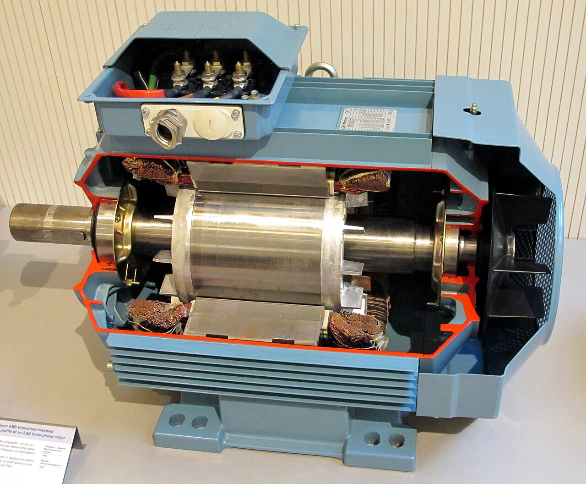
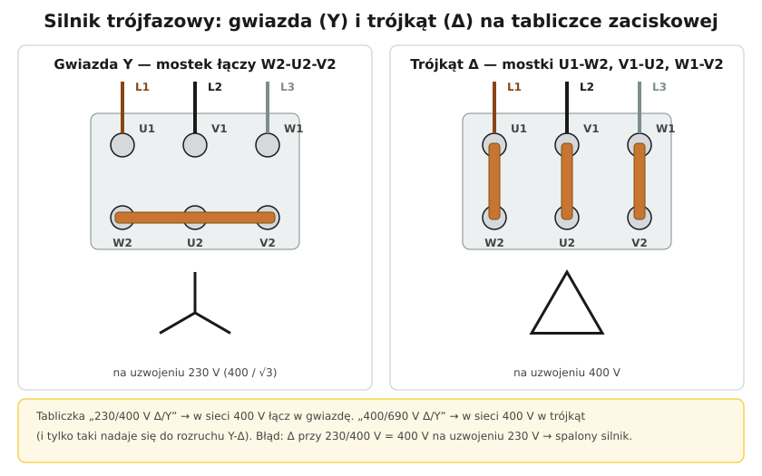

# 24.03 — Połączenie w gwiazdę i w trójkąt

> **Moduł:** [24 — Silniki i napędy](README.md) · **Oznaczenia:** 📋 · **Zakres SEP:** (a) (b) (c) · **Status:** ✅ pełny
>
> **Czytaj:**
>
> - Układ trójfazowy: [02.03](../02-prad-przemienny-230-400/02.03-uklad-trojfazowy-230-v-i-400-v-kolejnosc-faz.md)

[← poprzedni temat](24.02-tabliczka-znamionowa-silnika.md) · [spis modułu](README.md) · [następny temat →](24.04-rozruch-bezposredni-gwiazda-trojkat-softstart.md)

## Po co to jest

Każde uzwojenie silnika trójfazowego jest zaprojektowane na określone napięcie. Gwiazda i trójkąt to dwa sposoby połączenia trzech uzwojeń, które dają im różne napięcia przy tym samym zasilaniu. Dobór połączenia do napięcia sieci to podstawowa czynność przy podłączaniu silnika i częste pytanie egzaminacyjne.

## Po ludzku

**Tabliczka zaciskowa** ma 6 zacisków: górny rząd **U1, V1, W1** (tu przychodzi zasilanie L1, L2, L3), dolny rząd przesunięty: **W2, U2, V2**. Dzięki przesunięciu oba połączenia robi się samymi mostkami.

**Gwiazda (Y):** jeden mostek łączy **W2–U2–V2** (końce uzwojeń w jednym punkcie). Każde uzwojenie dostaje **napięcie fazowe**: $400/\sqrt{3} = 230$ V.

**Trójkąt (Δ):** trzy mostki pionowe **U1–W2, V1–U2, W1–V2** (koniec jednego uzwojenia z początkiem następnego). Każde uzwojenie dostaje **napięcie międzyfazowe**: **400 V**.

**Jak wybrać:** uzwojenie ma pracować na napięciu, na które zostało zaprojektowane — to mniejsza liczba na tabliczce:

| Tabliczka | Napięcie uzwojenia | W sieci 400 V |
|-----------|--------------------|---------------|
| 230/400 V Δ/Y | 230 V | **gwiazda** |
| 400/690 V Δ/Y | 400 V | **trójkąt** (można rozruch Y-Δ) |

**Prądy:** w trójkącie prąd w przewodzie zasilającym jest √3 razy większy niż w uzwojeniu. Dla tej samej mocy: $I_Δ = \sqrt{3} \cdot I_Y$ przy tym samym napięciu uzwojenia, dlatego tabliczka podaje dwa prądy.

**Moc** silnika jest taka sama przy prawidłowym połączeniu — zmienia się tylko napięcie sieci, do którego go podłączasz.

## Jak to wygląda

*Na co patrzeć: końce trzech uzwojeń stojana wychodzą do skrzynki zaciskowej na obudowie. To tam, mostkami, ustawia się gwiazdę albo trójkąt.*

## Schemat

## Pojęcia

| Pojęcie | Po ludzku | Termin normowy / symbol |
|---------|-----------|-------------------------|
| Gwiazda | Końce uzwojeń połączone w punkcie | Y |
| Trójkąt | Uzwojenia połączone w zamknięty obwód | Δ (D) |
| Napięcie fazowe / międzyfazowe | 230 V / 400 V | $U_f$ / $U$ |
| Tabliczka zaciskowa | Zaciski uzwojeń w skrzynce silnika | U1…W2 |

## Liczby do zapamiętania

| Wielkość | Wartość | Kiedy obowiązuje | Źródło |
|----------|---------|------------------|--------|
| Napięcie uzwojenia w Y | $U / \sqrt{3}$ = **230 V** | sieć 400 V | — |
| Napięcie uzwojenia w Δ | $U$ = **400 V** | jw. | — |
| Prąd przewodu w Δ | **√3 ×** prąd uzwojenia | — | — |
| Oznaczenia zacisków | **U1 V1 W1 / W2 U2 V2** | PN-EN 60034-8 | PN-EN 60034-8 |
| 230/400 V w sieci 400 V | **Y** | — | — |
| 400/690 V w sieci 400 V | **Δ** | — | — |

## W praktyce

- **Przed podłączeniem** otwórz skrzynkę zaciskową i sprawdź mostki — silniki wychodzą z fabryki różnie połączone.
- **Pomiar rezystancji** między U1–U2, V1–V2, W1–W2 (po zdjęciu mostków) — trzy równe wartości = uzwojenia sprawne.
- **Mostki** dokręć porządnie — przez nie płynie prąd całego silnika.
- **PE** do zacisku w skrzynce (oznaczenie ⏚).

## Błędy i zagrożenia

- ⚠️ **Trójkąt przy silniku 230/400 V w sieci 400 V** — na uzwojeniach 400 zamiast 230 V, prąd kilkukrotnie za duży, spalenie.
- **Gwiazda przy silniku 400/690 V w sieci 400 V** — uzwojenia na 230 zamiast 400 V; silnik ma ok. ⅓ momentu, nie uciągnie obciążenia, grzeje się.
- **Zgubiony mostek** — praca na dwóch uzwojeniach, przegrzanie.

## Przykład

**Zadanie.** Silnik: „Δ 230 V / Y 400 V, 6,4/3,7 A”. Sieć 3 × 400 V. Jak połączyć, jaki prąd pobiera i czy można go rozruszać metodą gwiazda-trójkąt?

**Rozwiązanie.** Uzwojenie na 230 V → w sieci 400 V **gwiazda**. Prąd: **3,7 A**. Rozruch gwiazda-trójkąt **nie** — po przełączeniu na trójkąt uzwojenia dostałyby 400 V. Do łagodnego rozruchu — softstart albo falownik.

## Pytania SEP

1. **Kiedy łączy się silnik w gwiazdę, a kiedy w trójkąt? Jak to odczytać z tabliczki?**

Odpowiedź

Tak, aby każde uzwojenie pracowało na napięciu, na które jest zaprojektowane — mniejszym z dwóch podanych na tabliczce. Przy tabliczce 230/400 V Δ/Y w sieci 400 V łączy się w gwiazdę (uzwojenia dostają 230 V); przy 400/690 V Δ/Y w sieci 400 V — w trójkąt (uzwojenia 400 V). W gwieździe mostek łączy zaciski W2, U2, V2, w trójkącie mostki łączą U1 z W2, V1 z U2 i W1 z V2.

## Sprawdź się

1. Na schemacie: ile mostków potrzeba do gwiazdy, a ile do trójkąta?

Odpowiedź

Gwiazda — jeden (wspólna blaszka łącząca trzy dolne zaciski; w praktyce często dwie blaszki). Trójkąt — trzy pionowe mostki.

## Źródła

- PN-EN 60034-8 — oznaczenia zacisków i kierunek wirowania.
- [02.03 — Układ trójfazowy](../02-prad-przemienny-230-400/02.03-uklad-trojfazowy-230-v-i-400-v-kolejnosc-faz.md).

---

[← poprzedni temat](24.02-tabliczka-znamionowa-silnika.md) · [spis modułu](README.md) · [następny temat →](24.04-rozruch-bezposredni-gwiazda-trojkat-softstart.md)
