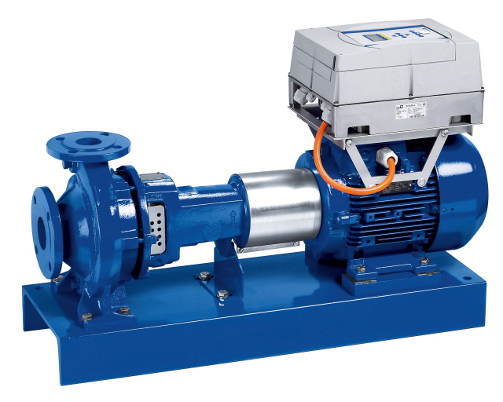
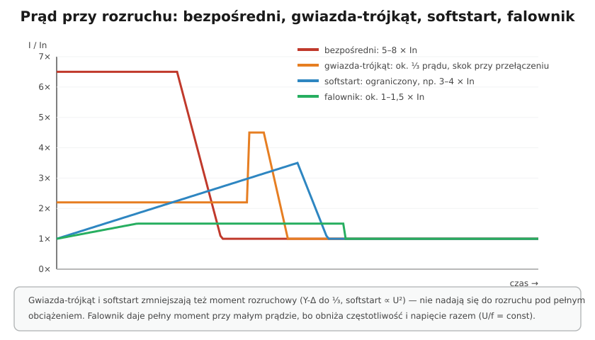

# 24.04 — Rozruch: bezpośredni, gwiazda-trójkąt, softstart

> **Moduł:** [24 — Silniki i napędy](README.md) · **Oznaczenia:** 📋 · **Zakres SEP:** (a) (b) (c) · **Status:** ✅ pełny
>
> **Czytaj:**
>
> - Charakterystyki wyłączników: [07.04](../07-zabezpieczenia-nadpradowe/07.04-charakterystyki-b-c-i-d.md)
> - Falowniki: [24.07](24.07-przemienniki-czestotliwosci.md)

[← poprzedni temat](24.03-polaczenie-w-gwiazde-i-w-trojkat.md) · [spis modułu](README.md) · [następny temat →](24.05-uklad-start-stop-ze-stycznikiem-i-przekaznikiem.md)

## Po co to jest

Prąd rozruchowy silnika (5–8 × In) powoduje spadki napięcia — migotanie światła, wybijanie zabezpieczeń, kłopoty sąsiadów na tej samej linii. Duży moment rozruchowy szarpie mechanizmy (taśmociągi, pompy — uderzenia wodne). Dlatego większe silniki rozrusza się łagodnie. Trzeba znać wady i zalety każdego sposobu.

## Po ludzku

**1. Rozruch bezpośredni (DOL)** — stycznik podaje pełne napięcie od razu.

- prosty, tani, pełny moment rozruchowy,
- prąd 5–8 × In,
- dla małych silników (do kilku kW) i tam, gdzie sieć „wytrzyma” rozruch; operator sieci może określać warunki dla dużych silników.

**2. Gwiazda-trójkąt (Y-Δ)** — start w gwieździe, po rozpędzeniu przełączenie na trójkąt.

- uzwojenia w Y dostają $1/\sqrt{3}$ napięcia → **prąd i moment** rozruchowy spadają do **⅓**,
- trzy styczniki (główny, gwiazdy, trójkąta) i przekaźnik czasowy, blokada między stycznikami Y i Δ,
- tylko dla silników pracujących w **trójkącie** przy napięciu sieci (400/690 V w sieci 400 V) i 6 wyprowadzeniach,
- przy przełączaniu — krótki skok prądu i momentu,
- mały moment — tylko rozruch lekki (wentylatory, pompy, rozruch bez obciążenia).

**3. Softstart (układ łagodnego rozruchu)** — tyrystory stopniowo podnoszą napięcie.

- prąd ograniczony (np. 3–4 × In), łagodne przyspieszenie, także łagodne zatrzymanie (pompy — brak uderzenia wodnego),
- moment ∝ U² — przy niskim napięciu mały,
- po rozruchu zwykle zwierany stycznikiem obejściowym (bypass).

**4. Przemiennik częstotliwości** — zmienia częstotliwość i napięcie ([24.07](24.07-przemienniki-czestotliwosci.md)).

- prąd rozruchowy ok. 1–1,5 × In przy pełnym momencie,
- regulacja prędkości podczas pracy, oszczędność energii,
- najdroższy, wymaga uwagi przy EMC i RCD.

## Jak to wygląda

*Na co patrzeć: przemiennik zamontowany bezpośrednio na silniku pompy. Pompa rusza łagodnie, bez uderzenia wodnego, a jej wydajność reguluje się prędkością zamiast zaworem.*

## Schemat

## Pojęcia

| Pojęcie | Po ludzku | Termin normowy / symbol |
|---------|-----------|-------------------------|
| Rozruch bezpośredni | Od razu pełne napięcie | DOL (direct-on-line) |
| Rozruch gwiazda-trójkąt | Start w Y, praca w Δ | Y-Δ |
| Softstart | Łagodne podnoszenie napięcia | układ łagodnego rozruchu |
| Bypass | Stycznik zwierający softstart po rozruchu | — |

## Liczby do zapamiętania

| Wielkość | Wartość | Kiedy obowiązuje | Źródło |
|----------|---------|------------------|--------|
| Prąd rozruchu bezpośredniego | **5–8 × In** | silniki klatkowe | katalogi |
| Y-Δ: prąd i moment | **⅓** wartości przy rozruchu bezpośrednim | silnik pracujący w Δ | — |
| Softstart: moment | ∝ **U²** | — | — |
| Falownik: prąd rozruchowy | ok. **1–1,5 × In** | pełny moment | katalogi |
| Warunek Y-Δ | tabliczka **400/690 V Δ/Y** w sieci 400 V | — | [24.03](24.03-polaczenie-w-gwiazde-i-w-trojkat.md) |

## W praktyce

- **Dobór sposobu rozruchu** — według mocy silnika, obciążenia przy starcie (lekkie/ciężkie), wymagań sieci i potrzeby regulacji prędkości.
- **Y-Δ — czas przełączenia** ustaw tak, żeby silnik zdążył osiągnąć ok. 80–90 % prędkości; za wcześnie — duży skok prądu.
- **Softstart dla pomp** — rampa zatrzymania eliminuje uderzenie wodne.
- **Zabezpieczenia** dobiera się uwzględniając prąd i czas rozruchu (wyłącznik silnikowy, charakterystyka C/D, klasa termika).

## Błędy i zagrożenia

- ⚠️ **Y-Δ dla silnika 230/400 V** w sieci 400 V — w trójkącie uzwojenia dostają 400 V, silnik się pali.
- **Y-Δ pod pełnym obciążeniem** — silnik nie rozpędzi się w gwieździe, a po przełączeniu prąd jest prawie jak przy rozruchu bezpośrednim.
- **Brak blokady Y–Δ** — jednoczesne załączenie styczników gwiazdy i trójkąta = zwarcie międzyfazowe.

## Przykład

**Zadanie.** Wentylator 11 kW, silnik 400/690 V Δ/Y, In(Δ) = 21 A. Ile wyniesie prąd rozruchowy bezpośrednio i w Y-Δ (zakładając 7 × In)?

**Rozwiązanie.** Bezpośrednio: $7 \cdot 21 = 147$ A. W gwieździe: ok. $147 / 3 \approx 49$ A. Wentylator ma lekki rozruch (moment rośnie z prędkością), więc Y-Δ się nada. Softstart dałby podobne ograniczenie prądu z łagodniejszym przejściem, falownik — dodatkowo regulację wydajności.

## Pytania SEP

1. **Jakie znasz sposoby rozruchu silników indukcyjnych klatkowych? Omów ich wady i zalety.**

Odpowiedź

Rozruch bezpośredni — najprostszy, pełny moment, ale prąd 5–8 In i obciążenie sieci; dla małych silników. Gwiazda-trójkąt — dla silników pracujących w trójkącie, w gwieździe prąd i moment rozruchowy spadają do jednej trzeciej; wymaga trzech styczników z blokadą i przekaźnika czasowego, nadaje się do lekkiego rozruchu, przy przełączeniu występuje udar prądu. Softstart — tyrystorowe łagodne podnoszenie napięcia, ograniczony prąd i płynne przyspieszenie i zatrzymanie, moment rośnie z kwadratem napięcia. Przemiennik częstotliwości — rozruch przy pełnym momencie i małym prądzie, regulacja prędkości, najdroższy, wymaga uwagi na EMC i dobór RCD.

## Sprawdź się

1. Dlaczego rozruch gwiazda-trójkąt zmniejsza moment rozruchowy aż do ⅓, choć napięcie spada tylko √3 razy?

Odpowiedź

Moment silnika indukcyjnego jest proporcjonalny do kwadratu napięcia na uzwojeniu: $(1/\sqrt{3})^2 = 1/3$.

## Źródła

- PN-EN 60947-4-1 — styczniki i rozruszniki silnikowe.
- PN-EN 60947-4-2 — półprzewodnikowe sterowniki silników (softstarty).
- Katalogi producentów silników i rozruszników.

---

[← poprzedni temat](24.03-polaczenie-w-gwiazde-i-w-trojkat.md) · [spis modułu](README.md) · [następny temat →](24.05-uklad-start-stop-ze-stycznikiem-i-przekaznikiem.md)
