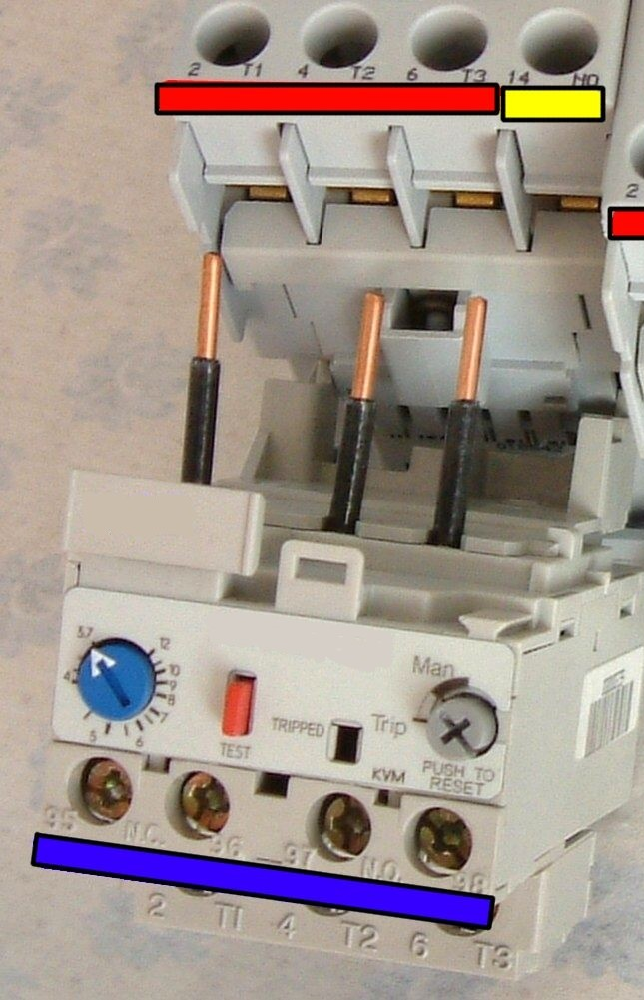
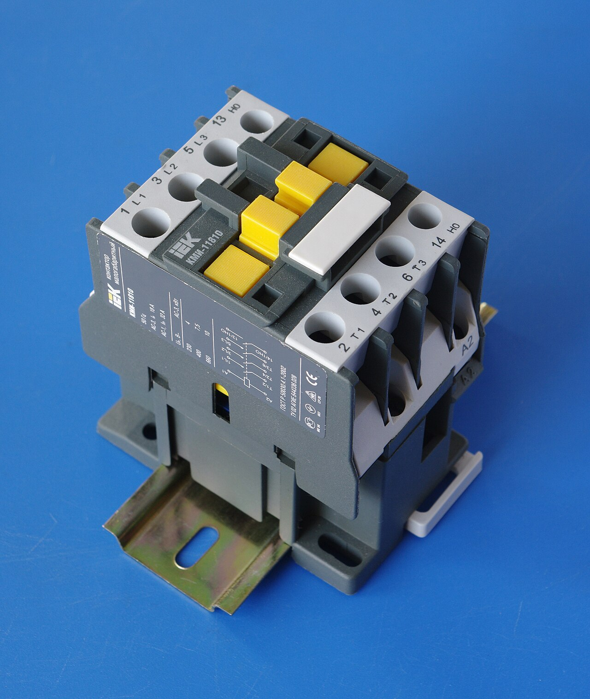
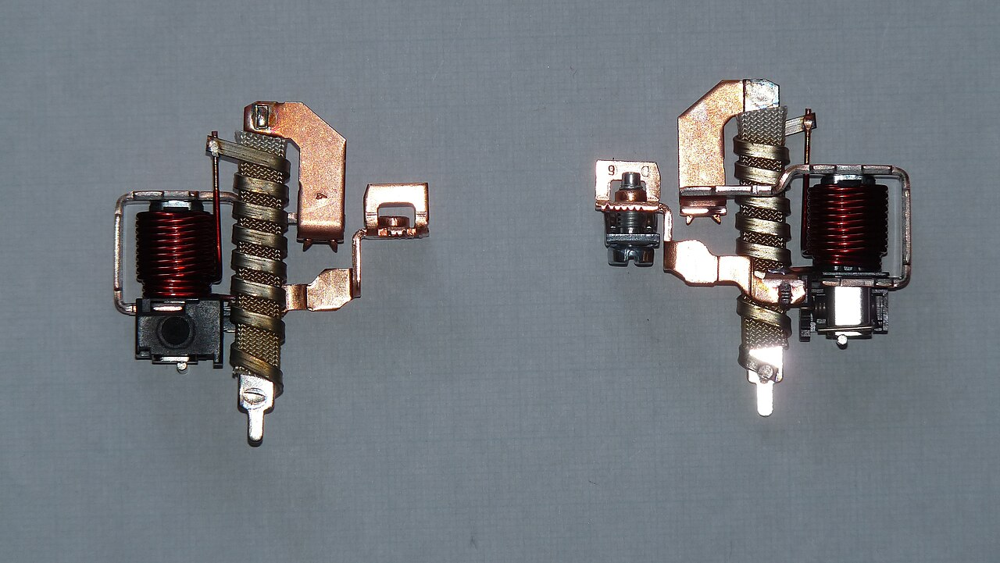
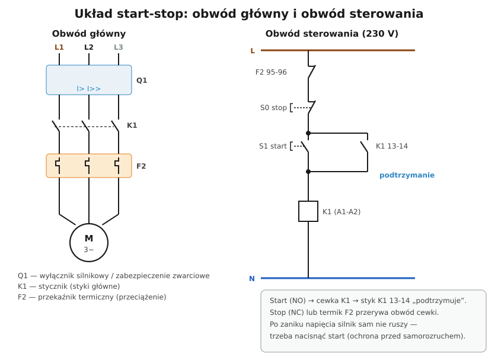

# 24.05 — Układ start-stop ze stycznikiem i przekaźnikiem termicznym

> **Moduł:** [24 — Silniki i napędy](README.md) · **Oznaczenia:** 📋 · **Zakres SEP:** (a) (b) (c) · **Status:** ✅ pełny
>
> **Czytaj:**
>
> - Stycznik i oznaczenia styków: [03.03](../03-elektromagnetyzm-w-praktyce/03.03-elektromagnes-w-pracy-przekaznik-i-stycznik.md)
> - PN-EN 60204-1 — wyposażenie elektryczne maszyn; PN-EN 60947-4-1 — styczniki i przekaźniki przeciążeniowe

[← poprzedni temat](24.04-rozruch-bezposredni-gwiazda-trojkat-softstart.md) · [spis modułu](README.md) · [następny temat →](24.06-zmiana-kierunku-obrotow.md)

## Po co to jest

Układ start-stop ze stycznikiem i przekaźnikiem termicznym to najczęściej rysowany schemat na egzaminie SEP grupy E. Jest też podstawą sterowania każdą maszyną: pompą, wentylatorem, piłą. Trzeba go umieć narysować, wyjaśnić działanie każdego elementu i wiedzieć, dlaczego jest zbudowany właśnie tak.

## Po ludzku

**Obwód główny** (prąd silnika):

- **Q1 — zabezpieczenie zwarciowe**: wyłącznik silnikowy (ma też człon przeciążeniowy) albo bezpieczniki / wyłącznik o charakterystyce dobranej do rozruchu,
- **K1 — styki główne stycznika**: załączają i wyłączają silnik,
- **F2 — przekaźnik termiczny** (przeciążeniowy): bimetale grzane prądem silnika; przy przeciążeniu otwierają styk **95-96** w obwodzie sterowania,
- **M — silnik**, obudowa do PE.

**Obwód sterowania** (szereg elementów od L do N):

1. **F2 95-96** (rozwierny) — termik,
2. **S0 STOP** (rozwierny, czerwony) — przerywa obwód cewki,
3. **S1 START** (zwierny, zielony / czarny) — załącza cewkę,
4. **K1 13-14** (zwierny styk pomocniczy) **równolegle do START** — **podtrzymanie**,
5. **cewka K1 (A1-A2)**.

**Działanie:** naciśnięcie START zasila cewkę → K1 załącza silnik i swój styk 13-14 → po puszczeniu START cewka jest zasilana przez 13-14. STOP albo zadziałanie termika przerywa obwód → cewka odpada → styk 13-14 się otwiera → silnik stoi, dopóki ktoś znów nie naciśnie START.

**Dlaczego tak:**

- **STOP jest rozwierny** — przerwany przewód do przycisku też zatrzymuje maszynę (bezpieczny stan przy usterce).
- **Podtrzymanie przez styk stycznika**, a nie łącznik — po zaniku napięcia stycznik odpada i **silnik sam nie ruszy**, gdy napięcie wróci (ochrona przed samorozruchem).
- **Termik w obwodzie sterowania** — nie przerywa prądu silnika sam, tylko „każe” stycznikowi go wyłączyć.

**Nastawa termika** = prąd znamionowy silnika (dla połączenia, w którym pracuje). **Klasa wyzwalania** (np. 10) mówi, jak szybko zadziała przy zablokowanym wirniku: klasa 10 — do 10 s przy 7,2 × prąd nastawy; klasa 20, 30 — do ciężkich rozruchów.

## Jak to wygląda

*Na co patrzeć: termik nakłada się na stycznik (trzy miedziane piny wchodzą w zaciski wyjściowe stycznika). Pokrętło ustawia prąd, przycisk — reset ręczny lub automatyczny.*

*Na co patrzeć: zaciski A1–A2 to cewka, pary zacisków 1-2, 3-4, 5-6 to styki główne; styki pomocnicze (13-14, 21-22) bywają wbudowane albo dokładane z boku lub z przodu.*

*Na co patrzeć: wyłącznik silnikowy ma w każdym biegunie wyzwalacz zwarciowy (cewka) i termiczny (bimetal z grzejnikiem). Łączy więc funkcję Q1 i F2 w jednym aparacie.*

## Schemat

## Pojęcia

| Pojęcie | Po ludzku | Termin normowy / symbol |
|---------|-----------|-------------------------|
| Stycznik | Przekaźnik dużej mocy | K, PN-EN 60947-4-1 |
| Przekaźnik termiczny | Zabezpieczenie przed przeciążeniem silnika | F, przekaźnik przeciążeniowy |
| Wyłącznik silnikowy | Zwarcie + przeciążenie w jednym | MPCB |
| Podtrzymanie | Styk stycznika równoległy do START | samopodtrzymanie |
| Samorozruch | Samoczynne ruszenie po powrocie napięcia | — |

## Liczby do zapamiętania

| Wielkość | Wartość | Kiedy obowiązuje | Źródło |
|----------|---------|------------------|--------|
| Styk termika | **95-96** rozwierny (97-98 zwierny — sygnalizacja) | przekaźniki termiczne | PN-EN 60947 |
| Podtrzymanie | **13-14** | styk zwierny stycznika | jw. |
| Cewka | **A1-A2** | jw. | jw. |
| Nastawa termika | **= In silnika** | dla danego połączenia Y/Δ | instrukcje |
| Klasa 10 | zadziała w **≤ 10 s** przy **7,2 ×** prąd nastawy | rozruch normalny | PN-EN 60947-4-1 |
| Kolory przycisków | **STOP czerwony**, START zielony/biały/czarny | — | PN-EN 60204-1 |

## W praktyce

- **Wyłącznik bezpieczeństwa (awaryjny)** — czerwony grzybek na żółtym tle, w obwodzie sterowania w szeregu ze STOP, z ryglowaniem (PN-EN 60204-1).
- **Kontrolka pracy** — przez styk zwierny K1; kontrolka „przeciążenie” — przez styk 97-98 termika.
- **Obwód sterowania 24 V** z transformatora — bezpieczniejsze przyciski w maszynach.
- **Reset termika** — najpierw przyczyna przeciążenia (zablokowany mechanizm, łożysko, praca na dwóch fazach).

## Błędy i zagrożenia

- ⚠️ **STOP jako zwierny** (np. przekaźnik odwracający) — przerwany przewód = brak możliwości zatrzymania.
- ⚠️ **Podtrzymanie łącznikiem z zatrzaskiem** zamiast styku stycznika — po zaniku napięcia maszyna rusza sama.
- **Termik nastawiony „z zapasem”** (np. 1,5 × In) — silnik spali się, zanim termik zadziała.
- **Termik w obwodzie głównym bez połączenia 95-96** z cewką — termik grzeje się, ale niczego nie wyłącza.

## Przykład

**Zadanie.** Silnik pompy 2,2 kW, 400 V Y, In = 4,7 A, rozruch bezpośredni. Dobierz elementy układu start-stop.

**Rozwiązanie.** Q1 — wyłącznik silnikowy z zakresem nastawy np. 4–6,3 A, ustawiony na **4,7 A** (wtedy osobny termik nie jest potrzebny) albo wyłącznik C10/C16 + przekaźnik termiczny 4–6 A ustawiony na **4,7 A**, klasa 10. K1 — stycznik w kategorii AC-3 o prądzie ≥ 4,7 A (np. 9 A), cewka 230 V, z zestykiem pomocniczym 13-14. S0 STOP (rozwierny), S1 START (zwierny). Przewód zasilający silnik 4 × 1,5 mm² + PE (5 żył) zależnie od długości.

## Pytania SEP

1. **Narysuj i omów układ start-stop ze stycznikiem i przekaźnikiem termicznym.**

Odpowiedź

Obwód główny: zabezpieczenie zwarciowe (bezpieczniki lub wyłącznik silnikowy), styki główne stycznika K1, przekaźnik termiczny F2, silnik. Obwód sterowania (od L do N): styk rozwierny przekaźnika termicznego 95-96, przycisk STOP rozwierny, przycisk START zwierny z równolegle połączonym stykiem zwiernym stycznika 13-14 (podtrzymanie), cewka stycznika A1-A2. Naciśnięcie START zasila cewkę, stycznik załącza silnik i przez styk podtrzymania utrzymuje się po zwolnieniu przycisku. STOP lub zadziałanie termika przerywa obwód cewki i wyłącza silnik. Układ zapewnia ochronę przed samorozruchem po zaniku i powrocie napięcia.

2. **Jak nastawia się przekaźnik termiczny silnika?**

Odpowiedź

Na prąd znamionowy silnika odczytany z tabliczki dla połączenia uzwojeń, w którym silnik pracuje (gwiazda lub trójkąt). Klasę wyzwalania dobiera się do warunków rozruchu (klasa 10 dla normalnego, 20 lub 30 dla ciężkiego rozruchu).

## Sprawdź się

1. Co się stanie, jeśli w układzie zamiast styku 13-14 stycznika jako podtrzymanie użyjemy łącznika z zatrzaskiem?

Odpowiedź

Silnik ruszy samoczynnie po każdym powrocie napięcia (bo łącznik pozostaje załączony) — brak ochrony przed samorozruchem, co przy maszynach grozi wypadkiem.

## Źródła

- PN-EN 60947-4-1 — styczniki i rozruszniki silnikowe, klasy wyzwalania.
- PN-EN 60204-1 — wyposażenie elektryczne maszyn (przyciski, zatrzymanie awaryjne).
- [03.03 — Przekaźnik i stycznik](../03-elektromagnetyzm-w-praktyce/03.03-elektromagnes-w-pracy-przekaznik-i-stycznik.md).

---

[← poprzedni temat](24.04-rozruch-bezposredni-gwiazda-trojkat-softstart.md) · [spis modułu](README.md) · [następny temat →](24.06-zmiana-kierunku-obrotow.md)
