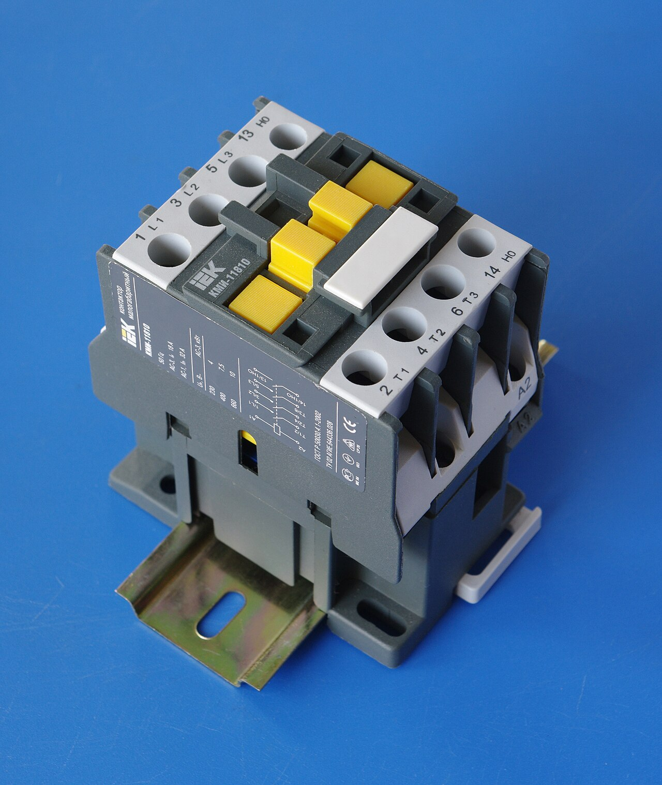
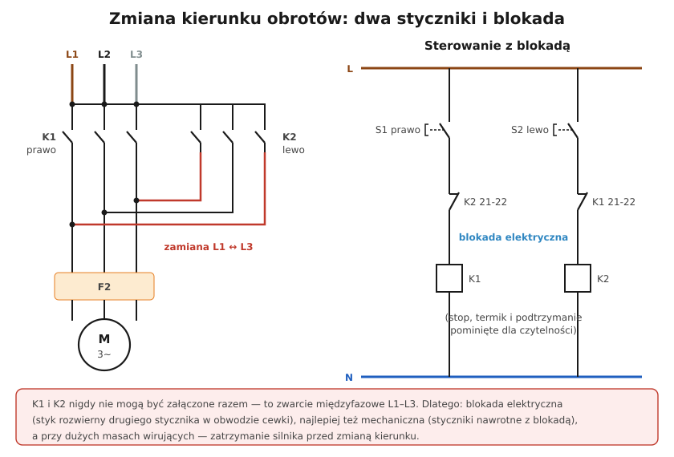

# 24.06 — Zmiana kierunku obrotów

> **Moduł:** [24 — Silniki i napędy](README.md) · **Oznaczenia:** 📋 · **Zakres SEP:** (a) (b) (c) · **Status:** ✅ pełny
>
> **Czytaj:**
>
> - Kolejność faz: [23.07](../23-pomiary-odbiorcze-i-okresowe/23.07-kolejnosc-faz.md)

[← poprzedni temat](24.05-uklad-start-stop-ze-stycznikiem-i-przekaznikiem.md) · [spis modułu](README.md) · [następny temat →](24.07-przemienniki-czestotliwosci.md)

## Po co to jest

Suwnice, bramy, wciągarki, betoniarki, obrabiarki — wiele napędów musi kręcić się w obie strony. W silniku trójfazowym robi się to prostą zamianą dwóch faz, ale w układzie sterowania trzeba zadbać, żeby oba kierunki nigdy nie załączyły się jednocześnie. To klasyczne zadanie egzaminacyjne.

## Po ludzku

**Zasada:** kierunek wirowania pola zależy od kolejności faz. **Zamiana dwóch dowolnych faz** zmienia kierunek obrotów.

**Układ nawrotny:**

- **K1** („prawo”) — podaje fazy prosto: L1, L2, L3,
- **K2** („lewo”) — zamienia dwie fazy, np. L1 ↔ L3,
- wspólny przekaźnik termiczny i silnik.

**Blokady** — K1 i K2 załączone razem to **zwarcie międzyfazowe** L1–L3:

- **elektryczna** — w obwodzie cewki K1 styk rozwierny K2 (21-22), a w obwodzie cewki K2 — rozwierny K1. Gdy jeden stycznik jest załączony, drugiego nie da się załączyć;
- **mechaniczna** — styczniki nawrotne łączone mechanicznym ryglem;
- **przyciskami** — przyciski z podwójnym stykiem (zwierny + rozwierny), które przy wciśnięciu „prawo” przerywają obwód „lewo”.

**Zatrzymanie przed zmianą kierunku** — przy dużych masach wirujących zmiana kierunku „w biegu” (przeciwprąd) to ogromny prąd i obciążenie mechaniczne. Sterowanie: STOP → odczekanie → drugi kierunek (lub przekaźnik czasowy).

**Silnik jednofazowy kondensatorowy** — kierunek zmienia się, przełączając kondensator z jednego uzwojenia na drugie (albo zamieniając końce uzwojenia pomocniczego) ([24.08](24.08-silniki-jednofazowe.md)).

## Jak to wygląda

*Na co patrzeć: w układzie nawrotnym są dwa takie styczniki obok siebie; najlepiej z blokadą mechaniczną zakładaną między nimi i stykami pomocniczymi do blokady elektrycznej.*

## Schemat

## Pojęcia

| Pojęcie | Po ludzku | Termin normowy / symbol |
|---------|-----------|-------------------------|
| Układ nawrotny | Sterowanie obrotami w obie strony | — |
| Blokada elektryczna | Styk drugiego stycznika w obwodzie cewki | — |
| Blokada mechaniczna | Rygiel między stycznikami | — |
| Przeciwprąd | Zmiana kierunku w biegu | hamowanie przeciwprądem |

## Liczby do zapamiętania

| Wielkość | Wartość | Kiedy obowiązuje | Źródło |
|----------|---------|------------------|--------|
| Zmiana kierunku | zamiana **dwóch** faz | silnik 3-faz. | — |
| Styk blokady | **21-22** (rozwierny) | styczniki | PN-EN 60947 |
| Liczba blokad | **elektryczna + mechaniczna** (zalecane obie) | układy nawrotne | praktyka |

## W praktyce

- **Gotowe zestawy nawrotne** — dwa styczniki z blokadą mechaniczną i połączeniami fabrycznymi.
- **Krańcówki** — w bramach i suwnicach styki wyłączników krańcowych przerywają obwód danego kierunku.
- **Próba** — po montażu sprawdź blokady przy wyłączonym obwodzie głównym (tylko sterowanie): wciśnięcie „lewo” przy załączonym „prawo” nie może nic zmienić.

## Błędy i zagrożenia

- ⚠️ **Brak blokady** — zwarcie międzyfazowe przy jednoczesnym naciśnięciu obu przycisków lub sklejonym styku.
- **Tylko blokada elektryczna** przy sklejonych stykach głównych — może zawieść; blokada mechaniczna to druga bariera.
- **Zamiana trzech faz „w kółko”** — kierunek się nie zmienia.

## Przykład

**Zadanie.** Brama przesuwna z silnikiem 3-faz.: otwieranie, zamykanie, krańcówki w obu pozycjach. Jak zbudować sterowanie?

**Rozwiązanie.** Dwa styczniki K1 (otwieranie) i K2 (zamykanie, zamiana L1↔L3) z blokadą mechaniczną. Obwód cewki K1: STOP → START „otwórz” (z podtrzymaniem K1) → krańcówka „otwarta” (rozwierna) → rozwierny K2 → cewka K1. Analogicznie K2 z krańcówką „zamknięta” i rozwiernym K1. Termik wspólny w obu obwodach. Do tego zatrzymanie awaryjne i — przy bramach — fotokomórki bezpieczeństwa.

## Pytania SEP

1. **Jak zmienić kierunek obrotów silnika trójfazowego i jak zabezpiecza się układ nawrotny?**

Odpowiedź

Przez zamianę dwóch dowolnych przewodów fazowych zasilających silnik. W układzie nawrotnym stosuje się dwa styczniki: jeden podaje fazy w kolejności prawidłowej, drugi z zamienionymi dwiema fazami. Ponieważ jednoczesne załączenie obu styczników spowodowałoby zwarcie międzyfazowe, stosuje się blokadę elektryczną (styki rozwierne każdego stycznika w obwodzie cewki drugiego), często także blokadę mechaniczną i przyciskową, a przy dużych masach wirujących — zatrzymanie silnika przed zmianą kierunku.

## Sprawdź się

1. Na schemacie: które przewody zamienia stycznik K2? Co by się stało, gdyby zamieniał wszystkie trzy „w kółko”?

Odpowiedź

L1 i L3 (L2 bez zmian). Przesunięcie wszystkich trzech „w kółko” nie zmienia kolejności faz — silnik kręciłby się w tę samą stronę.

## Źródła

- PN-EN 60204-1 — wyposażenie elektryczne maszyn.
- PN-EN 60947-4-1 — styczniki, zestawy nawrotne.
- PN-EN 60034-8 — kierunek wirowania.

---

[← poprzedni temat](24.05-uklad-start-stop-ze-stycznikiem-i-przekaznikiem.md) · [spis modułu](README.md) · [następny temat →](24.07-przemienniki-czestotliwosci.md)
