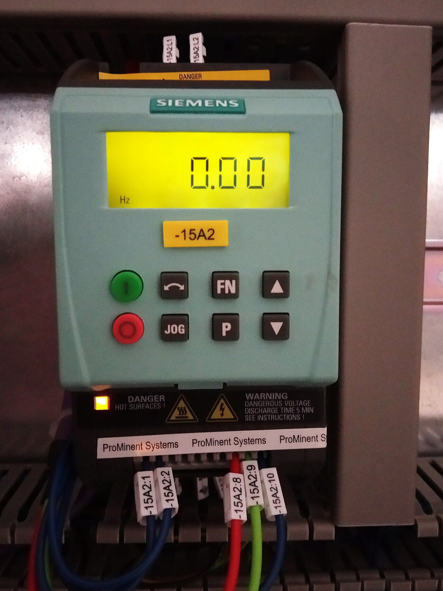
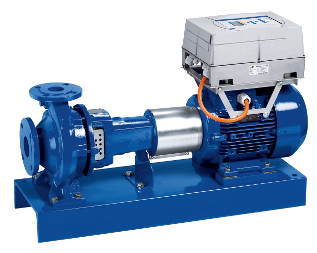
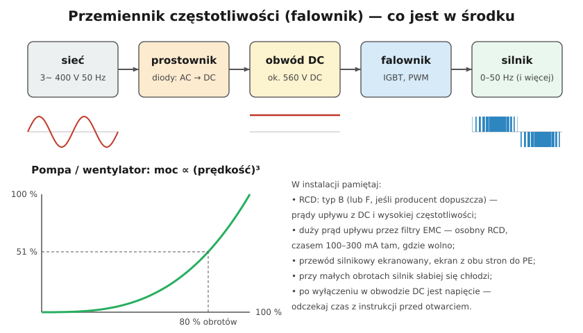

# 24.07 — Przemienniki częstotliwości

> **Moduł:** [24 — Silniki i napędy](README.md) · **Oznaczenia:** 📋 · **Zakres SEP:** (a) (b) (c) · **Status:** ✅ pełny
>
> **Czytaj:**
>
> - [ABB — Ecodesign dla silników i przemienników](https://new.abb.com/motors-generators/pl/ecodesign-dla-silników)
> - Typy RCD: [08.03](../08-wylaczniki-roznicowopradowe/08.03-typy-ac-a-f-i-b-ktory-do-czego.md)

[← poprzedni temat](24.06-zmiana-kierunku-obrotow.md) · [spis modułu](README.md) · [następny temat →](24.08-silniki-jednofazowe.md)

## Po co to jest

Przemiennik częstotliwości (falownik) pozwala płynnie zmieniać prędkość silnika indukcyjnego. W pompach i wentylatorach to ogromna oszczędność energii, w maszynach — płynny rozruch i precyzyjna regulacja. Falowniki są w pompach ciepła, klimatyzatorach, pralkach, windach. Elektryk musi wiedzieć, jak je bezpiecznie zasilić i podłączyć.

## Po ludzku

**Budowa:**

1. **Prostownik** — diody zamieniają napięcie sieci na stałe,
2. **obwód pośredni DC** — kondensatory, ok. **560 V DC** przy zasilaniu 400 V (szczytowa wartość napięcia międzyfazowego),
3. **falownik** — tranzystory IGBT „siekają” napięcie stałe w impulsy (PWM), tak że silnik „widzi” przebieg sinusoidalny o regulowanej częstotliwości.

**Zasada sterowania U/f:** przy niższej częstotliwości falownik obniża też napięcie (np. 25 Hz → ok. 200 V), żeby pole w silniku było stałe — wtedy moment jest pełny w całym zakresie.

**Oszczędność w pompach i wentylatorach:** moc rośnie z **sześcianem** prędkości. Przy 80 % obrotów pompa potrzebuje ok. 51 % mocy, przy 50 % — ok. 12,5 %. Dławienie zaworem nie daje takiej oszczędności.

**Instalacja — na co uważać:**

- **RCD** — falownik trójfazowy może wytworzyć prąd upływu z składową stałą i wysokimi częstotliwościami; producenci wymagają RCD **typu B** (albo F przy jednofazowych) — sprawdź instrukcję ([08.03](../08-wylaczniki-roznicowopradowe/08.03-typy-ac-a-f-i-b-ktory-do-czego.md));
- **prąd upływu** przez filtry EMC bywa duży — osobny RCD dla falownika;
- **przewód silnikowy ekranowany**, ekran połączony z PE na obu końcach, możliwie krótki;
- **silnik** — przy pracy z małą prędkością słabiej się chłodzi (wentylator na wale kręci się wolniej); przy długich przewodach — przepięcia na zaciskach (dławiki, filtry du/dt);
- **po wyłączeniu** kondensatory DC trzymają napięcie — przed otwarciem odczekaj czas z tabliczki (często kilka minut) i sprawdź brak napięcia;
- **klasa sprawności** — przemienniki objęte ekoprojektem muszą mieć klasę **IE2** (rozp. 2019/1781).

**Falownik 1 × 230 V → 3 × 230 V** — pozwala zasilić silnik trójfazowy (w trójkącie, 230 V) z sieci jednofazowej; lepsze niż kondensator (pełna moc, regulacja) ([24.08](24.08-silniki-jednofazowe.md)).

## Jak to wygląda

*Na co patrzeć: panel z wyświetlaczem częstotliwości i przyciskami start, stop, jog; na dole zaciski zasilania, silnika i sterowania. Naklejka ostrzega przed napięciem w obwodzie DC po wyłączeniu.*

*Na co patrzeć: przemiennik zintegrowany z silnikiem — przewód silnikowy jest bardzo krótki, co ogranicza problemy z EMC i przepięciami.*

## Schemat

## Pojęcia

| Pojęcie | Po ludzku | Termin normowy / symbol |
|---------|-----------|-------------------------|
| Przemiennik częstotliwości | Falownik do silników | VFD, PDS |
| PWM | Modulacja szerokości impulsów | — |
| Obwód pośredni DC | Kondensatory między prostownikiem a falownikiem | DC link |
| U/f | Stosunek napięcia do częstotliwości | sterowanie skalarne |
| Filtr EMC | Filtr przeciwzakłóceniowy | — |

## Liczby do zapamiętania

| Wielkość | Wartość | Kiedy obowiązuje | Źródło |
|----------|---------|------------------|--------|
| Napięcie DC | ok. **560 V** ($400 \cdot \sqrt{2}$) | zasilanie 3 × 400 V | — |
| Moc pompy / wentylatora | ∝ **n³** (80 % obrotów → **51 %** mocy) | prawa podobieństwa | — |
| RCD | typ **B** (lub F wg producenta) | falowniki | instrukcje producentów, [08.03](../08-wylaczniki-roznicowopradowe/08.03-typy-ac-a-f-i-b-ktory-do-czego.md) |
| Klasa sprawności przemienników | **IE2** od 1.07.2021 | 0,12–1000 kW | rozp. (UE) 2019/1781 |
| Czas rozładowania DC | wg tabliczki, często **kilka minut** | po wyłączeniu | instrukcje |

## W praktyce

- **Nastawy podstawowe**: dane silnika z tabliczki (U, I, f, n, P), czasy rozruchu i hamowania, częstotliwość min/maks.
- **Nie stawiaj stycznika między falownikiem a silnikiem** do załączania pod obciążeniem (chyba że producent dopuszcza) — uszkadza falownik.
- **Silnik do pracy z falownikiem** — przy dużych mocach izolowane łożyska (prądy łożyskowe).
- **Harmoniczne** — wiele falowników w budynku zniekształca napięcie; dławiki sieciowe.

## Błędy i zagrożenia

- ⚠️ **Praca przy falowniku zaraz po wyłączeniu** — kondensatory DC (560 V) mogą jeszcze być naładowane.
- **RCD typu AC lub A przed falownikiem trójfazowym** — może nie zadziałać przy upływie z składową stałą.
- **Przewód nieekranowany** — zakłócenia (radio, czujniki), zadziałania RCD.
- **Długa praca na 10–15 Hz** silnika z wentylatorem na wale — przegrzanie.

## Przykład

**Zadanie.** Wentylator wyciągowy 7,5 kW pracuje zwykle z 70 % wydajności, regulowanej przepustnicą. Ile mocy zaoszczędzi falownik?

**Rozwiązanie.** Z prawa sześcianu: przy 70 % obrotów potrzeba ok. $0{,}7^3 \approx 34\ \%$ mocy, czyli ok. **2,6 kW** zamiast prawie pełnych 7,5 kW (przepustnica zmniejsza moc tylko nieznacznie). Oszczędność rzędu kilku kW przy każdej godzinie pracy — falownik zwraca się zwykle w krótkim czasie.

## Pytania SEP

1. **Do czego służy przemiennik częstotliwości i jak jest zbudowany?**

Odpowiedź

Do zasilania silników indukcyjnych napięciem o regulowanej częstotliwości i wartości, co pozwala płynnie zmieniać prędkość obrotową, łagodnie rozruszać i hamować silnik oraz oszczędzać energię (zwłaszcza w pompach i wentylatorach). Składa się z prostownika (zamiana AC na DC), obwodu pośredniego z kondensatorami i falownika na tranzystorach IGBT, który metodą PWM wytwarza napięcie trójfazowe o regulowanej częstotliwości przy zachowaniu stosunku U/f. W instalacji wymaga odpowiedniego RCD (najczęściej typu B), ekranowanego przewodu silnikowego i uwagi na napięcie kondensatorów po wyłączeniu.

## Sprawdź się

1. Dlaczego przy obniżaniu częstotliwości falownik obniża też napięcie?

Odpowiedź

Strumień magnetyczny w silniku jest proporcjonalny do U/f. Przy obniżonej częstotliwości i pełnym napięciu strumień by wzrósł, rdzeń by się nasycił, a prąd i straty gwałtownie wzrosły. Utrzymanie stałego U/f daje stały strumień i pełny moment.

## Źródła

- Rozporządzenie Komisji (UE) 2019/1781; [Ecodesign dla silników i przemienników — ABB](https://new.abb.com/motors-generators/pl/ecodesign-dla-silników).
- PN-EN 61800 — elektryczne układy napędowe o regulowanej prędkości.
- Instrukcje przemienników (RCD, EMC, czasy rozładowania).

---

[← poprzedni temat](24.06-zmiana-kierunku-obrotow.md) · [spis modułu](README.md) · [następny temat →](24.08-silniki-jednofazowe.md)
