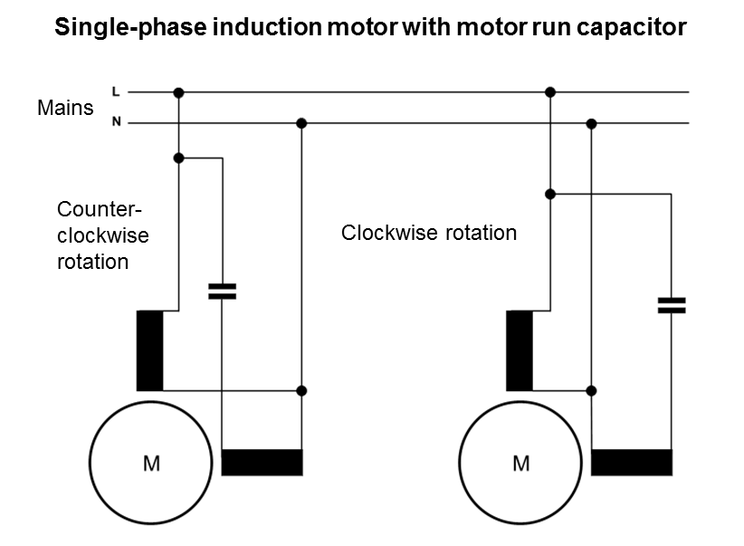
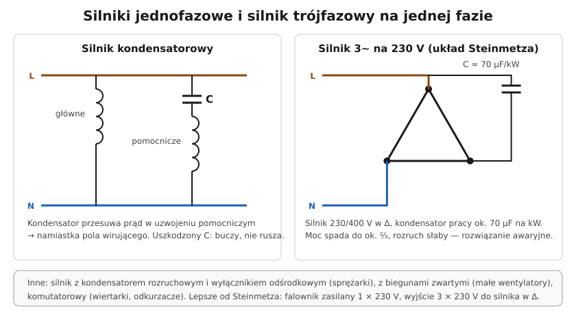

# 24.08 — Silniki jednofazowe

> **Moduł:** [24 — Silniki i napędy](README.md) · **Oznaczenia:** 📋 · **Zakres SEP:** (a) (b) (c) · **Status:** ✅ pełny
>
> **Czytaj:**
>
> - Intuicja: [03.04](../03-elektromagnetyzm-w-praktyce/03.04-jak-dziala-silnik-elektryczny-intuicja.md)
> - Falownik 1~/3~: [24.07](24.07-przemienniki-czestotliwosci.md)

[← poprzedni temat](24.07-przemienniki-czestotliwosci.md) · [spis modułu](README.md) · (koniec modułu) →

## Po co to jest

W domu i małym warsztacie jest zwykle tylko jedna faza — a silniki są w pompach, sprężarkach lodówek, wentylatorach, piłach, betoniarkach. Silnik jednofazowy sam z siebie nie ruszy, potrzebuje „pomocy” — najczęściej kondensatora. Jego usterka to częsta przyczyna „buczy, ale nie rusza”. Przydaje się też wiedza, jak zasilić silnik trójfazowy z jednej fazy.

## Po ludzku

**Problem:** jedno uzwojenie zasilane jedną fazą daje pole **pulsujące**, a nie wirujące — silnik nie wie, w którą stronę ruszyć.

**Rodzaje silników jednofazowych:**

- **kondensatorowy z kondensatorem pracy** — drugie (pomocnicze) uzwojenie zasilane przez kondensator; kondensator przesuwa prąd i daje namiastkę pola wirującego. Pompy, wentylatory, betoniarki;
- **z kondensatorem rozruchowym** (+ często pracy) — duży kondensator załączony tylko przy starcie (wyłącznik odśrodkowy lub przekaźnik); większy moment rozruchowy — sprężarki, piły;
- **z biegunami zwartymi** (zwojem zwartym) — mały, prosty, mała sprawność: małe wentylatory, pompki w pralkach;
- **komutatorowy (uniwersalny)** — szczotki i komutator; działa na AC i DC, duże obroty — wiertarki, szlifierki, odkurzacze.

**Zmiana kierunku** silnika kondensatorowego — zamiana końców uzwojenia pomocniczego (albo przełączenie kondensatora na drugie uzwojenie w silnikach z dwoma jednakowymi uzwojeniami).

**Silnik trójfazowy z jednej fazy:**

- **kondensator (układ Steinmetza)** — silnik 230/400 V w trójkącie na 230 V, kondensator pracy ok. **70 µF na kW**; moc spada do ok. **⅔**, rozruch słaby — rozwiązanie awaryjne,
- **falownik 1 × 230 V / 3 × 230 V** — silnik w trójkącie, pełna moc, regulacja prędkości — rozwiązanie właściwe ([24.07](24.07-przemienniki-czestotliwosci.md)).

**Kondensator** silnikowy ma pojemność w µF i napięcie (np. 450 V AC) — wymienia się na taki sam. Przed dotknięciem zacisków — rozładowanie.

## Jak to wygląda

*Na co patrzeć (opisy po angielsku: Mains — sieć, Counter-clockwise / Clockwise rotation — obroty w lewo / w prawo): przełączenie kondensatora z jednego uzwojenia na drugie zmienia kierunek obrotów.*

## Schemat

## Pojęcia

| Pojęcie | Po ludzku | Termin normowy / symbol |
|---------|-----------|-------------------------|
| Kondensator pracy | Stale włączony, przesuwa prąd | — |
| Kondensator rozruchowy | Tylko przy starcie, duża pojemność | — |
| Wyłącznik odśrodkowy | Odłącza kondensator rozruchowy po rozpędzeniu | — |
| Silnik uniwersalny | Ze szczotkami, na AC i DC | silnik komutatorowy |
| Układ Steinmetza | Silnik 3~ z kondensatorem na jednej fazie | — |

## Liczby do zapamiętania

| Wielkość | Wartość | Kiedy obowiązuje | Źródło |
|----------|---------|------------------|--------|
| Kondensator w układzie Steinmetza | ok. **70 µF / kW** | silnik 230/400 V w Δ na 230 V | reguła praktyczna |
| Moc w układzie Steinmetza | ok. **⅔** mocy znamionowej | jw. | jw. |
| Napięcie kondensatorów silnikowych | typowo **400–450 V AC** | — | katalogi |
| Objaw uszkodzonego kondensatora | **buczy, nie rusza** (rusza „popchnięty”) | silniki kondensatorowe | — |

## W praktyce

- **Diagnoza „buczy i nie rusza”** — po wyłączeniu i rozładowaniu zmierz pojemność kondensatora (multimetr z funkcją µF); wynik wyraźnie poniżej wartości z obudowy → wymiana.
- **Spuchnięty, wyciekający kondensator** — wymiana od razu.
- **Silnik komutatorowy iskrzy mocno** — zużyte szczotki lub komutator.
- **Pompy ciepła, klimatyzatory** — dziś zwykle z falownikiem i silnikami bezszczotkowymi; jednofazowe zasilanie, ale inne zasady diagnostyki (serwis producenta).

## Błędy i zagrożenia

- ⚠️ **Dotknięcie zacisków naładowanego kondensatora** — rozładowanie przez ciało.
- **Kondensator o innej pojemności „bo taki był”** — słaby rozruch albo przegrzanie uzwojenia pomocniczego.
- **Kondensator na zbyt niskie napięcie** — przebicie.
- **Silnik trójfazowy w gwieździe** z kondensatorem na 230 V — bardzo mała moc, nie ruszy pod obciążeniem.

## Przykład

**Zadanie.** Masz silnik 3~ 0,75 kW, 230/400 V Δ/Y, i tylko gniazdo 230 V. Jak go uruchomić awaryjnie i co lepiej zrobić?

**Rozwiązanie.** Awaryjnie: połączyć w **trójkąt** (230 V na uzwojenie), kondensator pracy ok. $0{,}75 \cdot 70 \approx 50\ \mu\mathrm{F}$, 450 V AC, między jeden zacisk a trzeci (wg schematu). Moc spadnie do ok. 0,5 kW, rozruch będzie słaby. Lepiej: **falownik 1 × 230 V → 3 × 230 V** 0,75 kW — pełna moc, łagodny rozruch, regulacja prędkości. W obu przypadkach obudowa silnika — do PE, obwód za RCD.

## Pytania SEP

1. **Jak uruchamia się silnik jednofazowy indukcyjny i jaką rolę pełni kondensator?**

Odpowiedź

Jedno uzwojenie zasilane jedną fazą wytwarza pole pulsujące, które nie daje momentu rozruchowego. Dlatego silnik ma drugie (pomocnicze) uzwojenie przesunięte w przestrzeni, zasilane przez kondensator, który przesuwa w czasie prąd w tym uzwojeniu względem prądu uzwojenia głównego — powstaje pole wirujące (eliptyczne) i moment rozruchowy. Kondensator pracy jest włączony stale, kondensator rozruchowy (o większej pojemności) tylko podczas rozruchu, odłączany wyłącznikiem odśrodkowym lub przekaźnikiem. Zmiana kierunku obrotów — przez zamianę końców uzwojenia pomocniczego.

## Sprawdź się

1. Pompa ogrodowa buczy i nie rusza, a po „popchnięciu” wirnika rusza i pracuje normalnie. Co jest uszkodzone?

Odpowiedź

Najpewniej **kondensator** (stracił pojemność) — bez niego nie ma momentu rozruchowego, ale rozpędzony silnik jednofazowy może pracować na samym uzwojeniu głównym.

## Źródła

- PN-EN 60034-1 — maszyny wirujące.
- Katalogi silników jednofazowych i kondensatorów silnikowych.
- [03.04 — Jak działa silnik elektryczny](../03-elektromagnetyzm-w-praktyce/03.04-jak-dziala-silnik-elektryczny-intuicja.md).

---

[← poprzedni temat](24.07-przemienniki-czestotliwosci.md) · [spis modułu](README.md) · (koniec modułu) →
