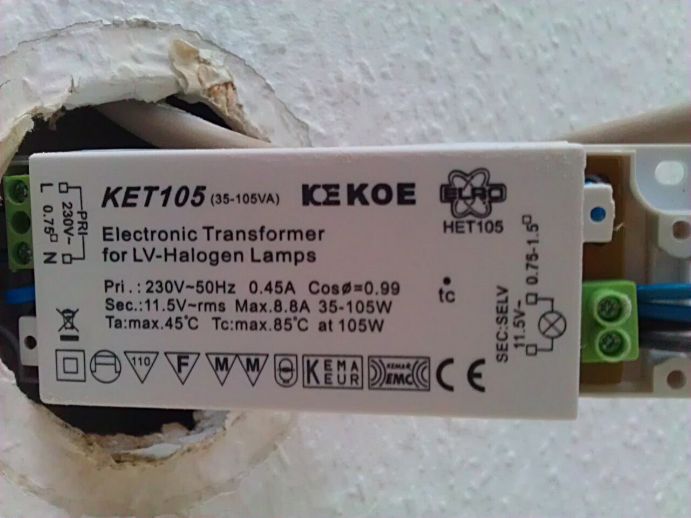
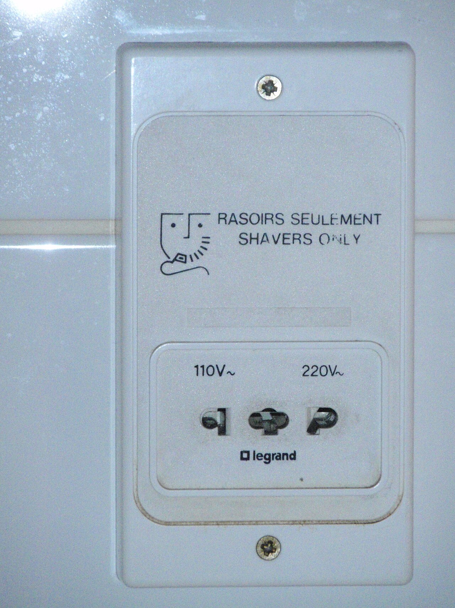
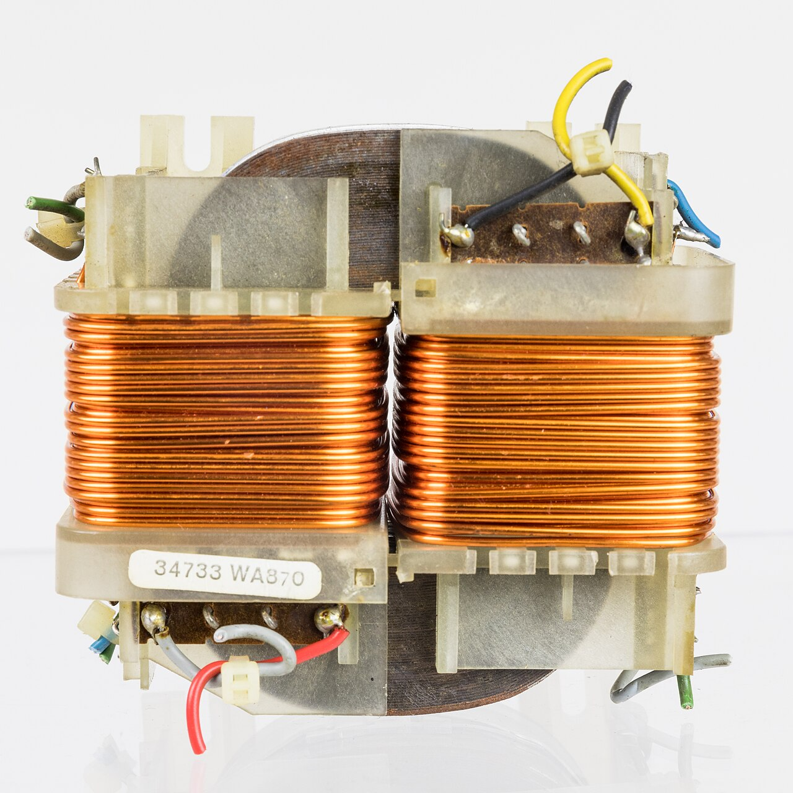
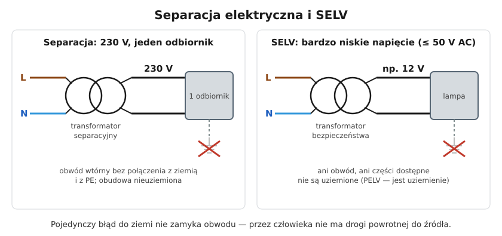

# 25.01 — Transformator separacyjny i bezpieczeństwa

> **Moduł:** [25 — Transformatory, zasilacze, UPS i agregaty](README.md) · **Oznaczenia:** 🏠📋 · **Zakres SEP:** (a) (c) (e) · **Status:** ✅ pełny
>
> **Czytaj:**
>
> - Podstawy transformatora: [03.02](../03-elektromagnetyzm-w-praktyce/03.02-indukcja-elektromagnetyczna-i-transformator.md)
> - Separacja i SELV jako środki ochrony: [12.04](../12-ochrona-przeciwporazeniowa/12.04-izolacja-podwojna-separacja-elektryczna-selv-i.md)
> - PN-EN 61558-2-4 (transformatory separacyjne), PN-EN 61558-2-6 (transformatory bezpieczeństwa)

← (początek modułu) · [spis modułu](README.md) · [następny temat →](25.02-zasilacze-impulsowe.md)

## Po co to jest

Transformator nie tylko zmienia napięcie — może też **odciąć obwód od ziemi**. Na tym opiera się separacja elektryczna (jedno urządzenie za transformatorem separacyjnym) i SELV (niskie napięcie za transformatorem bezpieczeństwa). Spotkasz je w lampach 12 V, dzwonkach, gniazdach golarki, warsztatach serwisowych i przy pracy w kotłach czy zbiornikach. Na egzaminie pada pytanie: „czym różni się transformator separacyjny od bezpieczeństwa i dlaczego autotransformator nie chroni?”.

## Po ludzku

W zwykłej sieci przewód N jest uziemiony w stacji transformatorowej. Dlatego człowiek stojący na podłodze i dotykający L zamyka obwód: **L → człowiek → ziemia → N**. To jest mechanizm prawie każdego porażenia ([04](../04-prad-a-czlowiek/README.md)).

Transformator ma dwa uzwojenia **niepołączone elektrycznie** — energia przechodzi przez pole magnetyczne w rdzeniu. Jeśli obwodu wtórnego nigdzie nie połączysz z ziemią, prąd nie ma którędy wrócić: dotknięcie **jednego** przewodu wtórnego nie poraża. Dotknięcie **obu** — poraża normalnie.

Trzy odmiany, które trzeba rozróżniać:

- **Transformator separacyjny** (PN-EN 61558-2-4) — zwykle 230/230 V, wzmocniona izolacja między uzwojeniami. Daje **separację elektryczną**: zasila **jeden odbiornik**, obwód wtórny nieuziemiony.
- **Transformator bezpieczeństwa** (PN-EN 61558-2-6) — obniża napięcie do bardzo niskiego, **≤ 50 V AC** (zwykle 12 lub 24 V), z izolacją wzmocnioną. Daje **SELV** (lub PELV, gdy obwód wtórny jest uziemiony). Tu chroni przede wszystkim niskie napięcie.
- **Autotransformator** — jedno uzwojenie z odczepem. Strona wtórna jest **galwanicznie połączona** z siecią, więc **nie daje żadnej ochrony**. Przykład: regulator napięcia (autotransformator regulowany), układ AVR w UPS-ie.

Separacja działa tylko, gdy obwód wtórny jest **mały i przejrzysty**. Kiedy podłączysz dwa urządzenia i oba będą miały uszkodzenie na różnych przewodach, ich obudowy mogą mieć między sobą 230 V. Dlatego zasada „**jedno uzwojenie — jeden odbiornik**” (przy kilku odbiornikach norma wymaga nieuziemionych połączeń wyrównawczych między obudowami — to już rozwiązanie projektowe).

## Jak to wygląda

*Na co patrzeć: napis „SEC: SELV” i napięcie wyjściowe 11,5 V. To zasilacz bezpieczeństwa — obwód lampy ma bardzo niskie napięcie i jest oddzielony od sieci izolacją wzmocnioną.*

*Na co patrzeć: napis „Shavers only”. W środku jest mały transformator separacyjny (PN-EN 61558-2-5) o mocy kilkunastu–kilkudziesięciu VA — wystarczy do golarki, nie do suszarki.*

*Na co patrzeć: dwie osobne cewki na wspólnym rdzeniu. Między nimi nie ma połączenia elektrycznego — tylko magnetyczne. Właśnie dlatego transformator może oddzielić obwód od sieci.*

## Schemat

## Pojęcia

| Pojęcie | Po ludzku | Termin normowy / symbol |
|---------|-----------|-------------------------|
| Transformator separacyjny | Oddziela odbiornik od uziemionej sieci, zwykle 230/230 V | PN-EN 61558-2-4 |
| Transformator bezpieczeństwa | Daje bardzo niskie napięcie oddzielone izolacją wzmocnioną | PN-EN 61558-2-6, SELV/PELV |
| Autotransformator | Jedno uzwojenie z odczepem — bez separacji | — |
| Separacja elektryczna | Środek ochrony: obwód nieuziemiony, jeden odbiornik | PN-HD 60364-4-41, rozdz. 413 |
| SELV | Bardzo niskie napięcie, obwód nieuziemiony | ≤ 50 V AC / 120 V DC |
| PELV | Jak SELV, ale obwód może być uziemiony | jw. |
| Izolacja wzmocniona | Izolacja równoważna podwójnej | — |

## Liczby do zapamiętania

| Wielkość | Wartość | Kiedy obowiązuje | Źródło |
|----------|---------|------------------|--------|
| Górna granica ELV (SELV/PELV) | **50 V AC**, **120 V DC** (nietętniące) | obwody bardzo niskiego napięcia | PN-HD 60364-4-41 |
| Napięcie obwodu separowanego | **≤ 500 V** | separacja elektryczna | jw., 413 |
| Długość oprzewodowania separowanego | iloczyn **U · l ≤ 100 000 V·m**, maks. **500 m** | separacja, zalecenie normy | jw. |
| Odbiorniki na jedno uzwojenie | **1** (przy kilku — nieuziemione połączenia wyrównawcze) | separacja | jw. |
| Typowe napięcia trafo bezpieczeństwa | **12 V, 24 V** | lampy, dzwonki, sterowanie | katalogi |

## W praktyce

- **Warsztat serwisowy** — przy naprawie urządzeń zasilanych z sieci (np. zasilacza otwartego „na stole”) używa się transformatora separacyjnego. Chroni przed porażeniem ręka–ziemia, ale **nie** przed dotknięciem dwóch punktów obwodu naraz.
- **Ograniczone przestrzenie przewodzące** (kocioł, zbiornik, wnętrze rury): narzędzia ręczne zasila się z SELV albo przez separację — **transformator stoi na zewnątrz** przestrzeni.
- **Lampy i taśmy 12/24 V** — zasilacz musi być oznaczony jako bezpieczeństwa (SELV). Zwykły „zasilacz z Chin” bez oznaczeń nie daje gwarancji izolacji ([18](../18-oswietlenie/README.md)).
- **Uziemić czy nie?** W separacji — **nie** łącz obwodu wtórnego ani obudowy odbiornika z PE. Wiele osób „dla bezpieczeństwa” podłącza PE i w ten sposób **likwiduje** ochronę.
- **Moc** — transformator dobierz do mocy odbiornika z zapasem; przy silnikach i grzejnikach pamiętaj o prądzie rozruchu.

## Błędy i zagrożenia

- ⚠️ **Autotransformator traktowany jak separacyjny** — strona wtórna jest połączona z siecią; dotyk = porażenie.
- ⚠️ **Kilka odbiorników na transformatorze separacyjnym** — podwójne uszkodzenie daje 230 V między obudowami.
- ⚠️ **Obwód wtórny połączony z PE lub ziemią** — separacja przestaje działać.
- **Długie, ukryte przewody separowane** — rosną pojemności do ziemi i ryzyko uszkodzenia izolacji, którego nie widać.
- **Transformator w zbiorniku** — uszkodzenie po stronie pierwotnej w środku ciasnej metalowej przestrzeni.

## Przykład

**Zadanie.** Serwisant chce zasilić przez jeden transformator separacyjny 230/230 V 400 VA lutownicę (60 W) i otwarty zasilacz komputerowy (pobór 200 W). Czy tak można?

**Rozwiązanie.** Moc wystarcza (260 W < 400 VA), ale to **dwa odbiorniki** na jednym uzwojeniu. Jeśli w lutownicy przebije się izolacja do obudowy na jednym przewodzie, a w zasilaczu na drugim, między obudową lutownicy a elementami zasilacza pojawi się 230 V. Poprawnie: **osobny transformator dla każdego odbiornika** albo lutownica z normalnego gniazda z RCD.

## Pytania SEP

1. **Czym różni się transformator separacyjny od transformatora bezpieczeństwa?**

Odpowiedź

Oba mają izolację wzmocnioną między uzwojeniami. Transformator separacyjny (PN-EN 61558-2-4) służy do separacji elektrycznej: zwykle nie obniża napięcia (np. 230/230 V), zasila jeden odbiornik, a obwód wtórny nie jest uziemiony; ochrona polega na braku drogi powrotu prądu przez ziemię. Transformator bezpieczeństwa (PN-EN 61558-2-6) daje bardzo niskie napięcie, nieprzekraczające 50 V AC, do obwodów SELV lub PELV; ochrona polega głównie na tym, że napięcie jest bezpieczne dla człowieka.

2. **Na czym polega ochrona przez separację elektryczną i jakie są jej warunki?**

Odpowiedź

Obwód odbiornika zasila się ze źródła separacyjnego (transformator separacyjny lub równoważne), a jego części czynne nie są połączone z ziemią ani z innymi obwodami. Pojedyncze uszkodzenie izolacji nie powoduje przepływu prądu przez człowieka, bo nie ma zamkniętej drogi. Warunki: napięcie obwodu separowanego nie większe niż 500 V; zasadniczo jeden odbiornik; części przewodzące dostępne nie łączy się z przewodem ochronnym ani z ziemią; przewody najlepiej oddzielne i widoczne, a długość ograniczona (iloczyn napięcia i długości do 100 000 V·m, maks. 500 m). Przy kilku odbiornikach stosuje się nieuziemione połączenia wyrównawcze — według projektu.

3. **Dlaczego autotransformator nie może być źródłem SELV ani separacji?**

Odpowiedź

Bo uzwojenie pierwotne i wtórne to jedno uzwojenie z odczepem — strona wtórna jest galwanicznie połączona z siecią. Przy uszkodzeniu (np. przerwie uzwojenia) na wyjściu może pojawić się pełne napięcie sieci, a nawet przy poprawnej pracy obwód wtórny ma potencjał względem ziemi wynikający z sieci. Nie ma więc izolacji, na której opiera się SELV i separacja.

## Sprawdź się

1. Ktoś „poprawił” obwód separowany, łącząc obudowę odbiornika z PE gniazda. Co się zmieniło?

Odpowiedź

Separacja przestała istnieć: przy uszkodzeniu izolacji w odbiorniku obwód wtórny zostaje połączony z ziemią przez PE. Wtedy dotknięcie drugiego przewodu wtórnego zamyka obwód przez ziemię. Jednocześnie zwarcie do obudowy nie wyłączy niczego po stronie pierwotnej — zamiast ochrony powstała ukryta pułapka.

2. Dlaczego transformator zasilający narzędzia do pracy w metalowym zbiorniku stawia się na zewnątrz?

Odpowiedź

Bo jego strona pierwotna ma pełne napięcie sieci. Uszkodzenie po stronie pierwotnej wewnątrz zbiornika, gdzie człowiek jest otoczony uziemionym metalem i ma dużą powierzchnię styku, byłoby szczególnie groźne. Do środka wchodzi tylko obwód SELV lub separowany.

## Źródła

- PN-HD 60364-4-41 — Ochrona przed porażeniem prądem elektrycznym (rozdz. 413 — separacja elektryczna, 414 — SELV i PELV).
- PN-EN 61558-2-4, PN-EN 61558-2-5, PN-EN 61558-2-6 — Bezpieczeństwo transformatorów (separacyjne, do golarek, bezpieczeństwa).
- [12.04 — Izolacja podwójna, separacja elektryczna, SELV i PELV](../12-ochrona-przeciwporazeniowa/12.04-izolacja-podwojna-separacja-elektryczna-selv-i.md).

---

← (początek modułu) · [spis modułu](README.md) · [następny temat →](25.02-zasilacze-impulsowe.md)
