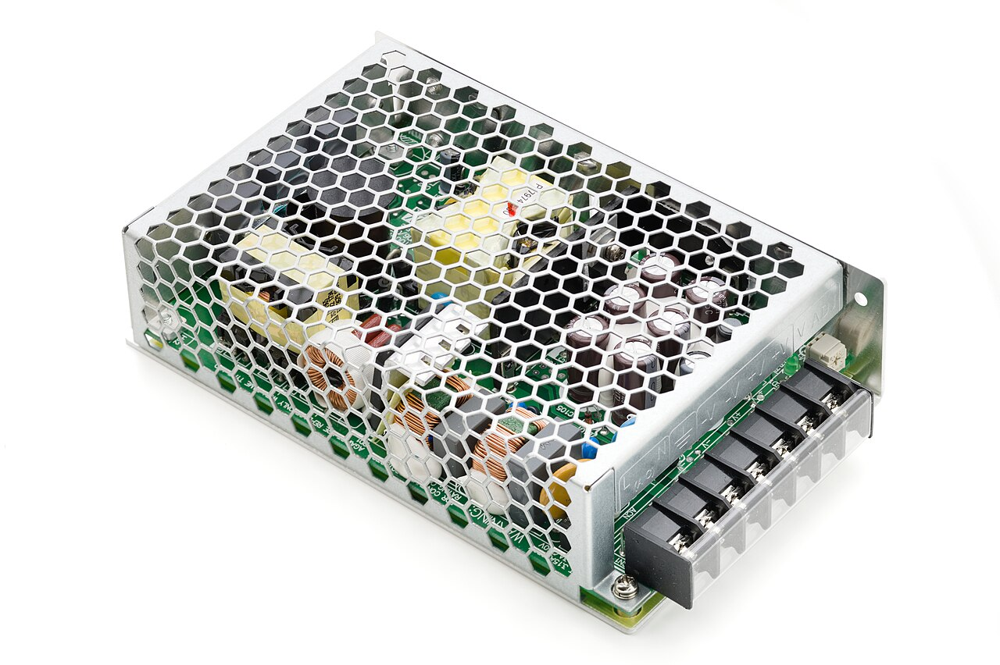
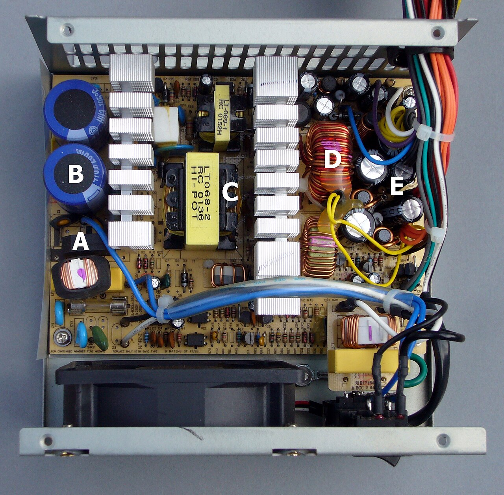
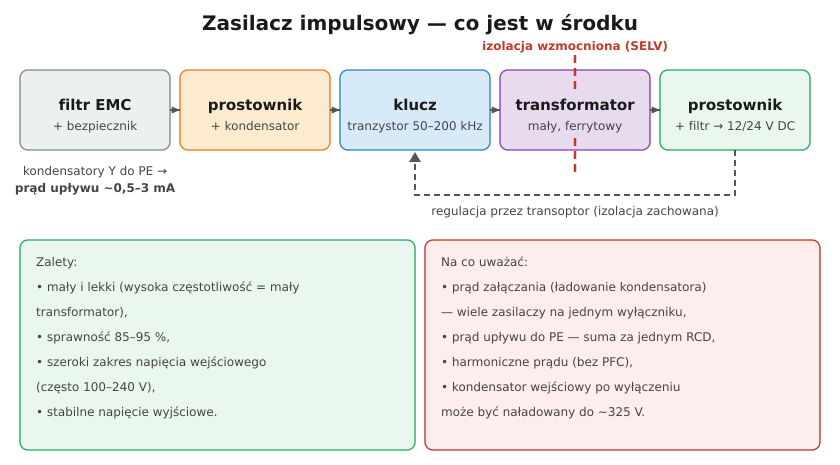

# 25.02 — Zasilacze impulsowe

> **Moduł:** [25 — Transformatory, zasilacze, UPS i agregaty](README.md) · **Oznaczenia:** 🏠📋 · **Zakres SEP:** (a) (c) (e) · **Status:** ✅ pełny
>
> **Czytaj:**
>
> - Harmoniczne od zasilaczy: [02.05](../02-prad-przemienny-230-400/02.05-odbiorniki-nieliniowe-i-wyzsze-harmoniczne.md)
> - Prąd upływu i RCD: [08.06](../08-wylaczniki-roznicowopradowe/08.06-dlaczego-roznicowka-wybija-przyczyny-i-szukanie.md)

[← poprzedni temat](25.01-transformator-separacyjny-i-bezpieczenstwa.md) · [spis modułu](README.md) · [następny temat →](25.03-ups-rodzaje-i-zastosowanie.md)

## Po co to jest

Prawie każde urządzenie elektroniczne w domu ma w środku zasilacz impulsowy: ładowarka telefonu, komputer, telewizor, zasilacz taśmy LED, sterownik pieca. Dla elektryka liczą się skutki: **prąd załączania**, który wybija wyłączniki, **prąd upływu**, który wybija RCD, **harmoniczne** w przewodzie N i **naładowany kondensator**, który kopie po wyłączeniu.

## Po ludzku

Zwykły transformator 50 Hz jest ciężki, bo przy niskiej częstotliwości potrzebuje dużego rdzenia. Zasilacz impulsowy robi to sprytniej:

1. **prostuje** napięcie sieci i ładuje kondensator do ok. **325 V DC** (szczyt sinusoidy 230 V),
2. **tranzystor** szybko włącza i wyłącza to napięcie — dziesiątki do setek **tysięcy** razy na sekundę,
3. **mały transformator ferrytowy** przenosi energię na stronę wyjściową (przy wysokiej częstotliwości wystarczy maleńki rdzeń),
4. **prostownik i filtr** dają gładkie napięcie stałe, np. 5, 12 lub 24 V,
5. **sprzężenie zwrotne** (przez transoptor, z zachowaniem izolacji) pilnuje, żeby napięcie wyjściowe było stałe.

Transformator i transoptor tworzą **barierę izolacji** — dzięki niej wyjście może być SELV.

**Skutki dla instalacji:**

- **Prąd załączania** — przy włączeniu pusty kondensator ładuje się „na raz”: przez ułamek milisekundy płyną dziesiątki amperów. Jeden zasilacz to nic, ale **kilkanaście zasilaczy LED na jednym B10** potrafi wybić wyłącznik przy każdym włączeniu. Producenci podają maksymalną liczbę zasilaczy na wyłącznik B i C.
- **Prąd upływu** — filtr przeciwzakłóceniowy ma kondensatory (tzw. Y) do PE. Każde urządzenie klasy I „upuszcza” do PE ułamek do kilku mA. Suma kilkunastu komputerów za jednym RCD 30 mA może go wybijać.
- **Harmoniczne** — prostownik z kondensatorem pobiera prąd krótkimi impulsami na szczycie sinusoidy. W instalacji trójfazowej z wieloma takimi odbiornikami trzecie harmoniczne sumują się w N ([02.05](../02-prad-przemienny-230-400/02.05-odbiorniki-nieliniowe-i-wyzsze-harmoniczne.md)). Większe zasilacze mają układ **PFC**, który to ogranicza.

## Jak to wygląda

*Na co patrzeć: listwa zacisków — z jednej strony L, N i PE (wejście 230 V), z drugiej +V i −V (wyjście DC). Taki zasilacz montuje się w rozdzielnicy lub puszce. Ażurowa obudowa musi mieć przepływ powietrza.*

*Na co patrzeć: duże kondensatory wejściowe (ładują się do ok. 325–400 V), radiatory tranzystorów i mały transformator ferrytowy. Te kondensatory mogą trzymać napięcie jeszcze długo po wyjęciu wtyczki.*

## Schemat

## Pojęcia

| Pojęcie | Po ludzku | Termin normowy / symbol |
|---------|-----------|-------------------------|
| Zasilacz impulsowy | Zasilacz z kluczowaniem wysokiej częstotliwości | SMPS |
| Prąd załączania | Krótki skok prądu przy włączeniu | inrush current |
| Prąd upływu / dotykowy | Prąd płynący do PE przez kondensatory filtra | — |
| PFC | Układ poprawiający kształt pobieranego prądu | Power Factor Correction |
| Zasilacz CV / CC | Stałe napięcie (taśmy LED) / stały prąd (moduły LED) | CV / CC |
| Klasa II | Podwójna izolacja, bez PE | symbol podwójnego kwadratu |

## Liczby do zapamiętania

| Wielkość | Wartość | Kiedy obowiązuje | Źródło |
|----------|---------|------------------|--------|
| Napięcie kondensatora wejściowego | ok. **325 V DC** (z PFC ok. **400 V**) | zasilanie 230 V | √2 · 230 V |
| Częstotliwość kluczowania | **dziesiątki–setki kHz** | typowe zasilacze | katalogi |
| Sprawność | **85–95 %** | zasilacze dobrej jakości | katalogi |
| Suma prądów upływu za RCD | najlepiej **≤ 0,3 · IΔn** (≈ 9 mA dla 30 mA) | podział obwodów | PN-HD 60364-5-53 |
| Prąd upływu urządzenia klasy I | do ok. **3,5 mA** (typowo mniej) | sprzęt IT | PN-EN 62368-1 |

## W praktyce

- **Zasilacz do taśmy LED** dobieraj z zapasem mocy ok. **20 %** i o właściwym typie (CV dla taśm 12/24 V, CC dla modułów zasilanych prądem).
- **Zasilacz w rozdzielnicy** (na szynę TH35) — sprawdź temperaturę pracy i odstępy; ciepło skraca życie kondensatorów.
- **RCD wybija przy włączaniu biurka z kilkoma komputerami** — rozłóż je na dwa obwody z osobnymi RCD (np. RCBO) zamiast zwiększać IΔn.
- **Buczenie, piszczenie, migotanie LED** — często wyschnięte kondensatory w zasilaczu. Wymiana zasilacza, nie naprawa w instalacji.
- **Wyjście „w powietrzu”** — zasilacz bez oznaczenia SELV/klasy izolacji nie nadaje się do miejsc, gdzie wymagane jest SELV (łazienka, basen).

## Błędy i zagrożenia

- ⚠️ **Otwieranie zasilacza zaraz po wyłączeniu** — kondensator wejściowy może być naładowany do kilkuset woltów. Odczekaj, zmierz, rozładuj przez rezystor.
- ⚠️ **Tanie zasilacze bez oznaczeń** — cienka izolacja między stroną sieciową a wyjściem; 230 V może pojawić się na „bezpiecznym” wyjściu.
- **Zbyt wiele zasilaczy LED na jednym wyłączniku B** — wybijanie przy włączaniu ([18](../18-oswietlenie/README.md)).
- **Zasilacz w szczelnej puszce bez chłodzenia** — przegrzanie, skrócona żywotność, pożar.
- **Zwiększenie IΔn na 100 mA, bo „wybija”** — to likwiduje ochronę uzupełniającą.

## Przykład

**Zadanie.** W biurze na jednym obwodzie z RCD 30 mA pracuje 8 komputerów, każdy z prądem upływu ok. 1 mA, i drukarka (ok. 1,5 mA). Czy to rozsądny podział?

**Rozwiązanie.** Suma upływów: 8 · 1 + 1,5 = **9,5 mA**, czyli ok. **0,32 · IΔn**. To już granica zalecenia (0,3 · IΔn ≈ 9 mA), a RCD może zadziałać przy prądzie od 0,5 · IΔn = 15 mA — wystarczy kilka mA więcej przy włączaniu, by zaczął wybijać. Lepiej podzielić na **dwa obwody z osobnymi RCD**.

## Pytania SEP

1. **Jakie zjawiska związane z zasilaczami impulsowymi mogą powodować zadziałanie zabezpieczeń w instalacji?**

Odpowiedź

Prąd załączania — przy włączeniu kondensator wejściowy ładuje się impulsem prądu wielokrotnie większym od znamionowego; wiele zasilaczy na jednym obwodzie może wyzwolić wyłącznik nadprądowy (zwłaszcza B). Prąd upływu — kondensatory filtra przeciwzakłóceniowego łączą przewody czynne z PE; suma upływów wielu urządzeń za jednym RCD może przekroczyć jego próg zadziałania. Do tego harmoniczne prądu przeciążające przewód N w instalacjach trójfazowych.

2. **Dlaczego przed pracą przy zasilaczu impulsowym trzeba sprawdzić napięcie na kondensatorze?**

Odpowiedź

Kondensator wejściowy ładuje się do szczytowej wartości napięcia sieci (ok. 325 V DC, w zasilaczach z PFC do ok. 400 V) i po odłączeniu może utrzymywać to napięcie przez dłuższy czas, jeśli nie ma rezystora rozładowującego albo jest on uszkodzony. Dotknięcie grozi porażeniem prądem stałym; trzeba zmierzyć napięcie i w razie potrzeby rozładować kondensator przez rezystor.

## Sprawdź się

1. Dlaczego zasilacz impulsowy 100 W jest wielokrotnie lżejszy od transformatora 100 VA na 50 Hz?

Odpowiedź

Bo jego transformator pracuje przy częstotliwości dziesiątek–setek kHz. Im wyższa częstotliwość, tym mniejszy rdzeń potrzebny do przeniesienia tej samej mocy, więc transformator jest maleńki, a większość masy to elektronika i radiator.

## Źródła

- PN-EN 61347 (sterowniki LED), PN-EN 62368-1 (sprzęt audio-wideo i IT — bezpieczeństwo, prądy dotykowe).
- PN-HD 60364-5-53 — Dobór i montaż wyposażenia: aparatura rozdzielcza i sterownicza (zalecenie dot. sumy prądów upływu za RCD).
- [02.05 — Odbiorniki nieliniowe i harmoniczne](../02-prad-przemienny-230-400/02.05-odbiorniki-nieliniowe-i-wyzsze-harmoniczne.md); [08.06 — Dlaczego różnicówka wybija](../08-wylaczniki-roznicowopradowe/08.06-dlaczego-roznicowka-wybija-przyczyny-i-szukanie.md).

---

[← poprzedni temat](25.01-transformator-separacyjny-i-bezpieczenstwa.md) · [spis modułu](README.md) · [następny temat →](25.03-ups-rodzaje-i-zastosowanie.md)
