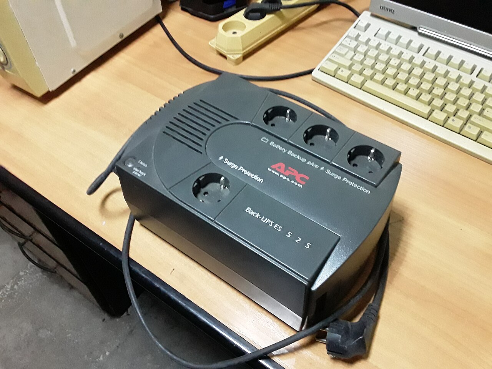
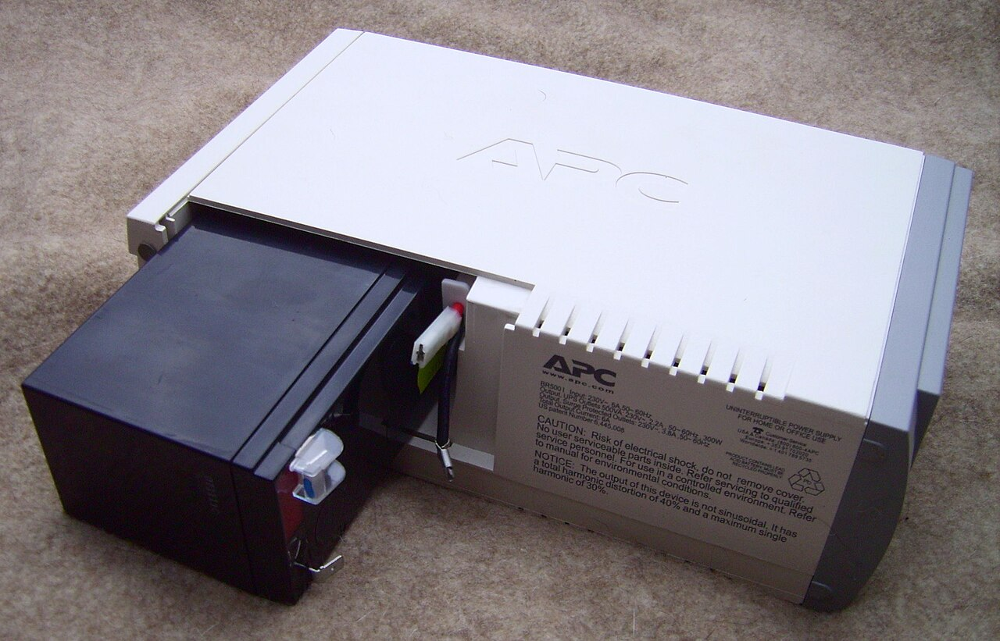
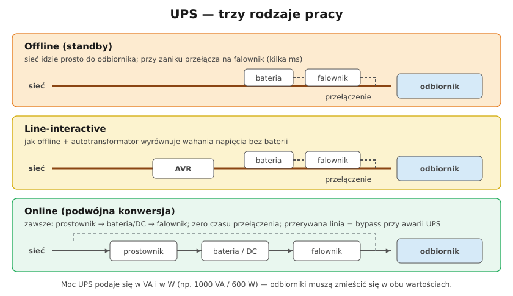

# 25.03 — UPS — rodzaje i zastosowanie

> **Moduł:** [25 — Transformatory, zasilacze, UPS i agregaty](README.md) · **Oznaczenia:** 🏠📋 · **Zakres SEP:** (a) (c) (e) · **Status:** ✅ pełny
>
> **Czytaj:**
>
> - Moc pozorna i czynna: [02.04](../02-prad-przemienny-230-400/02.04-moc-czynna-bierna-i-pozorna-wspolczynnik-mocy.md)
> - PN-EN 62040-3 — Systemy bezprzerwowego zasilania (UPS), klasyfikacja VFD / VI / VFI

[← poprzedni temat](25.02-zasilacze-impulsowe.md) · [spis modułu](README.md) · [następny temat →](25.04-agregat-pradotworczy-i-przelacznik-zasilania.md)

## Po co to jest

UPS (zasilacz awaryjny) podtrzymuje zasilanie przy zaniku napięcia: komputer zdąży zapisać dane, router działa dalej, a **pompa obiegowa pieca** nie stanie w czasie burzy. W domu najczęściej UPS chroni właśnie piec CO, serwer NAS i sieć internetową. Elektryk musi rozumieć rodzaje UPS, dobór mocy i to, że UPS to **drugie źródło napięcia** w instalacji.

## Po ludzku

UPS to bateria + elektronika, która w razie zaniku sieci zamienia prąd stały z baterii na 230 V AC (falownik). Różnią się tym, **jak** pracują na co dzień:

- **Offline (standby)** — normalnie sieć idzie prosto do odbiornika. Gdy napięcie zniknie, UPS w kilka milisekund przełącza się na falownik. Tani, ale ma **czas przełączenia** i często **przybliżoną sinusoidę** (schodkową).
- **Line-interactive** — jak offline, plus **autotransformator (AVR)**, który podnosi lub obniża napięcie przy wahaniach bez sięgania do baterii. Dobry wybór do domu i biura.
- **Online (podwójna konwersja)** — energia **zawsze** płynie przez prostownik → obwód DC z baterią → falownik. Odbiornik dostaje czystą sinusoidę wytworzoną przez UPS; przy zaniku sieci **nic się nie przełącza**. Najdroższy, głośniejszy, ma straty, ale chroni najlepiej (serwery, medycyna, automatyka).

**Moc UPS-a** podaje się w dwóch liczbach, np. **1000 VA / 600 W**. Odbiorniki muszą się zmieścić **w obu**: suma mocy czynnej ≤ W, suma mocy pozornej ≤ VA ([02.04](../02-prad-przemienny-230-400/02.04-moc-czynna-bierna-i-pozorna-wspolczynnik-mocy.md)).

**Czas podtrzymania** zależy od energii baterii i obciążenia. Bateria 12 V 9 Ah to ok. 108 Wh, ale z powodu sprawności falownika i spadku pojemności przy szybkim rozładowaniu realnie da się wyjąć ok. **60–70 %** tej energii.

**Pompa pieca na UPS** — silnik pompy i elektronika sterownika pieca często źle znoszą przybliżoną sinusoidę. Do pieca wybiera się UPS z **czystą sinusoidą** (zwykle line-interactive „sinus” lub online), często z możliwością dołączenia dodatkowego akumulatora.

## Jak to wygląda

*Na co patrzeć: gniazda na górze — część jest podtrzymywana z baterii, część daje tylko ochronę przeciwprzepięciową (opis przy gniazdach). To typowy UPS offline do komputera.*

*Na co patrzeć: akumulator kwasowo-ołowiowy VRLA — wymienny element eksploatacyjny. Po 3–5 latach traci pojemność; spuchnięta obudowa oznacza natychmiastową wymianę.*

## Schemat

## Pojęcia

| Pojęcie | Po ludzku | Termin normowy / symbol |
|---------|-----------|-------------------------|
| UPS offline | Przełącza na baterię dopiero przy zaniku | VFD (PN-EN 62040-3) |
| UPS line-interactive | Offline + regulacja napięcia AVR | VI |
| UPS online | Zawsze przez falownik, bez przełączania | VFI |
| Bypass | Obejście UPS — odbiornik zasilany z sieci | — |
| Czas podtrzymania | Jak długo UPS zasili odbiornik z baterii | autonomia |
| VRLA / AGM | Szczelny akumulator kwasowo-ołowiowy | — |
| Czysta / przybliżona sinusoida | Kształt napięcia z falownika | — |

## Liczby do zapamiętania

| Wielkość | Wartość | Kiedy obowiązuje | Źródło |
|----------|---------|------------------|--------|
| Czas przełączenia offline / line-interactive | ok. **2–10 ms** | zanik sieci | katalogi |
| Czas przełączenia online | **0 ms** | praca normalna → bateryjna | PN-EN 62040-3 (VFI) |
| Moc UPS | **VA i W** — np. 1000 VA / 600 W | dobór | katalogi |
| Żywotność akumulatora VRLA | ok. **3–5 lat** | temperatura ok. 20–25 °C | katalogi |
| Energia akumulatora | **U · Ah** — 12 V · 9 Ah = **108 Wh** | obliczenie orientacyjne | — |
| Realnie użyteczna energia | ok. **60–70 %** nominalnej | małe UPS-y, szybkie rozładowanie | szacunek |

## W praktyce

- **Dobór**: zsumuj moc odbiorników (W i VA), dodaj zapas ok. **20–30 %**, potem dobierz baterię pod wymagany czas.
- **Do UPS nie podłączaj** grzejników, czajników, drukarek laserowych — duża moc i skoki prądu.
- **UPS stacjonarny w instalacji** (np. zasilający wydzielony obwód) to **drugie źródło**: po wyłączeniu wyłącznika w RG obwód za UPS-em **dalej ma napięcie**. Obwody za UPS opisuje się w rozdzielnicy, a przed pracą odłącza wyjście UPS i sprawdza brak napięcia.
- **Bateria** wymaga przewietrzanego, chłodnego miejsca; ciepło skraca jej życie o połowę na każde ok. 10 °C powyżej 25 °C.
- **Test** — raz na jakiś czas wykonaj test baterii (funkcja UPS) albo odłącz zasilanie sieciowe pod kontrolą.

## Błędy i zagrożenia

- ⚠️ **„Wyłączyłem w rozdzielnicy, więc nie ma napięcia”** — za UPS-em napięcie jest nadal.
- ⚠️ **Spuchnięty lub gorący akumulator** — ryzyko wycieku i pożaru; wymień, nie ładuj dalej.
- **Przeciążenie mocy czynnej** (mieszczę się w VA, ale nie w W) — UPS się wyłącza właśnie przy zaniku sieci.
- **UPS offline z przybliżoną sinusoidą do pompy** — buczenie, grzanie, zatrzymanie pompy.
- **UPS w szafce bez wentylacji** — przegrzewanie, skrócona żywotność baterii.

## Przykład

**Zadanie.** Pompa obiegowa pieca pobiera 60 W, sterownik 10 W. UPS ma dwa akumulatory 12 V 9 Ah połączone szeregowo (24 V). Jak długo podtrzyma zasilanie?

**Rozwiązanie.** Energia nominalna: 24 V · 9 Ah = **216 Wh**. Realnie użyteczne ok. 65 % → ok. **140 Wh**. Obciążenie 70 W → czas ok. 140 / 70 = **2 h**. Na dłuższą awarię potrzebny jest większy akumulator zewnętrzny albo agregat ([25.04](25.04-agregat-pradotworczy-i-przelacznik-zasilania.md)).

## Pytania SEP

1. **Jakie znasz rodzaje zasilaczy UPS i czym się różnią?**

Odpowiedź

Offline (standby): odbiornik zasilany bezpośrednio z sieci, przy zaniku napięcia UPS przełącza się na falownik zasilany z akumulatora — z krótką przerwą rzędu milisekund. Line-interactive: jak offline, ale z układem stabilizacji napięcia (autotransformator AVR), który koryguje wahania bez użycia baterii. Online z podwójną konwersją: energia płynie stale przez prostownik i falownik, więc napięcie wyjściowe jest wytwarzane przez UPS i niezależne od zakłóceń sieci; przy zaniku nie ma przełączenia. W normie PN-EN 62040-3 odpowiadają im klasy VFD, VI i VFI.

2. **O czym trzeba pamiętać, wykonując prace w obwodzie zasilanym przez UPS?**

Odpowiedź

Że UPS jest niezależnym źródłem napięcia: po wyłączeniu zasilania sieciowego obwód za UPS-em nadal jest pod napięciem z akumulatora. Przed pracą trzeba wyłączyć i zabezpieczyć wyjście UPS (lub odłączyć akumulator), sprawdzić brak napięcia, a obwody zasilane z UPS powinny być oznaczone w rozdzielnicy. Przy pracy z akumulatorami trzeba też uważać na duży prąd zwarciowy prądu stałego.

## Sprawdź się

1. UPS 800 VA / 480 W. Odbiorniki: komputer 350 W przy cos φ = 0,9 i monitor 40 W przy cos φ = 0,6. Czy się zmieszczą?

Odpowiedź

Moc czynna: 350 + 40 = 390 W ≤ 480 W — mieści się. Moc pozorna: 350/0,9 + 40/0,6 ≈ 389 + 67 = 456 VA ≤ 800 VA — mieści się. UPS wystarczy, choć bez dużego zapasu po stronie mocy czynnej.

## Źródła

- PN-EN 62040-3 — Systemy bezprzerwowego zasilania (UPS). Metody określania właściwości i wymagania badań.
- [02.04 — Moc czynna, bierna i pozorna](../02-prad-przemienny-230-400/02.04-moc-czynna-bierna-i-pozorna-wspolczynnik-mocy.md).

---

[← poprzedni temat](25.02-zasilacze-impulsowe.md) · [spis modułu](README.md) · [następny temat →](25.04-agregat-pradotworczy-i-przelacznik-zasilania.md)
