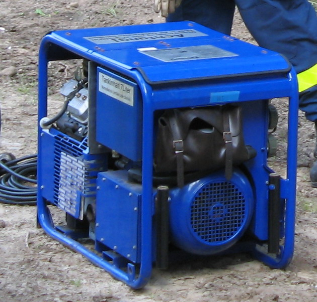
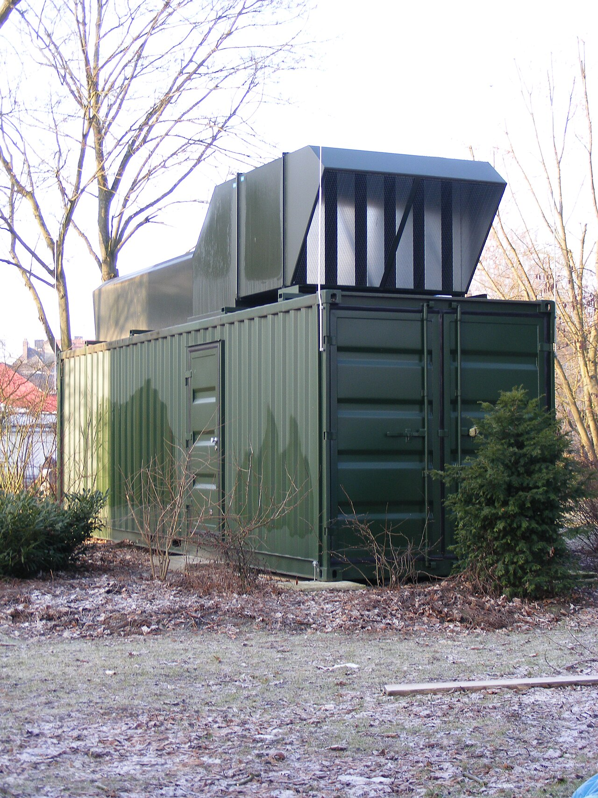

# 25.04 — Agregat prądotwórczy i przełącznik zasilania

> **Moduł:** [25 — Transformatory, zasilacze, UPS i agregaty](README.md) · **Oznaczenia:** 🏠📋 · **Zakres SEP:** (a) (c) (e) · **Status:** ✅ pełny
>
> **Czytaj:**
>
> - [TAURON Dystrybucja — Agregaty prądotwórcze w domu jednorodzinnym (PDF)](https://www.tauron-dystrybucja.pl/-/media/offer-documents/dystrybucja/inne-dokumenty/td-agregaty-pradotworcze-dom-jednorodzinny.ashx)
> - Układy sieci: [11](../11-uklady-sieci/README.md)

[← poprzedni temat](25.03-ups-rodzaje-i-zastosowanie.md) · [spis modułu](README.md) · [następny temat →](25.05-dlaczego-nie-zasila-sie-domu-przez-gniazdo.md)

## Po co to jest

Agregat prądotwórczy to silnik spalinowy z prądnicą. Ratuje przy długich awariach sieci (wichury, oblodzenie linii) — zasila pompę pieca, lodówkę, pompę studni. Żeby był bezpieczny dla domowników **i dla monterów sieci**, łączy się go z instalacją wyłącznie przez **przełącznik sieć–0–agregat**. Grupa E pyta o zasady podłączenia, a ty jako właściciel domu musisz wiedzieć, czego nie robić.

## Po ludzku

**Rodzaje agregatów:**

- **klasyczny (synchroniczny z AVR)** — prądnica obraca się ze stałą prędkością; napięcie przyzwoite, ale przy skokach obciążenia faluje,
- **inwerterowy** — prądnica daje „cokolwiek”, a elektronika (prostownik + falownik) wytwarza czystą sinusoidę. Lepszy do elektroniki i pieców, cichszy, zwykle mniejszej mocy,
- **jednofazowy / trójfazowy** — trójfazowy ma ograniczenia asymetrii (nie obciążysz jednej fazy pełną mocą agregatu).

**Moc** — producent podaje moc maksymalną (chwilową) i ciągłą. Dobieraj do **ciągłej**, z zapasem ok. **25 %** ponad sumę odbiorników. Silniki (pompa studni, sprężarka lodówki) przy rozruchu biorą kilkakrotnie więcej.

**Jak podłączyć do domu — przełącznik I-0-II:**

- montuje się go **za licznikiem**, przed rozdzielnicą (lub przed jej wydzieloną częścią),
- pozycja **I** — zasilanie z sieci, **0** — wszystko odłączone, **II** — zasilanie z agregatu,
- **nie da się** połączyć obu źródeł naraz — konstrukcja przełącznika to wyklucza,
- przełącza wszystkie przewody czynne, **także N** (np. 4-biegunowy przy 3 fazach, 2-biegunowy przy jednej fazie),
- agregat podłącza się przez złącze siłowe (np. CEE): na budynku **wtyk stały** (z bolcami), a przewód od agregatu zakończony **gniazdem przenośnym** (z otworami). Bolce na ścianie mają napięcie tylko wtedy, gdy podłączony agregat pracuje, a przewód od agregatu nie ma odsłoniętych bolców,
- montuje go **osoba z uprawnieniami** (świadectwo kwalifikacyjne), według projektu lub instrukcji.

**Ochrona przeciwporażeniowa przy agregacie** — agregat to osobne źródło, a ty musisz wiedzieć, w jakim układzie pracuje (IT „pływający”, czy TN po połączeniu N z PE w agregacie) i czy RCD w domu zadziała. To zależy od konstrukcji agregatu i projektu — szczegóły podaje instrukcja agregatu.

**Gdzie stoi** — zawsze **na zewnątrz**, z dala od okien, drzwi i czerpni powietrza. Spaliny zawierają **tlenek węgla (CO)** — bezwonny i śmiertelny. Garaż „z otwartą bramą” to nie jest zewnątrz.

**Duże i stacjonarne agregaty** — z automatyką **SZR** (samoczynne załączanie rezerwy): sterownik wykrywa zanik sieci, uruchamia agregat i przełącza zasilanie, z blokadą elektryczną i mechaniczną między stycznikami.

## Jak to wygląda

*Na co patrzeć: rama, silnik spalinowy i prądnica, gniazda z boku. Stoi na zewnątrz, na równym podłożu — tak ma być zawsze.*

*Na co patrzeć: agregat zasilania rezerwowego w kontenerze dźwiękochłonnym, z wyrzutem spalin w górę. Takie zestawy pracują z automatyką SZR i zasilają szpitale, serwerownie, obiekty publiczne.*

*Na co patrzeć: złącze siłowe CEE z wyraźnym PE. Przy agregacie zasada jest odwrotna niż przy zwykłym odbiorniku: bolce ma strona, która dostaje zasilanie (wtyk stały na budynku), a otwory — strona źródła (gniazdo na przewodzie od agregatu). Dzięki temu odsłonięte styki nigdy nie są pod napięciem.*

## Schemat

## Pojęcia

| Pojęcie | Po ludzku | Termin normowy / symbol |
|---------|-----------|-------------------------|
| Agregat prądotwórczy | Silnik spalinowy + prądnica | zespół prądotwórczy |
| Agregat inwerterowy | Napięcie wytwarzane przez elektronikę — czysta sinusoida | — |
| Przełącznik zasilania | Wybiera sieć albo agregat, z pozycją 0 | przełącznik I-0-II |
| SZR | Automatyczne przełączanie na rezerwę | samoczynne załączanie rezerwy (ATS) |
| AVR | Automatyczna regulacja napięcia prądnicy | — |
| Moc ciągła / maksymalna | Moc długotrwała / chwilowa | COP / PRP / LTP |

## Liczby do zapamiętania

| Wielkość | Wartość | Kiedy obowiązuje | Źródło |
|----------|---------|------------------|--------|
| Zapas mocy agregatu | ok. **25 %** ponad sumę odbiorników | dobór | TAURON Dystrybucja |
| Rozruch silników | kilka razy **In** | pompy, sprężarki | 24.01 |
| Pozycje przełącznika | **I – 0 – II** (sieć – wyłączone – agregat) | podłączenie do domu | TAURON Dystrybucja |
| Miejsce przełącznika | **za licznikiem** | instalacja odbiorcy | jw. |
| Napięcie po stronie SN transformatora | ok. **15 kV** (typowo 15–20 kV) | sieć rozdzielcza | 14.01 |

## W praktyce

**Kolejność przy zaniku sieci:**

1. Wyłącz większe odbiorniki.
2. Przełącznik z **I** na **0**.
3. Uruchom agregat na zewnątrz, poczekaj, aż się ustabilizuje.
4. Przełącznik z **0** na **II**.
5. Włączaj odbiorniki **po kolei** — najpierw te z silnikami.

**Powrót do sieci (gdy napięcie wróci):** wyłącz odbiorniki → przełącznik na **0** → zatrzymaj agregat → przełącznik na **I**.

- **Paliwo** przechowuj poza domem, tankuj zimny agregat.
- **Przegląd** — próbne uruchomienie co jakiś czas (np. raz w miesiącu), olej i świeże paliwo.
- **Uziemienie agregatu** — wtedy, gdy wymaga go instrukcja (zależy od układu pracy).

## Błędy i zagrożenia

- ⚠️ **Agregat w garażu, piwnicy, na zamkniętym ganku** — zatrucie tlenkiem węgla. Czujnik CO w domu to dobre uzupełnienie.
- ⚠️ **Podłączenie przez gniazdo kablem z dwiema wtyczkami** — śmiertelne zagrożenie dla monterów sieci i domowników ([25.05](25.05-dlaczego-nie-zasila-sie-domu-przez-gniazdo.md)).
- ⚠️ **Przełącznik bez pozycji 0 lub zwykłe dwa wyłączniki „pilnowane na oko”** — prędzej czy później ktoś włączy oba.
- **Za mały agregat** — spadki napięcia, przegrzewanie silników, zatrzymanie przy rozruchu pompy.
- **Tankowanie gorącego agregatu** — pożar.

## Przykład

**Zadanie.** Na czas awarii chcesz zasilić: piec gazowy z pompą (120 W), lodówkę (150 W, rozruch sprężarki ok. 3×), oświetlenie LED (100 W), router i laptop (80 W), pompę studni (900 W, rozruch ok. 3×). Jaki agregat?

**Rozwiązanie.** Suma pracy ciągłej: 120 + 150 + 100 + 80 + 900 = **1350 W**. Z zapasem 25 %: ok. **1,7 kW** mocy ciągłej. Najgorszy moment to rozruch pompy studni przy pracującej reszcie: 450 + 2700 ≈ **3,2 kW chwilowo**. Wybierz agregat **ok. 2 kW ciągłej / 3+ kW maksymalnej** (dla pieca najlepiej inwerterowy) albo nie uruchamiaj pompy studni razem z lodówką.

## Pytania SEP

1. **Jak należy podłączyć agregat prądotwórczy do instalacji budynku zasilanego z sieci?**

Odpowiedź

Przez przełącznik (np. trójpozycyjny I-0-II: sieć – wyłączone – agregat) zamontowany za układem pomiarowym, przed rozdzielnicą odbiorcy. Przełącznik musi wykluczać jednoczesne połączenie instalacji z siecią i z agregatem oraz przełączać wszystkie przewody czynne, łącznie z N. Agregat łączy się z przełącznikiem przez złącze wtykowe dobrane tak, aby żadne odsłonięte styki nie były pod napięciem (wtyk stały na budynku, gniazdo przenośne na przewodzie od agregatu). Montaż wykonuje osoba z odpowiednimi kwalifikacjami; ochronę przeciwporażeniową przy zasilaniu z agregatu zapewnia się zgodnie z instrukcją agregatu i projektem.

2. **Jakie zagrożenia stwarza eksploatacja agregatu prądotwórczego?**

Odpowiedź

Zatrucie tlenkiem węgla przy pracy w pomieszczeniach zamkniętych lub w pobliżu okien; pożar (paliwo, gorące elementy, tankowanie pracującego lub gorącego agregatu); porażenie przy niewłaściwej ochronie przeciwporażeniowej; przeniesienie napięcia do sieci przy podłączeniu bez przełącznika, zagrażające monterom; uszkodzenie agregatu i odbiorników po powrocie napięcia sieci; hałas i ruchome części.

## Sprawdź się

1. Dlaczego przełącznik zasilania musi rozłączać także przewód N?

Odpowiedź

Bo przy pracy z agregatu N instalacji nie może pozostać połączony z N sieci: przez wspólny N mogą płynąć prądy między źródłami, a agregat (np. z połączeniem N–PE) byłby powiązany z siecią. Pełne rozdzielenie obu źródeł, łącznie z N, daje pewność, że instalacja jest zasilana tylko z jednego z nich.

## Źródła

- [TAURON Dystrybucja — Agregaty prądotwórcze w domu jednorodzinnym (PDF)](https://www.tauron-dystrybucja.pl/-/media/offer-documents/dystrybucja/inne-dokumenty/td-agregaty-pradotworcze-dom-jednorodzinny.ashx).
- PN-HD 60364-5-551 — Niskonapięciowe zespoły prądotwórcze.
- [11 — Układy sieci](../11-uklady-sieci/README.md); [14.01 — Przyłącze](../14-od-slupa-do-gniazdka/14.01-przylacze-napowietrzne-i-kablowe.md).

---

[← poprzedni temat](25.03-ups-rodzaje-i-zastosowanie.md) · [spis modułu](README.md) · [następny temat →](25.05-dlaczego-nie-zasila-sie-domu-przez-gniazdo.md)
